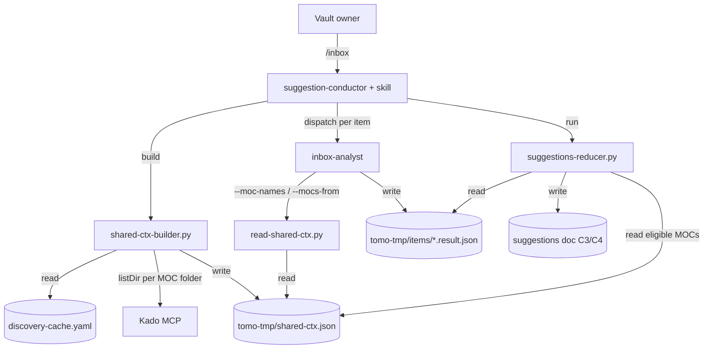
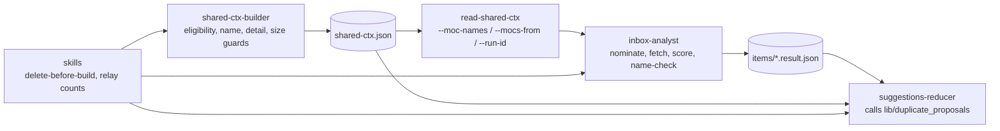

# Solution Design Document

> **Design in one paragraph.** `shared-ctx.json` keeps the full detail of every
> eligible MOC on disk, uncut, and gains one precomputed `name` per MOC. The
> analyst never loads the MOC list whole again: it reads the names
> (`read-shared-ctx.py --moc-names`), nominates by meaning, and after thread
> segmentation fetches detail for the nominated names only
> (`--mocs-from <file>`). Because nothing reads the detail whole, the budget
> passes that cut headings and callouts are removed and replaced by warnings on
> the size of each single read. A duplicate-name check runs twice: once as an
> analyst imperative, once as a deterministic mutator called by the reducer.
>
> **Line references** are as of commit `4ec22186`. For files this spec rewrites,
> the named symbol (function, step heading) is authoritative; the line is a hint.

## Validation Checklist

### CRITICAL GATES (Must Pass)

- [x] All required sections are complete
- [x] No [NEEDS CLARIFICATION] markers remain
- [x] Architecture pattern is clearly stated with rationale
- [x] **All architecture decisions confirmed by user**
- [x] Every interface has specification

### QUALITY CHECKS (Should Pass)

- [x] All context sources are listed with relevance ratings
- [x] Project commands are discovered from actual project files
- [x] Constraints → Strategy → Design → Implementation path is logical
- [x] Every component in diagram has directory mapping
- [x] Error handling covers all error types
- [x] Quality requirements are specific and measurable
- [x] Component names consistent across diagrams
- [x] A developer could implement from this design
- [x] Implementation examples use actual schema column names (not pseudocode), verified against migration files
- [x] Complex queries include traced walkthroughs with example data showing how the logic evaluates

---

## Output Schema

### SDD Status Report

| Field | Value |
|-------|-------|
| specId | 040-relevant-mocs-per-item |
| architecture | Name index + fetch-on-nomination inside the existing shared context |
| validationPassed | 15 |
| validationPending | 0 |
| nextSteps | Phase 1 of the plan (T1.1 scanner, T1.2 baseline runs) |

### ArchitectureSummary

| Field | Value |
|-------|-------|
| pattern | One per-run context file, read through narrow selector modes; deterministic backstop in the reducer |
| keyComponents | shared-ctx-builder, read-shared-ctx, inbox-analyst (Step 4 / Step 7.5b), lib/duplicate_proposals (called by suggestions-reducer), suggest-handling + force-atomic-handling skills |
| externalIntegrations | Kado (unchanged: one `listDir` per MOC parent folder for reconcile) |

### SectionStatus

| Section | Status | Detail |
|---------|--------|--------|
| Constraints | `COMPLETE` | |
| Implementation Context | `COMPLETE` | |
| Solution Strategy | `COMPLETE` | |
| Building Block View | `COMPLETE` | |
| Runtime View | `COMPLETE` | |
| Deployment View | `COMPLETE` | |
| Cross-Cutting Concepts | `COMPLETE` | |
| Architecture Decisions | `COMPLETE` | ADR-1 … ADR-10, confirmed 2026-10-24 |
| Quality Requirements | `COMPLETE` | |
| Acceptance Criteria | `COMPLETE` | |
| Risks and Technical Debt | `COMPLETE` | |
| Glossary | `COMPLETE` | |

### ADRStatus

| ADR | Name | Status |
|-----|------|--------|
| ADR-1 | One context file; the builder owns each MOC's `name` | `CONFIRMED` |
| ADR-2 | Two selector modes in `read-shared-ctx.py` | `CONFIRMED` |
| ADR-3 | Analyst: names in Step 4, one detail fetch after Step 7.5, score by meaning | `CONFIRMED` |
| ADR-4 | Budget shedding removed; per-read size warnings | `CONFIRMED` |
| ADR-5 | `exclude/moc` filtered in `build_mocs`; MOC folders from `concepts.map_note` | `CONFIRMED` |
| ADR-6 | Reducer duplicate mutator on the cluster key | `CONFIRMED` |
| ADR-7 | `placeholder_targets` replaces `placeholder_links` in the context | `CONFIRMED` |
| ADR-8 | Freshness: delete before build + `--run-id` check on read | `CONFIRMED` |
| ADR-9 | Schema edits without a version bump; golden baseline regenerated deliberately | `CONFIRMED` |
| ADR-10 | PRD amendments (unresolved names, normaliser) | `CONFIRMED` |

---

## Constraints

- **CON-1 Runtime substrate.** Python 3 scripts in `tomo/scripts/` (stdlib + PyYAML), runtime prose in `tomo/dot_claude/**` that the LLM reads line by line. Runtime prose carries only imperatives; every WHY goes to the mirrored `docs/tomo/**` page first (CLAUDE.md rule; strip second).
- **CON-2 Analyst tools.** `Read, Bash, Write, mcp__kado__kado-read` (`tomo/dot_claude/agents/inbox-analyst.md:8`). It cannot dispatch agents and may write only under its `items_dir` (`:40-45`). It must never compose structured output freehand or run inline Python; it calls scripts.
- **CON-3 Single tool-result ceiling.** A Bash result above ~37.7 KB (smallest observed spill, `tests/test_read_shared_ctx.py:136` `SPILL_FLOOR_BYTES`) reaches the model as a 2 KB preview. Every read introduced here stays below it at 512 MOCs.
- **CON-4 Bash command hygiene.** Note-derived text never goes into a command line (`inbox-analyst.md:313-315`); the Bash validator rejects `#`. MOC titles are note-derived.
- **CON-5 Wire stability.** ADR-029 channels C1–C10 keep their shape; `shared-ctx.json` is internal (`tomo/scripts/lib/wire_shape.py:79-83` `PUBLISHED_WIRES` excludes it; spec 035 excludes internal schemas from versioning).
- **CON-6 Versioning.** Every edited managed file bumps its `# version:` header, or `update-tomo.sh` ships nothing.
- **CON-7 Privacy (Constitution L1).** The model-facing surface is documented in `PRIVACY.md`; this spec narrows it and must update `PRIVACY.md:26-32`.
- **CON-8 Near-MVP, additive-safe.** Pass 2 reads `daily_notes.tracker_fields` (`instruction-render.py:146-175`) and the reducer reads `asset_folder` (`suggestions-reducer.py:1756-1769`) from the same file; both keys keep their place and shape.

## Implementation Context

### Required Context Sources

#### Documentation Context

```yaml
- doc: docs/XDD/specs/040-relevant-mocs-per-item/requirements.md
  relevance: HIGH
  why: "Features F1-F6, S1, S2, C1 and their acceptance criteria"
- doc: docs/XDD/specs/021-moc-propose-consolidation/solution.md
  relevance: HIGH
  why: "ADR-13 B-moc, superseded here for inbox candidates"
- doc: docs/XDD/specs/022-moc-insertion-point-intelligence/solution.md
  relevance: HIGH
  why: "Anchor tiers that consume headings/editable_callouts/has_footer"
- doc: docs/tomo/scripts/shared-ctx-builder.md
  relevance: HIGH
  why: "WHY of the budget (lines 81-118); rewritten, not deleted"
- doc: docs/tomo/scripts/read-shared-ctx.md
  relevance: HIGH
  why: "WHY of the field reader and the spill measurements"
- doc: docs/tomo/dot_claude/agents/inbox-analyst.md
  relevance: HIGH
  why: "WHY of Step 1 / Step 4 STRICT blocks (lines 399-483)"
- doc: docs/tomo/dot_claude/skills/suggest-handling.md, force-atomic-handling.md
  relevance: MEDIUM
  why: "Setup-before-dispatch rationale; the new delete step belongs there"
- doc: Kokoro global/decisions/ADR-029-tomo-hashi-boundary-is-a-set-of-channels.md
  relevance: MEDIUM
  why: "C1-C10 register; each named 'no shape change'"
- doc: PRIVACY.md
  relevance: MEDIUM
  why: "Lines 26-32 describe MOC headings reaching the model via shared-ctx"
- doc: docs/XDD/reference/tier-2/workflows/inbox-processing.md
  relevance: LOW
  why: "Phase A/B description (lines 68-74), already stale"
```

#### Code Context

```yaml
- file: tomo/scripts/shared-ctx-builder.py
  relevance: HIGH
  why: "build_mocs :223-261, build_placeholder_links :302-334, enforce_budget :694-765, build_arg_parser :770, main :792-910, module docstring :15-18"
- file: tomo/scripts/read-shared-ctx.py
  relevance: HIGH
  why: "CLI :111-141, resolve :52-71; gains --moc-names, --mocs-from, --run-id"
- file: tomo/dot_claude/agents/inbox-analyst.md
  relevance: HIGH
  why: "Step 1 :65-75, Step 4 :129-249, Step 7.5 :300-371, output :720-752"
- file: tomo/scripts/suggestions-reducer.py
  relevance: HIGH
  why: "action loop :2440-2600 (demote_structural_anchors :2452), load_asset_folder :1756, summary :2818-2830"
- file: tomo/scripts/lib/topic_clusters.py
  relevance: HIGH
  why: "strip_moc_marker :96-132, normalise_topic :134-155 (the cluster key)"
- file: tomo/scripts/lib/moc_tags.py
  relevance: MEDIUM
  why: "EXCLUDE_MOC_TAG; comment :20-21 must change; gains is_excluded_moc()"

- file: tomo/scripts/lib/item_key.py, tomo/scripts/item-result-filename.py
  relevance: HIGH
  why: "to_filename names every per-item file; the names file reuses it"

- file: tomo/scripts/suggestions-render.py
  relevance: MEDIUM
  why: "Builds the C3 wire candidate (_wire_selected :222-226, :300-308) from what the reducer persists"
- file: tomo/schemas/shared-ctx.schema.json
  relevance: HIGH
  why: "additionalProperties:false at root (:14) and per MOC (:31)"
- file: tomo/dot_claude/skills/suggest-handling/SKILL.md, force-atomic-handling/SKILL.md
  relevance: HIGH
  why: "Setup (:35-59 / :31-54), dispatch prompt (:99-121 / :76-99), Step 7 report (:165-169 in suggest-handling)"
- file: scripts/reset-tomo-tmp.sh
  relevance: LOW
  why: "--pass1 already removes shared-ctx.json (:155-167); unchanged"
```

#### External APIs

```yaml
- service: Kado MCP (kado-search listDir)
  doc: tomo/scripts/lib/kado_client.py
  relevance: LOW
  why: "Reconcile call is unchanged; no new Kado traffic"
```

### Implementation Boundaries

- **Must Preserve:**
  - `candidate_mocs[]` item shape `{path, score, pre_check, anchor?}` (`item-result.schema.json:73`), the anchor tiers' output, Classification Guard semantics, placeholder precedence.
  - `daily_notes`, `classification_keywords`, `tag_prefixes`, `asset_folder` keys and the Step-1 batch.
  - The discovery cache shape (including `placeholder_links` with `referenced_by` in the cache).
  - `/moc-propose` behaviour of `MiYo/Tomo/exclude/moc`.
- **Can Modify:** `mocs[]` entry (add `name`, sort order), the placeholder key in shared-ctx, `enforce_budget`, `read-shared-ctx.py` CLI, analyst Step 4 / Step 7.5 / Step 10.3 order prose, both skills' setup and Step 7 report, one call in the reducer's action loop, `lib/moc_tags.py`, spec 021 ADR-13 (a superseded note only).
- **Must Not Touch:** discovery-cache producers (`moc-tree-builder.py`, `cache-builder`), Pass 2 scripts, Hashi-facing schemas (`suggestions-wire`, `hashi-suggestions-wire`, instructions), `tomo-privat`.

### External Interfaces

#### System Context Diagram



#### Interface Specifications

```yaml
inbound:
  - name: "/inbox (both paths: suggest-handling, force-atomic-handling)"
    type: Claude Code command
    format: unchanged
outbound:
  - name: "Kado listDir (reconcile)"
    type: MCP
    format: unchanged
data:
  - name: "tomo-tmp/shared-ctx.json"
    type: internal JSON, rebuilt per run
    changes: "mocs[].name added; placeholder_targets replaces placeholder_links"
  - name: "tomo-tmp/items/<result stem>.moc-names.txt"
    type: internal text, written by the analyst
    changes: "new; <result stem> = item-result-filename.py output without .result.json; one delivered name per line, at most 20"
```

### Cross-Component Boundaries

- Tomo–Hashi (ADR-029): C1 vault-config, C2 Pass-1 trigger, C3 `_suggestions.json`, C4 rendered suggestions, C5 Pass-2 trigger, C6 instructions JSON, C7 rendered instructions, C8 apply results, C9 garden-audit wire, C10 session/launcher — **no shape change on any**. C3/C4 content may differ in which MOCs appear in `candidate_mocs` and which proposed MOCs appear — the same variation analysis quality already produces. No Kokoro or Hashi handoff.

### Project Commands

```bash
./venv/bin/python -m pytest -q tests          # full suite
./venv/bin/python -m pytest -q tests/test_read_shared_ctx.py tests/test_shared_ctx_inventory.py
./venv/bin/ruff check tomo/scripts scripts tests
./scripts/update-tomo.sh --instance tomo-instance --yolo   # sync to the test instance
./venv/bin/python scripts/measure-inbox-phase-b-token-cost.py --session-latest --run-id <id>
```

## Solution Strategy

- **Architecture pattern:** narrow reads over one per-run file. The context stays a single file the skill builds before dispatch; what changes is *how* it is read. The heavy part is never delivered whole, so it no longer needs a budget.
- **Integration approach:** additive selector modes on the existing reader; the analyst's tool set and the dispatch prompt shape stay the same (the prompt already carries `run_id` and `items_dir`).
- **Justification:**
  - A lexical Phase-A pre-filter was measured at 0.50 recall (PRD research); selection therefore stays with the analyst, which picks by meaning.
  - A second file would need its own lifecycle, reset line and schema, for no benefit: bytes cost only when read.
  - Precomputing `name` in the builder makes "every delivered name resolves to exactly one MOC" true by construction (single source of truth for the collision rule).
- **Key decisions:** ADR-1 … ADR-10 below.

## Building Block View

### Components



| Component | Single responsibility | PRD items owned |
|---|---|---|
| **shared-ctx-builder** | Decide eligibility, compute each MOC's `name`, write full detail and the placeholder targets, warn on oversized reads, report sizes | F1-AC2/3/4/7, F2-AC2, F5-AC1/2, S1-AC1, C1 |
| **read-shared-ctx** | Deliver the name list; deliver detail for a named subset; refuse a context from another run | F1-AC1/5/6, F6-AC2 |
| **inbox-analyst (prose)** | Nominate by meaning, fetch detail once per item, score, place, check proposed names | F2-AC1/3/4/5, F3-AC1/2/3, S1-AC2 |
| **lib/duplicate_proposals (called by suggestions-reducer)** | Convert proposals whose cluster key equals an eligible thematic title | F4-AC1/2/3/4, F5-AC3 |
| **skills (suggest-handling, force-atomic-handling)** | Delete the old context before build; pass `run_id`; relay the conversion count | F6-AC1/3, F4-AC4 (relay) |
| **docs** | WHY pages, PRIVACY.md, reference docs | S2-AC1/2 |

F4-AC4 has one owner: the reducer produces the count; the skills only relay the reducer's own summary line, they compute nothing.

### Directory Map

```
tomo/
├── scripts/
│   ├── shared-ctx-builder.py          MODIFY  eligibility, name, placeholder_targets, guards, summary
│   ├── read-shared-ctx.py             MODIFY  --moc-names, --mocs-from, --run-id
│   ├── suggestions-reducer.py         MODIFY  one call per action + count in the summary line
│   └── lib/
│       ├── duplicate_proposals.py     NEW     load_eligible_mocs, convert_duplicate_proposal
│       ├── moc_tags.py                MODIFY  is_excluded_moc(); comment: B-moc superseded for inbox
│       └── moc_folders.py             NEW     normalise concepts.map_note → folder prefixes
├── schemas/shared-ctx.schema.json     MODIFY  mocs[].name, placeholder_targets
└── dot_claude/
    ├── agents/inbox-analyst.md        MODIFY  Step 1 STRICT, Step 4, Step 7.5b, output refs
    └── skills/
        ├── suggest-handling/SKILL.md      MODIFY  delete-before-build, run_id note, Step 7 relay
        └── force-atomic-handling/SKILL.md MODIFY  same
scripts/measure-shared-ctx-reads.py    NEW     transcript read-size scanner (KPI: zero previews)
docs/tomo/                             MODIFY  mirrors of every runtime file above
docs/tomo/scripts/lib/                 NEW     moc_folders.md, duplicate_proposals.md
docs/XDD/specs/021-moc-propose-consolidation/solution.md  MODIFY  ADR-13 B-moc: superseded-for-inbox note
PRIVACY.md                             MODIFY  lines 26-32
docs/XDD/reference/tier-2/workflows/inbox-processing.md  MODIFY
tests/                                 NEW/MODIFY  see Acceptance Criteria
```

### Interface Specifications

#### Data Storage Changes

`tomo-tmp/shared-ctx.json` (internal, rebuilt every run):

```yaml
mocs[]:                       # eligible MOCs only (exclude/moc removed); never trimmed;
                              # sorted by path (deterministic for baselines and caching)
  name: string                # NEW, required: the delivered name (title, or path on collision)
  path: string                # unchanged
  title: string               # unchanged
  topics: [string]            # unchanged
  is_classification: bool     # unchanged
  headings: [{text, level}]   # unchanged, <= 8, thematic only
  editable_callouts: [...]    # unchanged, <= 4, thematic only
  has_footer: bool            # unchanged
placeholder_targets: [string] # NEW, required, always written ([] when none); unique, sorted;
                              # replaces placeholder_links
placeholder_links:            # REMOVED from shared-ctx (stays in the discovery cache)
```

`tomo-tmp/items/<result stem>.moc-names.txt` (new, written by the analyst): `<result stem>` is the output of `item-result-filename.py --item-key <item_key>` without `.result.json` (`lib/item_key.to_filename`; the item key itself is a vault path with `/` and spaces and cannot name a file). UTF-8, one delivered name per line, at most 20 lines, in thread order and within a thread in nomination order (most relevant first), no quoting.

#### Internal API Changes

**`read-shared-ctx.py`** — modes stay mutually exclusive: exactly one of `--field`, `--fields`, `--keys`, `--moc-names`, `--mocs-from`.

```
--moc-names
    stdout: compact JSON array of mocs[].name, in mocs[] order.
--mocs-from <file>
    stdin of names: <file>, one per line; blank lines ignored; duplicates collapsed.
    match: exact on mocs[].name; else a unique match after NFC + casefold +
           whitespace-collapse on name; else unresolved.
    cap: first 20 distinct names resolved; the rest reported as omitted (a safety net:
         the analyst writes at most 20 lines).
    stdout: {"mocs":[<full mocs[] entry>...], "unresolved":[name...], "omitted":[name...]}
    exit 0 even when unresolved/omitted are non-empty.
--run-id <id>   (combinable with every mode)
    if ctx.run_id != <id>: stderr "shared-ctx belongs to run <x>, expected <id>", exit 1.
exit 1 also for: missing or invalid context, missing or unreadable <file>; every exit 1
    prints one stderr line naming the cause. Unknown flags stay argparse's exit 2.
```

**`shared-ctx-builder.py`**

```
build_mocs(cache, moc_folders=()) -> list[dict]    # filters is_excluded_moc, sorts by path, sets name
assign_names(mocs, moc_folders) -> None            # collision rule, see ADR-1
build_placeholder_targets(cache, moc_re) -> list[str]   # always a list, possibly empty
size_guards(ctx, max_bytes) -> list[str]           # WARN lines; replaces enforce_budget
--max-bytes  default 32768: per-read warning threshold (no longer a file budget)
stderr summary line (full, in order):
    mocs_total mocs_after_reconcile mocs_reconcile_dropped
    eligible=<len(mocs)>            # replaces mocs_included
    excluded=<MOCs dropped by the exclude tag>
    collisions=<distinct titles shared by 2+ eligible MOCs>
    names_bytes=<len of compact JSON of --moc-names output>
    detail_bytes=<len of compact JSON of mocs[]>
    tag_prefixes_included classification_categories
    placeholder_targets=<n>         # replaces placeholder_links
    daily_notes_enabled asset_folder bytes run_id
    (topics_dropped is removed: nothing is shed)
```

**`lib/moc_tags.py`**

```
is_excluded_moc(tags) -> bool
    True when any tag equals EXCLUDE_MOC_TAG after stripping one leading '#'
    and casefolding (Obsidian tags are case-insensitive). orphan_link's exact
    membership check is left unchanged (out of scope; noted as debt).
```

**`lib/moc_folders.py`** (new)

```
moc_folder_prefixes(vault_cfg) -> tuple[str, ...]
    accepts concepts.map_note as {paths:[...]}, {path:str} or str; strips whitespace,
    ensures trailing "/", drops empties.
in_moc_folders(path, prefixes) -> bool             # startswith on any prefix
```

**`lib/duplicate_proposals.py`** (new; the reducer imports it and adds one call)

```
load_eligible_mocs(shared_ctx_path) -> dict[str, list[str]]
    key -> [paths] for eligible, non-classification mocs[]; key = cluster key of title.
    fail-open: missing/invalid ctx -> {} (no conversions).
convert_duplicate_proposal(action, eligible, suffix) -> bool
    called in the action loop next to demote_structural_anchors, before render/persist/
    cluster collection; skipped for suppressed atomics.
reducer stderr summary adds: duplicate_proposals_converted=<n>
```

#### Application Data Models

```
Delivered name (string)
  = title                      when no other eligible MOC has the same title
  = title                      when it collides, lies inside the MOC folders, and is the
                               only colliding MOC that does
  = path                       otherwise (every colliding MOC outside the MOC folders,
                               and all of them when zero or 2+ lie inside)

Cluster key (string) = normalise_topic(strip_moc_marker(s, moc_suffix))
```

#### Integration Points

- Analyst ↔ reader: Bash calls with `--run-id {run_id}` on every read (the dispatch prompt already carries `run_id`).
- Reducer ↔ context: default `--shared-ctx tomo-tmp/shared-ctx.json` (already present, `:2104`), so neither skill call changes.
- Skills ↔ reducer: Step 7 relays the reducer's `duplicate_proposals_converted` value.

### Implementation Examples

#### Example: assigning names (traced)

MOC folders: `("Atlas/200 Maps/",)`. Eligible MOCs after the exclude filter:

| path | title | inside? |
|---|---|---|
| Atlas/200 Maps/Projects.md | Projects | yes |
| Efforts/Work/Projects.md | Projects | no |
| Atlas/200 Maps/Vacation (MOC).md | Vacation (MOC) | yes |
| Areas/Health/Fitness.md | Fitness | no |
| Areas/A/Notes.md | Notes | no |
| Areas/B/Notes.md | Notes | no |

Evaluation:
- "Projects" collides; exactly one is inside → `Projects` and `Efforts/Work/Projects.md`.
- "Vacation (MOC)", "Fitness" unique → bare titles (a MOC outside the folders keeps a bare title when it does not collide).
- "Notes" collides; none inside → `Areas/A/Notes.md`, `Areas/B/Notes.md`.

`--moc-names` → `["Projects","Efforts/Work/Projects.md","Vacation (MOC)","Fitness","Areas/A/Notes.md","Areas/B/Notes.md"]`. Each element resolves to exactly one entry.

#### Example: duplicate mutator (traced)

Profile suffix `" (MOC)"`. Eligible thematic titles → keys: "Vacation (MOC)" → `vacation`; "Projects" → `project` (plural fold).

| analyst proposal | key | hit | result |
|---|---|---|---|
| "Vacations" | `vacation` | Vacation (MOC).md | needs_new_moc=false, proposed_moc_topic=null, candidate `{path:"Atlas/200 Maps/Vacation (MOC).md", score:0.0, pre_check:false}` appended unless present |
| "Project" | `project` | 2 paths | both appended unticked |
| "Urlaub" | `urlaub` | none | proposal unchanged |
| "2000 - Knowledge" | — | classification titles not in `eligible` | proposal unchanged |

#### Test Examples as Interface Documentation

```python
def test_mocs_from_reports_unresolved_without_failing(tmp_ctx, tmp_path):
    names = tmp_path / "n.txt"
    names.write_text("Vacation (MOC)\nNo Such MOC\n", encoding="utf-8")
    out = run_reader("--mocs-from", str(names), "--run-id", "r1", ctx=tmp_ctx)
    assert out.returncode == 0
    payload = json.loads(out.stdout)
    assert [m["path"] for m in payload["mocs"]] == ["Atlas/200 Maps/Vacation (MOC).md"]
    assert payload["unresolved"] == ["No Such MOC"]
```

## Runtime View

### Primary Flow — Pass 1, one item

1. Skill setup: `rm -f tomo-tmp/shared-ctx.json`, then build (both skills). On build failure: abort (existing prose), and no stale file exists to read.
2. Dispatch carries `run_id`, `items_dir`, `shared_ctx_path` (unchanged).
3. Analyst Step 1: `read-shared-ctx.py --run-id {run_id} --fields daily_notes,classification_keywords,tag_prefixes,asset_folder` (unchanged keys).
4. Analyst Step 4: `--run-id {run_id} --moc-names` and `--run-id {run_id} --field placeholder_targets`. Nominate up to 6 names by meaning (thematic or classification) for the whole item (or per thread later).
5. Step 7.5 segments threads (unchanged); each thread nominates up to 6 names.
6. **Step 7.5b (new):** Run `item-result-filename.py --item-key <item_key>` (moved here from Step 10.3; Step 10.3 reuses the captured value). Write the union of nominated names — at most 20, thread order, then nomination order — to `{items_dir}/<result stem>.moc-names.txt`; run `--run-id {run_id} --mocs-from <file>`. Skip the read if nothing was nominated.
7. Score each fetched MOC by meaning (0-1, topics as evidence); keep top 3 with score ≥ 0.15 per thread; pre_check when score ≥ 0.5 and not classification; Classification Guard; placeholder trigger; name-check before `needs_new_moc`; anchor tiers from the fetched detail.
8. Result written; validate-result unchanged.
9. Reducer: `convert_duplicate_proposal` per action before render; summary line carries the count; skill Step 7 relays it.

### Decision table — proposed name (analyst, per thread, first match wins)

| # | Condition | Outcome |
|---|---|---|
| 1 | A placeholder target matches the theme | `needs_new_moc:true`, topic = target verbatim |
| 2 | A thematic delivered name covers the would-be proposal | nominate that name; it is fetched and scored like any candidate; no `needs_new_moc` |
| 3 | No thematic candidate scored ≥ 0.15, or all top matches are classification | `needs_new_moc:true`, inferred thematic label |
| 4 | Otherwise | candidates as scored; `needs_new_moc:false` |

Row 2 is checked against thematic names only (Dewey-numbered names never satisfy it). Row 3 covers the zero-match case that today's prose leaves to improvisation.

### Error Handling

| Error | Where | Handling |
|---|---|---|
| Context from another run | reader → analyst | reader exit 1; the analyst treats any non-zero reader exit as a failure of the item: Step 11 failure block (`--status failed`) with an issue naming the reader's stderr line |
| Context missing (build failed) | reader → analyst | exit 1, same handling; the skill already aborted the run |
| Nominated name unresolved | reader | listed in `unresolved`, exit 0; analyst drops it and records an issue line |
| More than 20 names | analyst / reader | the analyst writes at most 20 lines (thread order, then nomination order); if a file still has more, the reader resolves the first 20 and lists the rest in `omitted` |
| Nominated MOC has no headings/callouts | analyst | anchor tiers fall back as today |
| Old-shape context (no `name`) | reader → analyst | `--moc-names` exit 1 "context predates spec 040"; item fails as above. Cannot occur within a run because the skill rebuilds (PRD edge case, amended) |
| No placeholder targets in the vault | builder | `placeholder_targets: []` is always written, so the Step-4 read never fails for this reason |
| Pass 2 after a failed Pass-1 build | instruction-render | no context file: tracker syntax falls back to defaults, as today with no file (fail-open, unchanged) |
| Reducer cannot read the context | reducer | fail-open: no conversions, count 0 |
| A single read exceeds `--max-bytes` | builder | WARN line on stderr, relayed by the skill; build continues |
| Missing `tags` on a cache entry | builder | treated as not excluded |

## Deployment View

No new runtime component. Delivery is `update-tomo.sh` (version-gated): every edited managed file bumps `# version:`. After sync, restart Claude in the instance (agent/skill change). The discovery cache does not need a rebuild: `name` and eligibility are derived at context build time.

## Cross-Cutting Concepts

### Cost

- Per item: name list (~1.2 KB at 65 MOCs, ~9.5 KB at 512 with 15.5-char titles) + placeholder targets + detail for ≤ 20 MOCs (typically 3–6 full entries × ~514 B).
- One extra Bash call per item (Step 7.5b); zero new Kado calls; zero new LLM calls.

### Fail direction

- Freshness failures fail closed (exit 1): a wrong-run context is never read silently.
- Selection failures fail soft: an unresolved name loses one candidate, never the item.
- The reducer backstop fails open: without the context it converts nothing, which is today's behaviour.

### Security and privacy

- Names of all eligible MOCs reach every item's analysis; headings and callouts reach it only for nominated MOCs. `PRIVACY.md` states this, and states that `MiYo/Tomo/exclude/moc` is not an access control: other workflows (`/moc-propose`, garden audit, vault exploration) still read such MOCs; sensitive MOCs belong behind Kado's deny rules.
- MOC titles never enter a shell command line (written to a file, read by the script).

## Architecture Decisions

### ADR-1 — One context file; the builder owns each MOC's `name`

- **Choice:** keep `shared-ctx.json` as the only per-run context; add `mocs[].name` computed once by the builder with the collision rule (title, or path when colliding outside the MOC folders; all paths when zero or 2+ colliding MOCs lie inside); sort `mocs[]` by path.
- **Rationale:** bytes cost only when read; one file keeps one lifecycle (build, reset, schema). Computing `name` once makes resolution exact and keeps the collision rule in one place.
- **Trade-offs:** the file grows with the vault (~512 B per MOC on disk); harmless because only scripts read it whole.
- **User confirmed:** Yes (2026-10-24); index form confirmed 2026-10-23.

### ADR-2 — Two selector modes in `read-shared-ctx.py`

- **Choice:** `--moc-names` and `--mocs-from <file>` (names from a file, one per line), output `{mocs, unresolved, omitted}`, exit 0 on unresolved, cap 20 per call.
- **Rationale:** titles contain characters that break shell quoting (CON-4); the analyst already writes files under `items_dir`. A non-failing selector keeps one mistyped name from costing all detail. The cap keeps the worst case (20 × 1.4 KB) under CON-3.
- **Trade-offs:** opposite failure semantics to `--fields` (which fails the batch); documented in the reader's docstring.
- **User confirmed:** Yes (2026-10-24).

### ADR-3 — Analyst: names in Step 4, one detail fetch after Step 7.5, score by meaning

- **Choice:** Step 4 reads names and placeholder targets; nomination up to 6 per thread; a new Step 7.5b fetches the union once; `score` is the analyst's confidence by meaning (topics as evidence), with the existing thresholds 0.15 (keep) and 0.5 (pre_check). The name-check (decision table row 2) runs before `needs_new_moc`; a hit is an ordinary candidate.
- **Rationale:** threads exist only after Step 7.5, so fetching earlier would fetch twice or before threads exist. The lexical formula would drop ~half of today's picks (25 of 52 at zero overlap); scoring by meaning matches what the analyst already does in practice.
- **Trade-offs:** `score` stops being a reproducible formula; it was never computed by code. Tests can assert the prose contract, not the numbers.
- **User confirmed:** Yes (scoring, index-hit handling 2026-10-24).

### ADR-4 — Budget shedding removed; per-read size warnings

- **Choice:** delete the three passes of `enforce_budget`; replace with `size_guards` that warn when the serialized name list, the Step-1 batch, the placeholder targets, or the largest single MOC entry × 20 exceed `--max-bytes` (default 32768, under CON-3).
- **Rationale:** shedding contradicts F2-AC2 and no reader loads `mocs` whole any more. Warnings keep growth visible (C1) without silently degrading content.
- **Trade-offs:** an extreme vault (e.g. 512 MOCs with 60-char titles ≈ 32 KB names) gets a warning, not an automatic fix; the fix would be a follow-up.
- **User confirmed:** Yes (2026-10-24).

### ADR-5 — `exclude/moc` filtered in `build_mocs`; MOC folders from `concepts.map_note`

- **Choice:** `build_mocs` drops entries whose `tags` contain `lib.moc_tags.EXCLUDE_MOC_TAG`; a new `lib/moc_folders.py` normalises `concepts.map_note` (dict with `paths`, dict with `path`, or string).
- **Rationale:** owner decision (supersedes spec 021 ADR-13 B-moc for inbox candidates); tags are already in every cache entry since #50. `lib/moc_scan.read_scope_paths` is not reused because it merges atomic-note paths.
- **Trade-offs:** an excluded MOC can no longer be linked from the inbox, even deliberately; the owner removes the tag to allow it.
- **User confirmed:** Yes (2026-10-23 scope, 2026-10-24 design).

### ADR-6 — Reducer duplicate mutator on the cluster key

- **Choice:** `convert_duplicate_proposal` in a new `lib/duplicate_proposals.py`, called from the reducer's action loop next to `demote_structural_anchors`; key = `normalise_topic(strip_moc_marker(·, suffix))` on both sides; only eligible thematic titles; on a hit clear the proposal and append every matching path as `{path, score:0.0, pre_check:false}` (no anchor, appended, deduplicated); skip suppressed atomics; count in the summary line.
- **Rationale:** one mutation before render/persist/cluster collection keeps C3, C4 and clusters consistent (precedent #71); the cluster key converts a cluster all-or-nothing. A lib module keeps the 2835-line reducer from growing (Constitution L2).
- **Trade-offs:** plural/punctuation folding goes beyond "case, whitespace, suffix" (PRD amended, ADR-10). English plural fold only.
- **User confirmed:** Yes (normaliser, collision handling 2026-10-24).

### ADR-7 — `placeholder_targets` replaces `placeholder_links` in the context

- **Choice:** the builder always emits `placeholder_targets` (required; `[]` when none) as sorted unique strings; the discovery cache keeps `{target, referenced_by}`.
- **Rationale:** no context reader uses `referenced_by`; a renamed key prevents prose that still expects objects from silently mis-reading strings.
- **Trade-offs:** `tests/test-shared-ctx-placeholders.py`, `tests/test_shared_ctx_moc_detection.py`, the hand-written fixture in `tests/test_read_shared_ctx.py`, and the analyst's "absent or empty" placeholder wording (pinned by `tests/test_inbox_analyst_no_condition_b.py`) change deliberately.
- **User confirmed:** Yes (2026-10-24).

### ADR-8 — Freshness: delete before build + `--run-id` check on read

- **Choice:** both skills run `rm -f tomo-tmp/shared-ctx.json` before the builder; every analyst read passes `--run-id {run_id}`.
- **Rationale:** today a failed build leaves the previous run's file, and nothing compares run ids. The reader check holds even if a conductor ignores the abort. The context is still rebuilt from the local discovery cache every run (no new Kado or vault reads); caching stays in the discovery cache.
- **Trade-offs:** Pass 2's `instruction-render.py` keeps reading whatever context is on disk (fail-open, unchanged).
- **User confirmed:** Yes (2026-10-24).

### ADR-9 — Schema edits without a version bump; golden baseline regenerated deliberately

- **Choice:** `shared-ctx.schema.json` adds `mocs[].name` (required) and root `placeholder_targets` (required), removes `placeholder_links`; `schema_version` stays `"1"`. Schemas carry no `# version:` header; `update-tomo.sh` ships them by byte comparison. `tests/fixtures/021-ac-baseline/` is regenerated with `generate.py` and the reason recorded in its README.
- **Rationale:** internal schema (CON-5); the file is rebuilt every run, so no reader meets an old shape within a run.
- **Trade-offs:** the baseline loses its byte-identity history; the README note preserves why.
- **User confirmed:** Yes (2026-10-24).

### ADR-10 — PRD amendments

- **Choice:** F2-AC5 and the "renamed MOC" edge case become "an unresolved name is dropped and logged"; F4-AC1's normalisation names the cluster key. Validation round (PRD v1.2): "chosen" → "nominated" for detail reads; F4-AC2 offers every colliding path; the old-shape context fails the item; F1-AC6 holds for typical title lengths; Rule 1 includes the reconcile; classification MOCs may be nominated (owner, 2026-10-24).
- **Rationale:** a name without a path cannot become a candidate (`path` is required); the normaliser follows ADR-6.
- **User confirmed:** Yes (2026-10-24).

## Quality Requirements

- **Performance:** at 512 eligible MOCs (synthetic, duplicated as in #173) the `--moc-names` output ≤ 12 KB with test-instance title lengths; every analyst read ≤ 32 KB; `--mocs-from` with 20 names ≤ 30 KB.
- **Fidelity:** at 65 and 512 MOCs every eligible thematic MOC in the context carries the same headings/callouts as `build_mocs` produces before budget (no shedding).
- **Cost:** live before/after run on the same inbox: per-item cache-write tokens ≥ 10% lower; $/item not above 0.603.
- **Quality:** candidate agreement ≥ min(90%, before-run-1 vs before-run-2 agreement), computed on per-item unions of candidate paths; zero proposed MOCs whose cluster key equals an eligible thematic title; zero analyst MOC reads delivered as preview (transcript scanner).
- **Reliability:** wrong-run context never read (exit 1); unresolved names never abort an item.

## Acceptance Criteria

**F1 — names (builder, reader)**
- [ ] THE SYSTEM SHALL emit one `name` per eligible MOC and `--moc-names` SHALL print all of them. (PRD F1-AC1)
- [ ] WHEN titles are unique, THE SYSTEM SHALL set `name` = title. (F1-AC2)
- [ ] IF titles collide and exactly one colliding MOC lies inside the MOC folders, THEN that one SHALL keep the title and the others SHALL carry their path. (F1-AC3)
- [ ] IF titles collide and zero or 2+ colliding MOCs lie inside, THEN every colliding MOC SHALL carry its path. (F1-AC4)
- [ ] WHEN `--mocs-from` receives a delivered name, THE SYSTEM SHALL return exactly one entry for it. (F1-AC5)
- [ ] WHILE the vault has 512 eligible MOCs with test-instance title lengths, `--moc-names` output SHALL stay ≤ 12 KB, and longer titles SHALL raise a size warning at build. (F1-AC6)
- [ ] THE SYSTEM SHALL include classification MOCs in the names with `is_classification` in their detail. (F1-AC7)

**F2 — detail**
- [ ] WHEN the analyst has nominations after Step 7.5, THE SYSTEM SHALL deliver detail for the union in one call at today's caps. (F2-AC1)
- [ ] THE SYSTEM SHALL NOT remove headings or editable callouts from any MOC because of vault size, up to 512 MOCs. (F2-AC2)
- [ ] WHEN a fetched MOC has no headings or callouts, THE analyst SHALL apply today's anchor fallback. (F2-AC3)
- [ ] IF the analyst nominated no MOC at all, THEN THE analyst SHALL NOT call `--mocs-from`. (F2-AC4)
- [ ] IF a nominated name is unresolved, THEN THE SYSTEM SHALL report it in `unresolved`, exit 0, and the analyst SHALL drop it and log an issue. (F2-AC5, amended)

**F3 — analyst name-check**
- [ ] WHEN a thematic delivered name covers the would-be proposal, THE analyst SHALL nominate it instead of setting `needs_new_moc`. (F3-AC1)
- [ ] IF no thematic name covers it, THEN THE analyst SHALL propose the new MOC as today. (F3-AC2)
- [ ] WHEN a placeholder target matches, THE analyst SHALL let the placeholder win. (F3-AC3)

**F4 — reducer mutator**
- [ ] IF a proposal's cluster key equals an eligible thematic title's key, THEN THE reducer SHALL clear the proposal before render. (F4-AC1, amended)
- [ ] WHEN it converts, THE reducer SHALL append every matching path (all colliding paths when titles collide) as an unticked, unanchored candidate, once. (F4-AC2)
- [ ] IF keys differ, THEN THE reducer SHALL leave the proposal unchanged. (F4-AC3)
- [ ] THE reducer SHALL print `duplicate_proposals_converted=<n>` and both skills SHALL relay it in the Step 7 report. (F4-AC4)

**F5 — exclude**
- [ ] WHERE a MOC carries `MiYo/Tomo/exclude/moc` (frontmatter or inline, any case, with or without `#`), THE builder SHALL omit it from `mocs[]`; a MOC tagged only `MiYo/Tomo/exclude/note` SHALL stay eligible. (F5-AC1)
- [ ] THE SYSTEM SHALL leave `/moc-propose` exclude behaviour unchanged; its cache-based link-candidate pool SHALL still contain the excluded MOC. (F5-AC2)
- [ ] IF a proposal's key equals only an excluded MOC's title, THEN THE reducer SHALL leave the proposal unchanged. (F5-AC3)

**F6 — parity and freshness**
- [ ] THE force-atomic skill SHALL run the same delete-before-build, build and dispatch inputs as suggest-handling. (F6-AC1)
- [ ] IF `ctx.run_id` differs from `--run-id`, THEN THE reader SHALL exit 1 with the stderr line "shared-ctx belongs to run <x>, expected <id>" and no stdout, AND the analyst SHALL fail the item via Step 11. (F6-AC2)
- [ ] WHEN `reset-tomo-tmp.sh --pass1` runs, THE SYSTEM SHALL leave no shared-ctx.json or `*.moc-names.txt`. (F6-AC3)

**S1, S2, C1**
- [ ] THE builder SHALL always emit `placeholder_targets` as sorted unique strings (`[]` when none). (S1-AC1)
- [ ] WHEN a placeholder target matches, THE analyst SHALL propose it verbatim. (S1-AC2)
- [ ] `PRIVACY.md` SHALL state the name/detail split and that the exclude tag is not an access control. (S2-AC1)
- [ ] The tier-2 inbox-processing reference SHALL describe names, detail, and the exclude tag's inbox meaning. (S2-AC2)
- [ ] THE builder summary line SHALL carry exactly the fields listed under Interface Specifications, in that order. (C1-AC1)

## Risks and Technical Debt

### Known Technical Issues

- Placement detail reflects the discovery cache (rebuilt by `/explore-vault`), not the live MOC; a MOC created or renamed since then is missing or dropped as a ghost. Unchanged by this spec.
- `force-atomic-handling` only `mkdir -p`s `tomo-tmp/items/` (`:36-38`) and never clears it. The new `*.moc-names.txt` is named by the result stem (`to_filename(item_key)`) and overwritten on each run's read, and `--run-id` guards the context, so this spec adds no stale-read path; the pre-existing items/ risk remains.

### Technical Debt

- The reducer docstring still says the cluster threshold defaults to 3 (`:12`); the code uses 1 (`--threshold`, `:2117`). Fix while editing.
- `suggestions-reducer.py` (2835 lines) and `shared-ctx-builder.py` (~910 lines) exceed the Constitution L2 size guidance. This spec adds to neither beyond a call site and small helpers; splitting them is separate work.
- `lib/orphan_link.py` compares `EXCLUDE_MOC_TAG` by exact membership, while the builder now compares case-insensitively and `#`-tolerant. Aligning orphan_link is out of scope.
- `tests/test_read_shared_ctx.py` fixture (`:32-66`) is hand-written and already diverges from the schema (`placeholder_links` as strings, no `is_classification`, `tag_prefixes` as `{prefix, values}` instead of `{name, wildcard, known_values}`). Rebuild it from the builder.
- `docs/XDD/reference/tier-2/workflows/inbox-processing.md:68-74` is stale ("~10KB/subagent").

### Implementation Gotchas

- `TestAgainstTheRealContract` (`tests/test_read_shared_ctx.py:225-252`) resolves every `shared_ctx.<path>` named in the analyst prose against its fixture; new prose references need fixture entries.
- `test_inbox_analyst_no_condition_b.py` requires the strings "Classification Guard", "is_classification", "needs_new_moc", "Placeholder link trigger", "placeholder_links", "verbatim", "casing", "takes precedence" and "absent or empty" inside Step 4, and holds a second copy of the golden-baseline guard (`:190-248`). Rename "placeholder_links" and retire "absent or empty" deliberately, with the reason in the test.
- Callers of the one-argument `build_mocs(cache)` / `build_placeholder_links(cache)`: `tests/fixtures/021-ac-baseline/generate.py:102-103`, `tests/test_shared_ctx_no_accumulation.py:289-339`, `tests/test_inbox_analyst_no_condition_b.py:190-248`, `tests/test_shared_ctx_feature5.py` (:88, :200, :239, :287; its docstring calls `build_mocs` "a pure projector, not a filter" — update the wording), `tests/test_shared_ctx_moc_detection.py:61-80`. `moc_folders=()` as a default keeps the first group calling; the placeholder callers move to `build_placeholder_targets`.
- `tests/test_shared_ctx_no_accumulation.py` pins `--max-bytes` 40960 (`test_max_bytes_default_is_40960`), "placeholder_links never trimmed", and builds contexts without `name` (`:195-252`).
- `tests/integration/test_moc_propose_e2e.py:1462-1469` asserts `placeholder_links` with `referenced_by` passes through.
- Step headings used by prose tests must keep their exact text; Step 7.5b must be a new heading that does not disturb "### Step 7.5" and "### Step 8".
- `test_034_t2_2_analyst_contract.py:76` counts state-update bash blocks; the new bash blocks must not call state-update.
- Several planned assertions are already true on `main` (identical builder commands in both skills, reset removing `items/`, unchanged proposals in negative cases, argparse's non-zero exit on unknown flags). They are guards, not RED proofs; each task names at least one assertion that fails on `main`, asserts exit code `1` exactly with the stderr text, and asserts the exact conversion count.
- WHY content moves to `docs/tomo/` before it is removed from runtime files (the Step-1 STRICT rationale, the budget rationale).
- Bump `# version:` on every runtime file touched.

## Glossary

### Domain Terms

| Term | Definition | Context |
|------|------------|---------|
| Eligible MOC | A MOC in the discovery cache, present in the vault at reconcile, not tagged `MiYo/Tomo/exclude/moc` | Everything delivered to the analyst |
| Delivered name | The string the analyst sees for a MOC: title, or path on collision | `mocs[].name`, `--moc-names` |
| Nomination | A delivered name the analyst picked by meaning for an item or thread | Input to `--mocs-from` |
| Thematic MOC | A MOC whose title is not Dewey-numbered | Only thematic MOCs are pre-checked, anchored, or used by the duplicate checks |

### Technical Terms

| Term | Definition | Context |
|------|------------|---------|
| Cluster key | `normalise_topic(strip_moc_marker(s, suffix))` | Groups proposals; compares proposals with titles |
| Spill | A tool result above ~37.7 KB delivered as a 2 KB preview | Sets every read limit |
| Size guard | A stderr warning when a single read would exceed `--max-bytes` | Replaces budget shedding |

### API/Interface Terms

| Term | Definition | Context |
|------|------------|---------|
| `--moc-names` | Reader mode printing all delivered names | Analyst Step 4 |
| `--mocs-from <file>` | Reader mode printing detail for named MOCs | Analyst Step 7.5b |
| `--run-id` | Reader guard rejecting a context from another run | Every analyst read |
