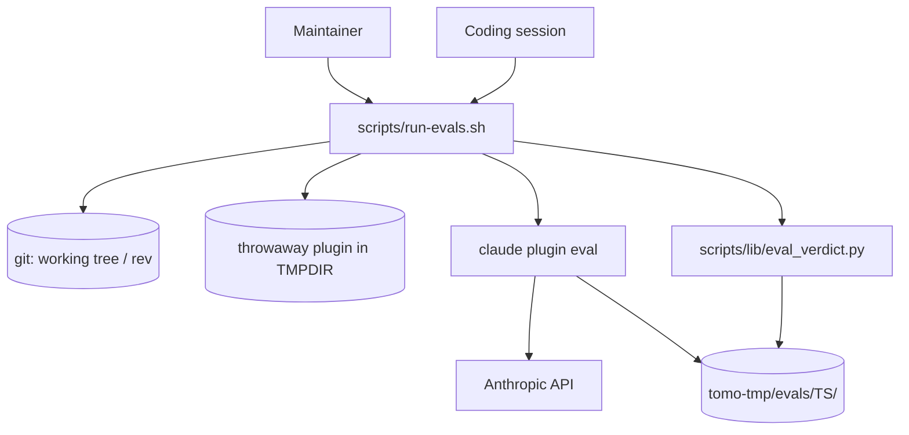
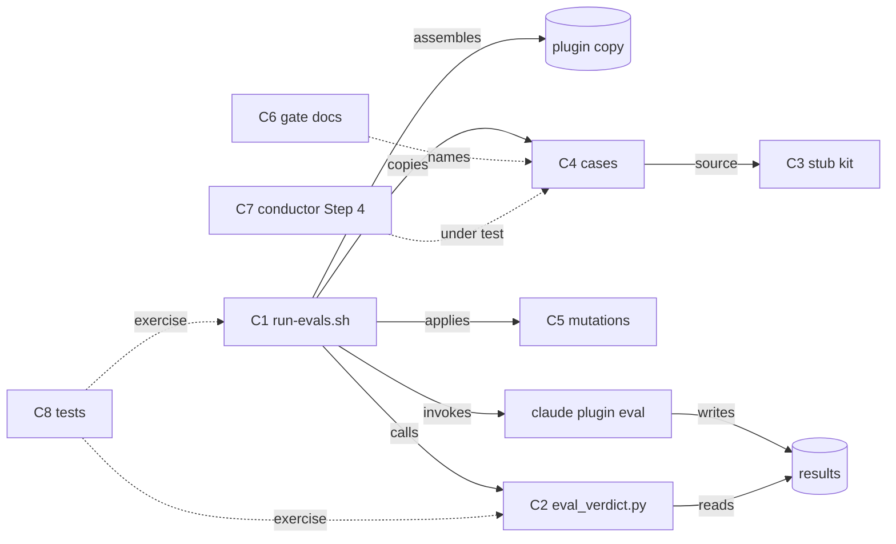
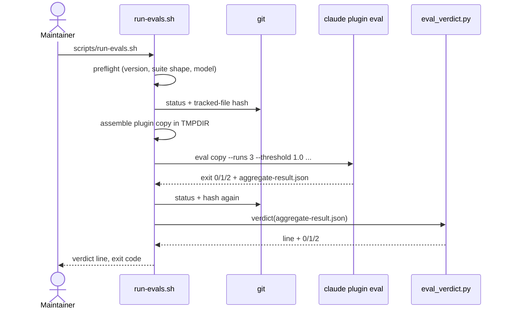

# Solution Design Document

## Validation Checklist

### CRITICAL GATES (Must Pass)

- [x] All required sections are complete
- [x] No [NEEDS CLARIFICATION] markers remain
- [x] Architecture pattern is clearly stated with rationale
- [x] **All architecture decisions confirmed by user**
- [x] Every interface has specification

### QUALITY CHECKS (Should Pass)

- [x] All context sources are listed with relevance ratings
- [x] Project commands are discovered from actual project files
- [x] Constraints → Strategy → Design → Implementation path is logical
- [x] Every component in diagram has directory mapping
- [x] Error handling covers all error types
- [x] Quality requirements are specific and measurable
- [x] Component names consistent across diagrams
- [x] A developer could implement from this design
- [x] Implementation examples use actual schema column names (not pseudocode), verified against migration files
- [x] Complex queries include traced walkthroughs with example data showing how the logic evaluates

---

## Output Schema

### SDD Status Report

| Field | Value |
|-------|-------|
| specId | 041-plugin-eval-gate-for-runtime-prose |
| architecture | Host-side pipeline: bash runner → generated throwaway plugin → `claude plugin eval` → Python verdict reader |
| sections | All complete |
| adrs | ADR-1 … ADR-10, all confirmed 2026-10-25 |
| validationPassed | all checklist items |
| validationPending | 0 |
| nextSteps | Decomposition (tier classification) |

### ArchitectureSummary

| Field | Value |
|-------|-------|
| pattern | Generate-run-read pipeline around an external CLI; fixtures as code (stub kit); mutations as data |
| keyComponents | C1 runner, C2 verdict reader, C3 stub kit, C4 cases, C5 mutations, C6 gate documentation, C7 conductor prose fix, C8 runner tests |
| externalIntegrations | `claude plugin eval` (Claude Code ≥ 2.1.269, host binary `~/.local/bin/claude`), Anthropic API (via the user's credential), git |

### SectionStatus

| Section | Status | Detail |
|---------|--------|--------|
| Constraints | `COMPLETE` | |
| Implementation Context | `COMPLETE` | |
| Solution Strategy | `COMPLETE` | |
| Building Block View | `COMPLETE` | 8 components |
| Runtime View | `COMPLETE` | |
| Deployment View | `COMPLETE` | Host only; instance sync for C7 |
| Cross-Cutting Concepts | `COMPLETE` | |
| Architecture Decisions | `COMPLETE` | 10 ADRs confirmed 2026-10-25 |
| Quality Requirements | `COMPLETE` | |
| Acceptance Criteria | `COMPLETE` | 35 EARS criteria, 1:1 with the PRD |
| Risks and Technical Debt | `COMPLETE` | |
| Glossary | `COMPLETE` | |

### ADRStatus

| id | name | status |
|----|------|--------|
| ADR-1 | Plugin assembled per invocation in `$TMPDIR`, from the working tree or a git rev | `CONFIRMED` |
| ADR-2 | Runner in bash, verdict reader in Python | `CONFIRMED` |
| ADR-3 | One shared stub kit, sourced by thin per-case scaffolds | `CONFIRMED` |
| ADR-4 | Stubs print the real scripts' output formats; notice lines come from Tomo's renderers | `CONFIRMED` |
| ADR-5 | Leak guard = planted bait + format patterns, one canonical grader file copied into every case | `CONFIRMED` |
| ADR-6 | Main-session model read from `tomo/dot_claude/settings.json`; agents keep their own | `CONFIRMED` |
| ADR-7 | Mutations as patch files in `evals/_mutations/`, applied to the assembled copy only | `CONFIRMED` |
| ADR-8 | Runner exit codes 0 / 1 / 2 / 3 = green / red / not graded / refused before spending | `CONFIRMED` |
| ADR-9 | The suite runs outside Claude Code's Bash sandbox | `CONFIRMED` |
| ADR-10 | Conductor Step 4 prose fix inside this spec | `CONFIRMED` |

---

## Constraints

CON-1 **Host-only, bash 3.2, `$TMPDIR`.** The runner is a user-invoked script under `scripts/` (`scripts/CLAUDE.md`): bash 3.2 compatible (no `declare -A`, no `mapfile`), `#!/bin/bash`, `# version:` header, `print_help` heredoc, `set -e`; temporary files under `$TMPDIR`, never `/tmp` (`docs/ai/memory/tools.md:142`); every `rm -rf` scoped to a path the script itself created.

CON-2 **The runtime tree stays single-purpose.** No file `install-tomo.sh` or `update-tomo.sh` copies may change for the gate. `install-tomo.sh:1201-1252` and `update-tomo.sh:374-463` copy only named subdirectories of `tomo/dot_claude/` and `tomo/scripts/`; anything under `tomo/dot_claude/skills/<name>/` is copied recursively (`install-tomo.sh:1208`, `update-tomo.sh:403`), so no eval file may live there. The only runtime change is C7, by owner decision.

CON-3 **No permanent plugin manifest** (owner decision 2026-10-24). The manifest is generated per invocation.

CON-4 **Cases are owner-authored code.** Each scaffold runs as the user, outside the eval sandbox (`claude plugin eval --help`: `--scaffold` "runs author-supplied bash as you"). The runner only ever runs the repo's own `evals/`.

CON-5 **Local-first, metadata-only results** (Constitution L1/L2). `--no-publish` on every run; no vault content ever enters a run, so none can enter a result.

CON-6 **Claude Code ≥ 2.1.269** for `claude plugin eval`. Host: 2.1.310. The `claude` on the user's interactive shell is a zsh alias to a wrapper that prompts (`~/claude-wrapper.sh:51,74`); non-interactive bash does not expand aliases, but the runner names the binary explicitly anyway.

CON-7 **The eval harness cannot run inside Claude Code's Bash sandbox.** Observed 2026-10-25: `run could not start (EPERM)` in the sandbox, success outside it (`spike/3-sdd-verification/write-up.md`).

## Implementation Context

### Required Context Sources

#### Documentation Context

```yaml
- doc: docs/XDD/specs/041-plugin-eval-gate-for-runtime-prose/requirements.md
  relevance: CRITICAL
  why: "The 35 acceptance criteria this design satisfies 1:1."
- doc: docs/XDD/specs/041-plugin-eval-gate-for-runtime-prose/spike/
  relevance: CRITICAL
  why: "Three spikes: subagent visibility, conductor cases red/green, SDD verification. The seeds for C3/C4 and the evidence for ADR-3/6/9/10."
- doc: scripts/CLAUDE.md
  relevance: HIGH
  why: "Conventions for user-invoked scripts; rm -rf guard rule; tests never touch tomo-instance."
- doc: docs/tomo/dot_claude/agents/synthesis-conductor.md
  relevance: HIGH
  why: "WHY layer for the conductor; C7's rationale goes here before any runtime edit (CLAUDE.md rule)."
- doc: docs/ai/memory/tools.md
  relevance: MEDIUM
  why: "$TMPDIR rule; where the gate rule is also recorded."
- url: https://code.claude.com/docs/en/plugin-evals
  relevance: CRITICAL
  why: "Case format, graders, isolation, exit codes, aggregate-result.json."
- url: https://code.claude.com/docs/en/plugins/cli-reference#plugin-eval
  relevance: HIGH
  why: "Flags: --case, --runs, --model, --max-cost-usd, --output-dir, --report, --json, --scaffold, --allow-tools, --trust-plugin."
```

#### Code Context

```yaml
- file: tomo/dot_claude/agents/synthesis-conductor.md
  relevance: CRITICAL
  why: "Under test. Steps 1-4 (l.44-237), STRICT blocks l.168-173 (audit stop) and l.233-237 (relay). v0.23.0, model haiku, tools Bash."
- file: tomo/dot_claude/commands/inbox.md
  relevance: HIGH
  why: "The production dispatch prompt (l.64-71) the cases reproduce verbatim."
- file: tomo/dot_claude/settings.json
  relevance: HIGH
  why: "\"model\": \"sonnet\" (l.2) — the production main-session model ADR-6 reads."
- file: tomo/scripts/instructions-diff.py
  relevance: HIGH
  why: "Real RESULT lines (l.762-765, l.1276-1282) the audit stub prints."
- file: tomo/scripts/run-id.py
  relevance: HIGH
  why: "Run id format YYYY-MM-DDTHH-MM-SSZ-<6 hex> (l.5) — what the leak guard matches."
- file: tomo/scripts/instruction-render.py
  relevance: HIGH
  why: "Writes tomo-tmp/withheld-deletes.md and withheld-attachments.md (l.270-328, 980-1009)."
- file: tomo/scripts/lib/render_md.py
  relevance: HIGH
  why: "_render_withdrawn_delete_notice (l.838-854) and _render_skipped_asset_notice (l.857-890) — the real notice lines."
- file: tomo/scripts/lib/render_helpers.py
  relevance: MEDIUM
  why: "_USER_FACING_WITHDRAWAL_REASONS keys = the guard names the leak guard bans."
- file: tomo/schemas/routing-plan.schema.json
  relevance: MEDIUM
  why: "The stub kit's routing plan must validate (required: action, timestamp, inbox_path)."
- file: scripts/update-tomo.sh
  relevance: MEDIUM
  why: "Version-gated sync used for C7 (`--instance tomo-instance --yolo`); source globs prove evals/ is never copied."
- file: tests/test_update_tomo_sync_gaps.py
  relevance: MEDIUM
  why: "Pattern for subprocess-testing a shell script in tmp_path; minimal instance fixture."
- file: tests/test_synthesis_conductor_step_order.py
  relevance: MEDIUM
  why: "Structural test over the conductor text; must stay green after C7."
- file: .gitignore
  relevance: MEDIUM
  why: "tomo-tmp/ is ignored — results land in tomo-tmp/evals/."
```

#### External APIs

```yaml
- service: claude plugin eval
  doc: https://code.claude.com/docs/en/plugin-evals
  relevance: CRITICAL
  why: "The only integration. Runs cases headless, grades traces, writes aggregate-result.json, exits 0/1/2."
- service: Anthropic API (through the user's Claude Code credential)
  doc: n/a
  relevance: HIGH
  why: "Every run is billed; rate limits surface as run errors."
```

### Implementation Boundaries

- **Must Preserve**: everything `install-tomo.sh` / `update-tomo.sh` copy, except C7's edit to `synthesis-conductor.md`; the conductor's step order and STRICT audit stop; `test_synthesis_conductor_step_order.py` green; the `/inbox` dispatch prompt.
- **Can Modify**: `tomo/dot_claude/agents/synthesis-conductor.md` Step 4 and its version header (C7), plus one sentence each in Step 3c (the stop report follows Step 4's report rule — the mismatch case's leak comes from that stop report) and Step 3a (its "relay the stamped stderr line" instruction contradicted the no-internals rule) — added during Phase 3 review; `docs/tomo/dot_claude/agents/synthesis-conductor.md`; root `CLAUDE.md` Rules; `docs/ai/memory/tools.md`; `README.md` (one pointer).
- **Must Not Touch**: `install-tomo.sh`, `update-tomo.sh`, `tomo/scripts/**`, `tomo/schemas/**`, every other runtime file, `tomo-privat`, `~/.tomo`.

### External Interfaces

#### System Context Diagram



#### Interface Specifications

```yaml
inbound:
  - name: "run-evals.sh CLI"
    type: shell command
    format: argv
    authentication: none (local user)
    doc: C1 below
    data_flow: "Options → one verdict line on stdout, details on stderr, exit code"

outbound:
  - name: "claude plugin eval"
    type: subprocess
    format: argv in, aggregate-result.json + report.html out, exit 0/1/2
    authentication: the user's Claude Code credential
    doc: https://code.claude.com/docs/en/plugin-evals
    data_flow: "Plugin dir + flags → graded runs"
    criticality: HIGH

data:
  - name: "Results directory"
    type: filesystem, gitignored
    connection: tomo-tmp/evals/<UTC timestamp>/
    doc: Data Storage Changes below
    data_flow: "aggregate-result.json, report.html, verdict.txt"
```

### Cross-Component Boundaries

- **API Contracts**: none cross-repo. The suite consumes `claude plugin eval`'s `aggregate-result.json` (`schemaVersion: 1`, additive-only per the docs); C2 checks `schemaVersion` and refuses an unknown major.
- **Team Ownership**: single maintainer.
- **Shared Resources**: `tomo-tmp/` (already shared host-side scratch, gitignored).
- **Breaking Change Policy**: a Claude Code upgrade that changes eval behaviour shows as a red on an unchanged tree; the verdict line carries the Claude Code version.

### Project Commands

```bash
# From pyproject.toml, scripts/, docs/ai/memory/tools.md
Install: existing venv/ (gitignored)
Test:    ./venv/bin/python -m pytest tests/
Lint:    ./venv/bin/ruff check scripts/lib tests
Sync:    scripts/update-tomo.sh --instance tomo-instance --yolo        # after C7 only
Evals:   scripts/run-evals.sh                                          # NEW, outside the Claude Code sandbox
```

## Solution Strategy

- **Architecture Pattern:** a generate-run-read pipeline around one external CLI. The runner *generates* a throwaway plugin from the repo, *runs* `claude plugin eval` on it, and *reads* the result into one verdict. Test fixtures are code (a stub kit sourced by every case); fault injections are data (patch files).
- **Integration Approach:** entirely host-side and additive: new `evals/`, new `scripts/run-evals.sh`, new `scripts/lib/eval_verdict.py`, new tests. The only runtime edit is the conductor's Step 4 (C7).
- **Justification:** the owner decided against a permanent manifest, so something must assemble the plugin; doing it per invocation into `$TMPDIR` also makes `--rev` (assemble from a pre-fix commit) and `--mutation` (patch the assembled copy) trivial — exactly the two mechanisms the RED-proof requirement (PRD F7) needs. Stubbed scripts keep the cases deterministic and isolate the prose, which is the only thing under test.
- **Key Decisions:** ADR-1 … ADR-10.

## Building Block View

### Components



| Component | Single responsibility |
|---|---|
| **C1 Runner** `scripts/run-evals.sh` | Preflight (version, suite shape, case filter), assemble the plugin copy, invoke the CLI, detect side effects on the tree, clean up, hand off to C2. Owns *when* and *how* a run happens. |
| **C2 Verdict reader** `scripts/lib/eval_verdict.py` | Turn one `aggregate-result.json` into a verdict (GREEN / RED / NOT GRADED), the failing case/grader names, and the exit code; compare two results (Could). Owns *what a result means*. |
| **C3 Stub kit** `evals/_lib/stubs.sh` | Stage a minimal instance in the eval workspace: stub scripts with real output formats, a schema-valid routing plan, relay files, leak bait. Owns *what the conductor sees*. |
| **C4 Cases** `evals/<case>/` | One behaviour each: its prompt, its scaffold parameters, its graders (including the canonical leak guard). Owns *what is asserted*. |
| **C5 Mutations** `evals/_mutations/` | Named, reproducible prose/stub changes that must turn named graders red. Owns *the proof that a grader can fail*. |
| **C6 Gate documentation** `evals/README.md` + `CLAUDE.md` rule + `docs/ai/memory/tools.md` | The coverage list, the merge rule, how to run, how to add a case. Owns *when the suite must run*. |
| **C7 Conductor prose fix** `tomo/dot_claude/agents/synthesis-conductor.md` Step 4 | Make the report carry the audit RESULT line verbatim, carry no internals, and end at consecutive relay lines. Owns nothing in the gate — it is the subject the gate found wanting. |
| **C8 Runner tests** `tests/test_run_evals.py`, `tests/test_eval_verdict.py` | Prove C1/C2 behave without spending money (fake `claude` binary, canned results). |

**Responsibility matrix (PRD criterion → owning component):**

| PRD | Owner | | PRD | Owner |
|---|---|---|---|---|
| F1-AC1 every case runs vs working tree | C1 | | F4-AC4 no script/schema/config edit | C4 |
| F1-AC2 nothing changes | C1 | | F5-AC1 one delete verbatim | C4 |
| F1-AC3 timestamped gitignored results | C1 | | F5-AC2 two deletes, not merged | C4 |
| F1-AC4 install/update never copy evals | C8 | | F5-AC3 attachment verbatim | C4 |
| F1-AC5 version gate before paying | C1 | | F5-AC4 deletes before attachments, last | C4 |
| F1-AC6 `--help` | C1 | | F5-AC5 nothing withheld → no notice | C4 |
| F2-AC1 green verdict + cost | C2 | | F6-AC1 no internals in final message | C4 (grader), C3 (bait) |
| F2-AC2 red names case + grader | C2 | | F6-AC2 every case carries the guard | C1 (preflight) |
| F2-AC3 cost cap → not graded | C2 | | F7-AC1 coverage list | C6 |
| F2-AC4 per-invocation cap raise | C1 | | F7-AC2 merge rule | C6 |
| F2-AC5 API error → not graded | C2 | | F7-AC3 rule silent for uncovered files | C6 |
| F2-AC6 pinned main model | C1 | | F7-AC4 every gate grader proven red | C5 |
| F3-AC1 audit before upload | C4 | | F7-AC5 controls marked exempt | C5 |
| F3-AC2 audit before flip | C4 | | F7-AC6 main green 3× | C7 (fix) — verified by the close-out |
| F3-AC3 report carries RESULT line | C4 | | F8-AC1 single case = partial | C1 + C2 |
| F4-AC1 no upload on mismatch | C4 | | F8-AC2 unknown case refused | C1 |
| F4-AC2 no flip on mismatch | C4 | | F9-AC1 compare two results | C2 |
| F4-AC3 mismatch output verbatim | C4 | | | |

F6-AC1 has two collaborating owners by construction — the grader asserts, the bait makes the assertion falsifiable — but no overlap: C3 never asserts, C4 never stages.

### Directory Map

```
.
├── evals/                                   # NEW — never copied by install/update (CON-2)
│   ├── README.md                            # NEW C6: coverage list, merge rule, run/add-a-case how-to
│   ├── _lib/
│   │   ├── stubs.sh                         # NEW C3: stage_instance + stub helpers
│   │   └── no-leak.md                       # NEW C4: canonical leak-guard grader (copied, see ADR-5)
│   ├── _mutations/
│   │   ├── README.md                        # NEW C5: index — mutation → expected red graders
│   │   └── *.patch                          # NEW C5: one per mutation (see Mutation table under Data Models)
│   ├── audit-gates-delivery/                # NEW C4 (seed: spike/2-conductor-cases)
│   │   ├── case.yaml
│   │   ├── scaffold.sh
│   │   └── graders/*.md
│   ├── audit-mismatch-stops/                # NEW C4 (seed: spike/2-conductor-cases)
│   └── withheld-notices-relayed/            # NEW C4 (seed: spike/3-sdd-verification)
├── scripts/
│   ├── run-evals.sh                         # NEW C1
│   └── lib/eval_verdict.py                  # NEW C2
├── tests/
│   ├── test_run_evals.py                    # NEW C8
│   ├── test_eval_verdict.py                 # NEW C8
│   ├── test_eval_suite_shape.py             # NEW C8: stub kit, leak-guard pattern
│   ├── test_eval_gate_docs.py               # NEW C8: evals/README.md, CLAUDE.md rule, scripts/CLAUDE.md and spike archive
│   ├── test_eval_conductor_cases.py         # NEW C8: cases, grader semantics, leak-guard identity, mutations, docs
│   ├── eval_kit.py                          # NEW C8: helpers shared by the two eval-suite test files
│   └── test_eval_suite_not_synced.py        # NEW C8: install/update never deliver evals/
├── tomo/dot_claude/agents/synthesis-conductor.md   # MODIFY C7: Step 4 + version 0.23.0 → 0.24.0
├── docs/tomo/dot_claude/agents/synthesis-conductor.md  # MODIFY C7: WHY for the new Step 4 rules (first)
├── docs/ai/memory/tools.md                  # MODIFY C6: how/where to run the suite
├── CLAUDE.md                                # MODIFY C6: the merge rule (Rules section)
└── README.md                                # MODIFY: one pointer to evals/README.md
```

### Interface Specifications

#### Interface Documentation References

```yaml
interfaces:
  - name: "claude plugin eval case format"
    doc: https://code.claude.com/docs/en/plugin-evals#eval-suite-reference
    relevance: CRITICAL
    sections: [case.yaml, graders, scaffold_script]
    why: "C4 files must load; unknown keys are errors."
  - name: "aggregate-result.json"
    doc: https://code.claude.com/docs/en/plugin-evals#run-evals-in-ci
    relevance: CRITICAL
    sections: [schemaVersion, partial, cases[].arms.with[], aggregates]
    why: "C2's only input. Shape confirmed against spike results 2026-10-24/25."
```

#### Data Storage Changes

No database. Filesystem only:

```yaml
Directory: tomo-tmp/evals/<YYYY-MM-DDTHH-MM-SSZ>/      # NEW, gitignored via tomo-tmp/
  aggregate-result.json   # written by the CLI (--json / --output-dir)
  report.html             # written by the CLI (--report), local only (--no-publish)
  verdict.txt             # written by C2: the one verdict line, for pasting into a PR
Temporary: $TMPDIR/tomo-evals.XXXXXX/tomo/            # NEW, created by mktemp -d, removed on exit
```

#### Internal API Changes

**C1 — `scripts/run-evals.sh`**

```yaml
Command: scripts/run-evals.sh [options]
  Options:
    --case <glob>         passed to --case; verdict marked PARTIAL SUITE (F8)
    --rev <git-rev>       assemble agents/skills/commands from <rev> instead of the working tree (RED proof)
    --mutation <name>     apply evals/_mutations/<name>.patch to the assembled copy (RED proof)
    --max-cost-usd <usd>  default 5; also EVAL_MAX_COST_USD; this invocation only (F2-AC4)
    --runs <n>            only together with --case or --mutation/--rev; a full-suite gate run is always 3
    --keep-temp           pass through; keep the plugin copy and eval workspaces for debugging
    -h, --help
  Fixed flags it always passes:
    --ablation none --threshold 1.0 --no-publish --trust-plugin --scaffold
    --allow-tools Bash --model <from settings.json> --runs 3 (unless --runs above) -j 2
  Environment:
    CLAUDE_BIN            default ~/.local/bin/claude; IF PYTEST_CURRENT_TEST is set and CLAUDE_BIN is not, exit 3
                          (no test can reach the real, paid binary by omission)
    TOMO_EVALS_REPO_ROOT  default: the repo containing the script; tests point it at a tmp_path git copy
    EVAL_MAX_COST_USD     default 5
  The CLI's own non-zero exit never aborts the runner (guarded under set -e); C2 always runs.
    --output-dir/--json/--report → tomo-tmp/evals/<TS>/
  Exit codes (ADR-8):
    0 GREEN            every grader passed in every run of every case
    1 RED              at least one grader failed; stderr names case/grader/run
    2 NOT GRADED       cost cap, API/rate-limit error, scaffold failure, harness error
    3 REFUSED          preflight failed before anything was spent
  stdout: exactly one verdict line (also written to verdict.txt), e.g.
    GREEN 3/3 cases · runs 3 · $1.04 · 214 s · claude 2.1.310 · tree clean · tomo-tmp/evals/2026-10-25T12-00-00Z
    RED 2/3 cases · withheld-notices-relayed: 4-relay-lines-last (run 1) · $1.10 · …
    NOT GRADED · cost cap $5 reached after 7 graded runs · …
    GREEN (PARTIAL SUITE — does not satisfy the merge rule) 1/1 cases · …
```

**C2 — `scripts/lib/eval_verdict.py`**

```yaml
Command: python3 scripts/lib/eval_verdict.py <aggregate-result.json> [--partial-suite] [--tree dirty|clean] [--mutation <name>|--rev <rev>] [--cost-cap <usd>] [--root <repo-root>]
  stdout: the verdict line; stderr: per-failure detail lines
  --root: C1 passes the repo root; the trailing results path is printed relative to it (never absolute)
  --cost-cap: C1 always passes its cap so a cost-ceiling partial names it; the JSON carries neither the cap
              nor the planned run count, so the line counts graded runs only, errored runs excluded (added in Phase 1 drift fix)
  exit:   0 | 1 | 2 (same meaning as C1; C1 forwards it)
  refuses: schemaVersion != 1 → exit 2 "unknown result schema"
  missing / unreadable / invalid JSON → exit 2 "no result" (never a traceback, never exit 1)
  NOT GRADED reasons never depend on partialReason/aborted alone: observed keys are schemaVersion,
  partial, costUsd, durationSeconds, claudeVersion, cases[].arms.with[].{score, passed, error,
  skippedPaidGraders, graders[]}; partialReason/aborted are read if present (documented, unobserved)
Command: python3 scripts/lib/eval_verdict.py --compare <a> <b>     # a result file or a results directory (<dir>/aggregate-result.json); F9, Could
  stdout: one line per (case, grader) whose pass rate differs
```

**C3 — `evals/_lib/stubs.sh`** (sourced by every case scaffold)

```yaml
Inputs (shell variables set by the case scaffold before sourcing):
  AUDIT_RESULT       ok | fail                    # instructions-diff stub
  WITHHELD_DELETES   0 | 1 | 2                    # lines written to tomo-tmp/withheld-deletes.md
  WITHHELD_ATTACH    0 | 1                        # lines written to tomo-tmp/withheld-attachments.md
Effects (in the eval workspace, cwd):
  scripts/{run-id,suggestion-parser,instruction-render,instructions-diff,upload-rendered,state-promoter}.py
    each appends its own name + argv to tomo-tmp/calls.log, prints the real script's output format
    on the real stream (render and upload report on stderr; a successful state flip prints nothing)
  tomo-tmp/routing-plan.json   schema-valid (action, timestamp, inbox_path + 4 buckets), one approved suggestions doc
  tomo-tmp/inbox-cache/<doc>.md, tomo-tmp/suggestions-doc.json, config/vault-config.yaml, state/inbox-cost-history.jsonl
  the relay files are written BY the instruction-render stub (as production does), not pre-staged;
  with a count of 0 the file does not exist afterwards (production unlinks it, instruction-render.py:317-320)
  leak bait on the instruction-render stub's stderr: a run id in the real format, act-… ids, guard names
```

#### Application Data Models

```pseudocode
ENTITY: Case (NEW, evals/<name>/)
  FIELDS:
    case.yaml: schema_version "1.1", name, runs 3, context.scaffold_script scaffold.sh,
               execution: {max_turns 30, timeout_seconds 600, allowed_tools [Agent, Bash], prompt}
    scaffold.sh: sets AUDIT_RESULT / WITHHELD_* ; sources "$(dirname "$0")/../_lib/stubs.sh"; calls stage_instance
    graders/0-conductor-dispatched.md   control
    graders/<n>-<behaviour>.md          gate
    graders/9-no-leak.md                gate, byte-identical to evals/_lib/no-leak.md
  BEHAVIOURS: none — data only

ENTITY: Mutation (NEW, evals/_mutations/<name>.patch + README.md row)
  FIELDS: name, base (working tree | <rev>), patch (unified diff against the assembled plugin root),
          cases: [case names], expected_red: [grader names it proves],
          side_effect_red: [other gate graders it is expected to turn red too]
  BEHAVIOURS: applied by C1 --mutation; never touches the repo

ENTITY: Verdict (NEW, produced by C2)
  FIELDS: state GREEN|RED|NOT_GRADED, partial_suite bool, cases_passed, cases_total, runs,
          failures[(case, grader, run)], not_graded_reason, cost_usd, duration_s,
          claude_version, tree clean|dirty, results_path, mutation|rev (if any)
```

**The three cases and their graders** (all `runs: 3`, prompt = the production dispatch from `inbox.md:64-71`, namespaced `tomo:synthesis-conductor`, plus "repeat its final report verbatim"):

| Case | Stub settings | Gate graders | Control |
|---|---|---|---|
| `audit-gates-delivery` | `AUDIT_RESULT=ok`, nothing withheld | `tool_order` diff → upload (F3-AC1); `tool_order` diff → state-promoter (F3-AC2); `regex contains 'RESULT: OK — 1/1 actions reconciled\.'` (F3-AC3); `regex not_contains '\*\*(Not deleted\|Attachment not filed):'` (F5-AC5; emoji-insensitive, so a `⚠` without its variation selector cannot slip past); no-leak (F6) | conductor dispatched |
| `audit-mismatch-stops` | `AUDIT_RESULT=fail` | `tool_used upload-rendered\.py max 0` (F4-AC1); `tool_used state-promoter\.py max 0` (F4-AC2); one `regex` with two lookaheads requiring the stub's distinctive mismatch line and `RESULT: FAIL — count or coverage mismatch above\.`, in any order (F4-AC3); two `tool_used Bash … min 0 max 0` graders for F4-AC4 — `5-no-write-…` (redirect / `tee` / `mv` / `rm` into the three dirs, plus `sed`/`perl` in-place edits whose quoted expression may contain `; & \|`) and `6-no-copy-…` (`cp`/`ln`/`install` whose **last** argument is under the three dirs, so a read-only copy *from* them stays silent); `input_match` runs on the **JSON-encoded** tool input (plugin-evals docs, grader table), so spans may not cross an encoded newline or an unescaped quote, which would run into the `description` field; exact patterns live in the grader files, residual limits in `evals/README.md`; no-leak | dispatched; audit ran |

Every grader that identifies a script call (`tool_order` before/after, `tool_used … max 0`, `audit ran`) matches an **interpreter invocation** — `python3?\s+\S*<stem>\.py` — not a mention, so a `cat scripts/instructions-diff.py` cannot stand in for running the audit.
| `withheld-notices-relayed` | `AUDIT_RESULT=ok`, `WITHHELD_DELETES=2`, `WITHHELD_ATTACH=1` | one `regex contains` per notice line, escaped literal anchored as `(?:^\|\n)<line>(?:\n\|$)` so a table row or an inline mention cannot pass (F5-AC1/2/3); `regex contains '<delete 1>\n<delete 2>\n<attachment>\s*$'` (F5-AC4); no-leak | dispatched |

**Mutation table — the planned RED proof per gate grader** (C5; the close-out records the actual verdict lines). A mutation must turn its grader red in every run; a rev-based proof is kept only where the historical defect was deterministic.

| Case · grader | Proof | What it changes |
|---|---|---|
| gates · audit before upload / before flip | `--rev 4350ddd^` | the pre-fix step order (audit last) — spike-2 showed red |
| gates · RESULT line in report | `--mutation drop-audit-line` | removes the `Coverage audit:` line from the Step 4 template |
| gates · no notice when none | `--mutation always-notice` | Step 4: "if a relay file is missing, write `- ⚠️ **Not deleted:** none`" (relies on the kit leaving no relay file at count 0) |
| mismatch · no upload / no flip | `--rev 4350ddd^` | pre-fix order — spike-2 showed red |
| mismatch · mismatch output verbatim | `--mutation summarise-mismatch` | Step 3c: "summarise the mismatch in one sentence" |
| mismatch · no script/schema/config write | `--mutation write-into-scripts` (no-write grader) and `--mutation copy-into-config` (no-copy grader) | Step 3c, before the audit: a neutral bookkeeping step — `echo audit-started >> scripts/.audit-log` / `cp tomo-tmp/parsed-suggestions.json config/parsed-suggestions.snapshot.json`; a "fix the failing script" prompt was never executed (the model refuses to tamper; owner decision 2026-10-25) |
| relay · each notice line verbatim (×3) | `--mutation paraphrase-relay` | replaces the relay STRICT with "summarise the notices in your own words" |
| relay · deletes before attachments, nothing after | `--mutation files-used-after` and `--mutation attachments-first` | "after the relay lines, list the files you used" (side effect: no-leak red too) / rewrite "followed by" at Step 4 so attachments come first (the `cat` order does not decide output order) |
| every case · no-leak | `--mutation report-run-id`, proven once per case (3 runs) | adds `Run ID: <RUN_ID>` to the Step 4 template; additionally, `main` before C7 is red here |
| controls · conductor dispatched, audit ran | exempt | preconditions only (F7-AC5) |

#### Integration Points

```yaml
- from: C1 run-evals.sh
  to: claude plugin eval
    - protocol: subprocess, binary $CLAUDE_BIN (default ~/.local/bin/claude)
    - data_flow: "plugin dir as target; results into tomo-tmp/evals/<TS>/"
- from: C1
  to: C2
    - protocol: subprocess, python3
    - data_flow: "aggregate-result.json path + flags → verdict line + exit code"
- from: C4 scaffold.sh
  to: C3 stubs.sh
    - protocol: bash source, path "$(dirname "$0")/../_lib/stubs.sh"
    - data_flow: "case parameters → staged workspace"
    - verified: "$0 is the scaffold's real path inside the plugin dir (spike/3-sdd-verification)"
External_Service: Anthropic API
  - integration: "only through claude plugin eval, on the user's credential"
  - critical_data: "prompts and stub output — no vault content"
```

### Implementation Examples

#### Example: Verdict derivation (C2)

**Why this example**: the whole value of the gate is that GREEN means every check held in every run, and that "could not check" is never mistaken for either outcome. This is the logic that decides it.

```python
# Guidance, not prescriptive. Field names are the real aggregate-result.json keys
# (schemaVersion, partial, partialReason, costUsd, durationSeconds, claudeVersion,
#  cases[].name, cases[].arms.with[].{score, passed, error, aborted, graders[].{name, passed}}).
def verdict(result: dict) -> tuple[str, list, int]:
    if result.get("schemaVersion") != 1:
        return "NOT_GRADED", ["unknown result schema"], 2
    not_graded = []
    if result.get("partial"):
        not_graded.append(result.get("partialReason") or "partial run")
    failures = []
    for case in result["cases"]:
        for i, run in enumerate(case["arms"]["with"]):
            if run.get("error") or run.get("aborted"):
                not_graded.append(f"{case['name']} run {i}: {run.get('error') or run['aborted']}")
                continue
            failures += [(case["name"], g["name"], i) for g in run["graders"] if not g["passed"]]
    if not_graded:                       # Rule 3: one ungraded run poisons the suite
        return "NOT_GRADED", not_graded, 2
    if failures:
        return "RED", failures, 1
    return "GREEN", [], 0
```

**Traced walkthrough** (spike/3-sdd-verification relay probe, `relay.json`):

| Input | Evaluates to |
|---|---|
| `partial: false`; case `withheld-notices-relayed`, runs 0/1/2 all `error: null` | `not_graded = []` |
| run 0 grader `4-deletes-before-attachments-and-last` `passed: false`; runs 1, 2 all passed | `failures = [("withheld-notices-relayed", "4-…", 0)]` |
| → | `RED`, exit 1 — even though the CLI's case score was 0.944 |
| same file, but run 1 `error: "run could not start (EPERM)"` | `NOT_GRADED`, exit 2, reason names the EPERM — the sandbox hint (ADR-9) is appended for EPERM |
| `partial: true, partialReason: "cost ceiling"` and all graded runs passing | `NOT_GRADED`, exit 2 — never GREEN |

Edge cases: zero cases (`cases: []`) → C1's preflight already refused (exit 3), C2 defensively returns NOT_GRADED "no cases"; a run with `skippedPaidGraders: true` cannot occur (no `llm` graders) and is treated as NOT_GRADED if it does.

#### Example: The canonical leak guard (C4, ADR-5)

```yaml
# evals/_lib/no-leak.md — copied byte-identical into every case as graders/9-no-leak.md
---
type: regex
target: last_message
match: not_contains
pattern: '\d{4}-\d{2}-\d{2}T\d{2}-\d{2}-\d{2}Z-[0-9a-f]{6}|run_id|\bact-[A-Za-z0-9]+|validate_destinations|suppress_moves_for_unfiled_attachments|filter_unresolvable_moc_links|filter_missing_daily_notes|filter_unappliable_relationships|describe_withdrawal_cause|skipped_assets|delete_withdrawals|\[warn\]|\[attach\]|tomo-tmp/|routing-plan\.json|parsed-suggestions\.json|instructions\.json|calls\.log|/private/|/tmp/|/var/folders/|/Volumes/|/opt/|/home/|/Users/'
---
```

Traced against today's `main` (relay probe run 0): the report contained ``Run ID: `2026-10-24T00-00-00Z-eval01` `` — the spike stub's id was not hex, so the first alternative would not have matched; with C3's stub printing the real format (`2026-10-25T00-00-00Z-c0ffee`) it matches → RED. The same report's `Files used:` block contains `/private/tmp/e-…/tomo-tmp/routing-plan.json` → matches `/private/`, `tomo-tmp/` and `routing-plan\.json` → RED. The suggestions-doc name `2026-10-24_1200_suggestions.md` does **not** match the run-id alternative (underscore, no `T…Z-hex`) and is allowed. Absolute paths are matched by prefix, not by a generic `/\S+` — the attachment notice's remedy legitimately contains `/inbox --pass2 --force`. The mismatch case's verbatim diff uses item ids like `s1`, which match none of the alternatives — the diff is dev-facing output the STRICT stop requires verbatim, and the guard deliberately does not ban generic short ids.

#### Example: A case scaffold (C4 → C3)

```bash
#!/bin/bash
# withheld-notices-relayed — two withheld deletes and one withheld attachment.
set -e
AUDIT_RESULT=ok
WITHHELD_DELETES=2
WITHHELD_ATTACH=1
. "$(dirname "$0")/../_lib/stubs.sh"
stage_instance
```

#### Test Examples as Interface Documentation

```python
# tests/test_eval_verdict.py — the verdict contract, no money spent
def test_one_failed_grader_in_one_run_is_red(tmp_path):
    result = canned(cases=[case("relay", runs=[ok(), failed("4-relay-last"), ok()])])
    line, code = run_verdict(tmp_path, result)
    assert code == 1 and line.startswith("RED") and "4-relay-last (run 1)" in line

def test_cost_cap_is_never_green_even_if_every_graded_run_passed(tmp_path):
    result = canned(partial=True, partial_reason="cost ceiling", cases=[case("a", runs=[ok()])])
    assert run_verdict(tmp_path, result)[1] == 2

# tests/test_run_evals.py — fake claude on CLAUDE_BIN records argv and writes a canned result
def test_runner_never_changes_the_repo(tmp_path, fake_claude):
    before = git_status_and_tree_hash()
    subprocess.run(["/bin/bash", "scripts/run-evals.sh"], env={**os.environ, "CLAUDE_BIN": fake_claude}, check=False)
    assert git_status_and_tree_hash() == before
```

## Runtime View

### Primary Flow

#### Primary Flow: Maintainer runs the gate after editing the conductor

1. Maintainer runs `scripts/run-evals.sh` (from a terminal, or the coding session runs it with the sandbox disabled — ADR-9).
2. C1 preflight: `claude --version` ≥ 2.1.269; `evals/` has ≥ 1 case; every case has `graders/9-no-leak.md` byte-identical to `_lib/no-leak.md`; `--case` glob matches ≥ 1 case; `--mutation` file exists; model readable from `tomo/dot_claude/settings.json`. Any failure → exit 3, nothing spent. Records `git status --porcelain` + a hash of tracked files.
3. C1 assembles `$TMPDIR/tomo-evals.XXXXXX/tomo/`: `.claude-plugin/plugin.json` = `{"name": "tomo"}`; `agents/`, `skills/`, `commands/` from the working tree (or `git archive <rev> tomo/dot_claude`); `evals/` copied minus `results/`; mutation applied with `patch -p1`.
4. C1 runs `claude plugin eval <copy> --ablation none --threshold 1.0 --runs 3 --model sonnet --max-cost-usd 5 --no-publish --trust-plugin --scaffold --allow-tools Bash --output-dir … --json … --report …`.
5. CLI runs 3 cases × 3 runs; each run gets an isolated home and workspace; each scaffold sources the stub kit.
6. C1 re-checks git status/hash (F1-AC2 — a difference turns the verdict into NOT GRADED "tree changed during run" and names the paths), removes the temp copy, calls C2.
7. C2 prints the verdict line, writes `verdict.txt`, exits 0/1/2; C1 forwards the code.



### Error Handling

- **Preflight failure** (old binary, no cases, missing leak guard, unknown `--case`/`--mutation`, unreadable settings) → exit 3, one line naming the problem, nothing spent (F1-AC5, F8-AC2).
- **Run could not start / API error / rate limit / scaffold failed** → the CLI records `error` on the run → C2 NOT GRADED, exit 2, reason quoted (F2-AC5). EPERM adds: "run outside Claude Code's Bash sandbox (see evals/README.md)".
- **Cost cap** → CLI exit 2 with `partial: true` → C2 NOT GRADED (F2-AC3).
- **Grader failure** → RED, exit 1, one stderr line per (case, grader, run) (F2-AC2).
- **Tree changed during the run** → NOT GRADED, exit 2, changed paths listed (F1-AC2).
- **Unknown result schema** → NOT GRADED, exit 2.
- **Interrupt** (CLI exit 130/143) → C1's trap removes the temp copy, exits 2 "interrupted".

### Complex Logic

```
ALGORITHM: Assemble plugin copy (C1)
INPUT: rev (optional), mutation (optional)
OUTPUT: $WORK/tomo

1. WORK = mktemp -d "$TMPDIR/tomo-evals.XXXXXX"; trap 'rm -rf "$WORK"' EXIT   # only this path
2. mkdir $WORK/tomo/.claude-plugin; write {"name": "tomo"}
3. IF rev: git archive "$rev" tomo/dot_claude/agents tomo/dot_claude/skills tomo/dot_claude/commands | tar -x -C $WORK/src
   ELSE: copy the same three dirs from the working tree
4. move src/tomo/dot_claude/{agents,skills,commands} → $WORK/tomo/
5. copy evals/ → $WORK/tomo/evals/ excluding evals/results/
6. IF mutation: (cd $WORK/tomo && patch -p1 --forward < evals/_mutations/$mutation.patch) — failure → exit 3
7. RETURN $WORK/tomo
```

Evals always come from the working tree, even with `--rev`: the cases at HEAD are what is being proven against old prose.

## Deployment View

### Single Application Deployment

- **Environment**: the maintainer's macOS host, outside Claude Code's Bash sandbox (ADR-9). Not in the Docker instance, not in CI.
- **Configuration**: `CLAUDE_BIN` (default `~/.local/bin/claude`), `EVAL_MAX_COST_USD` (default 5). Main model from `tomo/dot_claude/settings.json`.
- **Dependencies**: Claude Code ≥ 2.1.269, git, python3 (system or venv), `patch`, `tar`.
- **Performance**: 9 runs at `-j 2`; spike measured ~$0.05/run with sonnet main → ~$0.50–1.20 per full suite, ~2–4 min.

### Multi-Component Coordination

- **Deployment Order**: C7's docs (WHY) → C7's runtime edit + version bump → `scripts/update-tomo.sh --instance tomo-instance --yolo` → verify the instance copy carries 0.24.0. The suite itself needs no deployment.
- **Version Dependencies**: Claude Code ≥ 2.1.269.
- **Feature Flags**: none.
- **Rollback Strategy**: C7 reverts like any prose change (previous version restored, re-synced).
- **Data Migration Sequencing**: n/a.

## Cross-Cutting Concepts

### Pattern Documentation

```yaml
- pattern: scripts/CLAUDE.md (user-invoked script conventions, rm -rf guards)
  relevance: HIGH
  why: "C1 is a new user-invoked script."
- pattern: tests/test_update_tomo_sync_gaps.py (subprocess-testing a shell script in tmp_path)
  relevance: HIGH
  why: "C8 follows it, with a fake binary on CLAUDE_BIN."
- pattern: docs/tomo/<mirrored-path>.md WHY layer
  relevance: HIGH
  why: "C7's rationale is written there first; the runtime file gets imperatives only."
- pattern: STRICT block with one-line Why (CLAUDE.md Rules)
  relevance: HIGH
  why: "C7 adds STRICT only because a deviation was observed (the eval run), which is exactly the lever's precondition."
- pattern: evals/_lib stub kit + _mutations (NEW)
  relevance: MEDIUM
  why: "Every future case reuses the kit; every future gate grader gets a mutation."
```

### User Interface & UX

Not applicable beyond the CLI. The verdict line is the UX: one line, starts with the state word, carries cost, version, tree state and results path, pasteable into a PR.

### System-Wide Patterns

- **Security**: cases are owner-authored repo files (CON-4); the runner never accepts an external eval dir; `--trust-plugin` is passed only for the copy it just assembled from the repo; the scaffold runs as the user — the stub kit writes only into its cwd (the eval workspace).
- **Error Handling**: three-way outcome (GREEN / RED / NOT GRADED) plus REFUSED before spending; never a fourth "probably fine".
- **Performance**: `-j 2` (rate limit is shared across runs); cost cap $5.
- **i18n/L10n**: n/a. Notice lines are the renderers' English text.
- **Logging/Auditing**: `aggregate-result.json` + `report.html` + `verdict.txt` per run, metadata only (CON-5).

### Multi-Component Patterns

- **Communication Patterns**: synchronous subprocess calls only.
- **Data Consistency**: n/a.
- **Shared Code**: the stub kit is the only shared code; the leak guard is shared by copy, enforced identical by preflight and by `test_eval_conductor_cases.py`.
- **Service Discovery / Circuit Breakers / Distributed Tracing**: n/a.

## Architecture Decisions

- [x] **ADR-1 Plugin assembled per invocation in `$TMPDIR`, from the working tree or a git rev**
  - Choice: C1 builds `$TMPDIR/tomo-evals.XXXXXX/tomo/` each run (generated manifest `{"name": "tomo"}`, agents/skills/commands, evals copy); `--rev` takes the three runtime dirs from `git archive`.
  - Rationale: owner ruled out a permanent manifest; per-invocation assembly is also what makes `--rev`/`--mutation` RED proofs a one-flag operation, and it can never write into the repo.
  - Trade-offs: a copy per run (≈ 200 KB, negligible); results must be redirected out of the copy (`--output-dir`) or they vanish with it.
  - User confirmed: 2026-10-25

- [x] **ADR-2 Runner in bash, verdict reader in Python**
  - Choice: `scripts/run-evals.sh` (bash 3.2) orchestrates; `scripts/lib/eval_verdict.py` (stdlib only) reads the JSON.
  - Rationale: `scripts/` holds user-invoked shell scripts; JSON in bash means `jq` (not a project dependency) or fragile parsing. The Python half is directly unit-testable without a shell.
  - Trade-offs: two languages for one command; `scripts/lib/` has held only shell so far.
  - User confirmed: 2026-10-25

- [x] **ADR-3 One shared stub kit, sourced by thin per-case scaffolds**
  - Choice: `evals/_lib/stubs.sh` with `stage_instance`; each `scaffold.sh` sets three variables and sources it via `$(dirname "$0")/../_lib/stubs.sh`.
  - Rationale: verified that `$0` is the scaffold's real path inside the plugin dir and that a `_lib/` dir does not break case loading. One kit = one place where a stub's output format lives, which is the cheapest mitigation of the stub-drift risk the owner accepted.
  - Trade-offs: a kit change affects every case at once (that is also the point).
  - User confirmed: 2026-10-25

- [x] **ADR-4 Stubs print the real scripts' output formats; notice lines come from Tomo's renderers**
  - Choice: the audit stub prints `RESULT: OK — 1/1 actions reconciled.` / `RESULT: FAIL — count or coverage mismatch above.` (`instructions-diff.py:762-765`); run-id prints `YYYY-MM-DDTHH-MM-SSZ-<6 hex>`; notice lines are the text `render_md._render_withdrawn_delete_notice` / `_render_skipped_asset_notice` produce, copied into the kit with a comment naming the renderer.
  - Rationale: the spike's stub printed `RESULT: reconciled 1/1` and a non-hex run id — the latter hid a real leak from the probe's own guard. Formats are copied, not generated at scaffold time, because the scaffold must not depend on `tomo/scripts/` (owner chose no contract check).
  - Trade-offs: copied text can drift from the renderers; the comment names the source so a reviewer can re-check.
  - User confirmed: 2026-10-25

- [x] **ADR-5 Leak guard = planted bait + format patterns, one canonical grader copied into every case**
  - Choice: `evals/_lib/no-leak.md` (pattern above), copied byte-identical as `graders/9-no-leak.md`; preflight and `test_eval_conductor_cases.py` refuse a case without it (F6-AC2). The kit plants bait (real-format run id, `act-…` ids, guard names) on the render stub's stderr.
  - Rationale: the CLI has no suite-wide graders; a copy plus an identity check is the only way to make "every case carries it" mechanical. Bait makes the `not_contains` falsifiable — a guard with nothing to catch passes vacuously.
  - Trade-offs: the pattern lists guard names by hand; a new guard name must be added (named in `evals/README.md`'s "adding a case" section).
  - User confirmed: 2026-10-25

- [x] **ADR-6 Main-session model read from `tomo/dot_claude/settings.json`; agents keep their own**
  - Choice: C1 reads `"model"` from `tomo/dot_claude/settings.json` (today `sonnet`) and passes `--model`; subagents run on their frontmatter `model:`.
  - Rationale: verified that `--model` sets only the main session (spike: main sonnet, conductor haiku). Reading the file keeps one source of truth with production.
  - Trade-offs: a production model change silently changes what the gate tests — intended.
  - User confirmed: 2026-10-25

- [x] **ADR-7 Mutations as patch files in `evals/_mutations/`, applied to the assembled copy only**
  - Choice: each gate grader's RED proof is either `--rev <pre-fix>` or `--mutation <name>`; patches are unified diffs against the plugin root; `_mutations/README.md` lists mutation → case → expected red graders; the close-out records each run's verdict line.
  - Rationale: reproducible proofs that survive a Claude Code upgrade; never touch the repo; a reviewer can re-run any one for ~$0.15.
  - Trade-offs: patches against prose rot when the prose changes — a patch that no longer applies is refused (exit 3), which is the signal to refresh it.
  - User confirmed: 2026-10-25

- [x] **ADR-8 Runner exit codes 0 / 1 / 2 / 3**
  - Choice: 0 GREEN, 1 RED, 2 NOT GRADED, 3 REFUSED (before spending). Matches the CLI's own 0/1/2 where they overlap, but 1 is narrowed: C2 re-derives RED vs NOT GRADED from the result (the CLI exits 1 for both).
  - Rationale: PRD Rule 3 and journey "a run that cannot complete": "could not check" must be distinguishable without reading the report.
  - Trade-offs: differs from the CLI's exit 1 semantics; documented in `--help`.
  - User confirmed: 2026-10-25

- [x] **ADR-9 The suite runs outside Claude Code's Bash sandbox**
  - Choice: documented requirement. A coding session runs `scripts/run-evals.sh` with the sandbox disabled (the user approves the prompt), or the maintainer runs it via `! scripts/run-evals.sh`. An EPERM run error yields NOT GRADED with that hint.
  - Rationale: observed EPERM inside the sandbox; the eval harness brings its own OS sandbox per run.
  - Trade-offs: every gate run from a session costs one permission prompt.
  - User confirmed: 2026-10-25

- [x] **ADR-10 Conductor Step 4 prose fix inside this spec**
  - Choice: Step 4 gains **one report-level STRICT block** (widened 2026-10-25 after the T2.2 baseline, see `baseline.md`): (1) the `Coverage audit:` line carries the `RESULT:` line from `instructions-diff.py` character for character; (2) the report carries no internals — no run id, action id, guard or function name, raw script stderr line, file name, path or script name; (3) the relay lines are consecutive — nothing between them — and are the last lines of the report, nothing after. The block does not name `withheld-deletes.md` (`test_039_t5_1_reporting.py:412-425`). `Why:` = one line naming the observed deviations: "the model paraphrased the RESULT line, quoted run ids, action ids, guard names and temp paths, and put headings between and text after the relay lines." Version 0.23.0 → 0.24.0; WHY written to `docs/tomo/dot_claude/agents/synthesis-conductor.md` first; instance synced.
  - Rationale: owner decision (fix within 041); the deviations are observed by the gate, which is the STRICT lever's precondition. The baseline found three failure modes the first scope (relay last; no run id/file/path/script name) did not cover — a paraphrased RESULT line (F3-AC3 1/3), quoted render stderr with action ids and guard names (F6-AC1 0/3), headings between relay lines (F5-AC4 0/3) — and F7-AC6 needs three consecutive full-suite GREENs, so the owner widened the rule instead of iterating on a narrower one.
  - Trade-offs: touches the runtime tree; needs an instance sync and a live-free proof (the suite itself, 3 consecutive green runs). One STRICT carrying three rules is heavier than one carrying two; chosen over two STRICT blocks to keep the emergency lever used once.
  - As shipped (Phase 3, 0.24.0, full suite GREEN 9/9 twice — `baseline.md` "After"): the block also carries (4) no line outside the Step 4 template except relay lines, and the relay STRICT names the literal `- ⚠️ **` prefix and forbids an introduction (iteration 2, after a partial run dropped the `- ` and added an intro line). A failed step is reported as `<step> exited <code> for "<note>".` with a closed step vocabulary; `<note>` is the note name of the entry's vault path — the only doc identifier a report may carry (owner decision after code review). Steps 3a and 3c each gained one sentence pointing at the rule. Unmeasured: no case drives a failed upload/state flip.
  - User confirmed: 2026-10-25 (original scope); widened 2026-10-25 after the baseline; note-name failure line 2026-10-25

## Quality Requirements

- **Performance**: full suite ≤ 5 min wall-clock at `-j 2`; ≤ $2 median, hard cap $5 (measured per run in `verdict.txt`).
- **Usability**: one command, no arguments; one verdict line; exit code alone distinguishes green / red / not graded / refused.
- **Security**: runner writes only to `$TMPDIR/tomo-evals.*` and `tomo-tmp/evals/`; verified by C8 (tree hash before/after) and at runtime (F1-AC2 re-check).
- **Reliability**: `main` green in 3 consecutive full-suite runs at close-out; every gate grader red under its mutation; zero false GREEN on partial/errored runs (C8 unit tests).

## Acceptance Criteria

**Runner — F1**
- [x] WHEN `scripts/run-evals.sh` runs with no arguments, THE SYSTEM SHALL evaluate every case in `evals/` against `agents/`, `skills/`, `commands/` copied from the working tree. (F1-AC1)
- [x] THE SYSTEM SHALL leave `git status --porcelain`, the tracked-file hash, every Tomo instance and `~/.tomo` unchanged by a run; IF the post-run check differs, THEN THE SYSTEM SHALL report NOT GRADED and list the paths. (F1-AC2)
- [x] WHEN a run finishes, THE SYSTEM SHALL write `aggregate-result.json`, `report.html` and `verdict.txt` to `tomo-tmp/evals/<UTC timestamp>/` and print that path in the verdict line. (F1-AC3)
- [x] WHEN `install-tomo.sh` or `update-tomo.sh` populates an instance, THE SYSTEM SHALL copy no file from `evals/`. (F1-AC4)
- [x] IF `claude --version` is below 2.1.269, THEN THE SYSTEM SHALL exit 3 before invoking the eval, naming the required version. (F1-AC5)
- [x] WHEN `--help` is given, THE SYSTEM SHALL print what is run, the approximate cost, the results location and the meaning of exit codes 0–3. (F1-AC6)

**Verdict — F2**
- [x] WHEN every grader passed in every run, THE SYSTEM SHALL print `GREEN …` with cost and exit 0. (F2-AC1)
- [x] WHEN any grader failed in any graded run, THE SYSTEM SHALL print `RED …`, name each (case, grader, run) on stderr, and exit 1. (F2-AC2)
- [x] IF the cost cap is reached, THEN THE SYSTEM SHALL start no further run and exit 2 with `NOT GRADED · cost cap …`. (F2-AC3)
- [x] WHERE `--max-cost-usd` or `EVAL_MAX_COST_USD` is given, THE SYSTEM SHALL apply that cap to this invocation only. (F2-AC4)
- [x] IF any run ended on an API error, rate limit, scaffold failure or harness error, THEN THE SYSTEM SHALL exit 2 with `NOT GRADED` and the reason, regardless of other runs. (F2-AC5)
- [x] THE SYSTEM SHALL pass `--model` with the value of `model` in `tomo/dot_claude/settings.json` and SHALL NOT override any agent's frontmatter model. (F2-AC6)

**Case audit-gates-delivery — F3**
- [x] WHEN the audit stub reports OK, THE SYSTEM SHALL record the `instructions-diff.py` Bash call before the `upload-rendered.py` call. (F3-AC1)
- [x] WHEN the audit stub reports OK, THE SYSTEM SHALL record the `instructions-diff.py` call before the `state-promoter.py` call. (F3-AC2)
- [x] WHEN the conductor finishes, THE SYSTEM SHALL find `RESULT: OK — 1/1 actions reconciled.` in the final message. (F3-AC3)

**Case audit-mismatch-stops — F4**
- [x] WHEN the audit stub exits 1, THE SYSTEM SHALL record zero `upload-rendered.py` calls. (F4-AC1)
- [x] WHEN the audit stub exits 1, THE SYSTEM SHALL record zero `state-promoter.py` calls. (F4-AC2)
- [x] WHEN the audit stub exits 1, THE SYSTEM SHALL find the stub's mismatch line and `RESULT: FAIL — count or coverage mismatch above.` unchanged in the final message. (F4-AC3)
- [x] WHEN the audit stub exits 1, THE SYSTEM SHALL record zero Bash calls that write into `scripts/`, `schemas/` or `config/`. (F4-AC4)

**Case withheld-notices-relayed — F5**
- [x] WHEN one or more deletes were withheld, THE SYSTEM SHALL find each `- ⚠️ **Not deleted:** …` line, remedy included, as an exact substring of the final message. (F5-AC1)
- [x] WHEN two deletes were withheld, THE SYSTEM SHALL find both lines exactly, each on its own line (anchored at line start and end) with its leading `- `. (F5-AC2)
- [x] WHEN an attachment was withheld, THE SYSTEM SHALL find its `- ⚠️ **Attachment not filed:** …` line exactly. (F5-AC3)
- [x] WHEN both kinds were withheld, THE SYSTEM SHALL find delete 1, delete 2 and the attachment line consecutively in that order, and nothing but whitespace after them. (F5-AC4)
- [x] WHEN nothing was withheld, THE SYSTEM SHALL find no `⚠️ **Not deleted:**` or `⚠️ **Attachment not filed:**` in the final message. (F5-AC5)

**Leak guard — F6**
- [x] THE SYSTEM SHALL fail any case whose final message matches the canonical leak pattern (run-id format, `run_id`, `act-…`, guard and function names, `tomo-tmp/`, working-file names, absolute paths). (F6-AC1)
- [x] IF a case lacks `graders/9-no-leak.md` byte-identical to `evals/_lib/no-leak.md`, THEN THE SYSTEM SHALL exit 3 before spending, and the shape test SHALL fail. (F6-AC2)

**Gate documentation and proof — F7**
- [x] THE SYSTEM SHALL list in `evals/README.md` every covered runtime file and the cases covering it. (F7-AC1)
- [x] THE SYSTEM SHALL state in root `CLAUDE.md` Rules that a change to a listed file requires a full-suite GREEN before merge, with the verdict line in the PR. (F7-AC2)
- [x] WHILE a change touches no listed file, THE SYSTEM SHALL impose no run requirement. (F7-AC3)
- [x] WHEN the spec closes, THE SYSTEM SHALL have a close-out row per gate grader: mutation or rev, the RED verdict line, and the GREEN verdict on `main`. (F7-AC4)
- [x] THE SYSTEM SHALL mark control graders (`0-conductor-dispatched`, `audit-ran`) as controls in `_mutations/README.md` and the close-out, exempt from RED proof. (F7-AC5)
- [x] WHEN the spec closes, THE SYSTEM SHALL show three consecutive full-suite GREEN verdicts on the merge candidate (the branch head, clean tree). (F7-AC6)

**Single case — F8**
- [x] WHERE `--case` is given, THE SYSTEM SHALL run only matching cases and mark the verdict `PARTIAL SUITE — does not satisfy the merge rule`. (F8-AC1)
- [x] IF `--case` matches no case, THEN THE SYSTEM SHALL exit 3 before spending and list the existing cases. (F8-AC2)

**Compare — F9 (Could)**
- [x] WHEN `eval_verdict.py --compare a b` runs, THE SYSTEM SHALL print each (case, grader) whose pass rate differs between the two results. (F9-AC1)

## Risks and Technical Debt

### Known Technical Issues

- **The conductor fails gate graders on `main` today** — measured in `baseline.md` (T2.2): no-leak 0/3 in every case, relay adjacency-and-last 0/3, relay lines verbatim 2/3, RESULT line 1/3; step order, audit stop and no-tamper 3/3. (The spike's earlier "two graders, relay last-lines 1/3" is superseded.) Addressed by C7 as widened in ADR-10; the close-out shows before/after.
- **Subagent visibility in traces is observed, not documented.** A Claude Code change could make `tool_used`/`tool_order` blind to subagent calls; every case's control `0-conductor-dispatched` plus the gate graders' RED proofs would expose it (a mutation that no longer turns red).
- **No dry-run/validate mode in the CLI**: a malformed case is found only by a run. Preflight checks what it can (files present, leak guard identical); `case.yaml` keys are copied from a known-good spike file.

### Technical Debt

- **Stub drift** (owner accepted, PRD Won't Have): kit text is copied from the renderers. Mitigation: one kit, source named per string.
- **Hand-listed guard names** in the leak pattern.
- **Root `CLAUDE.md` names `tomo/skills/`**, which no longer exists — pre-existing, out of scope; noted for a docs sweep.

### Implementation Gotchas

- **Results inside the plugin copy vanish** with the temp dir — always pass `--output-dir`, `--json` and `--report` into `tomo-tmp/evals/<TS>/`.
- **`--keep-temp` dirs are sealed mode 000** and must not have git run inside them (CLI warning); `chmod 700` to inspect.
- **zsh `!`**: never inline Python with `!` in commands; C2 is a file.
- **JS regex in graders**: escape `. * + ? ^ $ { } ( ) | [ ] \ /` in literal notice lines; `$` without the `m` flag means end of message, which F5-AC4 relies on.
- **The prompt namespaces the agent** (`tomo:synthesis-conductor`) — production uses the bare name; the dispatch prompt text itself must stay identical to `inbox.md:64-71`.
- **`patch` against prose** fails on any context drift; regenerate mutation patches after C7 lands (C7 changes Step 4).
- **`test_synthesis_conductor_step_order.py`** asserts step text positions; C7 must not move the step headers.
- **`test_039_t5_1_reporting.py:412-425`** allows exactly one STRICT paragraph in Step 4 that names `withheld-deletes.md`, and requires "remedy" in its `Why:`. C7's new STRICT block must not name that file (it governs the whole report, not the relay files), or the change is folded into the existing block. The existing block already says "the last lines of the report" — the observed deviation broke it anyway, which is why C7 adds a report-level rule rather than rewording the relay rule.
- **F2-AC3's "no further run starts"** is the CLI's own `--max-cost-usd` behaviour (checked before each run launches); the suite tests the verdict, not the CLI's scheduler — recorded as an assumption.
- **Never-observed result shapes:** a cost-cap result and a rate-limited result have not been seen; T1.1's fixtures capture a cap-hit once before C2 is written.

## Glossary

### Domain Terms

| Term | Definition | Context |
|------|------------|---------|
| Runtime prose | The agent, skill and command files under `tomo/dot_claude/` that an LLM reads and follows at runtime | What the gate tests |
| Synthesis conductor | The Pass-2 subagent that parses, renders, audits, uploads and flips state for approved documents | The first gated agent |
| Coverage audit | `instructions-diff.py`: reconciles parsed suggestions against rendered instructions | Must run before upload/flip |
| Relay line / withheld notice | A `- ⚠️ **Not deleted:** …` or `- ⚠️ **Attachment not filed:** …` line written by `instruction-render.py` that the conductor must copy verbatim | F5 |
| STRICT block | A runtime rule marked STRICT with a one-line `Why:`, used only after an observed deviation | C7 |

### Technical Terms

| Term | Definition | Context |
|------|------------|---------|
| Case | One eval scenario: prompt, scaffold, graders | `evals/<name>/` |
| Grader | One check over a run's trace or final message (`tool_used`, `tool_order`, `regex`) | Gate vs control |
| Gate grader / control grader | A grader whose failure means the behaviour broke / a grader that only confirms a precondition | RED proof applies to gate graders only |
| Scaffold | The bash script that stages a case's workspace before the agent runs, as the user | Sources the stub kit |
| Stub kit | `evals/_lib/stubs.sh`: fake scripts with real output formats + fixtures + leak bait | C3 |
| Mutation | A patch applied to the assembled plugin copy to prove a grader can fail | C5 |
| Leak bait | Internal identifiers the stubs deliberately emit so the leak guard has something to catch | ADR-5 |
| Verdict | GREEN / RED / NOT GRADED (/ REFUSED) | C2, ADR-8 |

### API/Interface Terms

| Term | Definition | Context |
|------|------------|---------|
| `aggregate-result.json` | The CLI's machine-readable result, `schemaVersion: 1` | C2's input |
| `--ablation none` | Skip the no-plugin baseline arm | Always; the baseline carries no information here |
| `--threshold 1.0` | A case passes only at score 1.0 | Necessary but not sufficient: C2 re-derives per run |
| `--scaffold` / `--trust-plugin` / `--allow-tools Bash` | Run scaffolds; skip the trust prompt; grant Bash (sandboxed) | Always, only for the repo's own copy |
