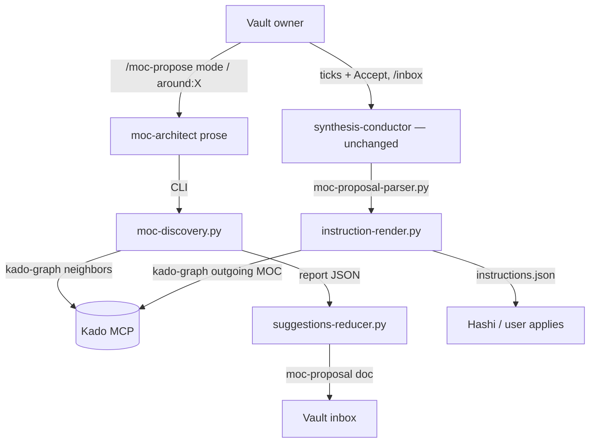
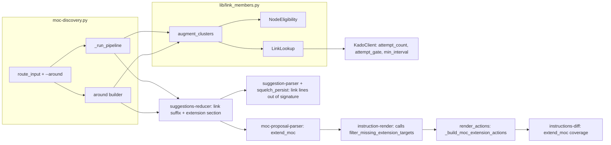
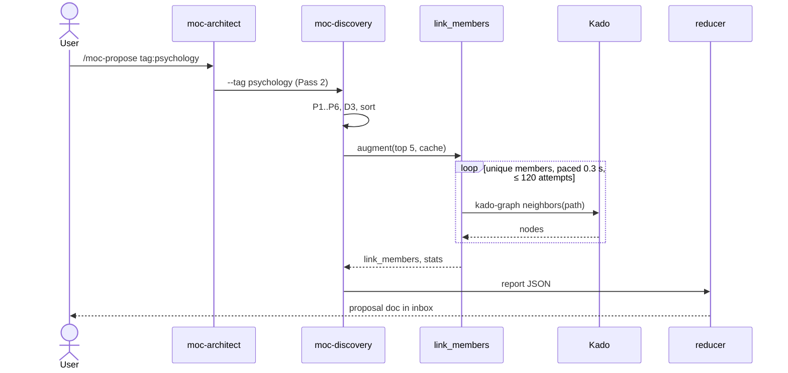

# Solution Design Document

## Validation Checklist

### CRITICAL GATES (Must Pass)

- [x] All required sections are complete
- [x] No [NEEDS CLARIFICATION] markers remain
- [x] Architecture pattern is clearly stated with rationale
- [x] **All architecture decisions confirmed by user**
- [x] Every interface has specification

### QUALITY CHECKS (Should Pass)

- [x] All context sources are listed with relevance ratings
- [x] Project commands are discovered from actual project files
- [x] Constraints → Strategy → Design → Implementation path is logical
- [x] Every component in diagram has directory mapping
- [x] Error handling covers all error types
- [x] Quality requirements are specific and measurable
- [x] Component names consistent across diagrams
- [x] A developer could implement from this design
- [x] Implementation examples use actual schema column names (not pseudocode), verified against migration files
- [x] Complex queries include traced walkthroughs with example data showing how the logic evaluates

---

## Output Schema

### SDD Status Report

| Field | Type | Required | Description |
|-------|------|----------|-------------|
| specId | string | Yes | Spec identifier (NNN-name format) |
| architecture | ArchitectureSummary | Yes | Architecture overview |
| sections | SectionStatus[] | Yes | Status of each SDD section |
| adrs | ADRStatus[] | Yes | Architecture decision statuses |
| validationPassed | number | Yes | Validation items passed |
| validationPending | number | Yes | Validation items pending |
| nextSteps | string[] | Yes | Recommended next actions |

### ArchitectureSummary

| Field | Type | Required | Description |
|-------|------|----------|-------------|
| pattern | string | Yes | Selected architecture pattern |
| keyComponents | string[] | Yes | Main system components |
| externalIntegrations | string[] | No | External services integrated |

### SectionStatus

| Field | Type | Required | Description |
|-------|------|----------|-------------|
| name | string | Yes | Section name |
| status | enum: `COMPLETE`, `NEEDS_DECISION`, `IN_PROGRESS` | Yes | Current state |
| detail | string | No | What decision is needed or what's in progress |

### ADRStatus

| Field | Type | Required | Description |
|-------|------|----------|-------------|
| id | string | Yes | ADR identifier (e.g., ADR-1) |
| name | string | Yes | Decision name |
| status | enum: `CONFIRMED`, `PENDING` | Yes | Confirmation state |

---

## Constraints

- **CON-1 Proposal-first.** `/moc-propose` writes only the proposal doc into the inbox. Vault notes change only through the user's ticks → `/inbox` → instruction set → Hashi or the user (spec 021).
- **CON-2 Kado limits.** Fixed window per requester IP, default 20 requests / 5 s, in the container as on the host, shared with the session's own MCP `kado-*` calls (`Kado/src/mcp/server.ts:105-157`, `canonical.ts:685-686`); 10 concurrent requests max (503). 429 carries `Retry-After`.
- **CON-3 Scope.** `kado-graph` silently omits resolved nodes outside the key's scope (Kado ADR-002). Such notes must never be named in a doc, report or log line. Telemetry is metadata-only (MiYo Constitution L2).
- **CON-4 No wire change.** Only `add_relationship` and `link_to_moc` reach `instructions.json`; `tomo/schemas/instructions.schema.json` (and Hashi's vendored copy) stay unchanged. No `tomo/CHANGELOG.md` entry.
- **CON-5 No eval-gated file.** `synthesis-conductor.md`, `inbox.md` and `settings.json` stay unchanged (root `CLAUDE.md` eval gate).
- **CON-6 Runtime-file rules.** `tomo/dot_claude/**` holds imperatives only; every rationale goes first to `docs/tomo/<mirrored-path>.md`; changed managed files bump `# version:`.
- **CON-7 Python stdlib + existing libs only**, run under `./venv/bin/python`; tests never touch an instance, `~/.tomo` or a real install.

## Implementation Context

**IMPORTANT**: You MUST read and analyze ALL listed context sources to understand constraints, patterns, and existing architecture.

### Required Context Sources

#### Documentation Context
```yaml
- doc: docs/XDD/specs/042-moc-propose-link-members/requirements.md
  relevance: HIGH
  why: "The 29 acceptance criteria this design satisfies"
- doc: docs/XDD/specs/042-moc-propose-link-members/README.md
  relevance: HIGH
  why: "Owner decisions and the live kado-graph probe"
- doc: docs/XDD/specs/021-moc-propose/requirements.md
  relevance: HIGH
  why: "/moc-propose contract: modes, F8 de-dup, squelch, proposal-first"
- doc: docs/tomo/scripts/moc-discovery.md
  relevance: HIGH
  why: "WHY layer for the discovery script; new sections land here"
- doc: docs/tomo/scripts/lib/render_actions.md
  relevance: HIGH
  why: "Up-preservation rules and the #82 up-target check this design reuses"
- doc: /Volumes/Moon/Coding/MiYo/Kado/docs/api-reference.md   # "Tool: kado-graph", lines 1792-1866
  relevance: HIGH
  why: "Operations, limit semantics, disclosure guard"
```

#### Code Context
```yaml
- file: tomo/scripts/moc-discovery.py
  relevance: HIGH
  why: "Pipeline (_run_pipeline :1699-1841), route_input :255-282, CLI scope group :146, empty_report :329, phase6_dedupe :1201, D3 :1326, phase65 :1431, _NullKadoClient :1598"
- file: tomo/scripts/lib/kado_client.py
  relevance: HIGH
  why: "graph() (#214), _call_tool :668, retry loop :689-717, _retry_delay :793-813"
- file: tomo/scripts/lib/topic_signature.py
  relevance: HIGH
  why: "Squelch signature = topics + top-5 sorted candidate stems (:70-77)"
- file: tomo/scripts/lib/squelch_persist.py
  relevance: HIGH
  why: "Recomputes the signature from the rejected doc's Children (:83-108)"
- file: tomo/scripts/suggestion-parser.py
  relevance: HIGH
  why: "RE_MOC_SECTION_HEADER :54, RE_CHILD_WIKILINK :1435, enumerate_all_moc_sections, parse_moc_proposal_doc :1609"
- file: tomo/scripts/suggestions-reducer.py
  relevance: HIGH
  why: "_child_annotation :1447, _render_cluster_section :1470-1563, render_moc_proposal_doc :1566-1686 (clusters[:max_results] at :1654)"
- file: tomo/scripts/moc-proposal-parser.py
  relevance: HIGH
  why: "RE_MOC_HEADER :23, block split :41-66, _parse_moc_block :70-179"
- file: tomo/scripts/instruction-render.py
  relevance: HIGH
  why: "Template-less items skipped (:493-500); filter order; drop_sources assert :897-918"
- file: tomo/scripts/lib/render_actions.py
  relevance: HIGH
  why: "emit_up_preservation_actions, _build_link_to_moc_actions :1397-1524, _build_up_preservation_actions :2091-2133, build_actions :2552-2600"
- file: tomo/scripts/lib/render_resolve.py
  relevance: MEDIUM
  why: "resolve_target_moc_paths :551, resolve_section_names :33 (anchor/placement for link_to_moc)"
- file: tomo/scripts/instructions-diff.py
  relevance: HIGH
  why: "Hard gate in synthesis-conductor Step 3c; per-item coverage :1125-1150 treats non-create_moc as move_note"
- file: tomo/scripts/lib/moc_scan.py
  relevance: MEDIUM
  why: "_is_excluded :133 (exclude_paths prefix rule)"
- file: tomo/scripts/lib/moc_tags.py
  relevance: MEDIUM
  why: "EXCLUDE_NOTE_TAG :27"
- file: tomo/profiles/miyo.yaml
  relevance: MEDIUM
  why: "concept_defaults.calendar (:44-51), map_note.name_suffix (:42), atomic-note paths"
- file: tomo/dot_claude/commands/moc-propose.md
  relevance: HIGH
  why: "Prefix whitelist (:24-46); runtime prose"
- file: tomo/dot_claude/agents/moc-architect.md
  relevance: HIGH
  why: "Mode mapping (:45-55), check-mode single-pass branch (:84-94), STRICT output block (:283-294)"
```

#### External APIs (if applicable)
```yaml
- service: Kado MCP `kado-graph`
  doc: /Volumes/Moon/Coding/MiYo/Kado/docs/api-reference.md#tool-kado-graph
  relevance: HIGH
  why: "neighbors = deduplicated outgoing ∪ backlinks minus the source (graph-traverse.ts:24-28); outgoing used for the extension's already-linked check; limit applies BEFORE the scope filter, so it is never passed"
```

### Implementation Boundaries
- **Must Preserve**:
  - Byte-identical proposal docs for runs with no link members (every existing reducer test).
  - Squelch signatures of topic clusters; the `drop_sources == WITHDRAWAL_GUARDS` assert; the anchor no-leak contract; `applied=False` stamping.
  - The two-pass flow: `--emit-phase1` makes zero graph calls.
  - The `create_moc` proposal gate keyed on `override_preserve_existing_up` (`render_actions.py:1511, :2121`).
- **Can Modify**: `moc-discovery.py`, `kado_client.py` (additive), reducer, both parsers, `instruction-render.py`, `render_actions.py`, `instructions-diff.py`, `moc-propose.md`, `moc-architect.md`, their `docs/tomo/` mirrors and tests.
- **Must Not Touch**: `synthesis-conductor.md`, `inbox.md`, `settings.json`, `instructions.schema.json`, `hashi-instructions.schema.json`, `state-promoter.py`, `inbox-triage.py`, `lib/topic_clusters.py` (shared with the reducer).

### External Interfaces

#### System Context Diagram



#### Interface Specifications

```yaml
# Inbound
inbound:
  - name: "/moc-propose around:<X>"
    type: slash command → moc-architect prose → CLI
    format: "around:<name or vault path>; case-sensitive lowercase prefix"
    data_flow: "Seed note or MOC for an around: proposal"
  - name: "moc-discovery.py --around <X>"
    type: CLI flag, member of the mutually exclusive scope group
    format: "string"
    data_flow: "Single-pass run, no Pass 1"

# Outbound
outbound:
  - name: "kado-graph neighbors"
    type: MCP over HTTP via KadoClient.graph
    format: "{operation:'neighbors', path} → nodes[{path, relation}]"
    authentication: Bearer (instance key)
    data_flow: "1-hop linked paths of one note"
    criticality: MEDIUM (degrades; never aborts a run except an around: seed)
  - name: "kado-graph outgoing (MOC)"
    type: MCP via KadoClient.graph, from instruction-render
    format: "{operation:'outgoing', path: moc_path}"
    data_flow: "Notes the MOC already links (extension Rule 3)"
    criticality: LOW (failure → emit link lines for all ticked members, report it)

# Data
data:
  - name: moc structure cache
    type: JSON file (moc-tree-builder)
    connection: lib/moc_cache_loader.load_moc_cache
    data_flow: "entries[{path, stem, kind, tags, up_state, up_target, topics}], map_notes — eligibility, up state and MOC detection without Kado reads"
```

### Cross-Component Boundaries (if applicable)

- **Tomo ↔ Kado:** read-only `kado-graph`; no Kado change. Node shape and operations suffice (stated on #82).
- **Tomo ↔ Hashi:** unchanged wire; Hashi sees ordinary `add_relationship` and `link_to_moc` actions.

### Project Commands

```bash
# Core Commands (from the repo: venv, pytest config, ruff)
Test:    ./venv/bin/python -m pytest -q
Lint:    ./venv/bin/ruff check .
Focused: ./venv/bin/python -m pytest -q tests/test_moc_discovery_*.py tests/test_link_members.py
Live host probe (sandbox off): KADO_URL=http://127.0.0.1:<port>/mcp KADO_TOKEN=<from tomo-instance/.mcp.json> ./venv/bin/python tomo/scripts/moc-discovery.py --around "<note>" --config tomo-instance/config/vault-config.yaml
```

## Solution Strategy

- **Architecture pattern:** extend the existing deterministic pipeline (script-owned logic, LLM prose only routes). Link evidence is a **post-selection augmentation**: topic clustering, de-dup and squelch decide *which* proposals exist, unchanged; links only add unticked members to the proposals that will actually be rendered. `around:` is a new single-pass scope mode that builds one proposal from links alone.
- **Integration approach:** one new pure-ish library module (`lib/link_members.py`) owns eligibility, budgeted lookups and augmentation; `moc-discovery.py` wires it in at one point per mode. The proposal doc gains a provenance suffix on member lines and one new section variant (extension) that keeps every existing parser boundary. The apply side adds one item kind (`extend_moc`) that never reaches the wire and expands into existing action types.
- **Justification:** placing lookups after D3 + sort restricts calls to the ≤ 5 rendered clusters (≈ 45 calls on the reference vault vs ≈ 180 for all kept clusters), keeps squelch signatures, D3 and confidence computed from topic members only, and needs no change to `topic_clusters`.
- **Key decisions:** ADR-1…ADR-7 below, all confirmed 2026-10-28.

## Building Block View

### Components



| Component | Single responsibility | PRD criteria owned |
|---|---|---|
| `NodeEligibility` | Decide from path + cache + profile whether a node may be a member; never reads Kado | F6-AC1, F6-AC2, F6-AC3, F6-AC4 |
| `LinkLookup` | Budgeted, paced, memoised `neighbors` lookups; counts attempts incl. retries | F5-AC2, F5-AC3 |
| `augment_clusters` | Add ≥ 2-member link members to the rendered clusters, each within its fair share of the budget (sampled when the share is short); record status | F1-AC1…AC4, F5-AC1, F5-AC4 (cluster part) |
| around builder (`moc-discovery.py`) | Resolve `around:` target, build one new-MOC or extension proposal | F2-AC1…AC4, F3-AC1, F3-AC2, F5-AC5 |
| `KadoClient` (additive) | Count every HTTP attempt; refuse a retry when the gate says the budget is spent; pace sends | F5-AC3 (mechanism) |
| Reducer | Render link suffixes, the "Why" link count, the extension section | F3-AC5, F4-AC1…AC3 |
| suggestion-parser + squelch_persist | Keep link lines out of the squelch signature while still returning them as children; the parser skips `around:` sections so they never reach the squelch registry (squelch_persist is affected only through that parser skip, no code change in it) | F4-AC4 (squelch side) |
| moc-proposal-parser | Emit `extend_moc` from an `**Extends:**` section; link lines parse as children | F1-AC5 (parse side), F4-AC4 (parse side) |
| `filter_missing_extension_targets` (`lib/render_resolve.py`, called from `instruction-render.py`) | Resolve the extension target by Kado name search; withhold an extension whose target MOC is absent, ambiguous or unverifiable | PRD edge case "MOC renamed/deleted" |
| `_build_moc_extension_actions` | Expand `extend_moc` into `add_relationship` + `link_to_moc`, skipping already-linked members | F3-AC3, F3-AC4 |
| instructions-diff | Verify extension coverage in the hard gate | F3-AC3 (gate side) |
| moc-architect / moc-propose prose | Route `around:`; print link counts on the `Discovery:` line | F2-AC4 (prefix), F7-AC1, F7-AC2 |

### Directory Map

**Component**: Tomo runtime + docs
```
.
├── tomo/scripts/
│   ├── moc-discovery.py                 # MODIFY: --around, augmentation call, report fields
│   ├── suggestions-reducer.py           # MODIFY: link suffix, Why count, _render_extension_section
│   ├── suggestion-parser.py             # MODIFY: link lines excluded from candidate_stems
│   ├── moc-proposal-parser.py           # MODIFY: **Extends:** → extend_moc
│   ├── instruction-render.py            # MODIFY: call filter_missing_extension_targets, pass client
│   ├── instructions-diff.py             # MODIFY: extend_moc expectations
│   └── lib/
│       ├── link_members.py              # NEW: NodeEligibility, LinkLookup, augment_clusters
│       ├── kado_client.py               # MODIFY: attempt_count, attempt_gate, min_interval
│       ├── render_actions.py            # MODIFY: _build_moc_extension_actions in build_actions
│       └── squelch_persist.py           # MODIFY (only if it bypasses the parser change)
├── tomo/dot_claude/commands/moc-propose.md   # MODIFY: around: in the whitelist
├── tomo/dot_claude/agents/moc-architect.md   # MODIFY: around: routing, single-pass branch, Discovery line
├── docs/tomo/scripts/lib/link_members.md     # NEW: WHY (written first)
├── docs/tomo/scripts/{moc-discovery,suggestions-reducer,instruction-render,instructions-diff}.md  # MODIFY: WHY sections
├── docs/tomo/scripts/moc-proposal-parser.md  # NEW: WHY (extend_moc branch)
├── docs/tomo/scripts/lib/kado_client.md  # NEW: attempts, gate, pacing
├── docs/tomo/scripts/lib/render_actions.md  # MODIFY: extension builder
├── docs/tomo/dot_claude/{commands/moc-propose,agents/moc-architect}.md  # MODIFY
└── tests/
    ├── test_link_members.py             # NEW
    ├── test_kado_client_attempts.py     # NEW
    ├── test_moc_discovery_around.py     # NEW
    └── (extend) test_moc_discovery_main.py, test_reducer_moc_proposal_mode.py, test_moc_proposal_parser.py,
        test_squelch_rejection.py, test_instruction_render_up_preservation.py, instructions-diff tests
```

### Interface Specifications

#### Interface Documentation References

```yaml
interfaces:
  - name: "kado-graph"
    doc: /Volumes/Moon/Coding/MiYo/Kado/docs/api-reference.md
    relevance: HIGH
    sections: [Tool: kado-graph]
  - name: "instructions.schema.json (unchanged)"
    doc: tomo/schemas/instructions.schema.json
    relevance: HIGH
    sections: [add_relationship, link_to_moc]
```

#### Data Storage Changes

None. The cache, the squelch registry and every schema stay as they are. The DiscoveryReport (unversioned, consumed only by the reducer) gains additive fields.

#### Internal API Changes

```yaml
KadoClient (lib/kado_client.py, additive):
  attempt_count: int            # +1 before every HTTP send, retries included
  attempt_gate: Callable[[], bool] | None   # consulted before every send; False → raise KadoBudgetExhausted
  min_interval: float = 0.0     # seconds between sends (monotonic); moc-discovery sets 0.3
  # KadoBudgetExhausted subclasses KadoError (callers that catch KadoError degrade on it)

lib/link_members.py (new):
  NodeEligibility(cache, profile, vault_cfg)
    .check(path: str) -> tuple[bool, str]        # reason ∈ ok|not-md|inbox|periodic|moc|out-of-scope|excluded-tag|uncached, first failing rule in that order; never printed or logged
    .is_periodic(path) / .is_moc(path) -> bool
  LinkLookup(client, budget: int = 120)   # context manager: installs client.attempt_gate and min_interval=0.3 on enter; close()/__exit__ restores the previous values
    .neighbors(path) -> list[str] | LookupFailed | BudgetExhausted   # memoised by path (failures too; budget refusals not)
    .remaining() -> int ; .cached(path) -> bool ; .attempts ; .lookups ; .failed
  augment_clusters(clusters, stem_to_path, lookup, eligibility, cache, threshold=2) -> AugmentResult
    # clusters: the rendered slice, each {cluster_id, items:[member keys], ...}; stem_to_path maps each key to a path. moc-discovery passes member paths with an identity map (lookups by path, O4) and maps linked_with back to stems.
    # mutates nothing; returns per-cluster link_members + status

moc-discovery.py CLI:
  --around NAME_OR_PATH          # new member of the scope group; single pass

suggestions-reducer.py CLI (--moc-proposal-mode):
  --config PATH                  # vault-config.yaml; tomo.moc_proposal.max_results via load_moc_proposal_config (default config/vault-config.yaml, missing file/key → 5) — owner decision O3
```

#### Application Data Models

```pseudocode
LinkMember {                       # one per added note per cluster
  stem: str, path: str,
  linked_with: list[str]           # member stems (or [seed] / [moc]) in alphabetical order
  up_state: absent|valid|broken, up_target: str|None   # from cache, no read
}

DiscoveryReport (additive fields):
  topic_clusters[i].link_members: list[LinkMember]          # [] when none
  topic_clusters[i].link_lookup_status: done|sampled|skipped_budget|failed|not_rendered
  link_stats: {lookups, attempts, failed, clusters_skipped_budget, clusters_sampled, members_total, skipped_uncached}
  around: {kind: note|moc, path, stem} | None
  extension: {moc_stem, moc_path, members: list[LinkMember]} | None   # around:<MOC> only
  # in extension mode link_stats.members_total = number of missing members

Parsed item (moc-proposal-parser, internal, never on the wire):
  {action: "extend_moc", id, target_moc: <stem>, supporting_items: [ticked stems],
   override_preserve_existing_up: bool, source_path: None}
  skipped extension entry: {target_moc, disposition: rejected | no_ticked_members | malformed_extension}
    # malformed_extension = an **Extends:** header line with no wikilink: skipped, stderr line
    # accepted with no ticked member: skipped (no_ticked_members), stderr line

Render records (instructions.json permissive `tomo` block, no schema change):
  tomo.extensions[]: {id, target_moc, target_moc_path, members, already_linked, outgoing_checked, no_relationship}
  tomo.withheld_extensions[]: {id, target_moc, kind: absent|ambiguous|unverifiable, reason, paths, member_count}
```

#### Integration Points

```yaml
inter_component:
  - from: moc-discovery
    to: lib/link_members
    protocol: in-process call
    data_flow: "rendered cluster slice + cache → link members + stats"
  - from: suggestions-reducer
    to: moc-proposal-parser / suggestion-parser
    protocol: markdown doc (the proposal file)
    data_flow: "member lines `- [ ] [[stem]] (up) — linked with [[A]], [[B]]`; extension section with **Extends:**"
  - from: moc-proposal-parser
    to: instruction-render
    protocol: parsed-suggestions.json (existing conductor step)
    data_flow: "extend_moc items alongside create_moc"

external:
  kado:
    doc: Kado api-reference "Tool: kado-graph"
    integration: "neighbors per eligible member/seed; outgoing per extension MOC at render time"
    critical_data: [paths only]
```

### Implementation Examples

#### Example: link-member qualification for one cluster (traced)

**Why this example**: the ≥ 2-member rule, memoisation and the no-bridge rule interact; a wrong order double-counts or lets a hub qualify.

```python
def augment_one(cluster, stem_to_path, lookup, elig, cache, share, threshold=2):
    if any(s not in stem_to_path for s in cluster["items"]):
        return [], "failed"                      # caller bug; no call, this cluster only
    member_paths = [stem_to_path[s] for s in cluster["items"]]
    uncached = [p for p in member_paths if not lookup.cached(p)]
    if uncached and share == 0:
        return [], "skipped_budget"              # no share left for this cluster (ADR-4)
    looked_up = [p for p in member_paths if lookup.cached(p) or p in uncached[:share]]
    status = "done" if len(uncached) <= share else "sampled"   # first `share` uncached, casefolded path order (v1.3)
    hits: dict[str, set[str]] = {}
    for stem, path in ((s, p) for s, p in zip(cluster["items"], member_paths) if p in looked_up):
        result = lookup.neighbors(path)          # memoised across clusters
        if isinstance(result, BudgetExhausted):
            return [], "skipped_budget"
        if isinstance(result, LookupFailed):
            return [], "failed"
        for node in result:
            if node in member_paths:
                continue                         # already a topic member (F1-AC3)
            ok, _ = elig.check(node)             # periodic / MOC / non-atomic / excluded → never counted
            if ok:
                hits.setdefault(node, set()).add(stem)
    members = [mk_link_member(p, sorted(by), cache) for p, by in hits.items() if len(by) >= threshold]
    return sorted(members, key=lambda m: m.stem), status
```

Traced with cluster `C = [A, B, D]` (topic "energy"):
- `neighbors(A) = [X, Daily-2025-06-04, Y]`, `neighbors(B) = [X, Daily-2025-06-04]`, `neighbors(D) = [Y, Z (MOC)]`.
- Daily → `is_periodic` → ineligible, never counted (so it cannot "bridge" A and B to anything).
- Z → `is_moc` → ineligible.
- X: hits {A, B} → 2 → link member, `linked_with=[A, B]`.
- Y: hits {A, D} → 2 → link member.
- Result: X, Y unticked; 3 lookups; a second cluster containing A reuses `neighbors(A)` without a call.

#### Example: budget gate across retries

```python
client.attempt_gate = lambda: lookup.remaining() > 0   # set by LinkLookup on enter, restored on close
# _call_tool: before EVERY send (first try and each retry):
#   if self.attempt_gate and not self.attempt_gate(): raise KadoBudgetExhausted
#   self.attempt_count += 1 ; sleep_until(last_send + min_interval)
# 429 with Retry-After: existing _retry_delay honours it (≤ 60 s), then the gate is asked again.
```

#### Test Examples as Interface Documentation

```python
def test_a_hub_never_bridges():
    # daily note links A and B; X links only A → X has 1 hit, not 2
    ...
    assert [m.stem for m in res.clusters["C1"].link_members] == []

def test_retries_count_toward_the_budget():
    # fake transport: 429 Retry-After 0 twice, then 200 → attempt_count == 3
    ...

def test_link_lines_do_not_change_the_squelch_signature():
    doc_without, doc_with = render(cluster), render(cluster_with_link_members)
    assert signature_from_doc(doc_without) == signature_from_doc(doc_with)
```

## Runtime View

### Primary Flow

#### Primary Flow: topic proposal with link members (any existing mode)

1. Architect prose runs `moc-discovery.py` exactly as today (Pass 1 / Pass 2 unchanged; `--emit-phase1` makes no graph call).
2. P1 → P6, D3, sort by confidence: unchanged.
3. **New:** take `clusters[:max_results]` (the slice the reducer renders); `augment_clusters` with `LinkLookup(budget=120)`; attach `link_members` + `link_lookup_status`; fill `link_stats`.
4. P6.5 validates existing `up::` for topic members as today; link members already carry cache up state.
5. Reducer renders link members after topic members, unticked, with the suffix; "Why" adds "N more members came through links." (singular "1 more member …"), only when N > 0.
6. Architect prints `Discovery: OK — N candidates → M clusters; links: K members, L lookups (P sampled: budget) (S skipped: budget)`; each suffix only when its count > 0.



#### Secondary flows

- **`around:<note>`:** resolve (cache only; path argument allowed) → refuse MOC-ambiguous / periodic / not-found → refuse a seed that fails member eligibility → `neighbors(seed)` (1 attempt) → eligible nodes → if < 2 → "fewer than 3 notes" → else one cluster: title `<seed stem><name_suffix>`, items `[seed]` (ticked) + link members `linked_with=[seed]`; parents via P5 from the seed's cached topics; Phase 6.5 existing-up check on the seed (one `read_note`, outside the graph budget); no squelch read, decrement or write. Rendered with no `**Confidence:**` line; Why: "N notes link with [[seed]] and have no dedicated MOC." (singular "1 note links with [[seed]] and has no dedicated MOC." for 1); no "more members came through links" and no classification sentence.
- **`around:<MOC>`:** resolve → `neighbors(moc)` → eligible nodes that are not yet members → if none → "no missing members" → `report.extension` (`link_stats.members_total` = missing members). A neighbour is already a member when the MOC is its cached `up_target` or any element of its cached `up_value` (frontmatter list), compared by bare stem, case-insensitive (`_up_targets_stem`, `_run_around_extension`). Residual limit: the cache keeps only the first inline `up::`, so a note whose first inline parent is another note but which also names the MOC (second inline line, or frontmatter after an inline win) is still proposed, unticked (PRD Rule 5). Reducer renders `### MOC01 — Extend [[X]]`, `- [ ] Accept`, `**Extends:** [[X]]`, `#### Missing members (n)`, Override, Why.
- **Apply (extension):** `moc-proposal-parser` → `extend_moc` → `filter_missing_extension_targets` (`lib/render_resolve.py`; withhold + report if MOC gone) → `_build_moc_extension_actions`: members de-duplicated case-insensitively (first spelling kept); per ticked member `emit_up_preservation_actions(member, moc_stem, override)`; one `outgoing(moc)` call; `link_to_moc` (`line_to_add: "- [[member]]"`, anchor via the existing resolver) only for members not in it → instructions-diff checks one `add_relationship` set per member and `link_to_moc` count = ticked − already linked.

### Error Handling

| Error | Where | Handling | User sees |
|---|---|---|---|
| 429 with Retry-After | KadoClient | existing backoff; every attempt counted; gate stops retries when budget is spent | nothing unless the budget runs out |
| Cluster larger than its budget share | augment | share = remaining // clusters still to do; memoised members are free; the first `share` uncached members in casefolded path order (v1.3; was item order) are looked up, status `sampled`; ≥ 2 hits counted among those | `Discovery:` line "(P sampled: budget)" |
| Budget exhausted mid-run | LinkLookup / augment | a cluster with share 0 is `skipped_budget`; a cluster whose retries spend the budget mid-cluster keeps the hits of the members already looked up or memoised and is `sampled` (v1.3; was `skipped_budget`), or `skipped_budget` when none was; fully memoised ones still run | `Discovery:` line "(S skipped: budget)" |
| Pass 2 exits 1 (partial: D3/duplicate or squelched clusters dropped) | moc-architect | stdout holds the full DiscoveryReport; parse it and continue; only exit 2 (fatal) stops the run | none |
| Lookup error (Kado error, 503 after retries) | augment | that cluster `failed`, no link members; others continue | "lookups failed: F" note in `Aborts/notes` |
| Seed lookup fails (Kado error, key cannot read the seed, budget refusal) | around builder | no proposal; reason "seed lookup failed" | `Discovery:` abort reason naming the seed |
| Seed not in cache / not found | around builder | no proposal | "around: '<X>' not found — rebuild the cache or give a path" |
| Seed name matches several cached notes (MOC + note, or two notes) | around builder | no proposal | "around: '<X>' matches several notes — give a path: <paths>" |
| Seed is periodic | around builder | no proposal | "around: periodic notes cannot be a MOC seed" |
| Seed not eligible (inbox / outside atomic folders / exclude/note) | around builder | no proposal | "around: '<X>' cannot seed a MOC — <reason>" |
| < 2 eligible neighbours | around builder | no proposal | "fewer than 3 notes" |
| `--around` combined with `--emit-phase1` / `--phase1-input` / `--check-moc-uplinks` | moc-discovery CLI | exit 2, no report | FATAL usage line on stderr |
| MOC has no missing members | around builder | no proposal | "no missing members" |
| Extension target MOC gone at /inbox | `filter_missing_extension_targets` (`lib/render_resolve.py`) | Kado name search, exact-stem `.md` hits: 0 hits `absent`, 2+ hits `ambiguous` (both paths listed; deliberately unlike `link_to_moc`'s first-hit resolver because the extension writes `up::` into N notes), search failure `unverifiable`; all withheld with a stated cause, kept items get `target_moc_path` | instructions.md withheld notice with the cause |
| Extension doc section malformed or empty | moc-proposal-parser | `**Extends:**` header line with no wikilink → skipped (`malformed_extension`); accepted with no ticked member → skipped (`no_ticked_members`); both write a stderr line; skipped entries carry `target_moc` and `disposition` | stderr line |
| No Kado client at render | instruction-render | extension not built; instructions-diff hard-fails "MISSING — not rendered" (cannot happen on a real /inbox run: the client is built whenever confirmed items exist) | instructions-diff FAIL |
| `outgoing(moc)` fails at render | extension builder | emit link lines for all ticked members, report "already-linked check unavailable" | instructions.md note |
| MOC has no anchor | existing resolver | `anchor.value` null, action still emitted (existing behaviour) | existing "(unresolved callout…)" line |
| `_NullKadoClient` (no Kado) | discovery | `graph` raises → every cluster `failed`, run continues | notes line |

### Complex Logic (if applicable)

```
ALGORITHM: augment rendered clusters
INPUT: clusters sorted by confidence, max_results R, cache, profile, budget 120
1. slice = clusters[:R]
2. FOR i, c IN enumerate(slice) (confidence order):
     share = lookup.remaining() // (len(slice) - i)     (unused share flows to later clusters)
     c.link_members, c.status = augment_one(c, share)   (done | sampled | skipped_budget | failed)
3. FOR c NOT IN slice: c.status = not_rendered (no calls)
4. stats = lookup counters + per-status counts
```

## Deployment View

### Single Application Deployment
- Ships through `update-tomo.sh --instance tomo-instance` (never `tomo-privat` during validation). Version-gated: every changed managed file bumps `# version:`.
- No new dependency, no config key. Budget (120), pacing (0.3 s) and threshold (2) are module constants in `lib/link_members.py`, documented in its WHY doc.
- Runs in the container; Kado reached via `host.docker.internal`, same per-IP limiter (CON-2).

### Multi-Component Coordination (if applicable)
None. No Kado or Hashi release needed; no handoff.

## Cross-Cutting Concepts

### Pattern Documentation

```yaml
- pattern: Script owns the flow, prose only routes (memory: skill owns flow / agents use scripts)
  relevance: HIGH
  why: "around: routing is a prefix map in prose; every decision is in moc-discovery.py"
- pattern: WHY-first docs (root CLAUDE.md)
  relevance: HIGH
  why: "docs/tomo mirrors written before each runtime change"
- pattern: Withdrawal / pre-build item filters (instruction-render)
  relevance: MEDIUM
  why: "filter_missing_extension_targets (lib/render_resolve.py, next to filter_missing_source_notes) mirrors it"
- pattern (new): budgeted, memoised graph lookups (lib/link_members.LinkLookup)
  relevance: HIGH
  why: "First per-run Kado call budget; reusable by later graph features"
```

### User Interface & UX (if applicable)

**Information Architecture:** unchanged doc layout; link members append to `#### Children (n)` after topic members; extension is one section of the same doc type.

#### UI Visualization Guide

```
### MOC02 — Energy & Recovery
- [ ] Accept
**Title:** `Energy & Recovery (MOC)`  **Location:** `Atlas/200 Maps/`  **Template:** [[t_moc_tomo]]
**Trigger:** tag:psychology   **Confidence:** 60%   **Cluster:** 3 Notes — energy
#### Parent
- [x] up:: [[2100 Psychology]] (confidence 0.71)
#### Children (5)
- [x] [[Energy Level (Thought)]] (no up:: yet)
- [x] [[Sleep Debt]] (existing up:: [[Health MOC]] → becomes `related::`)
- [x] [[Recovery Days]] (no up:: yet)
- [ ] [[Afternoon Slump]] (no up:: yet) — linked with [[Energy Level (Thought)]], [[Sleep Debt]]
- [ ] [[Caffeine Timing]] (no up:: yet) — linked with [[Recovery Days]], [[Sleep Debt]]
#### up::-Handling Override
- [ ] **Keep existing up::, add new MOC as `related::`** (applies to all 5 children)
#### Why this proposal
3 notes with topic overlap energy have no dedicated MOC. 2 more members came through links.

### MOC01 — Extend [[Health MOC]]
- [ ] Accept
**Extends:** [[Health MOC]]
**Trigger:** around:Health MOC
#### Missing members (2)
- [ ] [[Cold Showers]] (no up:: yet) — linked with [[Health MOC]]
- [ ] [[Sleep Debt]] (existing up:: [[Psychology MOC]] → becomes `related::`) — linked with [[Health MOC]]
#### up::-Handling Override
- [ ] **Keep existing up::, add [[Health MOC]] as `related::`** (applies to all ticked members)
#### Why this proposal
2 notes link with [[Health MOC]] but have no up:: to it.
```

With one missing member the Why reads "1 note links with [[Health MOC]] but has no up:: to it."

#### UI Visualization Guide: `around:<note>`

```
### MOC01 — Energy Level (Thought) (MOC)
- [ ] Accept
**Title:** `Energy Level (Thought) (MOC)`  **Location:** `Atlas/200 Maps/`  **Template:** [[t_moc_tomo]]
**Trigger:** around:Energy Level (Thought)
**Cluster:** 3 Notes — linked around [[Energy Level (Thought)]]
#### Parent
- [x] up:: [[Personal Management]] (confidence 0.80)
- [ ] no parent (top-level MOC)
#### Children (3)
- [x] [[Energy Level (Thought)]] (no up:: yet)
- [ ] [[Afternoon Slump]] (no up:: yet) — linked with [[Energy Level (Thought)]]
- [ ] [[Caffeine Timing]] (no up:: yet) — linked with [[Energy Level (Thought)]]
#### up::-Handling Override
- [ ] **Keep existing up::, add new MOC as `related::`** (applies to all 3 children)
#### Why this proposal
2 notes link with [[Energy Level (Thought)]] and have no dedicated MOC.
```

### System-Wide Patterns
- **Security:** only paths Kado returns (scope-filtered) are ever named; ineligible-node reasons are counted, not logged by name.
- **Error handling:** degrade per cluster; only an `around:` seed failure ends a run without a doc.
- **Performance:** ≤ 120 kado-graph attempts per run (incl. retries and the `around:` seed lookup), ≥ 0.3 s apart (≤ 36 s worst case); memoised lookups. Other Kado calls (e.g. Phase 6.5 `read_note`) are outside this budget and its pacing.
- **Logging/Auditing:** counters in the report and on the `Discovery:` line; no note content.

### Multi-Component Patterns (if applicable)
- **Communication:** proposal doc is the only contract between discovery and apply; parsers keep "first wikilink on the line is the member".
- **Data consistency:** "already linked" is re-checked at render time (ADR-6), so a stale doc never duplicates a MOC line.

## Architecture Decisions

- [x] ADR-1 Link source: live `kado-graph neighbors` per note.
  - Rationale: Obsidian-resolved paths including frontmatter links, current, scope-filtered; the point of #82.
  - Trade-offs: costs Kado calls → budget and pacing (ADR-4); an offline cache adjacency would cost zero calls but reintroduce name guessing and up to a day of staleness.
  - User confirmed: 2026-10-28
- [x] ADR-2 Insertion point: after D3 + confidence sort, only for the `max_results` clusters the reducer renders, before Phase 6.5; lookups memoised per unique member path; a note qualifies when it is in ≥ 2 members' neighbour lists. The reducer and discovery read the same `tomo.moc_proposal.max_results` (default 5).
  - Rationale: squelch, D3 and confidence stay topic-only for free; ≈ 45 vs ≈ 180 calls on the reference vault.
  - Trade-offs: clusters below the rendered slice never get link members (they are not shown anyway).
  - User confirmed: 2026-10-28
- [x] ADR-3 Eligibility offline from cache + profile + vault-config: `.md`, not inbox, atomic-note path (vault-config `concepts.atomic_note`/`inbox` over profile `concept_defaults`), not periodic (union of profile and vault-config calendar base + granularity paths, plus `tomo.moc_structure_cache.exclude_paths`; prefixes stripped and `/`-terminated), not a MOC (cache kind / map_notes / profile `map_note.name_suffix` via `profile_conventions.moc_suffix`; vault-config has no suffix key), no `exclude/note` tag, present in the cache. Uncached nodes are skipped and counted. Topic members are looked up even when uncached (tag/folder candidates come from live Kado and may be newer than the cache); only other ineligible members are dropped before lookups.
  - Rationale: the cache already holds every in-scope note with tags and up state; zero extra reads; up state for link members comes from the cache.
  - Trade-offs: notes created since the last cache build are skipped until the next build.
  - User confirmed: 2026-10-28
- [x] ADR-4 Budget: 120 kado-graph HTTP attempts per run (incl. retries and the `around:` seed lookup); other Kado calls (e.g. Phase 6.5 `read_note`) are outside this budget; sends paced ≥ 0.3 s; `KadoClient.attempt_count` + `attempt_gate`; each rendered cluster gets a fair share (remaining // clusters still to do), larger clusters are `sampled` (first `share` uncached members in item order). v1.2: was 60 and all-or-nothing; the T5.3 live run left 3 of 5 rendered clusters (62/45/17 members) without lookups.
  - Rationale: Kado's 20 / 5 s per IP shared with interactive MCP traffic; retries are invisible to `call_count` today; the owner requires backoff support.
  - Trade-offs: very large clusters may be skipped while a smaller later one still fits.
  - User confirmed: 2026-10-28
- [x] ADR-5 Extension doc shape: stays `doc_type: moc-proposal` with frontmatter `proposal_kind: moc-extension` and filename slug `moc-proposal-extend-<moc slug>`; section `### MOCxx — Extend [[X]]` with `**Extends:** [[X]]` and `#### Missing members (n)`; parser emits `extend_moc`; extensions are excluded from squelch; the Extend section renders `**Trigger:** around:<MOC>` on its own line (the parser's `RE_AROUND_TRIGGER` is anchored at line start), which the around skip relies on (Phase 4 must keep it).
  - Rationale: promoter, triage and the eval-gated conductor stay untouched; a non-`MOCxx` heading would be swallowed into the previous block by the parser.
  - Trade-offs: the `MOCxx` id no longer implies "create"; the parser branches on `**Extends:**`.
  - User confirmed: 2026-10-28
- [x] ADR-6 Already-linked check at render time: `instruction-render` calls `outgoing(moc)` once per extension and emits `link_to_moc` only for members the MOC does not link; failure → emit all and report. Members are de-duplicated case-insensitively (first spelling kept) in the renderer and in instructions-diff; instructions-diff is a paired consumer of the render record (`tomo.extensions`) and checks per member against the renderer's `already_linked` / `no_relationship`, not an independent `outgoing` call.
  - Rationale: reflects the MOC as it is when `/inbox` runs, not when the doc was written.
  - Trade-offs: one Kado call per accepted extension at apply time.
  - User confirmed: 2026-10-28
- [x] ADR-7 Member line contract: `- [ ] [[stem]] (<up annotation>) — linked with [[A]], [[B]]`; the member wikilink stays first; `suggestion-parser` and `squelch_persist` exclude lines carrying ` — linked with ` from `candidate_stems` but return them as children. `suggestion-parser` also skips sections whose `**Trigger:**` starts with `around:` or whose header (before the first `####`) carries an `**Extends:**` line, in `enumerate_all_moc_sections`, `enumerate_moc_sections_split` and `parse_moc_proposal_doc`, so around and extension proposals never reach the squelch registry.
  - Rationale: rejected proposals must not resurface because link members changed the top-5 stems of the signature.
  - Trade-offs: the marker text is a parse contract and must not be localised.
  - User confirmed: 2026-10-28

## Quality Requirements

- **Performance:** ≤ 120 kado-graph attempts per run (assert in tests via `LinkLookup.attempts` / `link_stats.attempts` — `KadoClient.attempt_count` also counts non-graph calls); ≥ 0.3 s between kado-graph sends; added wall time ≤ 40 s on the reference vault (64 MOCs / 295 notes).
- **Usability:** every link member shows its reason; docs without link members are byte-identical to today's.
- **Security:** no out-of-scope or ineligible note named anywhere; metadata-only counters.
- **Reliability:** no Kado failure aborts a non-`around:` run; 0 rate-limit aborts across validation runs; every ticked member reaches `instructions.json` (instructions-diff hard gate stays green).

## Acceptance Criteria

**F1 — augmentation**
- [ ] F1-AC1: WHEN a rendered cluster has a non-member eligible note in ≥ 2 members' `neighbors`, THE SYSTEM SHALL list it unticked under Children with its link suffix.
- [ ] F1-AC2: IF a note is in exactly 1 member's `neighbors`, THEN THE SYSTEM SHALL NOT add it.
- [ ] F1-AC3: IF a linked note is already a topic member, THEN THE SYSTEM SHALL render it once, as a topic member, unchanged.
- [ ] F1-AC4: WHEN a note qualifies for several rendered clusters, THE SYSTEM SHALL list it unticked in each.
- [ ] F1-AC5: WHEN an accepted section has ticked link members, THE SYSTEM SHALL pass them to `supporting_items` and apply the same up-preservation rules; unticked ones SHALL produce no action.

**F2 — around:<note>**
- [ ] F2-AC1: WHEN `--around` names a non-MOC, non-periodic cached note with ≥ 2 eligible neighbours, THE SYSTEM SHALL emit one new-MOC cluster: seed ticked, neighbours unticked, title `<stem><name_suffix>`.
- [ ] F2-AC2: IF fewer than 2 eligible neighbours remain, THEN THE SYSTEM SHALL write no proposal and report "fewer than 3 notes".
- [ ] F2-AC3: IF the target is not in the cache, THEN THE SYSTEM SHALL write no proposal and report "around: '<X>' not found — rebuild the cache or give a path". A cached target that Kado refuses or cannot read fails the seed lookup and is reported per F5-AC5 ("seed lookup failed", naming the seed and the key-readability remedy).
- [ ] F2-AC4: THE SYSTEM SHALL route only the exact lowercase `around:` prefix; any other casing SHALL fall to free text.
- [ ] F2-AC5: IF a section's `**Trigger:**` starts with `around:` or its header carries an `**Extends:**` line, THEN the parser SHALL omit it from `enumerate_all_moc_sections`, from the unticked list of `enumerate_moc_sections_split` and from `parse_moc_proposal_doc`, so neither discovery nor rejection reads or writes the squelch registry for it (README decision 2026-10-28; no PRD criterion).

**F3 — around:<MOC>**
- [ ] F3-AC1: WHEN `--around` names a MOC, THE SYSTEM SHALL emit `report.extension` with every eligible neighbour that is not yet a member (the MOC is neither its cached `up_target` nor any element of its cached `up_value`, bare stem, case-insensitive), unticked.
- [ ] F3-AC2: IF there are none, THEN THE SYSTEM SHALL write no proposal and report "no missing members".
- [ ] F3-AC3: WHEN an accepted extension is rendered, THE SYSTEM SHALL emit `add_relationship` per ticked member via `emit_up_preservation_actions(member, moc, override)` and `link_to_moc` per ticked member not in `outgoing(moc)`; instructions-diff SHALL verify both.
- [ ] F3-AC4: IF a ticked member is in `outgoing(moc)`, THEN THE SYSTEM SHALL emit its `add_relationship` and no `link_to_moc`.
- [ ] F3-AC5: THE SYSTEM SHALL render an extension as `### MOCxx — Extend [[X]]` with `**Extends:**`, `#### Missing members`, no Title/Location/Template and no `#### Parent`.

**F4 — provenance**
- [ ] F4-AC1: THE SYSTEM SHALL suffix each link member line with ` — linked with ` and its `linked_with` stems as wikilinks.
- [ ] F4-AC2: WHEN a link member has an existing `up::`, THE SYSTEM SHALL render the existing annotation before the link suffix.
- [ ] F4-AC3: WHEN a cluster has link members, THE SYSTEM SHALL append "N more members came through links." (singular "1 more member came through links.") to "Why this proposal".
- [ ] F4-AC4: WHEN a doc is parsed back, THE SYSTEM SHALL read each member line as its first wikilink, and SHALL exclude link lines from the squelch signature.

**F5 — budget and degradation**
- [ ] F5-AC1: WHEN a rendered cluster's uncached lookups exceed its fair share of the remaining budget, THE SYSTEM SHALL look up only the first `share` uncached members (`sampled`), skip it when the share is 0 (`skipped_budget`), still write proposals, and count both on the `Discovery:` line.
- [ ] F5-AC2: THE SYSTEM SHALL NOT exceed 120 kado-graph attempts per run (retries and the `around:` seed lookup included) and SHALL pace those sends ≥ 0.3 s apart; other Kado calls are outside this budget (ADR-4).
- [ ] F5-AC3: WHEN Kado answers 429 with `Retry-After`, THE SYSTEM SHALL wait as stated, retry, count each attempt, and stop retrying when the gate reports the budget spent.
- [ ] F5-AC4: WHEN a lookup fails, THE SYSTEM SHALL mark that cluster `failed` with no link members, count it, and leave the rest of the proposal unchanged.
- [ ] F5-AC5: IF the `around:` seed lookup fails, THEN THE SYSTEM SHALL write no proposal and report the failure, not "fewer than 3 notes".

**F6 — boundaries**
- [ ] F6-AC1: THE SYSTEM SHALL never propose a non-`.md`, periodic, MOC, inbox or non-atomic-path note as a link member.
- [ ] F6-AC2: THE SYSTEM SHALL never propose a note whose cached tags contain `exclude/note`.
- [ ] F6-AC3: THE SYSTEM SHALL NOT count an ineligible node toward any note's member hits (no bridge).
- [ ] F6-AC4: THE SYSTEM SHALL name only paths returned by Kado and SHALL NOT log ineligible or uncached node paths.

**F7 — report**
- [ ] F7-AC1: WHEN a run ends, THE SYSTEM SHALL print `links: K members, L lookups` on the `Discovery:` line.
- [ ] F7-AC2: WHEN K is 0, THE SYSTEM SHALL still print `links: 0 members, L lookups`.

## Risks and Technical Debt

### Known Technical Issues
- `extract_first_up_marker` (render) ignores frontmatter `up:`, while discovery's `up_parse` reads both: an extension member whose parent is in frontmatter renders as "no up:: yet" but at apply is treated as absent → gets `up::` while its frontmatter parent stays. Same as today's create path; documented, not fixed here.
- Phase 6.5 reads every child of every kept cluster unpaced (`moc-discovery.py:1517`); out of scope, noted as a separate rate-limit risk.
- `title:` / free-text mode only ever selects MOCs (`moc-discovery.py:481`) — pre-existing, out of scope.

### Technical Debt
- `tomo-help.md:152-157` lists a non-existent "placeholder" mode — fix alongside the `around:` help line (runtime prose touched anyway).
- `instructions-diff` per-item coverage assumes every non-`create_moc` item is a `move_note`; this design adds an explicit `extend_moc` branch instead of generalising.

### Implementation Gotchas
- `kado-graph` `limit` slices before the scope filter — never pass it.
- `neighbors` loses direction; "MOC already links it" needs `outgoing`, never `neighbors`.
- Phase 6.5 builds `stem_to_path` with last-wins on stem collisions; build the augmentation map from candidates by path and render by stem.
- `--emit-phase1` must make zero graph calls; Pass 2 trusts `--phase1-input` candidates without re-filtering — re-apply eligibility to members before lookups.
- Extension members are de-duplicated case-insensitively (first spelling kept) in `_build_moc_extension_actions` and in instructions-diff; the two must agree or the gate flags a phantom member.
- A non-`MOCxx` heading is swallowed into the previous section by `moc-proposal-parser` — the extension must keep `### MOCxx`.
- `instruction-render` skips template-less items before the manifest; `extend_moc` must be built from `confirmed`, not from the manifest.
- `_NullKadoClient` needs a `graph` that raises.
- Colliding stems are counted as distinct members by path; the reason line shows the shared stem once (owner decision 2026-10-28).
- A non-member note sharing a topic member's stem renders `[[stem]]` twice (ticked and unticked); accepted with O4.
- Calendar paths may carry a trailing space in vault-config (`"Calendar/301 Daily/ "`); normalise before prefix matching.

## Glossary

### Domain Terms

| Term | Definition | Context |
|------|------------|---------|
| Topic member | A note that joined a cluster through a shared normalised topic | Ticked by default, as today |
| Link member | A note added because it is linked with ≥ 2 topic members (or with the `around:` seed / MOC) | Always unticked, carries "linked with" |
| Seed | The note named in `around:<note>` | Ticked member of its own proposal |
| Extension | A proposal that adds missing members to an existing MOC | `around:<MOC>` |
| Missing member | Eligible note linked with a MOC but without `up::` to it | Extension rule 1 |
| Periodic note | Daily, weekly, monthly … note under the profile/vault-config calendar paths | Never a member or bridge |

### Technical Terms

| Term | Definition | Context |
|------|------------|---------|
| Rendered slice | `clusters[:max_results]` after D3 and confidence sort | The only clusters looked up |
| Attempt | One kado-graph HTTP send made while a `LinkLookup` is open, first try or retry | Budget unit (ADR-4); other Kado calls do not count |
| Squelch signature | sha1 of sorted topics + top-5 sorted candidate stems | Mutes rejected proposals; must exclude link members |

### API/Interface Terms

| Term | Definition | Context |
|------|------------|---------|
| `neighbors` | Deduplicated outgoing ∪ backlinks of a note, source excluded | Link lookups |
| `outgoing` | Resolved targets a note links to | Extension already-linked check |
| `extend_moc` | Internal parsed item for an accepted extension; never on the wire | moc-proposal-parser → render_actions |
