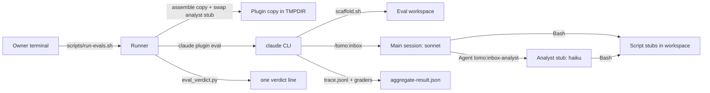
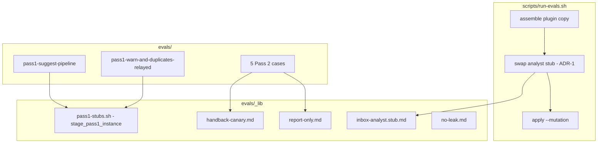
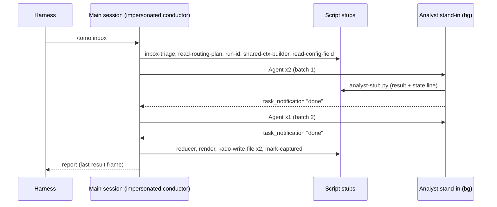

# Solution Design Document

## Validation Checklist

### CRITICAL GATES (Must Pass)

- [x] All required sections are complete
- [x] No [NEEDS CLARIFICATION] markers remain
- [x] Architecture pattern is clearly stated with rationale
- [x] **All architecture decisions confirmed by user**
- [x] Every interface has specification

### QUALITY CHECKS (Should Pass)

- [x] All context sources are listed with relevance ratings
- [x] Project commands are discovered from actual project files
- [x] Constraints → Strategy → Design → Implementation path is logical
- [x] Every component in diagram has directory mapping
- [x] Error handling covers all error types
- [x] Quality requirements are specific and measurable
- [x] Component names consistent across diagrams
- [x] A developer could implement from this design
- [x] Implementation examples use actual schema column names (not pseudocode), verified against migration files. Here that means the real script flags and trace field names, verified against the spike traces.
- [x] Complex queries include traced walkthroughs with example data showing how the logic evaluates

---

## Constraints

- **CON-1 Harness.** The gate runs on `claude plugin eval` (≥ 2.1.269; validated on 2.1.314), through `scripts/run-evals.sh`.
  - Scripts and scaffolds must run on bash 3.2.
  - Stubs are stdlib-only Python, written by the scaffold into the eval workspace.
- **CON-2 Isolation.** A case touches only its own eval workspace. No instance, no `~/.tomo`, no vault, no Kado, no network apart from the model API.
  - The runner never writes into the repo; results go to `tomo-tmp/evals/<TS>/`.
  - The tree-change guard stays in place.
- **CON-3 Runtime prose rules.**
  - `tomo/dot_claude/` files contain imperatives only.
  - An edit to a managed file bumps its `# version:`.
  - The WHY goes to `docs/tomo/` before it is stripped from a runtime file.
  - Agent files are edited through `tcs-helper:agent-author`, and skill files through `tcs-helper:skill-author`.
- **CON-4 Cost.**
  - The full suite stays under the $5 cap.
  - The Pass 1 cases add about $1.50 per gate run.
  - Each paid run is started by the owner from a terminal, because of the sandbox EPERM.
- **CON-5 Gate contract unchanged.** Exit codes 0–3, the verdict line format, the leak-guard rule and the merge rule all stay as they are. This spec adds cases, a stub swap and documentation.

## Implementation Context

### Required Context Sources

#### Documentation Context

```yaml
- doc: evals/README.md
  relevance: HIGH
  why: "Coverage table, the 'Adding a case' rules, the leak-guard rule, known limits. Updated by F6/F7."
- doc: evals/_mutations/README.md
  relevance: HIGH
  why: "Mutation and RED-proof discipline; the new mutations are added here."
- doc: docs/XDD/specs/043-pass1-conductor-eval-gate/spike/write-up.md
  relevance: HIGH
  why: "Measured behaviour this design rests on: impersonation, background dispatch, trace format on 2.1.314."
- doc: docs/XDD/specs/041-plugin-eval-gate-for-runtime-prose/solution.md
  relevance: MEDIUM
  why: "Gate architecture (ADR-1 assembled plugin copy, stub kit, verdict)."
- doc: docs/XDD/specs/041-plugin-eval-gate-for-runtime-prose/red-proofs.md
  relevance: MEDIUM
  why: "Format of the RED-proof record that F5 extends."
```

#### Code Context

```yaml
- file: scripts/run-evals.sh
  relevance: HIGH
  why: "Assembles the plugin copy; gets the analyst-stub swap (ADR-1)."
- file: evals/_lib/stubs.sh
  relevance: MEDIUM
  why: "Pass 2 kit; the model for the Pass 1 kit's structure. Unchanged (ADR-2)."
- file: tomo/dot_claude/commands/inbox.md
  relevance: HIGH
  why: "Pass 1 entry: triage, read the plan, IMPERSONATE suggestion-conductor."
- file: tomo/dot_claude/agents/suggestion-conductor.md
  relevance: HIGH
  why: "Subject under test (impersonated)."
- file: tomo/dot_claude/skills/suggest-handling/SKILL.md
  relevance: HIGH
  why: "Pass 1 suggest pipeline; every script call it makes needs a stub."
- file: tomo/scripts/{read-routing-plan,read-config-field,run-id,shared-ctx-builder,suggestions-reducer,suggestions-render,kado-write-file,mark-captured,inbox-triage}.py
  relevance: HIGH
  why: "Source of the output formats the stubs copy (stdout/stderr lines, files written, exit codes)."
- file: tomo/scripts/lib/item_key.py
  relevance: MEDIUM
  why: "to_filename(): the result filename the analyst stub writes."
- file: tests/test_eval_gate_docs.py
  relevance: HIGH
  why: "Coverage-table check; gets the byte-identity check for the shared graders."
- file: tests/test_run_evals.py
  relevance: HIGH
  why: "Runner tests; gets the stub-swap test."
```

### Implementation Boundaries

- **Must Preserve:**
  - the runner's flags, exit codes and verdict format;
  - the 5 existing Pass 2 cases' current graders;
  - `evals/_lib/stubs.sh`;
  - the real `tomo/dot_claude/agents/inbox-analyst.md`, which is never read or modified by the gate.
- **Can Modify:**
  - `scripts/run-evals.sh` (the stub swap only);
  - `evals/` (new cases, the kit, the shared graders, mutations, README);
  - the two docs tests;
  - root `CLAUDE.md` (the gate rule);
  - Pass 1 runtime prose, but only where a new grader is RED on the current text (a finding; CON-3 applies).
- **Must Not Touch:**
  - `force-atomic-handling` (not gated, PRD Won't);
  - `inbox-analyst.md`;
  - any instance, vault or Kado config.

### External Interfaces

#### System Context Diagram



#### Interface Specifications

```yaml
# Inbound
- name: "scripts/run-evals.sh"
  type: CLI
  format: "unchanged options (--case, --rev, --mutation, --runs, --max-cost-usd, --keep-temp)"
  data_flow: "full suite now = 5 Pass 2 cases + 2 Pass 1 cases, 3 runs each"

# Outbound
- name: "claude plugin eval"
  type: CLI subprocess
  format: "unchanged fixed flags; case.yaml per case"
  data_flow: "trace.jsonl per run, aggregate-result.json"

# Data
- name: "trace.jsonl (read by graders)"
  type: JSONL, one event per line
  fields used:
    - "assistant tool_use: name + JSON-encoded input (tool_used / tool_order input_match)"
    - "assistant text blocks (WARN-before-dispatch regex)"
    - "user tool_result of Agent: hand-back frame text 'The report follows:' (report-only)"
    - "system task_started: subagent_type"
  doc: "spike/write-up.md Q2, Q5"
```

### Project Commands

```bash
# Unit/docs tests (host, sandbox OK)
./venv/bin/python -m pytest tests/test_run_evals.py tests/test_eval_gate_docs.py -q
# Shell lint
shellcheck scripts/run-evals.sh evals/_lib/*.sh evals/*/scaffold.sh
# Full gate (owner, terminal only; costs money)
scripts/run-evals.sh
# One case / RED proof (owner, terminal only)
scripts/run-evals.sh --case 'pass1-*' --runs 1
scripts/run-evals.sh --mutation <name> --case <case>
```

## Solution Strategy

- **Architecture pattern.** The spec 041 gate pattern, extended: an assembled plugin copy, scripts stubbed in a throwaway workspace, graders on the trace and on the last message, and RED proven by mutation. There is no new runner and no new verdict logic.
- **Pass 1 is tested as it runs in production.** The case prompt is `/tomo:inbox`. The main session impersonates the conductor and loads `suggest-handling` through the Skill tool. The leaf agent is a stub agent with the same name.
- **Stand-ins are plausible end to end (PRD F3).** Every stub writes the files the next step reads, with counts that agree with its own summary line. The spike showed that the conductor stops on inconsistent input.
- **Two cases, one kit (ADR-3).** The cases differ only by two scaffold variables, so each grader has one meaning in each case.
- **The report-only grader reads the hand-back frame (ADR-4).** It ships with a canary that fails when the frame moves.
- **Justification.** Every mechanism has been observed working in the spike on 2.1.314. The only new runner behaviour is the file copy for the stub swap.

## Building Block View

### Components



| Component | Owns | PRD |
|---|---|---|
| Runner stub swap (`scripts/run-evals.sh`) | Putting the analyst stand-in in place in every assembled copy | F3 (stand-in agent), F6 |
| Pass 1 kit (`evals/_lib/pass1-stubs.sh`) | The workspace, script stubs and stand-in outputs for Pass 1 | F3 |
| Analyst stand-in (`evals/_lib/inbox-analyst.stub.md`) | The leaf's contract in the eval: logs, writes a result and a state line, replies `done` | F3 |
| Case `pass1-suggest-pipeline` | Graders for pipeline order, dispatch, publishing and the report | F1 |
| Case `pass1-warn-and-duplicates-relayed` | Graders for the WARN and duplicate relays | F2 |
| Shared report-only grader and canary (`evals/_lib/report-only.md`, `handback-canary.md`) | The "reply is only the report" check on Pass 2 | F4 |
| Mutations (`evals/_mutations/*.patch`) and the RED-proof record | Proof that each grader can fail | F5 |
| Docs and tests (`evals/README.md`, root `CLAUDE.md`, `tests/test_eval_gate_docs.py`, `tests/test_run_evals.py`) | Coverage, merge rule, known limits, structural checks | F6, F7 |

### Directory Map

```
.
├── CLAUDE.md                                   # MODIFY: gate rule names the Pass 1 files
├── scripts/run-evals.sh                        # MODIFY: copy the analyst stub over agents/inbox-analyst.md (0.1.4 → 0.2.0)
├── evals/
│   ├── README.md                               # MODIFY: coverage table, adding a Pass 1 case, known limits, cost
│   ├── _lib/
│   │   ├── pass1-stubs.sh                      # NEW: stage_pass1_instance
│   │   ├── inbox-analyst.stub.md               # NEW (from the spike)
│   │   ├── report-only.md                      # NEW: hand-back-frame grader (shared)
│   │   ├── handback-canary.md                  # NEW: count:1 on the frame (shared)
│   │   ├── stubs.sh                            # unchanged
│   │   └── no-leak.md                          # unchanged
│   ├── pass1-suggest-pipeline/                 # NEW: case.yaml, scaffold.sh, graders/
│   ├── pass1-warn-and-duplicates-relayed/      # NEW: case.yaml, scaffold.sh, graders/
│   ├── audit-gates-delivery/graders/           # NEW files: 7-report-only.md, 8-handback-canary.md
│   ├── withheld-notices-relayed/graders/       # NEW files: same
│   ├── upload-failure-reported/graders/        # NEW files: same
│   ├── state-flip-failure-reported/graders/    # NEW files: same
│   ├── audit-mismatch-stops/graders/           # NEW files: 7-report-only-mismatch.md (own pattern), 8-handback-canary.md
│   └── _mutations/                             # NEW patches (table under Implementation Examples), README rows
├── docs/XDD/specs/043-.../red-proofs.md        # NEW: RED-proof record
└── tests/
    ├── test_run_evals.py                       # MODIFY: stub-swap test
    └── test_eval_gate_docs.py                  # MODIFY: shared graders byte-identical; Pass 1 rows
```

The grader numbers 7 and 8 are free in every existing case: they currently use 0–6 and 9.

### Interface Specifications

#### Data Storage Changes

None. No database. The eval workspace holds files only; they are listed under Application Data Models.

#### Internal API Changes

**`stage_pass1_instance`** (sourced from `evals/_lib/pass1-stubs.sh`; cwd = the eval workspace)

| Variable | Values | Effect |
|---|---|---|
| `SHARED_CTX_WARN` | `0` \| `1` | `1`: the shared-ctx-builder stub prints the tracker `WARN:` line on stderr |
| `DUPLICATES` | `0` \| `1` | The reducer stub's `duplicate_proposals_converted=` value, matched by its `proposed_mocs` count |

- Any other value fails with an error message (`return 1`), as in `stubs.sh`.
- The kit also copies the conductor file from the assembled plugin into the workspace (ADR-6).

**Runner stub swap** (`scripts/run-evals.sh`, after assembly, before `--mutation`):

```
cp "$EVALS/_lib/inbox-analyst.stub.md" "$PLUGIN/agents/inbox-analyst.md"
```

- If the stub file is missing, the runner refuses with exit 3 at preflight.
- The swap also applies under `--rev`: the stand-in always comes from the working tree, like `evals/`.

#### Application Data Models

Workspace files the kit creates or the stubs write (each format copied from the real script; the script and line numbers are recorded in the kit header, as in `stubs.sh`):

| File | Written by | Content |
|---|---|---|
| `tomo-tmp/routing-plan.json` | triage stub (copies the fixture) | `action: suggest`, `inbox_path: "100 Inbox/"`, 3 `fresh_sources`, one of them `100 Inbox/Places/Dresden.md` |
| `tomo-tmp/.run_id` | run-id stub | `2026-10-30T00-00-00Z-c0ffee` |
| `tomo-tmp/shared-ctx.json` | shared-ctx stub | a minimal JSON object with `mocs` |
| `tomo-tmp/items/<to_filename(item_key)>` | analyst stub script | `{"item_key", "path", "run_id", "status": "done", "sections": [...]}`, one per item |
| `tomo-tmp/inbox-state.jsonl` | analyst stub script | one `{"item_key", "run_id", "status": "done"}` line per item |
| `tomo-tmp/suggestions-doc.json` | reducer stub | 3 sections (one per result file found), `proposed_mocs` of length `DUPLICATES + 1` |
| `tomo-tmp/suggestions-rendered.md` | render stub | frontmatter, 3 `## ` sections and a MOC section; over 1 KB |
| `tomo-tmp/suggestions-wire.json` | render stub | a `schema_version` key and 3 sections |
| `tomo-tmp/calls.log` | every stub | `<script> <argv>` per call (debugging only; no grader reads it) |

**Strict stubs (PRD F3-AC3):**

- Each script stub checks its argv against the flags that `suggest-handling` passes. On an unknown flag or a missing required flag, it prints `stub <name>: unexpected argv: …` to stderr and exits 2.
- The reducer stub exits 2 if `tomo-tmp/items/` holds fewer result files than `inbox-state.jsonl` has lines or than `tomo-tmp/routing-plan.json` has `fresh_sources`. A pipeline that reduces before its analysts finish therefore fails loudly.

#### Integration Points

- **Model to stubs:** Bash, cwd = the workspace, `python3 scripts/<name>.py …`.
- **Model to analyst stand-in:** the Agent tool with `subagent_type: "tomo:inbox-analyst"`. The stand-in runs `python3 scripts/analyst-stub.py "<path>" "<item_key>" "<run_id>"` and replies `done <path>`.
- **Graders to trace:** read only. No grader reads `calls.log`, because a grader on the model's own tool calls is what the PRD asks for.

### Implementation Examples

#### Example: Pass 1 grader set (case `pass1-suggest-pipeline`, `SHARED_CTX_WARN=0`, `DUPLICATES=0`)

| # | Grader | Type / target | Pattern essence | PRD | RED proof |
|---|---|---|---|---|---|
| 01 | conductor-not-dispatched | `tool_used` Agent, min 0, max 0 | input `suggestion-conductor` | F1-AC1 | `dispatch-conductor` |
| 02 | analyst-dispatched-3x | `tool_used` Agent, min 3, max 3 | `"subagent_type":"tomo:inbox-analyst"` | F1-AC2 | `analyst-name-not-type` |
| 03 | no-general-purpose | `tool_used` Agent, min 0, max 0 | `general-purpose` | F1-AC2 | `analyst-name-not-type` |
| 04 | subfolder-path-and-key | `tool_used` Agent, min 1 | `path\s*=\s*\\"100 Inbox/Places/Dresden\.md\\"[\s\S]*item_key\s*=\s*\\"100 Inbox/Places/Dresden\.md\\"` | F1-AC3 | `path-from-stem` |
| 05 | shared-ctx-once | `tool_used` Bash, min 1, max 1 | `python3?\s+scripts/shared-ctx-builder\.py` | F1-AC4 | `setup-in-conductor` |
| 06 | run-id-once | `tool_used` Bash, min 1, max 1 | `python3?\s+scripts/run-id\.py` | F1-AC4 | `setup-in-conductor` |
| 07 | setup-before-dispatch | `tool_order` | shared-ctx-builder before Agent inbox-analyst | F1-AC4 | `dispatch-before-setup` |
| 08 | reducer-before-render | `tool_order` | reducer before render | F1-AC5 | `render-before-reduce` |
| 09 | reduce-after-last-dispatch | `regex` trace | last `tomo:inbox-analyst` tool_use occurs before the first `suggestions-reducer` call (anchored lookahead) | F1-AC5 | `reduce-before-batch-2` |
| 10 | two-script-writes-same-stem | `regex` trace | `--vault \\"100 Inbox/(\d{4}-\d{2}-\d{2}_\d{4})_suggestions\.md\\"[\s\S]*--vault \\"100 Inbox/\1_suggestions\.json\\"` | F1-AC6 | `publish-md-with-write-tool` |
| 11 | no-inline-vault-write | `tool_used` Write, min 0, max 0 | `100 Inbox/` | F1-AC6 | `publish-md-with-write-tool` |
| 12 | mark-captured-once-after-writes | `tool_used` count 1 + `tool_order` (`_suggestions\.json` write before mark-captured) | | F1-AC7 | `mark-before-write` |
| 13 | no-inline-python | `tool_used` Bash, min 0, max 0 | `python3? -c` | F1-AC8 | `inline-python-read` |
| 14 | report-line-anchored | `regex` last_message | `(?:^\|\n)Pass 1 complete: 3 items analysed, suggestions written to\s+\[\[\d{4}-\d{2}-\d{2}_\d{4}_suggestions\]\]` | F1-AC9 | `reword-report-line` |
| 15 | no-duplicate-line | `regex` last_message `not_contains` | `proposed MOC\(s\) already existed` | F1-AC10 | `always-duplicate-line` |
| 09-no-leak | leak guard | the shared file | | F1-AC9 | existing proofs (041) |

Notes on the controls:

- Grader 15 (absent line) and grader 11 are "never" graders. Their RED proofs use neutral text changes (memory: RED-prove "never" graders with a neutral step).
- Graders 06 and 03 share a mutation with 05 and 02. This is allowed: each grader still has a named mutation that turns it red.

#### Example: Pass 1 relay grader set (case `pass1-warn-and-duplicates-relayed`, `SHARED_CTX_WARN=1`, `DUPLICATES=1`)

| # | Grader | Type / target | Pattern essence | PRD | RED proof |
|---|---|---|---|---|---|
| 01 | warn-in-reply | `regex` last_message | the full WARN text, escaped, verbatim | F2-AC1 | `warn-is-diagnostic` |
| 02 | warn-before-first-dispatch | `regex` trace | see Complex Logic | F2-AC2 | `warn-in-report-only` |
| 03 | duplicate-line | `regex` last_message | `(?:^\|\n)1 proposed MOC\(s\) already existed in the vault and are offered as\s+unticked links instead\.` | F2-AC3 | `drop-duplicate-line` |
| 04 | report-line-anchored | as in pipeline 14 | | F2-AC4 | `reword-report-line` |
| 09-no-leak | leak guard | | | F2-AC4 | existing |

#### Example: Report-only grader (shared `evals/_lib/report-only.md`)

- Target `trace`, `match: contains`. The pattern is spike pattern B, which was green on 2.1.314:
  - `The report follows:\\n  ` followed only by known report-line shapes (`Pass 2 complete — …`, `Coverage audit: RESULT: …`, `Stamped …`, `<step> exited <code> for "<note>".`, the `- ⚠️ **…**` relay lines);
  - then `\\nagentId: `.
- A sentence before or between the report lines breaks the match.
- `audit-mismatch-stops` gets its own pattern that accepts the mismatch report shape: the conductor stops, and it reports the coverage-gap lines and `RESULT: FAIL — …`.
- The canary (`evals/_lib/handback-canary.md`) has target `trace`, pattern `\[Subagent hand-back\][^\n]*The report follows:`, and `match: "count:1"`.
  - Unlike the spike's canary c, it counts the same frame that the report-only grader reads.
- RED proof: mutation `status-sentence-first` adds to the conductor's report step "Begin your reply with one short sentence stating whether the run succeeded." The report-only grader turns red and the canary stays green.

#### Test Examples as Interface Documentation

```python
# tests/test_run_evals.py — stub swap (no claude call; CLAUDE_BIN is a fake that dumps the plugin dir)
def test_assembled_copy_carries_the_analyst_stub_not_the_real_agent(...):
    # run run-evals.sh with a fake CLAUDE_BIN that copies $PLUGIN/agents/inbox-analyst.md out
    # assert the copied file == evals/_lib/inbox-analyst.stub.md byte for byte
    # assert tomo/dot_claude/agents/inbox-analyst.md is unchanged (hash before == after)

def test_missing_analyst_stub_is_refused_before_spending(...):
    # remove the stub from a temp copy of the repo -> exit 3, "REFUSED"

# tests/test_eval_gate_docs.py
def test_report_only_and_canary_are_byte_identical_in_the_four_standard_cases(): ...
def test_coverage_table_lists_pass1_files_and_cases(): ...
```

## Runtime View

### Primary Flow

#### Primary Flow: One run of `pass1-suggest-pipeline`

1. The harness runs `scaffold.sh`, which sets `SHARED_CTX_WARN=0` and `DUPLICATES=0`, sources `pass1-stubs.sh` and calls `stage_pass1_instance`.
2. The prompt `/tomo:inbox` expands `inbox.md`. The model runs the triage stub (it writes `routing-plan.json`), reads the plan and sees `action: suggest`.
3. The model reads `.claude/agents/suggestion-conductor.md` (impersonation) and calls `Skill("tomo:suggest-handling")`.
4. Setup: `read-routing-plan --field inbox_path`, `rm`/`mkdir` items, `run-id`, `shared-ctx-builder`, then `read-config-field` (parallel → `2`, profile → `miyo`).
5. Fan-out:
   - `--batch-count --size 2` returns `2`.
   - Batch 1 (Alpha, Places/Dresden): 2 Agent calls to `tomo:inbox-analyst`, started in the background. Each stand-in writes its result file and its state line and replies `done`.
   - The main session ends its turn. A `task_notification` wakes it.
   - Batch 2 (Gamma) runs the same way.
6. Reducer stub (it checks the items against the state lines) → render stub → 2× `kado-write-file` (`.md`, `.json`, same stem) → `mark-captured`.
7. The model reports `Pass 1 complete: 3 items analysed, …`. The harness grades the trace and the last `result` frame.



### Error Handling

| Error | Where it shows | Handling |
|---|---|---|
| The model deviates from the prose | A grader goes red | RED verdict naming the case, the grader and the run. A new grader that is red on the current prose is a finding: fix the prose (CON-3) |
| A stub is called with an unknown argv | The stub exits 2 with `stub <name>: unexpected argv` | The model reports it; graders after that point go red. Read with `--keep-temp`, then fix the stub or the prose |
| The analyst stand-in is missing from the copy | The runner preflight | REFUSED (3), nothing spent |
| A harness format change moves the hand-back frame | The canary is red (count ≠ 1) | Read the trace and update `_lib/report-only.md` and the canary together, then RED-prove again |
| A run ends before the last notification (background dispatch) | The last message is "waiting…", and the pipeline graders go red | It counts as RED for that run. Record it; if it repeats, raise it as a harness issue. Never re-grade a single run |
| The cost cap is hit | `partial: true` | NOT GRADED (2), as today |

### Complex Logic

**WARN-before-first-dispatch (relay grader 02).** `tool_order` sees only tools, but this rule is about text. The grader is therefore a regex on the trace, which is in chronological order with one JSON event per line:

```
pattern: '^(?:(?![^\n]*"name":"Agent")[^\n]*\n)*?[^\n]*"type":"assistant"[^\n]*"type":"text","text":"[^\n]*active tracker field\(s\) have no keywords'
match: contains
```

It reads as: starting from the first line, pass over lines that contain no `"name":"Agent"` tool_use, until a line that is an assistant **text** block containing the WARN text. Because the lines skipped before it may not contain an Agent call, the match succeeds only if the relay comes before the first dispatch.

Walkthrough on the spike trace `e-t7N3jn`:

- Lines 0–53 contain no `"name":"Agent"`. Line 23 holds the WARN text, but inside a `tool_result` (`"type":"user"`), so it does not satisfy the assistant-text clause.
- Line 54 is the first Agent tool_use. The `(?!…Agent)` guard stops the scan there, and no assistant text with the WARN text has been seen.
- Result: **no match → red.** This is the expected finding on the current prose (PRD decision 2026-10-30).

On a compliant trace, an assistant text line such as `"text":"WARN: 2 active tracker field(s) have no keywords…"` appears at line ~24, before line 54 → match → green.

- The JSON encoding of `(`, `)` and `:` is unchanged, so the pattern needs no extra escaping beyond the regex.
- The implementation validates the pattern offline against `e-t7N3jn` (expected red) and against a hand-edited copy with an inserted relay line (expected green) before any paid run.

**Reduce-after-last-dispatch (pipeline grader 09).** The trace must not contain a reducer **tool_use** that is followed later by an analyst **tool_use**:

```
pattern: '"name":"Bash","input":\{"command":"python3? scripts/suggestions-reducer\.py[\s\S]*"name":"Agent","input":\{[^\n]*?"subagent_type":"tomo:inbox-analyst"'
match: not_contains
```

Both ends are anchored on the tool_use shape `"name":"<Tool>","input":{`. This is necessary, because the skill and conductor text also sits in the trace: the model's `Read` result and the `Skill` expansion (trace lines 8 and 12). An unanchored `suggestions-reducer\.py[\s\S]*…` matched the skill text, before any dispatch, and made the grader red on a compliant run. That was found in offline validation.

Offline validation (2026-10-30, spike trace `e-t7N3jn`):

| Pattern | Trace | Expected | Result |
|---|---|---|---|
| WARN before dispatch | spike, as recorded | no match (red) | no match ✅ |
| WARN before dispatch | assistant text inserted before the first Agent line | match | match ✅ |
| WARN before dispatch | the same text inserted after the first Agent line | no match | no match ✅ |
| reduce-after-dispatch violation | spike, as recorded | absent (green) | absent ✅ |
| reduce-after-dispatch violation | reducer tool_use moved before the first dispatch | present (red) | present ✅ |
| subfolder path and key | spike Agent inputs | 1 match | 1 ✅ |
| same-stem writes | spike (1 write only) | no match | no match ✅ |

## Deployment View

### Single Application Deployment

- Nothing is deployed. The gate runs on the owner's machine.
- `scripts/run-evals.sh` is a user-invoked script (`scripts/CLAUDE.md`). The instance is untouched, and `update-tomo.sh` does not ship `evals/`.
- **Rollout:**
  1. Merge with a 3× GREEN full suite. Record it in the PR (merge rule) and in `red-proofs.md`.
  2. From then on, any PR touching `suggestion-conductor.md`, `suggest-handling/SKILL.md`, `inbox.md` or `settings.json` needs the full-suite GREEN.

## Cross-Cutting Concepts

### Pattern Documentation

```yaml
# Existing patterns used
- pattern: "Assembled plugin copy + stub kit + mutation RED proofs"
  relevance: CRITICAL
  why: "Spec 041 gate; extended, not forked."
- pattern: "Byte-identical shared grader enforced by test/preflight (no-leak.md)"
  relevance: HIGH
  why: "Reused for report-only.md and handback-canary.md."
- pattern: "Neutral-step mutations for 'never' graders"
  relevance: HIGH
  why: "The model refuses mutations that ask it to misbehave."

# New patterns
- pattern: "Ordered trace regex (scan lines until the first X; require Y before)"
  relevance: HIGH
  why: "Grades text-before-tool ordering that tool_order cannot see."
- pattern: "Runner-swapped stand-in agent"
  relevance: MEDIUM
  why: "A leaf agent with real external access (Kado) replaced in the copy only."
```

### System-Wide Patterns

- **Security.** No credentials are involved. The stubs never touch the network. The leak guard keeps paths, run ids and internals out of user-facing replies, including the Pass 1 report.
- **Error handling.** A stub fails loudly. A runner failure maps to REFUSED or NOT GRADED, never to RED.
- **Logging.** `calls.log` is kept for debugging; the verdict line is the only output of record.

## Architecture Decisions

- [x] **ADR-1 The analyst stand-in is swapped in by the runner.**
  - Choice: `run-evals.sh` copies `evals/_lib/inbox-analyst.stub.md` over `agents/inbox-analyst.md` in the assembled copy, after `--rev` extraction and before `--mutation`.
  - Rationale:
    - Resolution is deterministic: the conductor dispatches the namespaced `tomo:inbox-analyst`, as seen in the spike.
    - The real file is never read.
    - A project-level agent in the workspace would sit beside the plugin agent and make resolution ambiguous.
  - Trade-offs:
    - The gate can never exercise the real analyst, which is PRD Won't and gets its own spec.
    - The stand-in applies to every case, which is harmless: no Pass 2 case dispatches the analyst.
  - User confirmed: **Yes (2026-10-30)**

- [x] **ADR-2 The Pass 1 kit is its own file.**
  - Choice: `evals/_lib/pass1-stubs.sh` provides `stage_pass1_instance`. `stubs.sh` stays unchanged.
  - Rationale: Pass 1 and Pass 2 stubs share no script, so an edit to either kit cannot break the other's cases.
  - Trade-offs: the 4-line stub header is duplicated.
  - User confirmed: **Yes (2026-10-30)**

- [x] **ADR-3 Two cases on one kit, differing only by `SHARED_CTX_WARN` and `DUPLICATES`.**
  - Choice: `pass1-suggest-pipeline` (0/0) and `pass1-warn-and-duplicates-relayed` (1/1), each with its own `scaffold.sh` of 4 lines.
  - Rationale:
    - This answers the PRD open question with the Pass 2 convention (one kit, variables per case).
    - The 0/0 case carries the "line absent" grader, and the 1/1 case carries the "line present" grader. Each condition is graded exactly once (MECE).
  - Trade-offs: the relay case also runs the full pipeline (about $0.75), but it grades only the relays, the report line and the leak guard.
  - User confirmed: **Yes (2026-10-30)**

- [x] **ADR-4 The report-only grader reads the hand-back frame, shared and with a canary.**
  - Choice:
    - `evals/_lib/report-only.md` (spike pattern B) and `evals/_lib/handback-canary.md` (count:1 on the hand-back frame) are copied byte for byte into the 4 standard Pass 2 cases.
    - `audit-mismatch-stops` gets its own pattern plus the shared canary.
    - `tests/test_eval_gate_docs.py` enforces byte identity.
  - Rationale:
    - Pattern A (`tool_use_result`) went red on 2.1.314 because of a format change. B was green.
    - The deviation was seen in 1 of 6 runs, so every case should watch for it.
  - Trade-offs: a harness format change breaks 5 cases at once. The canary makes that visible as a format change, not as a model regression.
  - User confirmed: **Yes (2026-10-30)**

- [x] **ADR-5 WARN-before-dispatch is an ordered trace regex.**
  - Choice: the line-scan regex under Complex Logic. The same technique is used for reduce-after-last-dispatch.
  - Rationale:
    - `tool_order` sees only tool calls.
    - The regex is free, deterministic and was validated offline against the spike trace.
  - Trade-offs:
    - It depends on one-event-per-line JSONL and on the `"type":"assistant"` / `"type":"text"` field spelling.
    - The canary does not cover this dependency. Mitigation: a hand-edited green fixture from the offline validation is kept under the spec, so a format change can be re-checked without paying.
  - User confirmed: **Yes (2026-10-30)**

- [x] **ADR-6 The conductor file is staged from the assembled copy.**
  - Choice: `stage_pass1_instance` copies `<plugin>/agents/suggestion-conductor.md` (resolved as `$(dirname "$0")/../../agents/` from the case directory) to `.claude/agents/suggestion-conductor.md` in the workspace, because `inbox.md` tells the model to read that path.
  - Rationale: `--rev` and `--mutation` act on the assembled copy, so a mutation of the conductor reaches the impersonating session. This worked in the spike.
  - Trade-offs:
    - The workspace also registers a project-level `suggestion-conductor` agent.
    - Grader 01 catches a dispatch of either name.
  - User confirmed: **Yes (2026-10-30)**

## Quality Requirements

- **Performance:**
  - one Pass 1 run ≤ 120 s (spike: 58 s with stopping early);
  - the full suite ≤ 4 min at `-j 2`;
  - a Pass 1 run costs ≤ $0.30 (spike: $0.21);
  - the full suite costs ≤ $3.10 median and < $5 maximum.
- **Reliability:**
  - the merge candidate is GREEN 3/3 in full-suite runs;
  - every non-control grader is red in 3/3 under its mutation;
  - no grader is a false positive on the recorded traces. Each pattern is checked offline against the spike traces before any paid run.
- **Security / isolation:** the tree-change guard is clean on every run, and no file outside the workspace and `tomo-tmp/evals/` is written. Both are verified by the existing runner tests plus the new stub-swap test.
- **Maintainability:**
  - every stub output format names its source script and line in the kit header;
  - the shared graders are byte-identical, which a test enforces.

## Acceptance Criteria

**Pipeline case (PRD F1)**
- [ ] WHEN `pass1-suggest-pipeline` runs on the current prose, THE SYSTEM SHALL pass graders 01–15 and `9-no-leak` in 3/3 runs (after any findings are fixed).
- [ ] WHEN any single mutation from the pipeline table is applied, THE SYSTEM SHALL turn its named grader red in 3/3 runs.

**Relay case (PRD F2)**
- [ ] WHEN `pass1-warn-and-duplicates-relayed` runs, THE SYSTEM SHALL pass relay graders 01–04 and `9-no-leak` in 3/3 runs.
- [ ] IF the WARN relay first appears after the first analyst dispatch, THEN THE SYSTEM SHALL fail relay grader 02.

**Stand-ins (PRD F3)**
- [ ] THE SYSTEM SHALL replace `agents/inbox-analyst.md` in every assembled copy with the stand-in, and leave the repo file unchanged.
- [ ] IF a stub receives argv that `suggest-handling` never passes, THEN THE SYSTEM SHALL exit 2 from that stub with `stub <name>: unexpected argv`.
- [ ] WHEN the reducer stub runs before all items have results, THE SYSTEM SHALL exit 2.

**Report-only (PRD F4)**
- [ ] WHEN a Pass 2 conductor returns only report lines, THE SYSTEM SHALL pass `7-report-only*` and `8-handback-canary` in all 5 Pass 2 cases.
- [ ] WHEN `status-sentence-first` is applied, THE SYSTEM SHALL fail `7-report-only` and pass `8-handback-canary`.
- [ ] IF the hand-back frame is absent or appears twice, THEN THE SYSTEM SHALL fail `8-handback-canary`.

**Gate (PRD F5–F7)**
- [ ] THE SYSTEM SHALL record every RED proof (mutation, grader, 3 verdicts, results path) in `red-proofs.md`.
- [ ] THE SYSTEM SHALL list the Pass 1 files and cases in the `evals/README.md` coverage table and in the root `CLAUDE.md` gate rule, and `tests/test_eval_gate_docs.py` SHALL fail when either is missing.
- [ ] WHEN the merge candidate runs the full suite 3 times, THE SYSTEM SHALL report GREEN each time, under the $5 cap, with the median cost and the maximum duration recorded in the PR.
- [ ] THE SYSTEM SHALL document the background-dispatch, trace-format (`claude` version) and analyst-not-covered limits in `evals/README.md` Known limits.

## Risks and Technical Debt

### Known Technical Issues

- **Contradiction in the conductor.** The conductor's Constraints say "Vault writes ONLY via `mcp__kado__kado-write`", while `suggest-handling` step 6 says to use `kado-write-file.py` and never `mcp__kado__kado-write`. The eval has no Kado MCP server, so the skill wins there; in a live run the conflict is real. If grader 10 or 11 goes red, this line is the first suspect. Otherwise record it as a finding for a follow-up, because it is outside the scope of this spec.
- **The source of HHMM in the suggestions stem is unspecified.** In the spike the model took `0000` from the run timestamp. Grader 10 checks only that both writes use the same stem, not where it came from.
- The batch rule "the next batch starts only after the previous one has finished" (PRD Rule 2) is only partly graded: grader 09 checks that reduce follows the last dispatch. The wait between batches is not graded; this is written down in Known limits.

### Technical Debt

- The 4-line stub header is duplicated between `stubs.sh` and `pass1-stubs.sh` (ADR-2).
- The stub output formats are copied by hand from the real scripts. Drift is caught only when someone re-checks the header references (the same debt as spec 041).

### Implementation Gotchas

- **`input_match` runs on JSON-encoded input.** Quotes appear as `\"`, and key order is not guaranteed (memory). Patterns over Agent prompts must use `\\"`.
- **A script-name matcher also hits `cat scripts/x.py`.** Require `python3?\s+scripts/x\.py`.
- **`tool_used` defaults to `min: 1`.** A "never" grader needs `min: 0` and `max: 0`.
- **Background dispatch gives several `result` frames.** `last_message` is the last one. Never grade the conductor's interim "waiting" text.
- **The spike's grader 13 was a false positive.** Every report grader anchors at `^` or `\n`.
- **The trace contains the runtime prose itself**, from the conductor's `Read` result and the `Skill` expansion. A `target: trace` pattern that names a script or a template line must anchor on the event shape (`"name":"Bash","input":{"command":…`, `"type":"assistant"…"type":"text"`). Otherwise it matches the instructions instead of the behaviour.
- **Kept traces are sealed with mode 000.** Use `chmod 700` on the directory and on `sealed/`, then `chmod -R u+rwX`. Never run git inside a kept directory.
- **No paid run while files change.** The tree-change guard would make the run NOT GRADED.
- **The analyst stand-in runs on haiku.** It must not read the vault or call Kado; its tools are `Bash` only.

## Glossary

### Domain Terms

| Term | Definition | Context |
|------|------------|---------|
| Pass 1 | `/inbox` phase that classifies fresh inbox notes into a suggestions document | Subject of the new cases |
| Impersonation | The main session reads the conductor's file and runs its workflow itself, without dispatching it | Required because subagents cannot use the Agent tool |
| Fresh source | An inbox note not yet captured | 3 per case |
| Duplicate proposal | A proposed MOC that already exists in the vault; the reducer converts it to an unticked link | `DUPLICATES=1` |

### Technical Terms

| Term | Definition | Context |
|------|------------|---------|
| Stand-in / stub | A replacement for a script or agent that has the real output format and no side effects | Kit, analyst |
| Hand-back frame | The text of the main session's tool_result after a subagent returns: `[Subagent hand-back] … The report follows:` | Report-only grader, canary |
| Canary | A grader that checks that the trace structure another grader depends on is present exactly once | ADR-4 |
| Mutation | A patch applied to the assembled copy that should turn a named grader red | RED proofs |
| Control | A grader that confirms a precondition and needs no mutation | evals/README rule |

### API/Interface Terms

| Term | Definition | Context |
|------|------------|---------|
| `last_message` | The final `result` frame's text | Report graders |
| `tool_used` / `tool_order` / `regex` | `claude plugin eval` grader types | All graders |
| `subagent_type` | The Agent tool input that selects the agent; the plugin namespace is `tomo:` | Dispatch graders |
