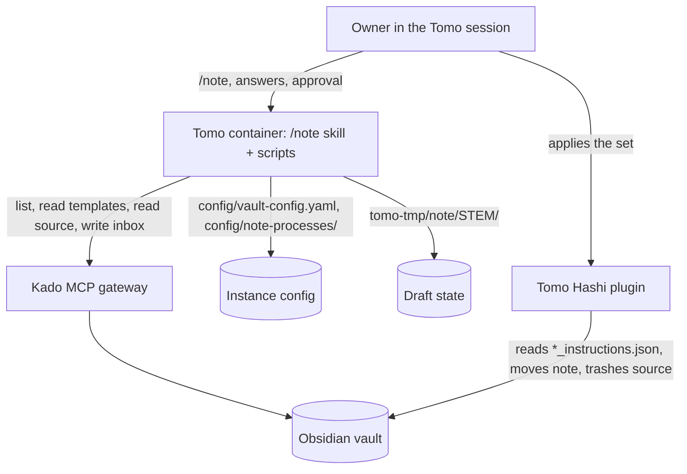
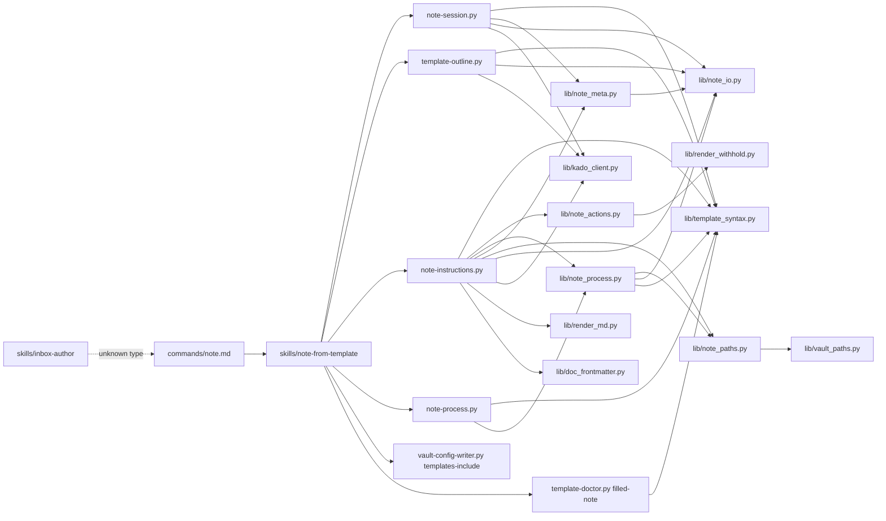
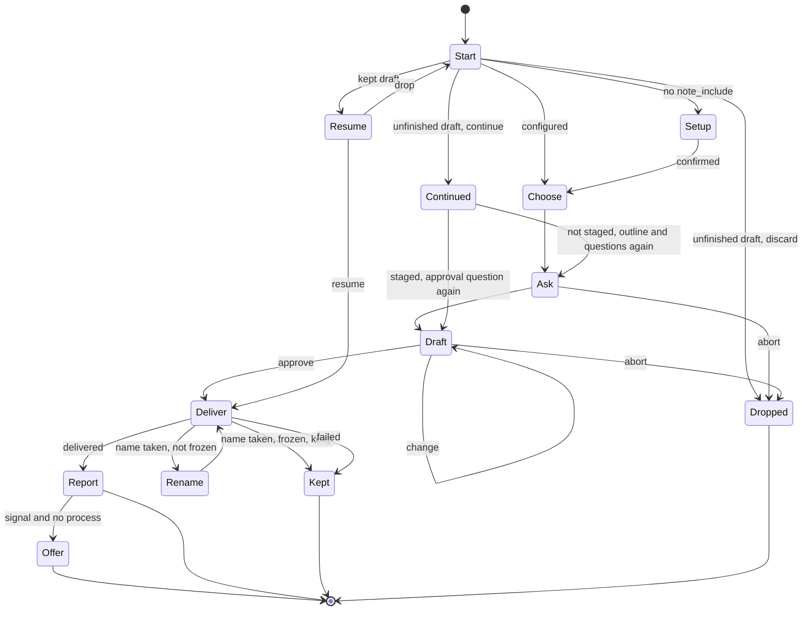

# Solution Design Document

## Validation Checklist

### CRITICAL GATES (Must Pass)

- [x] All required sections are complete
- [x] No [NEEDS CLARIFICATION] markers remain
- [x] Architecture pattern is clearly stated with rationale
- [x] **All architecture decisions confirmed by user**
- [x] Every interface has specification

### QUALITY CHECKS (Should Pass)

- [x] All context sources are listed with relevance ratings
- [x] Project commands are discovered from actual project files
- [x] Constraints → Strategy → Design → Implementation path is logical
- [x] Every component in diagram has directory mapping
- [x] Error handling covers all error types
- [x] Quality requirements are specific and measurable
- [x] Component names consistent across diagrams
- [x] A developer could implement from this design
- [x] Implementation examples use actual schema column names (not pseudocode), verified against migration files
- [x] Complex queries include traced walkthroughs with example data showing how the logic evaluates

---

## Constraints

- CON-1 **Runtime split.** Runtime prose in `tomo/dot_claude/` holds imperatives only; every WHY goes first to `docs/tomo/<mirrored-path>.md`. Every managed file carries `# version: X.Y.Z` and bumps it on each edit, or `update-tomo.sh` ships nothing. Scripts are Python 3 under `tomo/scripts/`, run as `python3 scripts/<name>.py` inside the instance; shared code lives in `tomo/scripts/lib/` because hyphenated scripts cannot be imported.
- CON-2 **Execution boundary.** Tomo writes to the vault only inside the inbox and only through Kado. It writes its own instance files under `config/` and `tomo-tmp/`. The note reaches its destination only when the user applies the instruction set in Hashi.
- CON-3 **Privacy (constitution L2).** Script stderr and logs carry paths, states, counts and error classes only. Script stdout carries the same, plus only the user-derived fields its output contract below names (the title and the paths built from it, a process file's destination, required points and guidance, template point names, leftover token names); never note text, source text or any other answer. `tests/test_note_privacy.py` holds the allowlist of those fields. Drafts in `tomo-tmp/note/` are removed on delivery, drop and abort.
- CON-4 **Interaction.** A question about a draft or a list (glob setup, several templates, question rounds, approval, process offer, process mode) with fixed options is an `AskUserQuestion` call that carries the content in every option's `preview`, copied from the tool result, never a dialog without it: the glob setup previews the globs and their match result, the approval previews the header and the full `note.md`, the process offer previews what would be saved. The template choice (at most three candidates plus Abort) and the process destination carry option descriptions instead. Free-text questions and longer candidate lists are plain text only: the content, then the numbered options as the last line, and the turn ends. Plain text is also the fallback when `AskUserQuestion` is not available and when the user says they cannot see the content. The answer is the dialog choice or a typed number or option word. Every other user decision goes through `AskUserQuestion`: at most four options (Other is added automatically) and four questions per call. Amended 2026-11-06: printing before an `AskUserQuestion` call failed live even as STRICT; 0.2.7 made these questions plain text, 0.2.10 added the dialog after the text and failed live (session 23125562: the content went into thinking only), 0.2.11 moves the content into the dialog's preview (see README Decisions Log).
- CON-5 **No eval-gated file changes.** `synthesis-conductor.md`, `suggestion-conductor.md`, `suggest-handling/SKILL.md`, `commands/inbox.md` and `settings.json` stay untouched. `settings.json` already allows `Bash(python3 scripts/*.py*)`, `Edit(config/*)`, `Edit(tomo-tmp/*)` and `mkdir -p tomo-tmp/*`.
- CON-6 **Wire.** The instruction set is the existing Hashi wire, with no new field and no schema bump. `schema_version` comes from `lib.wire_version.wire_schema_version("instructions.schema.json")`. `tomo/schemas/hashi-instructions.schema.json` is a mirror of Hashi's and is never edited.
- CON-7 **Kado.** An empty listing can hide a denial. `KadoClient` retries 429 and 503; a run needs about 12 to 14 calls, well below 20 per 5 s.

## Implementation Context

### Required Context Sources

#### Documentation Context

```yaml
- doc: docs/XDD/ideas/2026-11-02-note-from-template.md
  relevance: HIGH
  why: "Owner-approved brainstorm, the handoff contract"
- doc: docs/XDD/specs/044-note-from-template/requirements.md
  relevance: HIGH
  why: "Features F1-F9 and their criteria"
- doc: docs/XDD/specs/044-note-from-template/research.md
  relevance: HIGH
  why: "Evidence for every reuse claim in this design"
- doc: docs/instructions-json.md
  relevance: HIGH
  why: "User-facing description of the instruction set lifecycle"
- doc: docs/template-syntax.md
  relevance: MEDIUM
  why: "User-facing token and Templater rules the outline must respect"
- doc: evals/README.md
  relevance: MEDIUM
  why: "Case layout, no-leak grader, coverage table, RED-proof rule"
- doc: docs/tomo/dot_claude/skills/inbox-author.md
  relevance: MEDIUM
  why: "WHY entries for the write path and stem rule /note shares"
```

#### Code Context

```yaml
- file: tomo/scripts/kado-write-file.py
  relevance: HIGH
  why: "Exit-code contract (3 + EXISTS:) that note-instructions.py deliver keeps"
- file: tomo/scripts/lib/kado_client.py
  relevance: HIGH
  why: "list_dir, read_note, path_exists, write_note, read_frontmatter, write_frontmatter(mode=merge)"
- file: tomo/scripts/lib/doc_frontmatter.py
  relevance: HIGH
  why: "build_tomo_block (:87), merge_tomo_block_into_markdown (:172)"
- file: tomo/scripts/lib/render_md.py
  relevance: HIGH
  why: "render_instructions_md (:921) for the Markdown peer"
- file: tomo/scripts/lib/render_withhold.py
  relevance: HIGH
  why: "validate_destinations (:280), make_folder_listing (:37), withdraw_unjustified_deletes (:431)"
- file: tomo/scripts/lib/render_source_actions.py
  relevance: HIGH
  why: "Site 3 (:53-99): the move_note + depends_on delete_source precedent"
- file: tomo/scripts/mark-captured.py
  relevance: HIGH
  why: "The read/merge-write pattern (:172-190) the source mark mirrors"
- file: tomo/scripts/template-doctor.py
  relevance: HIGH
  why: "Mode dispatch (:370), _leading_block_lines, _extract_tokens, findings JSON"
- file: tomo/scripts/token-render.py
  relevance: HIGH
  why: "Token regex (:267), fence and Templater segmenting (:270-315)"
- file: tomo/scripts/vault-config-writer.py
  relevance: HIGH
  why: "Subcommand pattern (_run_section_command :212), validators, tests"
- file: tomo/scripts/read-config-field.py
  relevance: MEDIUM
  why: "--fields --format json returns absent keys as omitted"
- file: tomo/scripts/lib/obsidian_filename.py
  relevance: MEDIUM
  why: "sanitize_stem (:36)"
- file: tomo/scripts/inbox-triage.py
  relevance: MEDIUM
  why: "Skips captured and pending-move (:436-455); orphan warning (:1494-1534)"
- file: tomo/dot_claude/skills/inbox-author/SKILL.md
  relevance: MEDIUM
  why: "Unknown-type branch (:44-48) to redirect"
- file: tomo/dot_claude/commands/hashi-hook.md
  relevance: MEDIUM
  why: "Thin command that routes to a skill"
- file: tomo/schemas/hashi-instructions.schema.json
  relevance: HIGH
  why: "move_note and delete_source shapes; additionalProperties false"
```

#### External APIs

```yaml
- service: Kado MCP gateway
  doc: research.md#kado
  relevance: HIGH
  why: "All vault reads and inbox writes"
- service: Tomo Hashi
  doc: research.md#hashi-and-the-wire
  relevance: HIGH
  why: "Applies the instruction set; finds *_instructions.json in the inbox root"
```

### Implementation Boundaries

- **Must Preserve**: `/inbox` behaviour and every eval-gated file; the Hashi wire; the existing `vault-config-writer.py` subcommands; `inbox-author` for overviews, lists, comparisons, `.base`, `.canvas`, its built-in default and the mapped `default` template; the `kado-write-file.py` contract.
- **Can Modify**: `template-doctor.py` (new mode), `vault-config-writer.py` (new subcommand), `inbox-author/SKILL.md` step 2 unknown-type branch (only its "If found" path changes: found → point to `/note`; overviews, lists and comparisons find no template and keep the built-in default), user docs.
- **Must Not Touch**: `tomo/schemas/hashi-instructions.schema.json`, `tomo/dot_claude/settings.json`, the Pass 1 and Pass 2 scripts' behaviour, the owner's live instance `tomo-privat`.

### External Interfaces

#### System Context Diagram



#### Interface Specifications

```yaml
inbound:
  - name: "/note command"
    type: Claude Code slash command
    format: "$ARGUMENTS free text; a leading --process selects the process dialogue"
    authentication: none (local session)
    data_flow: "Request text or an inbox note path"

outbound:
  - name: "Kado"
    type: MCP over HTTP via tomo/scripts/lib/kado_client.py
    format: JSON
    authentication: bearer key from the instance
    data_flow: "List and read templates, read the source, write three inbox files, merge one frontmatter block"
    criticality: HIGH

data:
  - name: "vault-config.yaml"
    type: YAML file in the instance
    connection: yaml.safe_load in note-session.py, template-outline.py and note-instructions.py (one reader in lib/note_io); vault-config-writer.py writes
    data_flow: "templates.base_path, templates.mapping.daily, templates.note_include, concepts.inbox, concepts.atomic_note.path"
  - name: "config/note-processes/<template-stem>.md"
    type: Markdown with YAML frontmatter in the instance
    connection: note-process.py
    data_flow: "Per-template destination, required points, guidance, offer flag"
  - name: "tomo-tmp/note/<stem>/"
    type: files in the instance
    connection: note-instructions.py (owner), template-outline.py --stage writes template.md and outline.json, the skill writes draft.md
    data_flow: "Draft, resolved note.md, staged template, outline.json, staged source, meta.json"
```

### Cross-Component Boundaries

- **API Contracts**: the Hashi instruction wire (unchanged); the `kado-write-file.py` exit-code contract (reused, unchanged).
- **Team Ownership**: Tomo owns everything built here. Hashi owns the wire schema and the executor. Kado owns the gateway.
- **Shared Resources**: the inbox folder (shared with `/inbox`, Pass 2 and Hashi); `vault-config.yaml` (shared with every Tomo command).
- **Breaking Change Policy**: none expected. An informational handoff to Hashi is optional (PRD Could Have).

### Project Commands

```bash
Install: ./venv/bin/pip install -r requirements.txt   # existing venv; tests run under ./venv/bin/python
Test:    ./venv/bin/python -m pytest tests/ -q --deselect tests/ide_bridge/test_configure_ide_bridge.py::test_install_smoke_ide_bridge_block_exists
Lint:    ./venv/bin/ruff check tomo/scripts tests
Eval:    scripts/run-evals.sh --keep-temp            # paid; owner's explicit instruction only; run outside the sandbox
Sync:    ./scripts/update-tomo.sh --instance tomo-instance --yolo   # owner runs it, from main
```

## Solution Strategy

- **Architecture Pattern:** A thin command, one dialogue skill and four deterministic scripts over shared library modules (`lib/template_syntax`, `lib/note_meta`, `lib/note_process`, `lib/note_actions`, `lib/note_paths`, and `lib/note_io`). The model holds the conversation and writes the note text; scripts own everything that must be exact: argument parsing, template listing and pattern matching, outlines, draft state, config writes, process files, the instruction set, the write order and the resume comparison.
- **Integration Approach:** Reuse the Pass 2 building blocks in process (`build_tomo_block`, `merge_tomo_block_into_markdown`, `validate_destinations`, `withdraw_unjustified_deletes`, `render_instructions_md`, `KadoClient`) and the Pass 2 wire shape (move plus dependent delete). Add one writer subcommand and one `template-doctor.py` mode. Redirect one branch of `inbox-author`.
- **Justification:** The brainstorm chose approach A (model fills, script delivers) because any normal template works without Tomo tokens. Putting the session start and the delivery in scripts follows the repo rule that agents use scripts, never freehand structured output, and makes the order, the resume and the pattern preview testable without a model.
- **Key Decisions:** ADR-1 to ADR-8 below, all confirmed by the owner on 2026-11-04.

## Building Block View

### Components



| Component | Owns | PRD |
|---|---|---|
| `commands/note.md` | Entry point; routes to the skill with `$ARGUMENTS` | F1-F8 entry |
| Skill `note-from-template` | The dialogue: pattern proposal, template choice among candidates, filled/open judgement, question rounds, draft text and revisions, process offer signals, report wording | F1-F4, F7 dialogue parts |
| `note-session.py` | Session start: argument mode, kept drafts, `note_include` presence, template candidates, pattern preview | F1 preview, F2 candidate list, F6 kept-draft listing |
| `template-outline.py` | Reading one template and returning its points | F3 point list |
| `note-instructions.py` | Draft lifecycle (`new`, `stage`, `deliver`, `drop`) and the delivery order, collisions, resume, source mark, report data | F4 staging, F5, F6 |
| `note-process.py` | CLI over `lib/note_process.py`: `read`, `write`, `decline` | F7 storage |
| `vault-config-writer.py templates-include` | Writing `templates.note_include` only; with it present every other reader keeps working | F1 save, F1-AC5 |
| `template-doctor.py filled-note` | Manual and test entry point to the filled-note check; the flow runs the same check inside `stage` and `deliver` | F3-AC7 |
| `lib/template_syntax.py` | Frontmatter block, tokens, Templater spans, headings, filled-note checks | shared parsing |
| `lib/note_actions.py` | Building and guarding the instruction set | F5 wire |
| `lib/note_meta.py` | Reading and writing `meta.json`; listing stage directories | F6 state, shared by `note-session.py` and `note-instructions.py` |
| `lib/note_process.py` | Parsing and writing process files, decline markers, `missing_required`; keeps its own leading-fence split (str.splitlines, so CR-only and Unicode line breaks are read), a recorded exception to ADR-4 | F7 storage, shared by `note-process.py` and `note-instructions.py new` |
| `lib/note_paths.py` | Vault folder, note path and title character rules (`vault_folder`, `vault_note`, `is_inside`, `has_unsafe_char`, `has_template_syntax`) on `lib/vault_paths.path_key` | F4, F5, F7 input rules, shared by `note-instructions.py` and `lib/note_process.py` |
| `lib/note_io.py` | Shared `load_vault_config` with `ConfigError`, and `atomic_write_text` | One config reader for `note-session.py`, `template-outline.py` and `note-instructions.py`; one atomic write for those and `lib/note_meta.py`, `lib/note_process.py` |
| `lib/render_md.py` change | `templater_hint` render-config key (default on) that `deliver` switches off | F5 MD peer; Pass 2 output unchanged |
| `inbox-author` change | Redirect of the unknown-type branch when it finds a template | F8 |
| Triage interplay tests | Proving the next `/inbox` and `/inbox --recover` treat `/note` files correctly; no triage code changes | F5-AC5, F9-AC2 |
| Docs | `docs/usage.md` section, troubleshooting line, `docs/tomo/` mirrors | F9 |

### Directory Map

**Component**: runtime (synced to the instance)
```
tomo/
├── dot_claude/
│   ├── commands/
│   │   └── note.md                                # NEW: thin command, routes to the skill
│   └── skills/
│       ├── note-from-template/
│       │   └── SKILL.md                           # NEW: dialogue flow, imperatives only
│       ├── tomo-note-view/                        # NEW (2026-11-06): draft view pane mod, see Draft view pane
│       │   ├── dot_claude-plugin/plugin.json      # installed as .claude-plugin/plugin.json
│       │   ├── hooks/hooks.json
│       │   ├── hooks/register.tsx
│       │   ├── hooks/register.test.tsx
│       │   └── types/index.d.ts
│       └── inbox-author/
│           └── SKILL.md                           # MODIFY: unknown-type branch points to /note; 0.3.0 → 0.4.0
├── scripts/
│   ├── note-session.py                            # NEW: start, match
│   ├── template-outline.py                        # NEW: outline of one template
│   ├── note-instructions.py                       # NEW: new, stage, deliver, drop
│   ├── note-process.py                            # NEW: read, write, decline
│   ├── template-doctor.py                         # MODIFY: filled-note mode; 0.3.0 → 0.4.0
│   ├── vault-config-writer.py                     # MODIFY: templates-include subcommand; 0.4.0 → 0.5.0
│   └── lib/
│       ├── template_syntax.py                     # NEW: shared template and note parsing
│       ├── note_meta.py                           # NEW: meta.json and stage directories
│       ├── note_process.py                        # NEW: process file parsing and writing (own leading-fence split, see ADR-4 note)
│       ├── note_paths.py                          # NEW: vault folder, note path and title rules (on lib/vault_paths)
│       ├── note_io.py                             # NEW: shared load_vault_config + ConfigError, atomic_write_text
│       ├── note_actions.py                        # NEW: instruction set build and guards
│       └── render_md.py                           # MODIFY: templater_hint render-config key, default on
└── schemas/
    ├── vault-config-templates.schema.json         # NEW: documents templates.note_include
    └── note-process.schema.json                   # NEW: documents the process file frontmatter
```

**Component**: documentation and tests (host only)
```
docs/
├── usage.md                                       # MODIFY: /note section, discard steps (F9)
├── troubleshooting.md                             # MODIFY: template folder needs read access
└── tomo/
    ├── dot_claude/commands/note.md                # NEW: WHY
    ├── dot_claude/skills/note-from-template.md    # NEW: WHY
    ├── dot_claude/skills/inbox-author.md          # MODIFY: WHY of the redirect
    └── scripts/
        ├── note-session.md                        # NEW
        ├── template-outline.md                    # NEW
        ├── note-instructions.md                   # NEW
        ├── note-process.md                        # NEW
        ├── template-doctor.md                     # NEW: WHY of the filled-note mode (no mirror exists yet)
        ├── vault-config-writer.md                 # MODIFY: WHY of templates-include
        └── lib/
            ├── template_syntax.md                 # NEW
            ├── note_meta.md                       # NEW
            ├── note_process.md                    # NEW
            ├── note_actions.md                    # NEW
            ├── note_paths.md                      # NEW
            ├── note_io.md                         # NEW
            └── render_md.md                       # MODIFY: WHY of templater_hint
tests/
├── test_template_syntax.py                        # NEW
├── test_note_session.py                           # NEW
├── test_template_outline.py                       # NEW
├── test_note_instructions.py                      # NEW
├── test_note_actions.py                           # NEW
├── test_note_process.py                           # NEW
├── test_note_process_lib.py                       # NEW: lib/note_process.py
├── test_note_meta.py                              # NEW: lib/note_meta.py
├── test_note_paths.py                             # NEW: lib/note_paths.py
├── test_note_io.py                                # NEW: lib/note_io.py
├── test_note_privacy.py                           # NEW: CON-3 allowlist, marker strings never in stderr nor outside the allowlist on stdout
├── note_fake_vault.py                             # NEW: helper, fake Kado vault shared by the /note tests
├── test_note_triage_interplay.py                  # NEW: next /inbox and --recover on /note files
├── test_note_skill_prose.py                       # NEW: prose contract of the skill and command
├── test_read_config_field.py                      # MODIFY or NEW: note_include present and absent
├── test_note_processes_survive.py                 # NEW: backup, restore and update-tomo.sh leave config/note-processes/ alone
├── test-vault-config-writer.py                    # MODIFY: templates-include cases
├── test_template_doctor.py                        # MODIFY: filled-note mode
├── test_backup_restore_instance.py                # MODIFY: config/note-processes/ survives
└── test_inbox_author_pipeline.py                  # MODIFY: redirect of the unknown-type branch
evals/
├── _lib/note-stubs.sh                             # NEW: stub kit for the /note scripts
├── note-draft-before-approval/                    # NEW: one paid case (ADR-8)
└── README.md                                      # MODIFY: coverage table row, marked not gated
```

### Interface Specifications

#### Interface Documentation References

```yaml
interfaces:
  - name: "Hashi instruction wire"
    doc: tomo/schemas/hashi-instructions.schema.json
    relevance: CRITICAL
    sections: [move_note, delete_source, top-level required]
    why: "The set /note emits must validate unchanged"
  - name: "kado-write-file exit contract"
    doc: tomo/scripts/kado-write-file.py docstring :1-52
    relevance: HIGH
    sections: [exit codes, EXISTS line]
    why: "deliver keeps exit 3 + EXISTS:<vault-path>"
  - name: "doc frontmatter"
    doc: tomo/schemas/doc-frontmatter.schema.json
    relevance: HIGH
    sections: [rendered-note, source]
    why: "rendered-note/pending-move and source/captured blocks"
```

#### Data Storage Changes

```yaml
File: config/vault-config.yaml (instance)
  ADD KEY: templates.note_include (list of filename globs, at least one, each a non-empty string)
  UNCHANGED: templates.base_path, templates.mapping, templates.custom_tokens and every byte outside the note_include lines

Directory: config/note-processes/ (instance, NEW, optional)
  File: <template-stem>.md
    frontmatter:
      destination: vault folder path ending in "/" (optional)
      required: list of point names (optional)
      offer: "never" (optional; when present alone the file is a decline marker)
    body: free guidance text (optional)

Directory: tomo-tmp/note/<stem>/ (instance, transient)
  template.md   staged template with identity and date tokens pre-filled (template-outline.py --stage)
  outline.json  the template-outline.py output for that template (template-outline.py --stage)
  source.md     staged source body when the source is an inbox note
  draft.md      the note as the model last wrote it (keeps {{source_link}} as written)
  note.md       draft.md with {{source_link}} resolved from keep_source; rewritten by every stage, printed by the skill
  meta.json     see Application Data Models
```

#### Internal API Changes

All scripts print one JSON object on stdout and nothing else (the one exception is the `EXISTS:` first line of `deliver` exit 3). They exit 0 whenever the output is usable, including "nothing found" (repo rule: an agent-called script exits 0 for usable output). Text in stderr is diagnostics without user content: it names the problem class only. Exit 2 is always a bad invocation; the cases each script counts as one are named below.

```yaml
Script: note-session.py start
  Args: --args="<$ARGUMENTS verbatim>"   # the = form is required: a text starting with --process would otherwise be read as an option
  Output:
    mode: "note" | "process"   # the request text is never echoed (CON-3); the skill keeps $ARGUMENTS
    process_template: string   # stem after --process (one pair of surrounding quotes and one trailing .md removed), empty when none
    process_template_path: string  # vault path of that stem in templates.base_path, whatever note_include says; empty when not found
    include_configured: bool
    note_include: [string]     # empty when not configured
    kept_drafts: [{stem, title, template, created, failed_step, steps_done, frozen}]   # steps_done: landed steps in order; frozen: title and destination can no longer change (is_frozen); started deliveries: failed_step set or steps_done non-empty (failed_step empty when the run was killed between steps)
    unfinished_drafts: [{stem, title, template, created, source_path, staged}]   # readable meta.json with neither failed_step nor steps_done: a dialogue or approval that never ended; staged: note.md exists and a title is recorded (the draft was printed); the skill offers Continue / Discard for each (F6-AC7)
    stale_stages: [stem]       # stage dirs whose meta.json is missing or unreadable; the skill says so in one line and drops them
    candidates: [{path, stem}] # templates matching note_include, daily excluded; empty when not configured, and for a --process run with an empty stem (no listing call)
    folder_listed: int         # .md files the listing returned, before matching
    listing_error: string      # Kado error text, empty when none
  Exit: 0 usable; 2 bad invocation

Script: note-session.py match
  Args: --globs "<g1>,<g2>"
  Output:
    matched: [stem], unmatched: [stem], excluded_daily: string, folder_listed: int, listing_error: string
  Exit: 0; 2 bad invocation or empty glob list

Script: template-outline.py
  Args: --template <vault path> [--stage <stem>] [--out <file>]   (or --local <file> for tests)
  Effect: with --stage, writes tomo-tmp/note/<stem>/template.md (prefilled tokens resolved) and tomo-tmp/note/<stem>/outline.json;
          with --out, writes the outline JSON to that file (the --process mode uses tomo-tmp/note/process-outline.json)
  Output:
    template: string
    frontmatter: [{key, has_value, line}]
    headings: [{level, text, line, has_body}]
    tokens: [{name, line, prefilled}]
    templater: [{line, text}]
    frontmatter_ok: bool       # false when the leading fence is missing or unclosed
  On exit 1 or a stage/write problem stdout is {template, error}; error names the error class and the Kado message, never template text
  Exit: 0 usable (also when frontmatter_ok is false); 1 template unreadable (Kado error, missing local file, no text);
        2 bad invocation, an unusable stage meta.json, or a local write failure

Script: note-instructions.py new
  Args: --template <vault path> [--source <inbox note path>]
  Effect: draws the stem, the run id and the generated timestamp; reads concepts.inbox, concepts.atomic_note.path
          (first entry when it is a list named paths) and the profile from vault-config.yaml; reads the process
          file through lib/note_process.py for the destination; creates tomo-tmp/note/<stem>/, stages source.md, writes meta.json
  Rule: --template and --source must be relative vault paths ending in .md (lib/note_paths.vault_note: no leading / or ~,
        no drive letter, no backslash, no control or invisible character, no {{ or <%, no blank or dot-leading segment);
        --source must lie inside concepts.inbox (lib/note_paths.is_inside); concepts.inbox and concepts.atomic_note must be
        relative vault folders (lib/note_paths.vault_folder); a broken process file is ignored (one stderr line) and the
        atomic-note path is the default destination
  Output: {stem, run_id, default_destination, inbox}
  Exit: 0; 1 Kado error reading the source; 2 bad invocation: an unusable vault-config.yaml (unreadable, not a mapping,
        concepts.inbox or concepts.atomic_note not a relative vault folder), a --template or --source that is not a
        relative .md path, a --source outside concepts.inbox, a template name that cannot name a process file, or local I/O

Script: note-instructions.py stage
  Args: --stem <stem> [--title <t>] [--destination <folder>] [--keep-source true|false]
  Effect: updates meta.json; writes note.md (draft.md with every {{source_link}} resolved from keep_source; draft.md unchanged); runs the filled-note checks on note.md
  Rule: --title is refused when it contains a control or invisible character (Unicode Cc, Cf, Zl, Zp; U+200C and U+200D are
        allowed), when it is blank, when it starts with a dot, or when it contains {{ or <%; trailing dots and spaces are
        stripped first; --destination must be a relative vault folder (lib/note_paths.vault_folder, stored with one trailing /)
  Rule: a missing draft.md is reported as check {ok: false, findings: [{check: draft_present, status: FAIL}]} and note.md is removed
  Output: {stem, title, inbox_file, destination_file, keep_source, frozen, check: {ok, findings[]}}
          # inbox_file and destination_file are empty until a title is staged
  Rule: once steps_done is non-empty or failed_step names a delivery step (its upload may have landed; kado_config does not count), title and destination are frozen; once instructions_json is in steps_done or is failed_step, keep_source is frozen too; a change is refused with frozen: true
  Exit: 0 (findings reported in output); 2 bad invocation: unknown or malformed stem, an unusable meta.json, a refused --title or --destination

Script: note-instructions.py deliver
  Args: --stem <stem>
  Effect: resolves {{source_link}} in draft.md from meta (as stage does), reruns the filled-note check on the result and refuses on FAIL;
          then the ordered delivery in the example below, uploading the resolved text
  Output:
    status: "delivered" | "exists" | "failed" | "withdrawn"
    step: "kado_config" | "note" | "instructions_json" | "instructions_md" | "source_mark" | ""
    # kado_config: no Kado URL or token resolvable (KadoClient() raised); recorded as failed_step, nothing written.
    # A Kado outage passes the constructor and fails at step note.
    note_path, instructions_json, instructions_md: string
    source_marked: bool
    steps_done: [string]       # meta.json's steps_done when the run ended; names the files a Drop leaves behind
    frozen: bool               # is_frozen on meta.json when the run ended; true means title and destination can no longer change (also true with steps_done empty when the first upload was in flight)
    exists_path: string        # set when status is exists
    # delivered with source_marked false: no source, or the source vanished before the mark
  Stdout first line on a collision: EXISTS:<vault-path>
  Exit: 0 delivered; 1 Kado or guard failure (Kado config missing: status failed, step "kado_config"),
        or a failing filled-note check, a missing draft.md or a failed frontmatter stamp (status failed, step "", nothing recorded);
        2 bad invocation (unknown or malformed stem, an unusable meta.json, no title staged), or meta.json could not be written (no JSON then); 3 name taken

Script: note-instructions.py drop
  Args: --stem <stem>
  Effect: removes tomo-tmp/note/<stem>/
  Output: {stem, removed: bool}
  Exit: 0; 2 malformed stem

Script: note-process.py read | write | decline
  read:    --template <stem> [--outline <file>] → {exists, declined, destination, required, guidance, missing_required[], error}
  write:   --template <stem> --outline <outline.json> [--destination] [--required <point>]... (repeatable, one point per flag; names may contain commas) [--guidance-file f] → {written, rejected_required[]}
  decline: --template <stem> → {written}
  Rule: --destination must be a relative vault folder by lib/note_paths.vault_folder, the rule note-instructions.py uses, and is
        stored with one trailing /; a refused one exits 2 and nothing is written. A stored destination the rule refuses makes
        read report error. A destination:, offer: or required: key with no value (YAML null) reads as unset; a present
        non-null invalid value still reads as a broken file.
  Exit: 0 usable (a broken file reads as {exists: true, error: "..."}); 1 write rejected (a required point not in the outline);
        2 bad invocation: malformed stem, destination, outline or guidance file, or a write failure

Subcommand: vault-config-writer.py templates-include
  Args: --input <json file: {"note_include": [..]}> [--config config/vault-config.yaml] [--stdout]
  Exit: 0 written; 1 invalid input or result YAML; 2 I/O or arg error

Mode: template-doctor.py filled-note
  Args: filled-note --note <file>
  Output: {mode: "filled-note", note, ok, findings[{check, status, detail, fix}]}
  Checks (from lib/template_syntax.filled_note_check): leading fence present (leading_fence) and closed (frontmatter_closed); no user-authored tomo: key (no_user_tomo_key); no "<%" left (no_templater); every code fence closed (code_fence_closed); no "{{token}}" left outside fences (no_tokens)
  Parser: --template is required today for every non-scaffold mode (template-doctor.py:368-380); filled-note takes --note instead
  Exit: 0 no FAIL; 1 FAIL or file missing; 2 bad invocation
```

#### Application Data Models

```pseudocode
ENTITY: NoteDraftMeta (NEW) — tomo-tmp/note/<stem>/meta.json, owned by note-instructions.py
  FIELDS:
    stem: string              # "YYYY-MM-DD_HHMMSS", drawn from the clock by the script
    run_id: string            # from lib/run_id.generate()
    created: ISO string
    generated: ISO string     # fixed at new; every deliver reuses it so a resume rebuilds identical files
    template: string          # vault path
    template_stem: string
    source_path: string|null  # inbox note path, null for text-in-call
    title: string
    inbox_file: string        # "<inbox>/<stem>_<sanitize_stem(title)>.md"
    destination: string       # folder; default concepts.atomic_note.path or the process file's
    default_destination: string
    profile: string|null      # from vault-config at new; every deliver reuses it so a resume rebuilds identical files
    keep_source: bool         # default false
    steps_done: [string]      # subset of note, instructions_json, instructions_md, source_mark
    failed_step: string       # empty when none; one of steps_done's steps or kado_config (no Kado config, never a done step)
  BEHAVIORS:
    destination_file(): destination + sanitize_stem(title) + ".md"
    instructions_stem(): stem + "_instructions"

ENTITY: TemplateOutline (NEW) — output of template-outline.py, not stored
  FIELDS: see Internal API Changes
  RULE: a point is a heading, a frontmatter key or a token with prefilled false

TABLE: Token syntaxes in a template
  {{name}} matching token-render.py's _TOKEN_RE (:267) outside fenced code; a backslash before {{ makes it literal  → token
  <% ... %>, <%* ... %>, <%- ... %> (DOTALL)                                → Templater hint, never a point, never executed
  everything else (Dataview, callouts, wikilinks)                           → body text
TABLE: Prefilled tokens (resolved by the script, not points)
  generated:       uuid, datestamp, updated, date_iso         (token-render.py values)
  config-sourced:  locale, vault, vault_version, profile      (vault-config values)
  source metadata: source_path, source_link                   (only when the source is an inbox note)
    source_link is left as {{source_link}} in template.md and draft.md; note-instructions.py stage resolves it into note.md from keep_source:
    [[<source stem>]] when the source is kept, empty text when it will be deleted or there is no source (a link to a deleted note would dangle);
    deliver resolves draft.md the same way
  every other token, known or not (title, tags, body, up, summary, custom), is a point the model fills

ENTITY: ProcessFile (NEW) — config/note-processes/<template-stem>.md
  FIELDS: destination?, required?, offer?, body (guidance)
  RULE: offer "never" with no other field is a decline marker; read() reports declined true and no process

ENTITY: NoteInstructionSet (NEW producer, existing wire)
  FIELDS:
    schema_version: wire_schema_version("instructions.schema.json")
    type: "tomo-instructions"
    generated: ISO string
    profile: from vault-config
    md_peer: instructions_stem()
    actions:
      - {id: "I01", action: "move_note", source: inbox_file, destination: destination_file(),
         title, rendered_file: basename(inbox_file), source_inbox_item: source_path}
      - {id: "I02", action: "delete_source", source_path, reason: "Replaced by a /note note",
         depends_on: ["I01"]}            # only when source_path and not keep_source
```

#### Integration Points

```yaml
- from: note-from-template skill
  to: scripts
  protocol: Bash "python3 scripts/<name>.py ..." with JSON on stdout
  data_flow: "Arguments in; JSON out; draft.md written by the skill with the Write tool"

- from: note-instructions.py / note-session.py / template-outline.py
  to: Kado
  protocol: lib/kado_client.KadoClient in process
  endpoints: list_dir, read_note, path_exists, write_note, read_frontmatter, write_frontmatter(mode=merge)
  data_flow: "Template listing and bodies, source body, three inbox writes, one frontmatter merge"

Hashi:
  - doc: research.md#hashi-and-the-wire
  - integration: "Finds <stem>_instructions.json flat in the inbox, applies move_note, then delete_source after I01 applied"
  - critical_data: [move_note.source, move_note.destination, delete_source.source_path, depends_on]
```

### Implementation Examples

#### Example: Delivery order with resume

**Why this example**: the order, the collision handling and the resume comparison are the parts a reviewer must be able to check against the PRD without a model.

```python
# Guidance only. note-instructions.py deliver, in process.
STEPS = ["note", "instructions_json", "instructions_md", "source_mark"]

def stable_block(doc_type, state, meta):                       # updated_at = meta.generated, so a rebuild is byte-identical
    block = build_tomo_block(doc_type, state, meta.run_id); block["updated_at"] = meta.generated; return block

def deliver(meta, client):
    if not meta.title: usage_error()                            # exit 2, no title staged
    resolved = resolve_source_link(read(draft), meta)           # {{source_link}} resolved in draft.md, as stage does
    if resolved is None or not filled_note_check(resolved).ok:  # missing draft.md or a FAIL: script gate, not skill ordering
        return failed(meta, step="")                            # exit 1
    note_text = merge_tomo_block_into_markdown(resolved, stable_block("rendered-note", "pending-move", meta))
                                                                # FrontmatterMergeError → failed(meta, step=""), exit 1
    try: client = KadoClient()
    except KadoError: return failed(meta, "kado_config")       # missing URL/token only; failed_step recorded; the resume reruns from scratch
    actions = build_note_actions(meta)                          # lib/note_actions
    kept, clashes = validate_destinations(actions, make_folder_listing(client))
    kept, _ = withdraw_unjustified_deletes(kept)
    if clashes:  return exists(meta, clashes[0]["destination"]) # destination taken → exit 3, nothing written
    if kept != actions: return withdrawn_status(meta)           # exit 1: never deliver a set the guards cut
    md = render_instructions_md(kept, {"generated": meta.generated, "profile": meta.profile},
                                {"templater_hint": False})      # no run_id: deliver stamps the peer itself
    payloads = {"note": note_text,
                "instructions_json": dump(wire(meta, kept)),
                "instructions_md": merge_tomo_block_into_markdown(md, stable_block("instructions", "pending-apply", meta))}
    for step in STEPS[:3]:                                      # every target is re-probed, also on resume
        path = target(meta, step)
        try:
            if client.path_exists(path):
                if not same_text(client, path, payloads[step]): # only a trailing newline is normalised
                    return exists(meta, path, step)             # exit 3, "EXISTS:<path>" first line
            elif step not in meta.steps_done:
                mark_in_flight(meta, step)                      # failed_step = step, meta.json written: a landed but
                                                                # unrecorded upload is a kept draft, never unfinished
                upload(client, path, payloads[step])            # write_note for .md, write_file(bytes) for .json
            # absent but recorded in steps_done: not rewritten (the user removed it after it landed)
        except KadoError: return failed(meta, step)             # failed_step recorded; later steps never run
        mark_done(meta, step)                                   # meta.json written after every step; clears failed_step
    marked = False
    if meta.source_path:
        try:
            if "source_mark" in meta.steps_done:
                marked = carries_mark(client, meta)             # re-check: tomo.state captured with this run_id
            else:
                fm = client.read_frontmatter(meta.source_path)
                if fm.get("modified") is None: raise UnguardedMarkError()
                client.write_frontmatter(meta.source_path, {"tomo": build_tomo_block("source", "captured", meta.run_id)},
                                         mode="merge", expected_modified=fm["modified"])
                marked = True
        except KadoNotFoundError: marked = False                # source deleted or moved: the step counts as done
        except (KadoError, UnguardedMarkError): return failed(meta, "source_mark")
        mark_done(meta, "source_mark")
    remove_stage_dir(meta)                                      # success leaves no draft
    return delivered(meta, source_marked=marked)
```

Traced walkthrough, source `100 Inbox/Meeting raw.md`, title "Design review", stem `2026-11-04_173005`:

| Run | State before | Step results | Output |
|---|---|---|---|
| 1 | nothing in the inbox | note written, JSON write raises Kado 503 after retries | `failed`, step `instructions_json`; `steps_done=[note]`; source untouched |
| 2 (resume) | note present, identical | note: exists + identical → done; JSON, MD written; source merged | `delivered`, `source_marked: true`; stage dir removed |
| 2' (resume, user edited the note in Obsidian meanwhile) | note present, different | note: exists + different | exit 3, `EXISTS:100 Inbox/2026-11-04_173005_Design review.md`, `frozen: true` → skill offers keep or drop |
| 1' | `Atlas/Meetings/Design review.md` exists | `validate_destinations` clash before any write | exit 3, `EXISTS:Atlas/Meetings/Design review.md`; nothing written |
| 2'' (resume, user deleted the landed note meanwhile) | note absent, `note` in `steps_done` | note: absent and recorded → not rewritten; JSON, MD written; source merged | `delivered`, `source_marked: true` |
| 1'' | source deleted or moved in Obsidian after the dialogue | note, JSON, MD written; `read_frontmatter` raises `KadoNotFoundError` | `delivered`, `source_marked: false`; stage dir removed; the report says the source was not marked |
| 3 (resume after a run killed between recording the mark and removing the stage) | `source_mark` in `steps_done` | the three targets identical → done; mark re-checked (`tomo.state: captured`, same `run_id`) | `delivered`, `source_marked` from the re-check |

#### Example: Pattern preview on a first run

**Why this example**: the owner's own scheme must come out right, and the daily exclusion must hold even when a glob matches it.

Template folder `Templates/` lists `t_meeting.md`, `t_problem.md`, `t_day_privat.md`, `i_alias.md`, `a_archive.md`; `templates.mapping.daily = t_day_privat`.

| Proposed globs | matched | unmatched | excluded_daily |
|---|---|---|---|
| `t_*` | t_meeting, t_problem | i_alias, a_archive | t_day_privat |
| `t_meeting`, `t_problem` | t_meeting, t_problem | i_alias, a_archive | t_day_privat |
| `*` | t_meeting, t_problem, i_alias, a_archive | — | t_day_privat |

Globs match the basename without `.md`, case-sensitively (`fnmatch.fnmatchcase`).

#### Test Examples as Interface Documentation

```python
def test_deliver_resume_identical_note_counts_as_done(fake_kado, staged_meta):
    fake_kado.files[staged_meta.inbox_file] = stamped(staged_meta)   # note landed in run 1
    out = run_deliver(staged_meta.stem)
    assert out["status"] == "delivered"
    assert fake_kado.writes == [instr_json(staged_meta), instr_md(staged_meta)]   # no rewrite of the note
    assert fake_kado.frontmatter_merges == [(staged_meta.source_path, "captured")]

def test_deliver_never_overwrites_different_note(fake_kado, staged_meta):
    fake_kado.files[staged_meta.inbox_file] = "other text"
    proc = run_deliver_proc(staged_meta.stem)
    assert proc.returncode == 3 and proc.stdout.splitlines()[0] == f"EXISTS:{staged_meta.inbox_file}"
    assert fake_kado.files[staged_meta.inbox_file] == "other text"
    assert fake_kado.frontmatter_merges == []
```

## Runtime View

### Primary Flow

#### Primary Flow: `/note` from an inbox note

1. User runs `/note meeting notes from 100 Inbox/Meeting raw.md`.
2. Skill runs `note-session.py start`. A kept draft (Resume / Drop) and then an unfinished draft (Continue / Discard) are offered first. With no `note_include`, the first-run setup runs.
3. Skill picks among `candidates` (asks when several fit) and runs `note-instructions.py new --template ... --source ...`, then `template-outline.py --template ... --stage <stem>`.
4. Skill reads `template.md`, `source.md` and the process file (`note-process.py read`), prints which points the material covers, and asks open points in at most two rounds, then required points again.
5. Skill writes `draft.md`, runs `note-instructions.py stage`, and prints the header line and `note.md` (never `draft.md`).
6. User revises in dialogue; each revision rewrites `draft.md`, reruns `stage` and reprints `note.md`.
7. On approval the skill runs `note-instructions.py deliver` and prints the report from its output.
8. When the session showed an offer signal and the template has no process file, the skill asks save, not now or never. On save it regenerates the outline with `template-outline.py --template <path> --out tomo-tmp/note/process-outline.json`, because `deliver` removed the stage and its `outline.json`.

```mermaid
sequenceDiagram
    actor User
    participant Skill as note-from-template
    participant S as note-session.py
    participant O as template-outline.py
    participant N as note-instructions.py
    participant P as note-process.py
    participant K as Kado
    User->>Skill: /note ...
    Skill->>S: start --args
    S->>K: list templates.base_path
    S-->>Skill: candidates, kept_drafts, unfinished_drafts, include_configured
    Skill->>N: new --template --source
    N->>K: read source
    Skill->>O: --template --stage
    O->>K: read template
    O-->>Skill: outline
    Skill->>P: read --template --outline outline.json
    Skill->>User: covered points, questions (≤2 rounds)
    User-->>Skill: answers
    Skill->>N: stage --stem
    Skill->>User: header + note.md
    User-->>Skill: approve
    Skill->>N: deliver --stem
    N->>K: guards, 3 writes, frontmatter merge
    N-->>Skill: delivered, paths
    Skill->>User: report; process offer if signalled
```

### Error Handling

- **Template folder empty or unreadable** (`folder_listed == 0`): the skill says the folder is empty or not readable by the Kado key, tells the user to either grant the key read access to `templates.base_path` or not use `/note`, and stops; it never says that no template exists. A `listing_error` is shown verbatim.
- **No candidate fits**: the skill offers adjust patterns, `inbox-author`, abort.
- **Template unreadable** (`template-outline.py` exit 1): the skill names the template and shows the error verbatim, says the key may lack read access and gives the same remedy (grant read access to `templates.base_path` or do not use `/note`), then offers another candidate or abort.
- **Template without frontmatter** (`frontmatter_ok: false`): the skill drafts with a frontmatter block anyway; `stage` reports the filled-note result.
- **Broken process file** (`error` set): one line saying it is ignored and why; continue with the template alone.
- **Required point missing from the template**: one line naming it; continue without it.
- **Input refused** (exit 2 of `new` or `stage` whose error starts with `note-instructions: --title`, `note-instructions: --destination` or `note-instructions: --source`: a `--source` outside `concepts.inbox`, a title that is blank, starts with a dot, holds an invisible character or `{{`/`<%`, a destination that is not a relative vault folder): the skill names what was refused and asks for another value; nothing is staged. Any other exit 2 of `new` or `stage` (config, local I/O, stem or `meta.json`) is shown verbatim and the skill stops; the stem is not dropped.
- **Filled-note check fails at `stage`**: the skill fixes the draft and reruns `stage`; delivery never runs on a failing check.
- **Name taken** (exit 3 with `frozen` false): the skill offers rename (new title, rerun `stage`, `deliver`) or abort; never overwrite.
- **Name taken during a resume** (exit 3 with frozen true): title and destination are frozen, so the skill offers keep (leave the draft for later) or drop; on drop it names the files of steps_done, or says the note may already be in the inbox when steps_done is empty.
- **Guard withdrew an action** (`withdrawn`): the skill reports it and branches on `frozen` like a taken name (rename or abort while false, keep or drop once true); nothing is written in this run. The guards run before the uploads on every `deliver`, a resume included, so a withdrawn stop can come on a frozen stage.
- **Kado error during delivery** (exit 1): the skill reports the failed step; the draft stays; the next `/note` offers resume.
- **Kado config missing at delivery** (exit 1, step `kado_config`: no Kado URL or token; an outage fails at `note` instead): nothing is written; `failed_step` is recorded so the draft is a kept draft, not an unfinished draft; resume reruns the whole delivery. The draft is not at fault, so the skill does not send the user to fix it.
- **Source changed between read and mark** (concurrency error on the merge): reported as a failed `source_mark`; resume retries it.
- **Source deleted or moved before the mark** (`KadoNotFoundError` on the frontmatter read or merge): the step counts as done, `deliver` reports `delivered` with `source_marked: false`, the stage is removed; the report says the source was not marked.
- **Abort at any question**: the skill runs `note-instructions.py drop` when a stem exists and confirms in one line; a confirmed `note_include` stays saved.
- **Interrupted dialogue** (`unfinished_drafts` at start): the skill shows each by title, template and time and asks Continue / Discard, never dropping one unasked. Continue on a `staged` draft reruns `stage --stem <stem>` and returns to the approval question; otherwise it reruns the outline and process read for the same stem (never `new`) and asks the questions again. Discard runs `drop` and says nothing landed in the inbox (F6-AC7). An explicit Abort still drops (F6-AC5).
- **Unreadable stage** (`stale_stages` at start): `meta.json` missing or unreadable; one line, then `drop` for each.
- **Interrupted delivery** (a kept draft with `steps_done` non-empty and `failed_step` empty, the process was killed between steps; or `failed_step` naming the step whose upload was in flight, killed or unrecorded after the upload): treated like a failed delivery; the next `/note` offers resume or drop, never a silent drop, since part of it is already in the vault.

### Complex Logic

```
ALGORITHM: note-session.py start
INPUT: $ARGUMENTS
1. PARSE: first token "--process" → mode process, template stem = the rest of the text (one pair of surrounding quotes and then one trailing ".md" removed; empty when none, since stems may contain spaces); else mode note, request = whole text
2. DRAFTS: every tomo-tmp/note/*/meta.json; unreadable or missing meta.json → stale_stages [stem]; otherwise failed_step set or steps_done non-empty → KEPT DRAFTS {stem, title, template, created, failed_step, steps_done, frozen}; else UNFINISHED DRAFTS {stem, title, template, created, source_path, staged} (staged: note.md exists and a title is recorded)
3. CONFIG: templates.note_include, templates.base_path, templates.mapping.daily read from config/vault-config.yaml with yaml.safe_load (the way the other Python scripts read it; a missing key reads as absent)
4. IF note_include absent → include_configured false, candidates [] (the --process mode still lists the folder for process_template_path)
5. ELSE LIST: kado list_dir(base_path, depth=1), direct children only, .md only → folder_listed; filter by fnmatchcase(stem, any glob); drop mapping.daily
6. RESPOND JSON

ALGORITHM: /note --process <template> (skill)
1. start reports process_template_path; empty → say the template is unknown, write nothing (F7-AC11)
2. template-outline.py --template <path> --out tomo-tmp/note/process-outline.json
3. note-process.py read --template <stem> --outline tomo-tmp/note/process-outline.json → print current values
4. ask destination, required points (offered from the outline headings, paged by four), guidance
5. note-process.py write --template <stem> --outline tomo-tmp/note/process-outline.json ... → replaces a decline marker
6. rm tomo-tmp/note/process-outline.json

ALGORITHM: question budget (skill)
1. open = outline points not filled by material or prefilled
2. round 1: up to 4 of open, process guidance decides order; required points first
3. round 2: up to 4 of the remaining open plus gaps opened by answers
4. required still unanswered → ask each again with no skip option; answer or abort
5. remaining optional open → named in the "Skipped, left empty:" line above the draft
```

## Deployment View

No change to deployment. `update-tomo.sh` picks up the new command, skill, scripts and libraries by glob once each carries `# version:` (`scripts/update-tomo.sh:386-411,449-459`); schemas are copied bytewise (`:531-534`) and need no version header. `config/note-processes/` is user-owned: backup, restore and update never remove it, and no seed is added. The owner syncs `tomo-instance` from `main` and restarts the Claude session in the container after the sync.

## Cross-Cutting Concepts

### Pattern Documentation

```yaml
- pattern: "Thin command routes to a skill (commands/hashi-hook.md)"
  relevance: HIGH
  why: "/note needs AskUserQuestion, so it runs in the main session, never as a dispatched subagent"
- pattern: "Agents use scripts, never freehand structured output"
  relevance: CRITICAL
  why: "Config, process files, the instruction set and the tomo block are written only by scripts"
- pattern: "Print findings before every question (vault-explorer 0.18.0 STRICT)"
  relevance: HIGH
  why: "Pattern preview, candidates, covered points and the draft are the dialog's preview or option descriptions, or text in the same plain-text message as the question (CON-4)"
- pattern: "Pass 2 move + dependent delete (render_source_actions.py site 3)"
  relevance: HIGH
  why: "Same wire shape, same Hashi ordering"
- pattern: "Clock-drawn stems (suggest-handling 0.14.2)"
  relevance: MEDIUM
  why: "The stem comes from the script's clock, never from the model"
```

### User Interface & UX

**Information Architecture:**
- One command, two modes: `/note <request>` and `/note --process <template>`.
- A kept draft is handled first, then an unfinished draft, both before the new request.

**Interaction Design:**
- Draft header, one block of plain lines above the fenced note:
  ```
  Template: t_meeting · Final name: Atlas/Meetings/Design review.md · In the inbox until applied: 2026-11-04_173005_Design review.md
  Skipped, left empty: Next steps
  Source 100 Inbox/Meeting raw.md is deleted when you apply the instruction set in Hashi.
  ```
- Approval question, a dialog whose options carry the header and the fenced note as their preview: `1 Deliver · 2 Change something · 3 Abort` (plain text below the header and the note when no dialog is available)
- Template choice with several fits, text below the numbered list: `Which number, or 0 Abort?` Any listed number is valid; 0 because the list owns the numbers from 1. The dialog (one option per candidate with the reason as its description, plus Abort) is used only with at most three candidates; longer lists stay plain text only.
- Process offer, a dialog whose options carry what would be saved as their preview: `1 Save · 2 Not now · 3 Never`
- Glob setup: `1 Confirm · 2 Correct · 3 Abort`. Process destination: `1 Keep current · 2 Default · 3 Another folder` (`1 Default · 2 Another folder` without a current process). The answer is the number or the option word.
- Name-taken options: Rename / Abort while `frozen` is false; Keep / Drop once it is true.
- Delivery report: note path, instruction set paths, source marked or not, and "Next: review and apply the instruction set in Hashi."

**State diagram of one session:**


### Draft view pane

Added 2026-11-06 (owner decision "Mod inside 044", #182). The approval question showed the draft only as the model chose to: in thinking (0.2.10) or in the dialog preview, which the terminal box truncates for a long draft (0.2.11, session 8a8f3e67). The pane shows the staged draft from a file the script writes, so what the user sees no longer depends on the model.

**view.md contract.** `note-instructions.py` owns `tomo-tmp/note/view.md`, one file for the instance (one draft is at the approval question at a time):
- `stage` removes `view.md` first, then writes it again only when the stage has a title and `check.ok` is true. A refused stage (exit 2), a stage without a title or with a failing check leaves no `view.md`, so the pane never shows another stem's draft or an outdated one.
- `new`, `deliver` (at its start, whatever its outcome) and `drop` remove it.
- Content: the header lines of the SKILL step 6 header in its wording, each its own paragraph, then the `note.md` text in a fence longer than any backtick run in it:
  ```
  Template: <template stem> · Final name: <destination_file> · In the inbox until applied: <inbox_file name>

  Source <source path> is deleted when you apply the instruction set in Hashi.

  ````markdown
  <note.md>
  ````
  ```
  The source line is omitted when there is no source or `keep_source` is true, as in step 6. The skipped line is the model's (the script does not know which points were skipped) and is not in `view.md`.
- No stdout field changes; the file is local instance state like `note.md` (CON-3: nothing new on stdout or stderr).

**The mod.** `tomo/dot_claude/skills/tomo-note-view/` is a Claude Code mod (function-hooks plugin): `dot_claude-plugin/plugin.json`, `hooks/hooks.json`, `hooks/register.tsx`, `types/index.d.ts` and `hooks/register.test.tsx`.
- `session.start` registers the command `/note-draft`.
- `tool.call` on `AskUserQuestion`: when `view.md` exists, read it into `$.state` and `$.ui.open({ id: 'note-draft', title: 'Note draft' })` before the dialog runs; when it is absent, close the pane if open. When `$.ui.open` answers `isPlaced: false`, `$.ui.log` names the reason and `/note-draft`.
- `tool.call` on `Bash`: after the call, while the pane is open, re-read `view.md`; close the pane when it is gone (deliver, drop).
- `/note-draft`: read `view.md`, open the pane; without one answer "No staged /note draft." as the command's text.
- `ui.render` on `{ component: 'Pane', requestId: 'note-draft' }`: one `Markdown` element with the text (control characters other than tab and newline removed).
- No draw at the `AskUserQuestion` render site: it allows 12 rows on the terminal and refuses `Markdown` there.

**Delivery.** Claude Code auto-loads a plugin folder from the project's `.claude/skills/<name>`. `install-tomo.sh` copies `skills/` recursively and renames `dot_claude-plugin` to `.claude-plugin`; `update-tomo.sh` syncs every skill support file bytewise and maps a leading `dot_claude-plugin/` to `.claude-plugin/`. `.claude-plugin/types/`, which the engine writes beside a loaded mod, is gitignored in the source tree, never copied and never compared. The `plugin.json` `version` and the `// version:` line of `register.tsx` move together.

**Limits.**
- Width: an open the mod makes on its own (the `AskUserQuestion` call is the model's, not the person's input) is placed only from 144 terminal columns, or 110 once the person opened the pane with `/note-draft` and has not closed it by hand; below that it waits undrawn. `/note-draft` answers the person's input and is placed at any width: docked beside the transcript in fullscreen from 110 columns, else inline above the prompt (a third of the rows by default), arrows scroll it when focused.
- Mods do not run under `claude -p` or in `claude plugin eval`; the eval case cannot see the pane.
- Hashi's session view and other hosts draw panes only where they support them.
- Fallback: when the pane is absent the 0.2.11 behaviour stands unchanged: the dialog preview, and "show me the draft" prints the draft as plain text.

### System-Wide Patterns

- Security: no new Kado permission; read access to `templates.base_path` is documented as a prerequisite. No write outside the inbox.
- Error Handling: scripts exit 0 with usable JSON, 3 for a taken name, 1 for a failure the skill must report; the skill never retries a failed step on its own within the session.
- Performance: about 12 to 14 Kado calls per run; `KadoClient` retry covers bursts.
- i18n: questions follow the language of the call; the note keeps the template's headings.
- Logging: metadata only (CON-3); `deliver` prints paths and step names.

## Architecture Decisions

- [x] ADR-1 Approach A: the model fills the template, scripts check and deliver.
  - Rationale: any normal template works; a Pass 2 route would need a Tomo token per section.
  - Trade-offs: note text quality is the model's; scripts check structure, not content.
  - User confirmed: 2026-11-02 (brainstorm), recorded 2026-11-04
- [x] ADR-2 One delivery script: `note-instructions.py deliver` writes the note, the JSON and the MD and marks the source in one process, with the `kado-write-file.py` exit contract and the same `KadoClient`.
  - Rationale: order, collision handling and the resume comparison become deterministic and testable; three separate calls would leave them to the model.
  - Trade-offs: a second implementation of the no-overwrite probe beside `kado-write-file.py`; both rest on `KadoClient.path_exists`.
  - User confirmed: 2026-11-04
- [x] ADR-3 Mark the source by a direct frontmatter merge, mirroring `mark-captured.py:172-190`, not by calling `mark-captured.py`.
  - Rationale: `mark-captured.py` needs a state file and a run-id filter; one path needs neither.
  - Trade-offs: the pattern exists twice; a test pins both to `build_tomo_block("source","captured",run_id)` with `mode="merge"`.
  - User confirmed: 2026-11-04
- [x] ADR-4 Shared module `lib/template_syntax.py` for frontmatter blocks, tokens, Templater spans, headings and the filled-note checks, used by `template-outline.py`, `template-doctor.py filled-note`, `note-session.py`, `note-process.py` and `note-instructions.py`.
  - Rationale: hyphenated scripts cannot be imported; one parser means outline points and the filled-note check agree.
  - Trade-offs: `template-doctor.py` and `token-render.py` keep their own copies until a later refactor; a parity test covers the token regex.
  - Exception (2026-11-05): `lib/note_process.py` keeps its own leading-fence split for process files. It splits with `str.splitlines` (CR-only and Unicode line breaks), while `leading_block` splits on `\n` only; moving it would silently drop the destination of a CR-only process file, and changing `leading_block` would change outlines. Process files are written by the script with LF.
  - User confirmed: 2026-11-04
- [x] ADR-5 New writer subcommand `templates-include` that inserts or replaces only the `note_include` lines inside `templates:`, with a hand-written validator and a `yaml.safe_load` check before writing.
  - Rationale: the existing helper replaces whole top-level blocks and would drop the `mapping` comments.
  - Trade-offs: a second text-editing helper in the writer; byte-identity tests guard everything outside the key.
  - Amended 2026-11-04 (review findings, owner-approved): the read-back refuses a duplicate key that the edit introduces; a duplicate already in the user's file is not blamed on the edit but named as pre-existing in the error. The file is read and written with its own line endings (CRLF kept), and the write is atomic.
  - User confirmed: 2026-11-04
- [x] ADR-6 Session start in a script: `note-session.py` parses `$ARGUMENTS`, lists kept drafts, checks `note_include`, lists candidates with the daily exclusion and previews proposed globs.
  - Rationale: the `/inbox` pattern (script argparse) is deterministic; prose branching on a flag depends on the model.
  - Trade-offs: one more script and its tests.
  - User confirmed: 2026-11-04
- [x] ADR-7 Draft state per draft in `tomo-tmp/note/<stem>/` (`template.md`, `outline.json`, `source.md`, `draft.md`, `note.md`, `meta.json`), owned by `note-instructions.py` (`template-outline.py --stage` writes `template.md` and `outline.json`; the skill writes `draft.md`).
  - Rationale: resume needs the stem, the title, the destination, the source and the steps done; a per-stem directory keeps parallel drafts apart and `reset-tomo-tmp.sh` never touches it.
  - Trade-offs: `/inbox` resets do not clean it; `drop` and a successful `deliver` must.
  - User confirmed: 2026-11-04
- [x] ADR-8 One paid eval case with a new stub kit; `/note` is not added to the CLAUDE.md eval gate.
  - Rationale: one recorded run proves the model prints the draft before asking and delivers only after approval; gating every later edit would cost a paid run each time.
  - Trade-offs: later edits to the skill have no automatic model check.
  - User confirmed: 2026-11-04
- [x] ADR-9 The approval draft is shown in a side pane of a Claude Code mod (`tomo-note-view`) that reads `tomo-tmp/note/view.md`, written by `stage`; the dialog preview stays as the fallback.
  - Rationale: the preview truncates long drafts and printed text depended on the model; a file the script writes and a hook that opens a pane at `AskUserQuestion` are deterministic.
  - Trade-offs: early-access mod API; an unasked pane is drawn only from 144 columns (110 after `/note-draft`); no pane under `-p`, in evals or where a host does not draw panes.
  - User confirmed: 2026-11-06 ("Mod inside 044", #182)

## Quality Requirements

- Performance: at most 16 Kado calls in a run without a collision or resume; the scripted parts of a run take under 10 s on `tomo-instance` excluding model time.
- Usability: at most two optional question rounds of four; the draft and every list are printed before the question that refers to them.
- Security: no new Kado permission; zero writes outside the inbox; under the amended CON-3 no note text, source text or answer appears in any script output: stdout carries only the user-derived fields CON-3 names and stderr none. `tests/test_note_privacy.py` holds the allowlist of those fields and runs every script on fixtures with marker strings in the request, the source, the template body and the answers, asserting that no marker outside the allowlist appears in stdout and none appears in stderr.
- Reliability: 100 % of delivered instruction sets validate against `hashi-instructions.schema.json` with `jsonschema` in tests; zero overwrites in the collision and resume tests; the abort and success paths leave no stage directory.

## Acceptance Criteria

**F1 Template selection setup**
- [ ] WHEN `start` reports `include_configured: false`, THE SYSTEM SHALL print proposed globs with `match` output (matched, unmatched, excluded daily) before asking (F1-AC1)
- [ ] WHEN the user corrects globs, THE SYSTEM SHALL rerun `match` and reprint before asking again, and write nothing until confirmed (F1-AC2)
- [ ] WHEN the user confirms, THE SYSTEM SHALL write via `templates-include` only, leaving every other byte of `vault-config.yaml` unchanged, and continue the request (F1-AC3)
- [ ] IF the user aborts the setup, THEN THE SYSTEM SHALL write no setting and nothing to the vault (F1-AC4)
- [ ] WHILE `templates.note_include` is absent, THE SYSTEM SHALL keep `/tomo-setup` and `read-config-field.py` working unchanged (F1-AC5)
- [ ] THE SYSTEM SHALL exclude `templates.mapping.daily` from `candidates` and `matched` whatever the globs (F1-AC6)

**F2 Choosing the template**
- [ ] WHEN `candidates` holds one fitting template, THE SYSTEM SHALL name it and continue (F2-AC1)
- [ ] WHEN several fit, THE SYSTEM SHALL print them and ask (F2-AC2)
- [ ] IF `folder_listed > 0` and none fits, THEN THE SYSTEM SHALL offer adjust patterns, `inbox-author`, abort (F2-AC3)
- [ ] IF `folder_listed == 0` or `template-outline.py` exits 1, THEN THE SYSTEM SHALL say the folder or template may not be readable by the Kado key and tell the user to grant read access to `templates.base_path` or not use `/note` (F2-AC4)

**F3 Checklist and questions**
- [ ] THE SYSTEM SHALL list every heading, frontmatter key and non-prefilled token as a point in `template-outline.py` output (F3-AC1)
- [ ] WHEN open points exist, THE SYSTEM SHALL ask at most four per round and at most two rounds before the draft (F3-AC2)
- [ ] WHEN no point is open, THE SYSTEM SHALL show the draft without a question (F3-AC3)
- [ ] WHEN an optional point is skipped, THE SYSTEM SHALL keep its heading empty and name it in the skipped line (F3-AC4)
- [ ] IF a required point is unanswered after the rounds, THEN THE SYSTEM SHALL ask it again with no skip option (F3-AC5)
- [ ] THE SYSTEM SHALL accept any non-empty answer for a required point (F3-AC6)
- [ ] THE SYSTEM SHALL never execute Templater code, and `filled-note` SHALL fail on any remaining `<%` (F3-AC7)
- [ ] THE SYSTEM SHALL ask in the language of the call and keep the template's headings (F3-AC8)

**F4 Draft and revision**
- [ ] WHEN the draft is shown, THE SYSTEM SHALL print the header (template, file, destination, skipped, source deletion) and the full note (F4-AC1)
- [ ] WHEN the user asks for a change, THE SYSTEM SHALL rewrite `draft.md`, rerun `stage` and reprint the full note from `note.md` (F4-AC2)
- [ ] WHEN the user changes title, destination or keep-source, THE SYSTEM SHALL record it via `stage` and deliver accordingly (F4-AC3)
- [ ] WHEN the user approves, THE SYSTEM SHALL run `deliver`; WHEN the user aborts, THE SYSTEM SHALL run `drop` (F4-AC4)
- [ ] WHEN `stage` succeeds with a title and a passing check, THE SYSTEM SHALL write `tomo-tmp/note/view.md` (header and fenced `note.md`); WHEN `AskUserQuestion` is called while `view.md` exists, the `tomo-note-view` mod SHALL open the draft pane with that text; WHEN the user runs `/note-draft`, THE SYSTEM SHALL open the same pane; `new`, any other `stage`, `deliver` and `drop` SHALL remove `view.md` (F4-AC5, see Draft view pane)

**F5 Delivery**
- [ ] WHEN `deliver` runs, THE SYSTEM SHALL write the note stamped `rendered-note`/`pending-move`, then `<stem>_instructions.json`, then `<stem>_instructions.md`, flat in the inbox (F5-AC1)
- [ ] IF a source is set and not kept, THEN THE SYSTEM SHALL add `delete_source` with `depends_on: ["I01"]` (F5-AC2)
- [ ] THE SYSTEM SHALL emit a set that validates against `hashi-instructions.schema.json` and a peer stamped `doc_type: instructions` (F5-AC3)
- [ ] IF a step fails, THEN THE SYSTEM SHALL run no later step (F5-AC4)
- [ ] WHEN all three writes succeeded, THE SYSTEM SHALL merge `source`/`captured` into the source, and triage SHALL count neither file as new (F5-AC5)
- [ ] IF a target in the inbox or at the destination exists with other content, THEN THE SYSTEM SHALL exit 3 with `EXISTS:<path>`, write nothing more, and the skill SHALL offer rename or abort (F5-AC6)
- [ ] WHEN delivered, THE SYSTEM SHALL report note path, set paths, source mark and the Hashi next step (F5-AC7)
- [ ] THE SYSTEM SHALL print no note text, source text or answers from any script: stdout carries only the user-derived fields CON-3 names (allowlist in `tests/test_note_privacy.py`), stderr none (F5-AC8)

**F6 Interruption and abort**
- [ ] WHEN a step fails, THE SYSTEM SHALL keep the stage directory with `failed_step`, leave the source unmarked and report the step (F6-AC1)
- [ ] WHEN `start` finds kept drafts, THE SYSTEM SHALL offer resume or drop for each by title, template and time before the request (F6-AC2)
- [ ] WHEN resuming, THE SYSTEM SHALL treat an identical target as done and a different one as name taken (F6-AC3)
- [ ] WHEN dropping, THE SYSTEM SHALL remove the stage directory and write nothing (F6-AC4)
- [ ] IF the user aborts, THEN THE SYSTEM SHALL remove the stage directory and leave the vault and source untouched; a confirmed `note_include` stays (F6-AC5)
- [ ] WHEN `deliver` succeeds, THE SYSTEM SHALL remove the stage directory (F6-AC6)
- [ ] WHEN `start` finds unfinished drafts, THE SYSTEM SHALL offer continue or discard for each by title, template and time before the request, returning to the approval question for a printed draft and to the questions otherwise (F6-AC7)

**F7 Process files**
- [ ] WHEN a process file names a destination, THE SYSTEM SHALL use it as `default_destination`; otherwise `concepts.atomic_note.path` (F7-AC1)
- [ ] WHEN a process file lists required points, THE SYSTEM SHALL apply F3 required rules to them (F7-AC2)
- [ ] WHEN a process file has guidance, THE SYSTEM SHALL order and weight questions by it (F7-AC3)
- [ ] IF `read` reports an error, THEN THE SYSTEM SHALL say so in one line and continue with the template alone (F7-AC4)
- [ ] IF a required point is not in the outline, THEN THE SYSTEM SHALL say so and continue without it (F7-AC5)
- [ ] WHEN a delivery ends with a signal (destination differs from default, a point skipped in the question rounds was filled through Change something before delivery, or a question order was requested) and `read` reports no process and not declined, THE SYSTEM SHALL ask save, not now or never once (F7-AC6)
- [ ] IF there is no signal or a process file or decline marker exists, THEN THE SYSTEM SHALL not ask (F7-AC7)
- [ ] WHEN "save", THE SYSTEM SHALL write via `note-process.py write`, which rejects required points absent from the outline; WHEN "not now", nothing (F7-AC8)
- [ ] WHEN "never", THE SYSTEM SHALL write a decline marker via `decline`, and later `read` SHALL report declined (F7-AC9)
- [ ] WHEN `/note --process <template>` runs, THE SYSTEM SHALL show current values, ask destination, required points from the outline and guidance, and write, replacing a decline marker (F7-AC10)
- [ ] IF the template stem is unknown, THEN THE SYSTEM SHALL say so and write nothing (F7-AC11)
- [ ] THE SYSTEM SHALL keep `config/note-processes/` through backup, restore and `update-tomo.sh` (F7-AC12)

**F8 One path per request**
- [ ] WHEN `inbox-author`'s unknown-type branch finds a matching template in the template folder, THE SYSTEM SHALL point the user to `/note` instead of filling it; WHEN it finds none, THE SYSTEM SHALL use the built-in default as in 0.3.0 (F8-AC1)
- [ ] WHEN `inbox-author` receives an overview, list, comparison, `.base` or `.canvas`, THE SYSTEM SHALL behave as in 0.3.0 (F8-AC2)

**F9 Documented discard**
- [ ] THE SYSTEM SHALL document the two deletions and `/inbox --recover` in `docs/usage.md` (F9-AC1)
- [ ] WHEN `/inbox --recover` runs on a `/note`-marked source, THE SYSTEM SHALL treat it as fresh (F9-AC2)

## Risks and Technical Debt

### Known Technical Issues

- The owner confirmed on 2026-11-04 that their Kado key reads `templates.base_path`. Another user's key may not, so F2-AC4 tells that user to grant read access or not use `/note`.
- `write_frontmatter(mode="merge")` deep-merging the `tomo` key and keeping the user's other keys is taken from docstrings (`mark-captured.py:7-9`), not from Kado code. The source-mark test asserts the call shape; the live run confirms the effect.
- `AskUserQuestion` cannot be offered inside a plugin eval run, so the paid case covers material that fills every point (zero questions) and grades that the draft is printed before the approval question and that `deliver` never runs before approval. Since 2026-11-06 the approval question is text in production too (0.2.11 puts it into the dialog's preview), so the eval runs the plain-text fallback and never the dialog or its preview.
- Live, claude-sonnet-5-5 called `AskUserQuestion` straight after a Read of `note.md` with no text block, under a plain print-first rule and again under two STRICT blocks (sessions c573b7b7, afc60d6c, 2e8fb1d3). Questions about a draft or a list therefore carry the content in the dialog's own preview, with plain text as the fallback (CON-4); the remaining `AskUserQuestion` questions (Resume / Drop, Continue / Discard, Rename / Abort, Keep / Drop, withdrawn Drop / Abort, Another source / Another template, none-fits) carry no list or draft, only a line the question text can name.
- The dialogue criteria (F1-AC1/AC2, F2-AC1/AC2, F3-AC2/AC4/AC5/AC6/AC8, F4-AC2/AC3, F7-AC3/AC6/AC7) are model behaviour. Each is covered twice: `test_note_skill_prose.py` asserts the imperative exists in the skill ("at most four", "at most two rounds", "no skip option", "ask once", print before ask), and a live walk on `tomo-instance` with a written checklist, one plan task, records the outcome per criterion.

### Technical Debt

- Token and frontmatter parsing exists in `template-doctor.py`, `token-render.py` and now `lib/template_syntax.py`. ADR-4 accepts this; a later refactor can move the older scripts onto the library.
- The no-overwrite probe exists in `kado-write-file.py` and `note-instructions.py` (ADR-2).

### Implementation Gotchas

- `validate-json.py` only parses JSON; it does not check a schema. Wire validity is proven by a `jsonschema` test against `hashi-instructions.schema.json`.
- `move_note` has `additionalProperties: false`: never copy `audio_peer` or other Pass 2 fields into it.
- `delete_source.depends_on` is required; an absent key is rejected and `[]` would mean "no partner".
- `validate_destinations` and `withdraw_unjustified_deletes` drop actions silently; `deliver` must compare input and output and refuse to write a cut set.
- `render_instructions_md` stamps `doc_type: instructions` only when `metadata["run_id"]` is set, and its own block carries a fresh `updated_at`, so two runs would differ. `deliver` therefore calls it without `run_id` and with `{"templater_hint": False}` (a `/note` note has no Templater left to run) and stamps the peer itself with `merge_tomo_block_into_markdown` and an `instructions`/`pending-apply` block whose `updated_at` is `meta.generated`; without a `doc_type: instructions` stamp triage raises the orphan warning (`inbox-triage.py:1512-1521`). `metadata["generated"]` is required.
- `merge_tomo_block_into_markdown` raises on a missing leading fence; `stage` must report `frontmatter_ok` false so the skill writes a fence.
- Hashi finds sets only flat in the inbox root and by the `_instructions.json` suffix.
- `read-config-field.py --field` exits 1 on a missing key without `--default`; use `--fields ... --format json`.
- A file named `inbox-state.jsonl` is guarded by a hook; nothing here writes one.
- The stem has seconds (`YYYY-MM-DD_HHMMSS`) and comes from the script's clock. Pass 2 uses `YYYY-MM-DD_HHMM`; both end in `_instructions.json`.
- Kado reads return the note text; the identical-content comparison normalises only a trailing newline.
- `templates.mapping.daily` may carry `.md` (`vault-example.yaml:123`); strip it before comparing stems.
- `KadoClient.write_file` takes bytes; `read_frontmatter` returns a dict (`.get("modified")`).
- The no-overwrite probe exists twice (ADR-2); one shared test asserts exit 3 and the `EXISTS:` line for both scripts.
- Every new script and the changed ones need `# version:` headers, and every runtime file a `docs/tomo/` mirror written before the runtime text.
- Restart the Claude session in the container after syncing, or the new skill and command are not loaded.

## Glossary

### Domain Terms

| Term | Definition | Context |
|------|------------|---------|
| Note kind | A kind of note defined by a vault template, such as Meeting Notes | What `/note` produces |
| Point | A heading, frontmatter field or fill-in token of a template | The unit Tomo checks and asks for |
| Required point | A point a process file says may not stay empty | F3, F7 |
| Process file | Optional per-template settings in `config/note-processes/` | F7 |
| Decline marker | A process file holding only `offer: never`: no other field and no body | F7-AC9 |
| Kept draft | A draft whose delivery started and did not finish (a step failed or the run was killed between steps), kept for resume | F6 |
| Unfinished draft | A stage directory with a readable `meta.json` and no step done or failed: a dialogue or approval that never ended, offered Continue / Discard at the next start | F6 |
| Stale stage | A stage directory whose `meta.json` is missing or unreadable, dropped at the next start with one line | F6 |
| Source | The inbox note the material came from, if any | F5 |

### Technical Terms

| Term | Definition | Context |
|------|------------|---------|
| Stem | `YYYY-MM-DD_HHMMSS`, drawn by the script | Names the stage dir, the inbox note prefix and the instruction set |
| Stage directory | `tomo-tmp/note/<stem>/` | ADR-7 |
| Prefilled token | A Tomo token whose value comes from the clock or an id generator | Excluded from points |
| `pending-move` | `tomo.state` of a rendered note waiting for Hashi's move | F5 |
| `captured` | `tomo.state` of a source that has been turned into a note | F5, triage |

### API/Interface Terms

| Term | Definition | Context |
|------|------------|---------|
| `move_note` | Hashi action: rename inbox file to destination, strip the `tomo:` block | The note's filing |
| `delete_source` | Hashi action: trash `source_path` after `depends_on` applied | The source's end |
| `EXISTS:<path>` | First stdout line of a taken-name exit 3 | Shared with `kado-write-file.py` |
