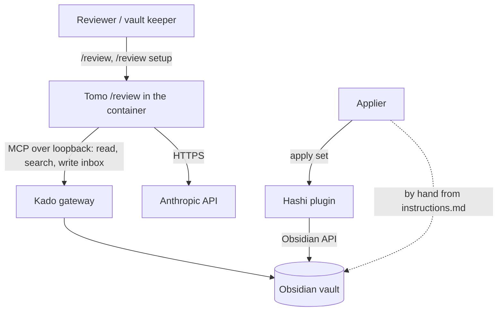
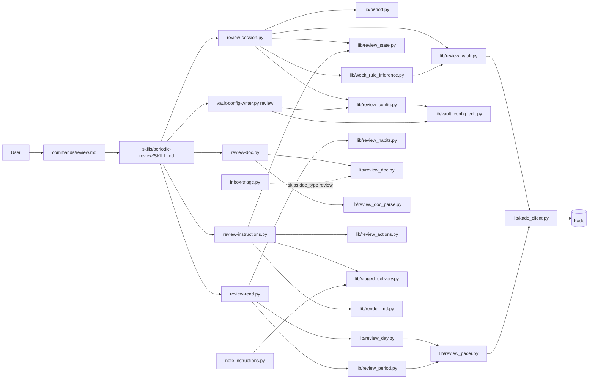
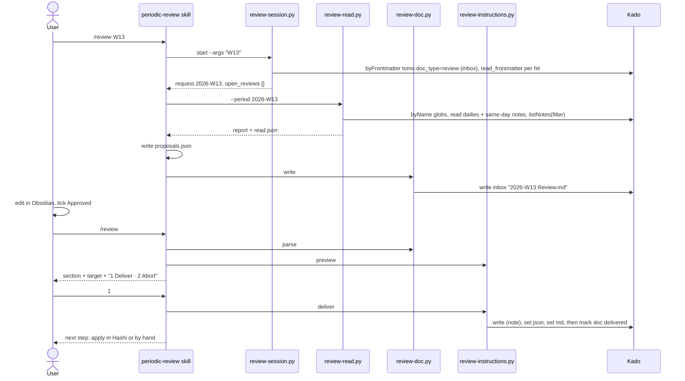

# Solution Design Document

## Validation Checklist

### CRITICAL GATES (Must Pass)

- [x] All required sections are complete
- [x] No [NEEDS CLARIFICATION] markers remain
- [x] Architecture pattern is clearly stated with rationale
- [x] **All architecture decisions confirmed by user**
- [x] Every interface has specification

### QUALITY CHECKS (Should Pass)

- [x] All context sources are listed with relevance ratings
- [x] Project commands are discovered from actual project files
- [x] Constraints → Strategy → Design → Implementation path is logical
- [x] Every component in diagram has directory mapping
- [x] Error handling covers all error types
- [x] Quality requirements are specific and measurable
- [x] Component names consistent across diagrams
- [x] A developer could implement from this design
- [x] Implementation examples use actual schema column names (not pseudocode), verified against migration files — N/A: no database; examples use the real config keys, file paths and Kado tool names
- [x] Complex queries include traced walkthroughs with example data showing how the logic evaluates

---

## Output Schema

### SDD Status Report

| Field | Type | Required | Description |
|-------|------|----------|-------------|
| specId | string | Yes | Spec identifier (NNN-name format) |
| architecture | ArchitectureSummary | Yes | Architecture overview |
| sections | SectionStatus[] | Yes | Status of each SDD section |
| adrs | ADRStatus[] | Yes | Architecture decision statuses |
| validationPassed | number | Yes | Validation items passed |
| validationPending | number | Yes | Validation items pending |
| nextSteps | string[] | Yes | Recommended next actions |

### ArchitectureSummary

| Field | Type | Required | Description |
|-------|------|----------|-------------|
| pattern | string | Yes | Selected architecture pattern |
| keyComponents | string[] | Yes | Main system components |
| externalIntegrations | string[] | No | External services integrated |

### SectionStatus

| Field | Type | Required | Description |
|-------|------|----------|-------------|
| name | string | Yes | Section name |
| status | enum: `COMPLETE`, `NEEDS_DECISION`, `IN_PROGRESS` | Yes | Current state |
| detail | string | No | What decision is needed or what's in progress |

### ADRStatus

| Field | Type | Required | Description |
|-------|------|----------|-------------|
| id | string | Yes | ADR identifier (e.g., ADR-1) |
| name | string | Yes | Decision name |
| status | enum: `CONFIRMED`, `PENDING` | Yes | Confirmation state |

---

## Constraints

- **CON-1 Runtime and language.** Python scripts run in the Tomo container (Python 3.11; the host test run needs ≥ 3.9, `pyproject.toml:13`). Dependencies are stdlib, PyYAML and jsonschema only (`docker/Dockerfile:21-23`); week arithmetic and parsing use the stdlib. Runtime prose in `tomo/dot_claude/` holds imperatives only; every WHY lives in `docs/tomo/<mirrored path>.md` and is written before the runtime text (CLAUDE.md). Every edited managed file bumps its `# version:`.
- **CON-2 Boundaries.** Tomo writes only to the inbox (MVP execution boundary); everything else reaches the vault as an instruction set the user applies in Hashi or by hand. No change to Hashi or Kado. No change to the eval-gated files (`agents/synthesis-conductor.md`, `agents/suggestion-conductor.md`, `skills/suggest-handling/SKILL.md`, `commands/inbox.md`, `dot_claude/settings.json`). The Hashi contract schema `tomo/schemas/hashi-instructions.schema.json` is a mirror and is never edited.
- **CON-3 Data protection.** All vault access goes through Kado and its key (MiYo Constitution L1). Tomo's own logs, stderr and cost records carry metadata only — paths, dates, counts, states (Constitution L2, PRD F7-AC1). Where read content rests on the machine is documented, not cleaned up (PRD F7-AC2, owner decision 2026-11-11).
- **CON-4 Rate limit.** Kado rate-limits per IP, by default 20 requests per 5 s, and that window is shared with the session's own `kado-*` MCP calls (`Kado/src/mcp/server.ts:105-157`, `Kado/docs/api-reference.md:41-84`). A review must pace and retry, never stop at a fixed budget (PRD F3).
- **CON-5 Test vault.** `/Volumes/Moon/Coding/MiYo/temp/Privat-Test/` is read-only for this work; live walks use March 2026; the daily gap after 2026-09-12 stays as it is.

## Implementation Context

### Required Context Sources

#### Documentation Context
```yaml
- doc: docs/XDD/specs/045-weekly-monthly-review/requirements.md
  relevance: CRITICAL
  why: "The approved PRD v1.2 — 8 features, 59 criteria this design must satisfy"

- doc: docs/XDD/specs/044-note-from-template/solution.md
  relevance: CRITICAL
  why: "The precedent: shim + skill + scripts, session start, staged and resumable delivery (ADR-2/3/6/7 of spec 044)"

- doc: docs/tomo/scripts/note-instructions.md
  relevance: HIGH
  why: "WHY of the deliver loop this design generalises (step order, identical-text resume, failed_step before upload)"

- doc: docs/tomo/scripts/inbox-triage.md
  relevance: HIGH
  why: "doc_type routing and the known-bucket rule the review document must fit"

- doc: docs/tomo/scripts/instruction-render.md
  relevance: MEDIUM
  why: "How instructions.md is rendered deterministically; the per-action branches extended here"

- doc: Kado/docs/api-reference.md
  relevance: HIGH
  why: "Rate limiter (:41-84), section reads (:226-247), universal filter (:1066-1092), listNotes fields (:1515-1540)"

- doc: PRIVACY.md
  relevance: HIGH
  why: "Gets the /review paragraph and the new 'Where content rests on your machine' section"

- doc: Kokoro ADR-028 (replace_section, mirror-only so far) and ADR-018 (doc_type list)
  relevance: MEDIUM
  why: "First Tomo producer of replace_section and a new doc_type → FYI handoff (Constitution Architecture L2)"

- doc: evals/README.md
  relevance: MEDIUM
  why: "How a plugin eval case is added; /review is not eval-gated, an eval suite is optional"
```

#### Code Context
```yaml
- file: tomo/dot_claude/commands/note.md
  relevance: HIGH
  why: "Shim pattern for commands/review.md"

- file: tomo/dot_claude/skills/note-from-template/SKILL.md
  relevance: HIGH
  why: "Skill-owned flow, plain-text approval form (:15-24), setup match/confirm loop (:62-76)"

- file: tomo/scripts/note-session.py
  relevance: HIGH
  why: "Session start that lists kept/unfinished/stale work before a new request"

- file: tomo/scripts/note-instructions.py
  relevance: CRITICAL
  why: "Deliver loop _deliver_step/_mark_in_flight/_record/_fail/_stable_block (:384-596) extracted into lib/staged_delivery.py"

- file: tomo/scripts/lib/note_meta.py
  relevance: MEDIUM
  why: "Meta dataclass pattern (steps_done, failed_step, frozen); stem regex is /note-specific"

- file: tomo/scripts/lib/kado_client.py
  relevance: CRITICAL
  why: "Retry loop (:721-753), _pace (:676-682), attempt_gate, call/attempt counters (:142-144), _search_all without filter (:638-674), list_notes (:243-273)"

- file: tomo/scripts/lib/link_members.py
  relevance: HIGH
  why: "LinkLookup context manager (:185-257) — the pacer pattern"

- file: tomo/scripts/inbox-triage.py
  relevance: HIGH
  why: "query_frontmatter buckets (:370-395), compute_new_sources (:434-456), _get_doc_type filename fallback (:574-599), pending loop (:939-951)"

- file: tomo/schemas/doc-frontmatter.schema.json
  relevance: HIGH
  why: "doc_type enum (:17) and per-type state branches (:58-101)"

- file: tomo/scripts/lib/tomo_lifecycle.py
  relevance: MEDIUM
  why: "STATE_MACHINE; tests/test_tomo_lifecycle.py:157-161 pins the doc-type set"

- file: tomo/schemas/instructions.schema.json
  relevance: HIGH
  why: "Producer schema — lacks replace_section"

- file: tomo/schemas/hashi-instructions.schema.json
  relevance: HIGH
  why: "Contract: insert_under_marker (:259-287), replace_section (:288-300), move_note (:88-104); read only"

- file: tomo/scripts/lib/render_md.py
  relevance: HIGH
  why: "insert_under_marker branch renders a blockquote (:297-308), no replace_section branch (:370)"

- file: tomo/scripts/lib/wire_snapshot_parity.py
  relevance: MEDIUM
  why: "Lists replace_section as never emitted (:58-62); the exemption goes"

- file: tomo/scripts/vault-config-writer.py
  relevance: HIGH
  why: "Text-preserving writer with subcommands (:9-17, :947-968); templates-include (:888) is the model for the new review subcommand"

- file: tomo/scripts/shared-ctx-builder.py
  relevance: MEDIUM
  why: "build_tracker_fields (:578), build_daily_log (:637), daily path strip (:672-685)"

- file: tests/test_note_privacy.py
  relevance: HIGH
  why: "Marker + USER_TEXT_FIELDS allowlist pattern for test_review_privacy.py"

- file: tests/note_fake_vault.py
  relevance: HIGH
  why: "In-process fake Kado for script tests"

- file: Hashi/src/actions/insertUnderMarker.ts, replaceSection.ts, moveNote.ts
  relevance: HIGH
  why: "Verified apply semantics: placement before/after/inside, section end rule, move refusal on existing target"
```

#### External APIs (if applicable)
```yaml
- service: Kado MCP gateway
  doc: Kado/docs/api-reference.md
  relevance: CRITICAL
  why: "Only vault surface; rate limit with Retry-After ≤ 5 s; empty search can mean denial"

- service: Hashi instruction executor (Obsidian plugin)
  doc: tomo/schemas/hashi-instructions.schema.json (v3 mirror)
  relevance: HIGH
  why: "Applies the review set; lists *_instructions.json in the inbox root and writes per-action applied:true"
```

### Implementation Boundaries

- **Must Preserve:** `/inbox` triage output and routing for every existing doc type; `/note` delivery behaviour and its tests after the deliver loop moves into a lib; the wire schema version; `kado_client` behaviour for existing callers (new counters and the new exception subclass are additive — `KadoRateLimitError` subclasses `KadoError`, so existing `except KadoError` keeps catching it).
- **Can Modify:** `kado_client.py` (counters, `KadoRateLimitError`, `filter` parameter), `inbox-triage.py` (review skip), `doc-frontmatter.schema.json`, `tomo_lifecycle.py`, `instructions.schema.json` (add `replace_section`), `render_md.py` (review-ready branches), `wire_snapshot_parity.py`, `note-instructions.py` (call the extracted lib), `vault-config-writer.py` (new subcommand), `PRIVACY.md`, `tomo/config/vault-example.yaml` (weekly pattern `GGGG-[W]WW`, review section).
- **Must Not Touch:** the five eval-gated files; `hashi-instructions.schema.json`; Hashi and Kado repos; `tomo-privat`; the test vault; `~/.tomo`.

### External Interfaces

#### System Context Diagram



#### Interface Specifications

```yaml
inbound:
  - name: "/review slash command"
    type: Claude Code command in the Tomo container session
    format: "$ARGUMENTS free text: '', 'month', 'setup', 'W13', '2026-W13', 'M03', '2026-03', '@<vault path>'"
    data_flow: "User request → skill"

outbound:
  - name: "Kado MCP"
    type: HTTP JSON-RPC over loopback (kado_client)
    format: kado-read, kado-search, kado-write
    authentication: bearer token from the instance .mcp.json
    data_flow: "Reads dailies, linked notes, weekly notes, templates, target note, instruction JSON; writes inbox files only"
    criticality: HIGH

  - name: "Anthropic API"
    type: HTTPS (Claude Code session)
    data_flow: "Read content of the period goes to the model to write proposals (PRIVACY.md)"
    criticality: HIGH

data:
  - name: "Instance config"
    type: YAML file config/vault-config.yaml
    connection: vault-config-writer.py (write), note_io.load_vault_config (read)
    data_flow: "Periodic note setup and the review section"

  - name: "Working folder"
    type: files under tomo-tmp/review/<stem>/
    data_flow: "read.json (content, Pass 1 only), proposals.json (model output), meta.json (content-free delivery state)"

  - name: "Inbox"
    type: vault folder via Kado
    data_flow: "<name> Review.md, the new periodic note, <stem>_instructions.json, <stem>_instructions.md"
```

### Cross-Component Boundaries (if applicable)

- **API Contracts:** the Hashi instruction schema v3 (unchanged; this design only emits actions it already defines). The `doc-frontmatter` `tomo:` block (one new doc type). Kado tool semantics (unchanged; the `filter` argument already exists server-side).
- **Team Ownership:** Tomo owns everything changed here. Hashi and Kado are consumed as they are; no change is asked of them. Kokoro gets an FYI handoff (`_outbox/for-kokoro/`): Tomo becomes the first producer of `replace_section` (Kokoro ADR-028 recorded it as mirror-only, and its rule routes such a change as an L2 handoff) and adds the doc_type `review` to the list in ADR-018 and `global/architecture/06-miyo-tomo-hashi.md`.
- **Shared Resources:** the Kado rate-limit window (shared with the session's MCP calls and any other Tomo run); the inbox folder (shared with `/inbox` and `/note`).
- **Breaking Change Policy:** no wire change. Adding `replace_section` to the producer schema aligns it with the contract it mirrors; the schema_version stays.

### Project Commands

```bash
# Discovered from pyproject.toml, venv/ and evals/README.md
Install: none for this spec — the repo's ./venv already carries pytest and ruff (no requirements file exists); the container image needs no change
Test:    ./venv/bin/python -m pytest tests/ -q
Test one area: ./venv/bin/python -m pytest tests/test_review_*.py tests/test_period.py -q
Lint:    ./venv/bin/ruff check tomo/scripts scripts tests
Integration (opt-in, Privat-Test): ./venv/bin/python -m pytest -m integration tests/
Eval (paid, owner-run only):       scripts/run-evals.sh --case <review case>
Sync to the test instance (owner instruction only): scripts/update-tomo.sh --instance tomo-instance --yolo
```

## Solution Strategy

- **Architecture Pattern:** the `/note` pattern (spec 044): a command shim, one skill that owns the dialogue, and deterministic scripts that own every state change, every vault read and write and every rendering. The model does exactly one creative step — writing the proposal texts from the read period into a JSON file the scripts validate.
- **Integration Approach:** `/review` is a new command beside `/inbox` and `/note`. It reuses Kado access, the frontmatter block, the instruction-set builder pieces, the readable-instructions renderer and the staged delivery loop (extracted from `note-instructions.py`). `/inbox` learns one thing: skip the `review` doc type. Hashi needs nothing.
- **Justification:** the PRD forbids a black box (every item editable before it lands) and requires the same 2-pass shape as `/inbox` without touching its eval-gated files. The `/note` pattern already passed its live walk and eval with that shape; copying it keeps the risky parts (delivery, resume, privacy) on proven code.
- **Key Decisions:** ADR-1 to ADR-13 below. In short: state lives in the vault, not in `tomo-tmp` (the user edits between passes); the review section is found again by a marker and replaced, never doubled; Kado is paced and retried; weeks follow a rule `(first_day, min_days_in_first_week)` read from the user's notes or asked; Templater templates use a Tomo variant or stay raw with a hint; privacy is documented, not cleaned up.

## Building Block View

### Components



Responsibilities (one owner each):

| Component | Owns |
|---|---|
| `commands/review.md` | Invoking the skill in-session with `$ARGUMENTS` verbatim |
| `skills/periodic-review/SKILL.md` | The dialogue order: start → setup → read → propose → write doc → continue → preview → deliver; plain-text confirmations |
| `lib/period.py` | Week/month arithmetic, the week rule, name-format rendering, parsing and refusal of unsafe formats, overlapping weeks, argument parsing to a `Period` |
| `lib/review_config.py` | The setup's key layout, one owner for reader and writer (implemented, spec 045 Phase 2): `load_profile`, `folder_for` (config over profile), `inbox_folder`, `configured_formats`, `setup_present`, `review_setup()` → `ReviewSetup` or `SetupInvalid` (JSON pointers), `tracker_types`; the session shapes `current_setup` and `request_dict`; the writer side `input_problems` (schema + `period.check_format`) and `writer_edits` (`(path, value)` leaf edits); `place_level` (the only owner of the heading-level rule) and the inbox-path guard `inbox_path()` every review write goes through |
| `lib/review_vault.py` | The Kado access of every review script (implemented, spec 045 Phase 2): `Vault` maps every Kado failure onto the SDD's error kinds once (`Stopped("kado-unreachable" \| "kado-auth")` stops the run; a failed single read degrades to None / `unreadable`), `review_documents` (the byFrontmatter query plus one frontmatter read per hit), `list_notes`, `template`, `folder_listed`; the date and heading helpers `frontmatter_start`, `headings`, `heading_start`. No second Kado error mapping anywhere |
| `lib/review_templates.py` | The two questions `match` can leave open and their answers (implemented, spec 045 Phase 6 live-walk fix, fix round 1): `template_candidates` (the notes of `templates.base_path` whose file name fits the kind, one listing, sorted), `resolve_template` (the named template read and classified, or the candidates listed once, with the hint sentences), `template_name` (the `--template` value with `.md`, refusing `..`, `\` and a leading `/`), `template_choice` (the same with the bare word `none` as the "no template" answer), `anchor_text` (the `--anchor` answer trimmed, one non-blank line), `anchor_candidates_from_notes` (the headings of the two most recent periodic notes, two reads at most), and what a template's headings propose (`template_anchor_candidates`, `propose_anchor`, `daily_sections_from`) |
| `lib/week_rule_inference.py` | Inferring the week rule from the dates up to 8 recent weekly notes carry (`infer_rule` → `Inference` inferred \| ambiguous \| default with every `Checked` note), never from the Obsidian plugin configuration (implemented, spec 045 Phase 2) |
| `lib/vault_config_edit.py` | Text-preserving insert / replace / remove of one nested key in `vault-config.yaml` (`set_path`, `get_path`), creating missing parents and sections, rewriting a flow mapping on a key line as a block; the line helpers `templates-include` shares (implemented, spec 045 Phase 2) |
| `review-session.py` | `start` (parse request, list open reviews via `review_vault` + `review_state.open_reviews`, record each listed applied review as reported), `match` (setup preview against existing notes via `review_vault` + `week_rule_inference`), `setup-input` (build the writer input from a confirmed proposal) (implemented, spec 045 Phase 2) |
| `vault-config-writer.py review` | Applying `review_config.writer_edits` to `vault-config.yaml` text-preservingly through `vault_config_edit.set_path`, including absent nested keys and the new `review:` section, with the duplicate refusal and the per-leaf read-back before the atomic write (implemented, spec 045 Phase 2) |
| `lib/review_pacer.py` | Spacing, widening after retries, the end-of-run retry pass, retry and wait accounting, the not-read list, abort on connection/auth errors |
| `lib/review_day.py` | Reading one day: same-day links and embeds from the whole daily, configured sections, fields, tasks by ✅ date, size cap, per-day state |
| `lib/review_period.py` | Reading a period: finding dailies (flat and year folders, duplicates), weekly notes of a month and their day blocks, link differences, vault growth, the report |
| `lib/review_md.py` | The markdown structure of a daily: frontmatter split, fence-aware headings and thematic breaks, section ranges, the trailing navigation block, query/embed fence removal; no setting, no Kado (implemented, spec 045 Phase 3) |
| `lib/review_reader.py` | `PacedReader`: the one cache in front of `ReviewPacer.read` for notes, link-stem lookups, folder listings and `listNotes` queries; pending until the end pass, then `not_read` or `missing` (implemented, spec 045 Phase 3) |
| `lib/review_weekly.py` | Daily name rendering and parsing, link targets and comparison keys, the split of a weekly note into day blocks and week text; no Kado call (implemented, spec 045 Phase 3) |
| `review-read.py` | CLI over `review_day` + `review_period` + `review_habits`; writes `read.json`; prints the report |
| `lib/review_habits.py` | Tracker numbers (counts, averages, missing/unreadable days); takes fields as the reader attributed them |
| `lib/review_doc.py` + `review-doc.py` | Validating `proposals.json`, rendering the review document with item ids, the label table, start-over replacement, the delivered mark function |
| `lib/review_doc_parse.py` | Parsing the edited document: Approved line, items by id, user items, warnings |
| `lib/review_doc_read.py` | The one shared reader of the review document for `parse`, `preview` and `deliver`: `doc_path_of`, and `read_document` (the Kado read, Kado's `modified` stamp, the parse with `meta.pass1_links` and the Pass 1 total) so `edited` and `deleted` are computed one way (implemented, spec 045 Phase 4) |
| `lib/review_actions.py` | Locating the target (by path, else by name outside the inbox), choosing insert vs replace vs new note, the heading and marker rules as Hashi reads the file, building the section text with escaping, the actions and the stamped new note (implemented, spec 045 Phase 4) |
| `lib/review_delivery.py` | The delivery around the plan: `classify` (refusing problems against notices), `ReviewMeta` (the `meta.json` dict as the staged loop's record: `started()`, `withdrawn()`, `second_set()`), set paths, template paths, the set's MD peer, the withdrawn set and its MD (implemented, spec 045 Phase 4) |
| `lib/review_state.py` | The one open-review state function and `stem_state`, the one probe-and-classify step: reads document frontmatter, `meta.json`, the set JSON (`applied`) and the probes, and returns the canonical state or None; also `safe_stem`, `read_meta` and the listing `open_reviews` (implemented, spec 045 Phase 4) |
| `lib/staged_delivery.py` | The ordered, resumable, identical-text-idempotent write of inbox payloads (extracted from `note-instructions.py`; steps and targets supplied by the caller) |
| `review-instructions.py` | `preview`, `deliver`, `drop`, `status` subcommands over the above (implemented, spec 045 Phase 4) |
| `lib/render_md.py` | Readable `instructions.md`: copy-ready fenced content for `insert_under_marker` and `replace_section`, placement wording |
| `inbox-triage.py` | Treating `review` documents as known and skipping them silently |

Every new script and lib starts with a header docstring that says why the file exists and an initial `# version: 0.1.0`. Every script's `main` catches any exception and prints only its class name to stderr (CON-3).

### Directory Map

**Component**: runtime (synced into the instance)
```
tomo/
├── dot_claude/
│   ├── commands/
│   │   └── review.md                         # NEW: shim (implemented, spec 045 Phase 5)
│   └── skills/
│       └── periodic-review/
│           └── SKILL.md                      # NEW: the /review flow (implemented, spec 045 Phase 5)
├── scripts/
│   ├── review-session.py                     # NEW: start / match / setup-input
│   ├── review-read.py                        # NEW: read the period → read.json + report
│   ├── review-doc.py                         # NEW: write / parse / replace
│   ├── review-instructions.py                # NEW: preview / deliver / drop / status
│   ├── vault-config-writer.py                # MODIFY: + `review` subcommand
│   ├── note-instructions.py                  # MODIFY: use lib/staged_delivery.py
│   ├── inbox-triage.py                       # MODIFY: review doc_type filename rule + silent skip
│   └── lib/
│       ├── period.py                         # NEW
│       ├── review_config.py                  # NEW (implemented, spec 045 Phase 2)
│       ├── review_vault.py                   # NEW: Kado wrapper + weekly-note evidence (implemented, spec 045 Phase 2)
│       ├── review_templates.py               # NEW: template candidates of the templates folder, --template name rule, the anchor candidates of the recent periodic notes, what a template's headings propose (implemented, spec 045 Phase 6 live-walk fix)
│       ├── week_rule_inference.py            # NEW (implemented, spec 045 Phase 2)
│       ├── vault_config_edit.py              # NEW: nested text-preserving config editor (implemented, spec 045 Phase 2)
│       ├── review_pacer.py                   # NEW
│       ├── review_day.py                     # NEW
│       ├── review_period.py                  # NEW
│       ├── review_md.py                      # NEW: markdown structure of a daily (implemented, spec 045 Phase 3)
│       ├── review_reader.py                  # NEW: PacedReader, cached paced Kado reads (implemented, spec 045 Phase 3)
│       ├── review_weekly.py                  # NEW: daily names, link targets, weekly day blocks (implemented, spec 045 Phase 3)
│       ├── review_habits.py                  # NEW
│       ├── review_doc.py                     # NEW
│       ├── review_doc_parse.py               # NEW
│       ├── review_actions.py                 # NEW (implemented, spec 045 Phase 4)
│       ├── review_delivery.py                # NEW: problem classes, meta adapter, set paths, withdrawn set (implemented, spec 045 Phase 4)
│       ├── review_doc_read.py                # NEW: the one reader of the review document for Pass 2 (implemented, spec 045 Phase 4)
│       ├── review_state.py                   # NEW (implemented, spec 045 Phase 4)
│       ├── staged_delivery.py                # NEW: extracted deliver loop
│       ├── note_meta.py                      # MODIFY: step set supplied by the caller
│       ├── kado_client.py                    # MODIFY: wait counters, KadoRateLimitError, filter
│       ├── render_md.py                      # MODIFY: copy-ready insert/replace branches
│       ├── tomo_lifecycle.py                 # MODIFY: + review
│       └── wire_snapshot_parity.py           # MODIFY: drop replace_section exemption
├── schemas/
│   ├── doc-frontmatter.schema.json           # MODIFY: + review doc_type
│   ├── instructions.schema.json              # MODIFY: + replace_section
│   ├── review-proposals.schema.json          # NEW: model output contract
│   └── vault-config-review.schema.json       # NEW: writer input contract
└── config/
    └── vault-example.yaml                    # MODIFY: weekly "GGGG-[W]WW", review section example
```

**Component**: documentation (WHY layer, written before the runtime text)
```
docs/tomo/
├── dot_claude/commands/review.md             # NEW (implemented, spec 045 Phase 5)
├── dot_claude/skills/periodic-review.md      # NEW (implemented, spec 045 Phase 5)
└── scripts/
    ├── review-session.md, review-read.md, review-doc.md, review-instructions.md   # NEW
    ├── lib/period.md, review_config.md, review_pacer.md, review_day.md,
    │   review_period.md, review_md.md, review_reader.md, review_weekly.md, review_habits.md, review_doc.md, review_doc_parse.md,
    │   review_actions.md, review_state.md, staged_delivery.md                      # NEW
    ├── lib/review_vault.md, lib/week_rule_inference.md, lib/vault_config_edit.md  # NEW (implemented, spec 045 Phase 2)
    ├── lib/review_templates.md                                                     # NEW: WHY the candidates are listed, the words, the two recent notes (implemented, spec 045 Phase 6 live-walk fix)
    ├── lib/review_delivery.md, lib/review_doc_read.md                              # NEW: WHY of the delivery adapter and the one document reader (implemented, spec 045 Phase 4)
    ├── vault-config-writer.md, inbox-triage.md, note-instructions.md,
    │   instruction-render.md, lib/kado_client.md, lib/note_meta.md                 # MODIFY
docs/tomo/schemas/vault-config-review.schema.md  # NEW: WHY of the writer input contract (implemented, spec 045 Phase 2)
PRIVACY.md                                    # MODIFY: /review paragraph, record scope, where content rests (implemented, spec 045 Phase 5)
docs/setup.md                                 # MODIFY: protect the instance like the vault (link to PRIVACY) (implemented, spec 045 Phase 5)
tomo/dot_claude/commands/tomo-help.md         # MODIFY: list /review (implemented, spec 045 Phase 5)
_outbox/for-kokoro/                           # NEW (gitignored): FYI handoff — first replace_section producer, doc_type review
```

**Component**: tests (host only)
```
tests/
├── test_period.py                            # NEW: arithmetic, rule, formats, arguments, W53 months
├── test_review_config.py                     # NEW (incl. inbox guard)
├── test_review_session.py                    # NEW
├── test_review_session_templates.py          # NEW: match without a mapping entry lists the template candidates, --template resolves the choice, needs_anchor + anchor_candidates when no anchor can be proposed, setup-input refuses the unchanged proposal, the writer saves the choice to templates.mapping.weekly and `0 none` touches no mapping key; template_frontmatter + needs_template_ok and the --template-frontmatter-ok carry (implemented, spec 045 Phase 6 live-walk fixes)
├── test_review_pacer.py                      # NEW
├── test_review_day.py                        # NEW (same-day rule, sections, fields, tasks, size cap)
├── test_review_period.py                     # NEW (dailies, duplicates, year folders, weeklies, growth)
├── test_review_period_end_pass.py            # NEW: the end pass of a period read — recovered listings and notes, not_read (implemented, spec 045 Phase 3)
├── review_period_fixtures.py                 # NEW: shared vault fixtures of the period-read tests (implemented, spec 045 Phase 3)
├── test_review_read.py                       # NEW: review-read.py end to end over the fake vault — report, stops, read.json (implemented, spec 045 Phase 3)
├── test_review_habits.py                     # NEW
├── test_review_doc.py                        # NEW (render, ids, labels, write failure)
├── test_review_doc_parse.py                  # NEW (edits, ids, Approved line; implemented, spec 045 Phase 3)
├── test_review_instructions.py               # NEW (insert/replace/new note, resume, drop, conflicts)
├── test_review_deliver.py                    # NEW (Phase 4): review-instructions.py preview/deliver/drop/status over the fake vault; MODIFY: a drop that failed after the set write is listed again (implemented, spec 045 Phase 5)
├── test_review_deliver_rerun.py              # NEW: a rerun writes its set over the first run's fully applied set, set-exists for a waiting or partly applied one, the resume over the old MD (split out of test_review_deliver.py; implemented, spec 045 Phase 6 fix round)
├── test_review_deliver_report.py             # NEW: the doc-changed stop's reason (open-unsaved | changed-since-read | unknown, Kado's message never on stdout), no reason on kado-write-failed, a resume reports the recorded delivered_plan and falls back to the re-plan without one (split out of test_review_deliver.py; implemented, spec 045 P6 live-walk fix)
├── test_review_state.py                      # NEW (canonical states; MODIFY: a fresh record over a fully applied set reads open, Phase 6 fix round)
├── test_review_state_listing.py              # NEW: open_reviews — one entry per document found by frontmatter, probed through stem_state, ordered under the configured rule and formats, the kind inferred, skips with a reason, withdrawn and reported-applied never listed (split out of test_review_state.py; implemented, spec 045 Phase 6, pre-live-walk)
├── test_review_state_finished.py             # NEW: a complete delivery (doc_mark) whose set the user deleted is finished — not listed, status null — while a record short of doc_mark stays failed-delivery; the neighbouring rules unchanged (implemented, spec 045 Phase 6, pre-live-walk fix)
├── test_review_privacy.py                    # NEW (marker allowlist, exception handler; implemented, spec 045 Phase 5)
├── review_privacy_fixture.py                 # NEW: the marked vault of the privacy walk, never a production code path (implemented, spec 045 Phase 5)
├── test_review_privacy_docs.py               # NEW: PRIVACY.md clauses, docs/setup.md, README, the vault-example.yaml review example (implemented, spec 045 Phase 5)
├── review_cli_contract.py                    # NEW: the /review CLI contract read from the scripts' own argparse parsers, shared by the WHY-doc and skill tests (implemented, spec 045 Phase 5)
├── test_review_why_docs.py                   # NEW: the WHY documents name every subcommand the parsers have and none they lack (implemented, spec 045 Phase 5)
├── test_review_skill.py                      # NEW: the shim, the skill's Pass 1 imperatives per criterion and its rules, the help entry (implemented, spec 045 Phase 5)
├── test_review_skill_pass2.py                # NEW: the skill's Pass 2 steps — every refusing problem and notice has its line, drop statuses read from the script (split out at Phase 5; implemented, spec 045 Phase 5)
├── test_review_skill_contract.py             # NEW: the SDD's Error Handling rows in the skill, the WHY document's option lines, the CLI-contract sweep over every skill naming a review script (implemented, spec 045 Phase 5)
├── review_skill_helpers.py                   # NEW: paths, text slicers and rule-line pins shared by the test_review_skill*.py files (implemented, spec 045 Phase 5)
├── test_review_sdd_map.py                    # NEW: this Directory Map names every review file that exists (glob-driven), the Phase 5 markers, the example-config check, the empty-listing row (implemented, spec 045 Phase 5)
├── test_review_e2e.py                        # NEW: the 2-pass flow end to end on the fake vault without an AI — setup confirm/abort, the user's edits, deliver, Hashi's apply simulated, reruns, the target appearing or moved, the aborts, the inbox-prefix guard per test and per module (implemented, spec 045 Phase 6)
├── test_review_e2e_failures.py               # NEW: the month in new-note mode, a failure at each delivery step then Resume, drop after a partial delivery, the half-withdrawn drop listed again with Resume refused, the set deleted by hand after Hashi applied it (not listed, Start over works) (implemented, spec 045 Phase 6)
├── test_review_e2e_edges.py                  # NEW: everything unticked, the document renamed or moved, the Approved line deleted, /review setup over a saved setup, a sparse week; names the unit tests of the read-side edge cases (implemented, spec 045 Phase 6 fix round)
├── review_e2e_walk.py                        # NEW: the driver of the e2e tests — the scripts as the skill calls them, the user's edits and Hashi's apply on the fake, the recorder of every write attempt for the inbox guard; never a production code path (implemented, spec 045 Phase 6)
├── test_review_integration.py                # NEW (-m integration, Phase 6)
├── test_045_close_out_gaps.py                # NEW (Phase 6, if gaps are found)
├── test_staged_delivery.py                   # NEW (+ existing /note tests stay green)
├── test_vault_config_writer_review.py        # NEW (implemented, spec 045 Phase 2)
├── test_vault_config_edit.py                 # NEW: the nested editor, byte-identity outside the edited lines (implemented, spec 045 Phase 2)
├── test_week_rule_inference.py               # NEW (implemented, spec 045 Phase 2)
├── test_inbox_triage_review_skip.py          # NEW
├── review_fake_vault.py                      # NEW: extends note_fake_vault with list_dir depth + Path-not-found, listNotes filter,
│                                             #      byName, byFrontmatter empty-frontmatter hits, connection/auth error switches,
│                                             #      paths_seen (implemented, spec 045 Phase 2; 429/503 injection arrives with the pacer)
├── test_kado_client_retry.py                 # MODIFY: KadoRateLimitError, wait counters
├── test_kado_client_attempts.py              # MODIFY: pace wait counter, filter pass-through
├── test_tomo_lifecycle.py                    # MODIFY: doc-type set
├── test_tomo_schema_parity.py                # MODIFY: replace_section no longer mirror-only
├── test_wire_snapshot_parity.py              # MODIFY: sanctioned set without replace_section
├── test_hashi_instructions_schema.py         # MODIFY: invert "replace_section absent from producer"
└── test_035_schema_identity.py               # MODIFY: docstring
```

### Interface Specifications

#### Interface Documentation References

```yaml
interfaces:
  - name: "Hashi instruction set v3"
    doc: tomo/schemas/hashi-instructions.schema.json
    relevance: CRITICAL
    sections: [insert_under_marker, replace_section, move_note, applied_field]
    why: "The only way the review reaches a periodic note"

  - name: "Tomo document frontmatter"
    doc: tomo/schemas/doc-frontmatter.schema.json
    relevance: HIGH
    sections: [doc_type enum, per-type states]
    why: "The review document's tomo block"

  - name: "Review proposals (model → scripts)"
    doc: tomo/schemas/review-proposals.schema.json (NEW)
    relevance: HIGH
    why: "The one LLM-authored artifact; validated before it reaches the document"

  - name: "Review setup writer input"
    doc: tomo/schemas/vault-config-review.schema.json (NEW; implemented, spec 045 Phase 2 — WHY in docs/tomo/schemas/vault-config-review.schema.md)
    relevance: MEDIUM
    why: "Never hand-composed YAML"
```

#### Data Storage Changes

No database. Two persistent shapes change.

```yaml
# config/vault-config.yaml (written by vault-config-writer.py review; the writer-input key that
# produces each line is named in the comment — implemented, spec 045 Phase 2, review_config.writer_edits)
# None of these keys exist in tomo-instance today: the writer inserts absent nested keys
# (4 levels deep) and creates the naming: and review: sections when they are missing.
concepts.calendar.granularities.weekly:  {enabled: true, path: "Calendar/302 Weekly/"}   # input folder (enabled always true)
concepts.calendar.granularities.monthly: {enabled: true, path: "Calendar/303 Monthly/"}
concepts.calendar.granularities.daily.path: "Calendar/301 Daily/"   # input daily_path_fix — only when the user confirms the trailing-space fix
naming.calendar_patterns.weekly:  "GGGG-[W]WW"     # input format
naming.calendar_patterns.monthly: "YYYY-MM"
templates.mapping.weekly:  "t_week_privat.md"      # input template; as found; may be absent; null removes the key
templates.mapping.monthly: "t_month_privat.md"

review:                                  # NEW top-level section
  language: de                           # input language (default: frontmatter locale of the dailies, else en)
  week:                                  # input first_day + min_days; kind week only
    first_day: monday                    # monday..sunday
    min_days_in_first_week: 4            # 4 = ISO; 1 = week 1 contains 1 January
  daily:                                 # written only for the input keys present
    sections: ["Habit", "5 Year Journal", "Start of the Day", "ToDos", "Daily Log", "End of the Day"]   # input daily_sections
    skip_sections: ["On This Day... last year"]   # input skip_sections; prefix match on heading text
    task_notes: ["Efforts/500 OnGoing/Next Todos.md"]   # input task_notes; living task notes
    max_chars_per_day: 12000             # input max_chars_per_day; read cap per day; beyond it the day is "partly read"
  weekly:
    heading: "Tomo Review"               # input heading
    place: {anchor: "In my own words", placement: before}    # input place; placement: before | inside
    own_sections: ["In my own words", "Reflections"]         # input own_sections
    template_variant: null               # input template_variant, e.g. "t_week_privat_tomo.md"; null removes the key
  monthly:
    heading: "Tomo Review"
    place: {anchor: "In my own words", placement: before}
    own_sections: ["In my own words", "Reflections"]
    template_variant: null
```

The writer input (`tomo/schemas/vault-config-review.schema.json`, WHY in `docs/tomo/schemas/vault-config-review.schema.md`) carries `kind`, `folder`, `format`, `heading`, `place` and `language` as required keys, `first_day`/`min_days` for a week (forbidden for a month), and `template`, `template_variant`, `own_sections`, `daily_sections`, `skip_sections`, `task_notes`, `max_chars_per_day` and `daily_path_fix` as optional keys; an absent optional key changes nothing (implemented, spec 045 Phase 2).

Same-day links and embeds are collected from the **whole** daily, before the section filter: the owner's Dayplanner embed sits under a heading whose text changes every day (`## [[DP-2026-03-26|Dayplanner]]`), so a section list cannot name it.

Tracker fields are not duplicated: F8 reads the existing `trackers.daily_note_trackers` (`today_fields`, `yesterday_fields`, `end_of_day_fields`) and their types; the setup may propose a type change (for example `Sleep` `text` → `duration`) through the existing `vault-config-writer.py trackers` subcommand.

```yaml
# tomo-tmp/review/<stem>/   (<stem> = "<period-name>_review", e.g. "2026-W13_review")
read.json        # content of the period (Pass 1 only; deleted after the document is written or on abort;
                 #  a session that ends without either leaves it until the next /review of that stem — named in PRIVACY.md)
proposals.json   # model output (Pass 1 only; deleted with read.json)
meta.json        # content-free: period, kind, doc_path, target, mode, generated, steps_done, failed_step,
                 #  pass1_counts {group: n}, pass1_links, withdrawn, applied_reported
```

#### Internal API Changes

Every script prints one JSON object on stdout. Exit codes: **0** for every outcome the skill can act on (the outcome is in `status` / `problems` / `error`), **2** for a usage error (unknown subcommand or flag, missing required argument), **1** only for an unexpected exception (stderr: the exception class name, nothing else). stderr never carries note text, titles or proposal text.

```yaml
review-session.py start --args '<raw $ARGUMENTS>'
  out: {status: ok|stopped,                                        # (implemented, spec 045 Phase 2)
        request: {kind: week|month|setup, period?: "2026-W13", year_inferred?: bool, source?: "arg|at|default",
                  start?: "2026-03-23", end?: "2026-03-29"}        # first and last day of a period request
               | null,                                              # a blank argument while open_reviews is non-empty
        request_withheld?: open-reviews,                            # only beside a null request: no new period starts
                                                                    # until the user names one; a kind word (`month`),
                                                                    # a period, an @ note and `setup` are never withheld
                                                                    # (Phase 6 live walk, owner decision)
        current?: {week: <proposal shape>|null|{invalid: [json-pointer]}, month: ...},   # setup request only
        open_reviews: [{period, kind, doc_path, stem, state}],      # state from review_state.stem_state (canonical list below);
                                                                    # a withdrawn review is not listed, nor a complete delivery (doc_mark)
                                                                    # whose set is gone from the inbox; an applied one is listed once
        skipped_review_docs: [{doc_path, reason: frontmatter-unreadable|period-missing|stem-unsafe}],   # never dropped silently
        setup: {week: present|missing, month: present|missing},
        problems?: [inbox-not-configured],                          # no Kado call was made
        notices?: [applied-not-recorded],                           # the applied flag could not be written; status stays ok
        error?: {kind: invalid-period|unfinished-period|not-periodic-note|unknown-argument, expected, example,
                 last_finished?: "2026-W13"}                        # last_finished on unfinished-period (implemented, spec 045 T1.1)
              | {kind: kado-unreachable|kado-auth, detail}}         # with status stopped

review-session.py match --kind week|month [--folder P] [--format F] [--first-day D] [--min-days N] [--template T|none] [--anchor H]
                        [--template-frontmatter-ok T]
  out: {status: ok|stopped, kind,                                   # (implemented, spec 045 Phase 2; --template and the
                                                                    #  two question keys: Phase 6 live-walk fix, lib/review_templates.py;
                                                                    #  --template none and --anchor: fix round 1 — the skill carries both
                                                                    #  answers on every rerun of match, so neither question is asked twice;
                                                                    #  template_frontmatter, needs_template_ok and --template-frontmatter-ok:
                                                                    #  P6 live walk 2026-11-13, ADR-8 amendment)
        proposal: {folder, format, first_day, min_days, template, template_kind: plain|templater|missing|unreadable,
                   template_frontmatter: true|false|null,
                   heading, place: {anchor, placement}, own_sections, daily_sections, language},
                                                                    # template: --template none (null, nothing listed) > --template T
                                                                    #  (with or without .md) > templates.mapping.<kind>
                                                                    # template_frontmatter: the template text opens a frontmatter block at
                                                                    #  its first line and closes it (lib/review_templates
                                                                    #  .template_has_frontmatter = doc_frontmatter.body_after_frontmatter's
                                                                    #  rule, the one Pass 2's merge applies); false for Templater code first,
                                                                    #  a lone unclosed ---, an empty text; null when no text was read (none,
                                                                    #  the candidate list, missing, unreadable); dropped by setup-input like
                                                                    #  template_kind
                                                                    # place.anchor: --anchor (trimmed, one non-blank line, else exit 2)
                                                                    #  > review.<kind>.place.anchor > the template's headings
        evidence: {matched: [names], unmatched: [names], week_rule: given|inferred|ambiguous|default, notes_checked: n,
                                                                    # week_rule: given whenever --first-day/--min-days were passed (the
                                                                    #  user's answer stands; the skill asks on ambiguous only — final fix
                                                                    #  round), else what the notes showed; matched/unmatched follow the rule in use
                   folder_listing: found|kado-none,
                   format_problems: [{kind, example}],              # period.check_format on the proposed format
                   template_headings: [{level, text}]},             # anchor candidates of the template
        daily_path_fix?: {configured: "Calendar/301 Daily/ ", found: "Calendar/301 Daily/"},
        template_candidates?: [names],                             # only when neither the mapping nor --template names a template
                                                                    #  and --template is not none: notes of templates.base_path whose
                                                                    #  file name holds week/woche (month/monat), case-insensitive, one
                                                                    #  listing, sorted, no .md; [] without a base_path or for a
                                                                    #  kado-none listing (+ hint)
        needs_anchor?: true, anchor_candidates?: [headings],        # only when no anchor could be proposed (no --anchor, no configured
                                                                    #  anchor, no template heading): the headings of the two most recent
                                                                    #  periodic notes of the kind, two read_note calls at most; the skill asks
        needs_template_ok?: true,                                   # only when template_frontmatter is false and --template-frontmatter-ok
                                                                    #  (the --template syntax, else exit 2) does not name the resolved template:
                                                                    #  the skill asks `1 Use it as it is · 2 I'll create a Tomo variant` once;
                                                                    #  `1` is carried as --template-frontmatter-ok <template> on every later
                                                                    #  match of the step, bound to that template, so a corrected template
                                                                    #  without a block is asked about again; the field stays false under it
        hints: [plain sentences for the skill],                    # folder empty/denied, no notes to compare, template unreadable,
                                                                    #  templates folder kado-none
        error?: {kind: kado-unreachable|kado-auth|unsafe-format, detail?}}

review-session.py setup-input --kind week|month --confirmed <json file>
  out: {status: ok, kind, input_path}                               # (implemented, spec 045 Phase 2)
     | {status: invalid, kind, errors: [json-pointer], problems: [{pointer, kind: schema|<FormatProblem kind>, example?}]}

vault-config-writer.py review --input <json>   (validated against vault-config-review.schema.json)
  out: {status: written, keys: [config key paths]}                 # paths only, never values (implemented, spec 045 Phase 2)
     | {status: unchanged} | {status: refused, reason, pointers?, problems?}

review-read.py --period 2026-W13 --kind week [--stem S]      (implemented, spec 045 Phase 3)
  out: {status: ok|stopped, stem, period: {kind, name, start, end},
        report: {days: [{date, dailies: [{path, state: found|empty|partly-read|failed}], duplicate: bool,
                         linked: [{name, path|null, state: read|missing|failed}]}],
                 day_after: {date, dailies: [{path, state: read|failed}]},
                 task_notes: [{path, state}],
                 weekly_status?: found|none-found|kado-empty|not-read|not-configured,   # month only
                 weekly_notes?: [{week, path|null, state: read|failed|absent}],         # month only
                 growth: {created, mocs_changed, mocs_linked_by_new, moc_folders, kado_none},
                 calls, retried, waited_s, not_read: [paths], kado_empty: [sources],
                 advice: [raise-kado-limit|check-key-access]},      # check-key-access only with a non-empty kado_empty
                                                                    # (a listing Kado answered empty), never for a
                                                                    # period whose dates the listed folder lacks
        read_path: "tomo-tmp/review/<stem>/read.json" | null, nothing_to_review?: bool,
        error?: {kind: kado-unreachable|kado-auth, detail},
        problems?: [setup-missing|setup-invalid|daily-not-configured|dailies-not-read], errors?: [json-pointer]}
  # read_path is null on nothing_to_review and on every stop; nothing_to_review exists only when the period was
  # read — a stopped output never carries it. setup-invalid brings errors (pointers); dailies-not-read means the
  # daily folder listing was still in not_read after the end pass (nothing written)

review-doc.py write --stem S --proposals tomo-tmp/review/<stem>/proposals.json [--run-id R]   (implemented, spec 045 Phase 3)
  out: {status: written|refused|stopped, stem, doc_path, target, target_exists, target_found_elsewhere?: path,
        counts: {group: n}, rejected: [{group, index, reason}], calls,
        problems?: [proposals-invalid|doc-name-taken|review-exists|kado-write-failed|read-missing|read-invalid|
                    setup-missing|setup-invalid|inbox-not-configured],
        errors?: [json-pointer]                  # with proposals-invalid and setup-invalid
        error?: {kind}}                          # stopped: kado-write-failed carries the error class name; a Kado stop
                                                 # (kado-unreachable|kado-auth) carries {kind, detail}
  # `calls` is on written and on stopped (the write failed after Kado calls were made).
  # rejected[].reason: no-source-in-period | theme-needs-two-days | month-only-group | no-weekly-notes | empty-text
  # write never overwrites: an existing Tomo review document gives review-exists and keeps read.json and
  # proposals.json; only `replace --confirm` writes over it, from those kept files (F6-AC1)

review-doc.py parse --stem S [--doc-path P]            (reads the doc through Kado)
  out: {status: ok|not-found|stopped, stem, doc_path, approved: bool, nothing_to_deliver: bool,
        items: {group: [{id?, origin: tomo|user, kept: bool, edited: bool}]},
        counts: {kept, unticked, deleted, added},
        warnings: [approved-line-missing|unknown-group|duplicate-group|frontmatter-broken|item-outside-group],
        error?: {kind: kado-unreachable|kado-auth, detail}}
  # --doc-path overrides the doc_path of meta.json; not-found = no meta.json and no --doc-path, or nothing at the path

review-doc.py replace --stem S [--confirm | --abort] [--proposals <json>] [--run-id R]
  out: no flag      {status: needs-confirm, stem, doc_path}      # nothing written, no Kado call
       --confirm    as write, with status replaced instead of written
       --abort      {status: aborted, stem}                      # deletes read.json and proposals.json; document and meta.json untouched

review-instructions.py preview --stem S [--place-anchor H]
  out: {status: ok|stopped, stem, doc_path, mode: insert|replace|new-note, target, target_moved?: true, duplicates?: [paths],
        target_appeared?: true, place: {anchor, placement, level}, section_md, escaped_lines: n, templater_hint: bool,
        variant_missing?: true, template_unmergeable?: "<reason>", unlanded?: n, headings?: [names],
        problems: [refusing names], notices: [names], set_exists: bool, set_applied: bool, resume: bool}   # (implemented, spec 045 Phase 4; set_applied Phase 6)
  # problems refuse a delivery (nothing is written): not-approved | approved-line-missing | nothing-to-deliver |
  #   place-missing | place-too-deep | user-heading-collision | set-exists | set-withdrawn. A name that is in neither list refuses too.
  # notices are shown and the delivery proceeds: heading-renamed | unlanded-items | variant_missing | templater_hint |
  #   template_unmergeable.
  # place-too-deep: the review heading would exceed level 5 at the configured anchor and placement
  # (rule: review_config.place_level, spec 045 Phase 2). set-exists: a delivery now would be a second set; preview
  # reports it as deliver does. A set at the path whose every action is applied (set_applied, lib/review_state.all_applied)
  # is the finished set of an earlier run of the period and not a second set: deliver writes the new set JSON over it
  # under the modified the probe read (Kado's CONFLICT there is kado-write-failed, resumable) and the new MD over the old,
  # with set_replaced: true in meta.json so a resume overwrites the old MD too and never rewrites the set it landed
  # itself (owner decision 2026-11-12, T6.1 fix round). set-withdrawn (SDD 1.7): the set at the path has an empty actions list and this
  # delivery began — a drop that did not finish; the set is read (lib/review_state.read_set), not only probed. target_appeared: Pass 1 said new-note and the fresh plan does not (the reverse case,
  # a target that vanished, is not flagged). A refused replace reports mode replace and the heading found above the marker.

review-instructions.py deliver --stem S [--place-anchor H]
  out: {status: delivered|resumed, stem, step: "", paths: {set_json, set_md, note?}, next: hashi-or-by-hand,
        mode, target, place, notices, problems: [], target_appeared?: true, ...the preview keys except section_md}
     | {status: refused, stem, problems: [<refusing names>|name-taken], notices, exists_path?, step?}
     | {status: stopped, stem, step, failed_step, paths, problems: [doc-changed|kado-write-failed],
        reason?: open-unsaved|changed-since-read|unknown}
  # refused = nothing written (a problem the user must fix); stopped = a step failed after writing began (resumable)
  # name-taken: a payload's path holds a note that is not Tomo's identical text (exists_path names it)
  # deliver success carries no section_md; the section is the preview's
  # reason: only with doc-changed — why Kado refused the mark, read from its CONFLICT message and never echoed:
  #   open-unsaved (the document is open in Obsidian with unsaved changes), changed-since-read (the write guard, or the
  #   client's KadoConcurrencyError), unknown (a CONFLICT with neither). kado-write-failed carries no reason (P6 live walk).
  # mode, target, place on a resumed output are the plan the delivery wrote, recorded in meta.json (delivered_plan) with
  #   its first step; target_appeared on a resume compares Pass 1's mode with the recorded mode. On a delivered output
  #   and on a resume of a delivery that began before the record existed they are the plan built now (P6 live walk).
  #   place.anchor is recorded only when it is the configured anchor (a heading of the note's own never enters
  #   tomo-tmp, ADR-9); a resume reports the plan built now for that one field otherwise.

review-instructions.py drop --stem S
  out: {status: dropped, stem, removed: bool}                       # no step began: only the stage is removed
     | {status: withdrawn, stem, paths: {set_json, set_md, note?}}  # a step began (done or in flight): see Error Handling
     | {status: refused, stem, problems: [already-applied]}         # an action of the set carries applied: true; nothing written
     | {status: stopped, stem, problems: [set-changed|kado-write-failed], error: {kind}}
  # a begun drop reads the set JSON first (absent only on NotFound, an unreadable set still withdraws) and
  # writes the empty set guarded by that read's modified; a CONFLICT there is set-changed, rerun drop

review-instructions.py status --stem S
  out: {state, stem}                             # canonical list below; state is null for a withdrawn review
```

**Canonical open-review states** (owned by `lib/review_state.py`, used everywhere): `open` · `failed-delivery` · `delivered` · `applied` · `move-refused` · `target-missing`. Not a state but None (not listed, `status` prints `state: null`): a withdrawn review, and a complete delivery (`doc_mark` recorded) whose set JSON is gone from the inbox — the user deleted it after Hashi applied it (SDD 1.11, owner decision 2026-11-12).

#### Application Data Models

```pseudocode
ENTITY: Period (NEW, lib/period.py)
  FIELDS: kind: week|month, year: int, number: int, start: date, end: date (inclusive), name: str
  BEHAVIORS:
    days() -> list[date]
    weeks_overlapping(rule=ISO) -> list[Period]    # month only (implemented, spec 045 T1.1: takes the week rule)
    week(year, number, rule=ISO) -> Period         # classmethod; InvalidPeriod outside the year (implemented, spec 045 T1.1)
    containing(kind, d, rule=ISO) -> Period        # classmethod (implemented, spec 045 T1.1: optional rule)
    previous(rule=ISO) -> Period                   # (implemented, spec 045 T1.1: optional rule)
    is_finished(today) -> bool                     # end < today
    note_paths(folder, fmt) -> list[str]           # flat, then <folder>/<year>/ — week year for weeks, calendar year otherwise
                                                   # (implemented, spec 045 T1.1: no rule parameter — a Period already carries its numbers)

ENTITY: WeekRule (NEW)
  FIELDS: first_day: 0..6 (0 = Monday), min_days_in_first_week: 1..7
  BEHAVIORS: week_of(date) -> (week_year, week); week_start(week_year, week) -> date; weeks_in(week_year) -> 52|53
  INVARIANT: ISO == WeekRule(0, 4)

ENTITY: ReviewSetup (NEW, lib/review_config.py) — the `review:` section plus calendar/naming/templates keys
  FIELDS: kind, folder, format, rule: WeekRule, heading, anchor, placement: before|inside, inbox, language,
          template?, template_base?, template_variant?, own_sections, daily_sections, skip_sections, task_notes,
          max_chars_per_day, tracker_types {name: type}      # (implemented, spec 045 Phase 2)
  CONSTRUCTION: review_setup(config, profile, kind, today=) -> ReviewSetup | None (setup missing)
                raises SetupInvalid(pointers) for a present but broken setup   # replaces validate() (implemented, spec 045 Phase 2)
  BEHAVIORS: place_level(target_headings) -> int   # PlaceMissing when the anchor is not among the headings,
                                                   # PlaceRefused above level 5 (module function place_level(placement, level))
             inbox_path(name) -> str   # refuses a name with "/", "\" or ".." and any result outside the inbox
             # check_format(fmt, rule) -> warnings | refusal became period.check_format(fmt, kind, rule, *, today)
             # -> list[FormatProblem] in lib/period.py, FormatProblem.kind naming the problem (implemented, spec 045 T1.1)

ENTITY: ReadResult (NEW) — read.json   (implemented, spec 045 Phase 3)
  FIELDS: period: {kind, name, start, end},
          days: [{date, dailies: [path], sections: {name: text}, fields: {name: raw}, partly_read: bool,
          has_content: bool, links: [target], problems: [{kind, path}],
          tasks: [{text, done, done_date, source}], linked: [{path, vault_path, kind: planner|journal|other, text}]}],
          open_tasks: [task],                        # not-done tasks of the task notes, labelled "open today"
          weekly: [{path, week, duplicate: bool, day_blocks: {date: text}, week_text: {section: text},
          overlap_days: n, links: [target]}],        # month only
          growth: {created: [{path, links}], mocs_changed: [path], mocs_linked_by_new: [path]},
          only_in_weekly_links: [target], dailies_not_in_weekly: [target],   # month with weekly notes only
          not_read: [paths], report: <the report review-read.py prints, incl. calls, retried, waited_s, advice>
  RULE: `previous_day_fields` is a per-day working field of `review_day`; `attribute_yesterday` removes it and
        moves its values onto the `fields` of the entry dated D-1, so it is absent from every `days[]` entry of
        read.json. `linked[].vault_path` is the path the link stem resolved to (null when it did not resolve).

ENTITY: Proposals (NEW) — proposals.json (model output, schema review-proposals.schema.json)
  FIELDS: language, groups: {done|open|themes|growth|weekly_only|not_in_weekly: [{text, sources: [vault path]}]}
  RULE: every item has ≥ 1 source inside the period (daily of a day in the period, or for weekly_only a weekly note
        of an overlapping week); a theme item names ≥ 2 distinct days; the habits group is never in this file

ENTITY: ReviewDoc (NEW) — the inbox document "<period-name> Review.md"
  FRONTMATTER: tomo: {doc_type: review, state: pending-approval|approved, run_id, updated_at}   # schema-valid block
               review_period, review_kind, review_target, review_target_exists, review_language, review_stem
               # plain top-level keys outside tomo:, read by review_doc_parse and review_state
  BODY: title, info callout (target, place, not-read list), "- [ ] Approved", one H2 per group (label table),
        Tomo items "- [x] <text with its source links> %%t<n>%%"; user items "- [x] <text>" (no id);
        continuation lines indented by 2 spaces
  RULES (implemented, spec 045 Phase 3):
    - an empty group renders one plain `- nothing found` / `- nichts gefunden` bullet (no checkbox, no id)
    - the habits group is omitted when no tracker has a value in the period
    - the month-only groups (weekly_only, not_in_weekly) appear only when the month has weekly notes
    - `rejected[].reason` is one of no-source-in-period | theme-needs-two-days | month-only-group |
      no-weekly-notes | empty-text
    - a link comes only from a source that resolves to a daily of the period or, for weekly_only, to an
      overlapping weekly note the reader listed; a source resolving to neither is dropped, never rendered

ENTITY: ApprovedReview (NEW) — parse result: ordered groups → kept item texts, each with origin and id
  RULE: in-process only — never written to a file; Phase 4 reads the document fresh through Kado and parses
        it at preview and deliver time, so it always lands what the document holds now

ENTITY: ReviewDeliveryMeta (NEW, content-free) — meta.json
  FIELDS: stem, period, kind, doc_path, target, target_exists, run_id, mode, generated, pass1_counts {group: n},
          pass1_links {t<n>: [link stem]} (the source-link stems of each Tomo item, dates and note stems only),
          steps_done: [note|set_json|set_md|doc_mark] (in this order), failed_step, withdrawn, applied_reported,
          set_replaced (this delivery writes over an earlier run's applied set), delivered_plan {mode, target, place}
          (the plan the delivery wrote, recorded with its first step; a resumed output reports it — P6 live walk;
          place.anchor only when it is the configured anchor, else null: a heading of the note's own is text)
  RULE: nothing text-derived (no digest of item text — templated lines are recoverable by enumeration)
        `mode` is `insert` when the target note exists and `new-note` when it does not, as Pass 1 knew it
        (implemented, spec 045 Phase 3); `replace` is decided later, by the marker search at preview.
        Preview and deliver compare it with the fresh plan: `target_appeared` is set when meta said `new-note` and
        the plan does not. The reverse (the target vanished since Pass 1) is not flagged.
        `withdrawn: true` is written by `drop` once a step began; `applied_reported: true` by `start` after it lists an
        applied review. `start` creates a minimal meta (`stem`, empty `steps_done`, empty `failed_step`) when none exists.
```

**Item identity.** Each Tomo item ends with an Obsidian comment id `%%t<n>%%` (invisible in reading view). The parser treats a line with an id as Tomo's item — edited when its source links differ from Pass 1's (`pass1_links`; a retyped text that keeps its links reads as unedited, an accepted limit), kept when ticked — and a ticked line without an id as a user item. An id the user deleted turns that item into a user item; the count difference is reported, never guessed. The id is stripped from the landed text.

**What the markdown document cannot carry safely (80/20 boundary, PRD Won't-Have):** headings inside an item, nested lists deeper than one level, tables, code fences, block quotes and HTML inside an item, edits to the frontmatter, renamed or duplicated group headings, and moving the Approved line into a group. As built (spec 045 Phase 3) the parser has exactly five warnings: `approved-line-missing`, `unknown-group`, `duplicate-group`, `frontmatter-broken` and `item-outside-group` (a checkbox line above the first heading, filed under `unknown`). Headings, lists, tables, fences, quotes and HTML inside an item are not detected: they are kept verbatim as item text, because only an exact column-0 Approved line, `## ` group heading or `- [ ] ` / `- [x] ` item start is structure. `review_doc` escapes a leading structural marker on every item line with `\` when it writes the document, and the delivery escapes again idempotently when it lands the text. An Approved line moved into a group still gates: the first column-0 Approved line of the document decides. A trailing Tasks done marker (` ✅ YYYY-MM-DD`, which the Obsidian Tasks plugin appends to a checkbox line when its box is ticked) is tolerated on the Approved line and cut from a checkbox line's text before the item is compared with Pass 1 and landed — one pattern, `review_md.DONE_MARK_RE`, shared with the daily reader (spec 045 Phase 6 fix round, fix `1ea36204`); the plugin's other fields (`📅 ⏳ 🛫 ➕ 🔁`) and a marker on a continuation line are the user's text. The later Hashi editor spec takes the rest over.

#### Integration Points

```yaml
- from: periodic-review skill
  to: scripts
    - protocol: Bash invocations, JSON on stdout, files under tomo-tmp/review/<stem>/
    - data_flow: "Requests, reports and previews; the model writes proposals.json only"

- from: review scripts
  to: Kado
    - protocol: kado_client (JSON-RPC over loopback)
    - endpoints: kado-read (note, frontmatter), kado-search (byName glob, listNotes with filter, byFrontmatter), kado-write (inbox only)
    - data_flow: "Period reads; inbox writes; target and instruction JSON reads for mode and applied state"

- from: inbox-triage.py
  to: review documents
    - data_flow: "Filename rule ' Review' inside the pending-approval/approved buckets → doc_type review → skipped before any read"

Hashi:
  - doc: tomo/schemas/hashi-instructions.schema.json
  - integration: "Lists <stem>_instructions.json in the inbox root, validates by schema, applies, writes applied:true per action"
  - critical_data: [target_path, anchor heading text, placement, content, source/destination of move_note]
```

### Implementation Examples

#### Example: the week rule and ISO week 53

**Why this example**: week numbering decides which note a review targets; a wrong rule creates a duplicate weekly note (PRD risk 1).

```python
# lib/period.py — guidance, not the exact implementation
from datetime import date, timedelta

def week_start_of_year(week_year: int, first_day: int, min_days: int) -> date:
    jan1 = date(week_year, 1, 1)
    # first day of the week containing 1 January
    start = jan1 - timedelta(days=(jan1.weekday() - first_day) % 7)
    days_in_year_of_that_week = 7 - (jan1 - start).days
    return start if days_in_year_of_that_week >= min_days else start + timedelta(days=7)

def week_of(d: date, first_day: int, min_days: int) -> tuple[int, int]:
    for wy in (d.year + 1, d.year, d.year - 1):
        s = week_start_of_year(wy, first_day, min_days)
        if d >= s:
            return wy, (d - s).days // 7 + 1
```

Traced walkthrough (verified with the stdlib against `date.isocalendar()` for ISO):

| Input | Rule | Result | Note |
|---|---|---|---|
| 2026-03-26 | ISO (Mon, 4) | 2026-W13, Mon 2026-03-23 .. Sun 03-29 | matches the vault note `2026-W13.md` |
| 2026-12-31 | ISO | 2026-W53 (Dec 28 .. Jan 3) | 2026 has 53 ISO weeks |
| 2027-01-01 | ISO | 2026-W53 | `YYYY-[W]WW` would give "2027-W53" → `check_format` warns on calendar-year + week tokens |
| 2025-12-29 | ISO | 2026-W01 | week spanning two years (F2-AC9) |
| 2025-W53 | ISO | invalid (2025 has 52) | F2-AC7 error, example `2025-W52` |
| 2026-03-01 | (Sun, 1) | 2026-W10 | ISO says W09 → shown as unmatched in the setup preview when it contradicts existing notes |

Name formats are Moment-style and support only the tokens a periodic name needs: `GGGG`/`gggg` (week year), `WW`/`W`/`ww`/`w` (week), `YYYY`, `MM`, `M`, literals in `[...]`. `GGGG/WW` require the ISO rule; `gggg/ww` follow the configured rule; a format mixing `YYYY` with a week token is refused by `check_format` with the year-end example above, and so is any format whose literals contain `/`, `\` or `..` (a name must never leave its folder). Months that contain week 53: January 2027 overlaps 2026-W53, December 2026 ends with it.

**Week-rule inference (F1-AC3, F1-AC6):** `match` reads the frontmatter of up to 8 recent weekly notes (`journal-start-date`/`journal-end-date` when present, else the dated links of the note's day headings). The first day is the weekday of the start dates; `min_days` is fixed by the first note of a year whose week 1 is known. If all checked notes agree, `week_rule: inferred`; if they disagree or none carry dates, `week_rule: ambiguous` and the skill asks the user in plain words ("Which day does your week start on? Is week 1 the week with 1 January, or the first week with at least four days in the new year?") and maps the answer to `(first_day, min_days)`. The Obsidian plugin configuration is never read for this. A folder listing that returns nothing is reported as `folder_listing: kado-none` with the access hint, and the skill asks before proposing to create notes there.

#### Example: same-day reading of one daily

**Why this example**: the owner's dailies link tomorrow's planner and embed last year's log; reading "whatever is linked" would put other days into the week.

```text
ALGORITHM: read_day(date D, daily files F[], setup S)
0. F holds every daily for D (flat folder and <folder>/<YYYY>/); more than one → read all, report duplicate.
1. In the WHOLE daily, collect links and embeds (wiki links, quoth `path:`, dynbedded targets), except inside
   sections matching S.daily.skip_sections (prefix) — e.g. "On This Day... last year - <weekday>".
   A target is same-day when its name contains D in the daily format (DP-2026-03-26, 5J-2026-03-26); a living
   task note in S.daily.task_notes is read once for the period, not per day; anything else is ignored.
2. Split the daily into heading sections; keep sections whose heading text is in S.daily.sections.
3. In kept sections, drop fenced dataview/dataviewjs blocks and inline `= ...` queries (never executed).
4. Read each same-day note once (paced). Inside it, drop embeds and sections whose heading names another date or
   year (the 5 Year Journal's "earlier years" subsections).
5. Parse fields `Name:: value` and `**Name**:: value`; yesterday_fields are attributed to D-1. The reader owns
   this shift — `review_habits` receives fields already attributed and never shifts again. The daily of the day
   after the period is read for its yesterday_fields only (no content, no links), so the period's last day
   is not always "missing". In `ReadResult.days[]` a shifted value sits in the `fields` of the entry dated
   D-1 (the day it describes); no entry is ever dated after the period.
6. Parse tasks `- [x] … ✅ YYYY-MM-DD`: a task counts as done in the period iff its ✅ date is in the period,
   whichever file holds it; open tasks from task notes are labelled "open today".
7. A day whose kept text exceeds S.daily.max_chars_per_day is cut at a section boundary and reported "partly-read".
8. "Has content" = some kept section carries text beyond the daily template's skeleton (headings, field names,
   empty list markers and template placeholders are skeleton).
```

Trace on 2026-03-26 (structure only): step 1 finds the quoth embed of `DP-2026-03-26` under `## [[DP-2026-03-26|Dayplanner]]` (same day → read, although that heading is in no section list), and `DP-2026-03-27` in the `DayPlanner::` field (other day → ignored); `JahresJournal:: … [[5J-2026-03-26]]` → read, its `### 5J-2022..2025` subsections dropped; `![[2025-03-26#Daily Log]]` sits in the skipped "On This Day" section → not collected. `DayEnergy` holding an unrun `<% … %>` on 2026-03-23 and 2026-03-31 → value unreadable (F8-AC2).

#### Example: the review section and the heading-level rule

**Why this example**: Hashi ends a section at the next heading of the same or higher level, and its `after` placement inserts directly below a heading line — before that heading's body (`Hashi/src/actions/anchorResolver.ts:30-40`). A wrong level or `after` would make the user's own text part of Tomo's section, and a rerun would delete it.

```text
place = before "### In my own words" (level 3)  → review heading level 3, groups level 4

### Tomo Review
%% tomo-review 2026-W13 %%
#### Erledigt
- … ([[2026-03-24]], [[2026-03-26]])
#### Offen
- …
(blank line)
### In my own words          ← untouched; the replace_section of a rerun stops here
```

Rules (level rule owned by `lib/review_config.place_level`, applied by `lib/review_actions.py`):
- placement for a heading anchor is `before` (review heading at the anchor's level n) or `inside` (level n+1, appended at the end of the anchor's section); `after` is refused at setup; groups one level deeper; the review heading may not exceed level 5 (its groups stay ≤ 6).
- every line of an item — first and continuation lines — that would be structure in a document gets a backslash prefixed to the line (`\# x`, `\> x`, `\- [ ] x`). `review_doc.neutralised` escapes a line that starts with: one or more `#` followed by whitespace or the end of the line; `>`; a code fence opener (three backticks or `~~~`); `---`, `***` or `___`; a list marker (`-`, `*`, `+`, or digits with `.` or `)`) followed by whitespace and `[`; or a thematic break of three or more of the same `-`, `*` or `_` with optional spaces between. The function is idempotent (a prefixed line matches no marker), so the document writer and the delivery both apply it once; the preview reports the count of lines escaped at delivery (F5-AC2). `%%` pairs are not in the set (open follow-up, README Decisions Log 2026-11-12).
- content ends with one blank line; it is a pure function of the approved document (no clock values), so Hashi's identical-block check makes a resumed insert idempotent.
- heading recognition mirrors Hashi's `parseHeadings` exactly (`review_actions.hashi_headings`): the target is split on `\n` only; a line that opens with ``` or `~~~` after JS whitespace toggles a fence and is itself fenced, frontmatter included; a heading is one to six `#`, JS whitespace, then the text up to the end of the line, trimmed with ECMAScript's whitespace set (`JS_WS`); closing hashes stay in the text; a line ending in CR, or holding U+2028 or U+2029, is no heading. Matching is tolerant, emission is exact: the configured anchor, the review heading and the own sections match a note heading with or without closing hashes and trailing whitespace, and the emitted anchor value or `replace_section` value is the heading's text as Hashi reads it, so Hashi resolves the same heading.
- the marker `%% tomo-review <period> %%` counts only at column 0, outside a fence, with trailing whitespace tolerated; an indented copy is an item's continuation line, not the marker.
- rerun: the target is read through Kado and searched for the marker. Marker found → mode `replace`, a `replace_section` on the heading directly above it, whatever its text (a text that differs from `heading` → notice `heading-renamed`). A marker with no heading above it → `place-missing`. A refused replace still reports mode `replace` and the heading found above the marker as the place. Collisions are `user-heading-collision` and never replaced: a heading equal to `heading` without a marker; a marker under an own section; a marker under a heading that an earlier heading of the same text shadows (Hashi resolves the first match); an `inside` placement into an own section. Neither marker nor collision → insert at the place.
- a new note: the template is chosen by ADR-8 and the section placed by the same before/inside rule; a template whose frontmatter carries a `tomo:` block or cannot be merged (an unclosed fence) falls back to the plain note and the notice `template_unmergeable` names the reason; no template gives a title H1 and the section at level 2.
- target lookup: by the configured path first — the paths `Period.note_paths(folder, fmt)` yields in order, the flat folder before `<folder>/<year>/`; when the same stem exists in both, the first path (the flat folder) is the target and the preview names the duplicate; when absent at every configured path, by name across the vault (`byName "<name>.md"`); a hit elsewhere becomes the target and is reported as `target_moved`; hits inside the inbox (the staged copy) are ignored.

#### Example: pacer

**Why this example**: the PRD replaces a call budget with pace-and-retry; the policy must be testable without Kado.

```python
class ReviewPacer:                      # lib/review_pacer.py, a context manager, modelled on link_members.LinkLookup
    START, MAX = 0.3, 2.0               # seconds between sends; 0.25 s is exactly 20 per 5 s
    def __init__(self, client):
        self.client, self.failed = client, []
        self.recovered, self._saved, self._installed = {}, client.min_interval, True
        client.min_interval = self.START
    def retries(self):                  # the client already counts sends: attempts beyond calls are retries
        return self.client.attempt_count - self.client.call_count
    def read(self, path, fn):
        before = self.retries()
        try:
            return fn(path)
        except KadoRateLimitError:      # 429 (Retry-After honoured) or 503 (backoff) outlasted the client's 4 retries
            self.failed.append((path, fn)); return None
        finally:
            if self.retries() > before:
                self.client.min_interval = min(self.MAX, self.client.min_interval * 2)
    def finish(self):                   # end-of-run pass at the widest spacing; only what fails here is "not read"
        self.client.min_interval = self.MAX         # stays installed: reads after the end pass keep the widest spacing
        retry, self.failed = self.failed, []
        not_read = []
        for p, fn in retry:
            try: self.recovered[p] = fn(p)          # values read in the end pass; the caller merges them
            except KadoRateLimitError: not_read.append(p)
        return not_read
    def close(self):                    # restores the saved interval once (also __exit__ of the context manager)
        if self._installed:
            self.client.min_interval = self._saved; self._installed = False
    # KadoConnectionError / KadoAuthError propagate → review-read.py stops, writes nothing (F3-AC10)
    def summary(self, not_read):
        return {"calls": self.client.call_count, "retried": self.retries(),
                "waited_s": round(self.client.retry_wait_s + self.client.pace_wait_s, 1),
                "not_read": not_read, "advice": ["raise-kado-limit"] if self.retries() else []}
```

Estimate (derived, counted per Kado call; owner decision 2026-11-12, T6.1 fix round): each daily is one read, and in the owner's vault each daily links one same-day `DP-` (Dayplanner) note and one same-day `5J-` (journal) note, each resolved by `byName` and then read — 1 + 2 × 2 = 5 calls per daily. A month ≈ 31 × 5 = 155, plus the listings, the weekly notes (≈ 6 reads, their day blocks) and the vault-growth queries ≈ 15 → ≤ 170 without retries (≈ 51 s at 0.3 s); a week ≈ 7 × 5 = 35 plus the same overhead for one week ≈ 10 → ≤ 45 (≈ 14 s). The earlier figures of 30 and 110 were estimated, not measured, from a fixture whose dailies link no planner or journal notes; the integration read of the owner's test vault (tests/test_review_integration.py, T6.2, run on request against live Kado) asserts the limits and reported 163 calls for March 2026 in its fix-round run (commit 9cdf8296). Within the 7-minute KPI (owner decision 2026-11-12: a 170-call month at the pacer's 2 s cap paces ≈ 340 s before model time, ≈ 51 s at 0.3 s) even with several `Retry-After` waits (≤ 5 s each with Kado's default window; a 503 "busy" has no Retry-After and backs off up to 10 s); the full derivation is in docs/tomo/scripts/lib/review_pacer.md. The KPIs are measured on an otherwise idle Kado.

#### Test Examples as Interface Documentation

```python
def test_week_53_belongs_to_the_old_week_year():
    assert period.parse("2026-W53", today=date(2027, 1, 10)).days()[-1] == date(2027, 1, 3)

def test_a_link_to_tomorrows_planner_is_not_read(review_fake_vault):
    result = read_period(review_fake_vault, Period.week(2026, 13))
    assert "Efforts/300 Planner/DP-2026-03-30.md" not in result.paths_read

def test_rerun_finds_the_marker_under_a_renamed_heading(review_fake_vault):
    preview = build_preview(approved, target_text=WEEKLY_WITH_RENAMED_MARKED_SECTION)
    assert preview["mode"] == "replace" and "heading-renamed" in preview["problems"]

def test_a_user_heading_named_like_the_review_is_never_replaced():
    assert preview(...)["problems"] == ["user-heading-collision"]

def test_a_rewritten_tomo_item_keeps_its_origin():
    assert parse(DOC_WITH_T3_REWRITTEN_WITHOUT_LINKS).items["done"][2] == {"id": "t3", "origin": "tomo", "kept": True, "edited": True}
```

## Runtime View

### Primary Flow

#### Primary Flow: finished week to applied review

1. User runs `/review` (or `W13`, `2026-W13`, `@…/2026-W13.md`).
2. `review-session.py start` parses the request and lists open reviews; the skill offers any open review first (F2-AC1). A bare `/review` while a review is listed carries no request (`request: null`, `request_withheld: open-reviews`): the run ends after the listed reviews, and a new period starts only when the user names one (`2026-W13`, `/review month`) or nothing is listed (F2-AC2; Phase 6 live walk, owner decision).
3. If the period kind is not set up, the setup dialogue runs (F1), saves via `vault-config-writer.py review`, and the request continues.
4. `review-read.py` reads the period under the pacer and prints the per-day report; nothing to review → stop, nothing written.
5. The model reads `read.json` and writes `proposals.json` (one creative step).
6. `review-doc.py write` validates, renders and writes `<name> Review.md` to the inbox; `read.json` and `proposals.json` are deleted; the Pass 1 counts go to `meta.json`.
7. User edits the document in Obsidian, ticks Approved.
8. User runs `/review` again → open review offered → `review-doc.py parse` → `review-instructions.py preview` → the skill prints the section, target and place in plain text and asks `1 Deliver · 2 Abort`.
9. `review-instructions.py deliver` writes (new note,) set JSON, set MD, then marks the document delivered (steps `note → set_json → set_md → doc_mark`).
10. User applies in Hashi (or by hand); the next `/review` reads `applied` from the set JSON.



### Error Handling

| Operation | Failure | stdout | User message (by the skill) |
|---|---|---|---|
| `start` | invalid argument, `@` note not periodic | `error.kind` invalid-period / not-periodic-note, `expected`, `example` | what was expected + one example; nothing written (F2-AC5, F2-AC7) |
| `start` | unfinished or future period | `error.kind = unfinished-period`, last finished period | only finished periods; names the last one (F2-AC6) |
| `start` | blank argument while a review is listed (any state) | `request: null`, `request_withheld: open-reviews` | one line: a bare `/review` starts no new period while a review is listed; `/review <period>` or `/review month` names one; the run ends after the last listed entry, nothing is read for a default week (F2-AC1/2; Phase 6 live walk, container session 68459faa: the skill read the default week after delivering the open review) |
| any reader (`start`, `match`, `review-read`, `parse`, `preview`, `status`) | Kado unreachable / key refused | `status: stopped`, `error.kind` kado-unreachable / kado-auth | the error; nothing written (F3-AC10) |
| `review-read` | rate limit | retries, widening, end pass; `not_read`, `advice: raise-kado-limit` | retried/waited counts, the advice, what is missing (F3-AC11..13) |
| `review-read`, `match` | empty listing | `kado_empty` / `folder_listing: kado-none` | "Kado returned none" + the key may not reach the folder (Rule 6, F3-AC9); after `match`, the skill asks before proposing to create notes in that folder (the setup step) |
| `review-read` | no daily has content | `nothing_to_review: true` | says so and names the days of the report; the access hint only when `advice` holds `check-key-access` (a listing Kado answered empty), never for a period whose dates a listed folder lacks; no document (F3-AC9; Phase 6 live walk: a week after the test vault's last daily got the hint although Kado had listed the folder) |
| `match` | template missing / unreadable | `template_kind` missing / unreadable | plain note proposed; unreadable may mean no access (F1-AC7) |
| `match` | no `templates.mapping.<kind>` entry and no `--template` (the owner's instance, Phase 6 live walk) | `template_candidates` (the templates folder's notes that fit the kind; `[]` + a hint naming the folder when Kado answered with nothing for it) | the skill asks which template, numbered with `0 none` last, before it prints the proposal; a number reruns `match --template`, `0` keeps the plain note and saves nothing to the mapping; every later `match` of the step carries the answer as `--template "<name>"` or `--template none`, so the candidates are listed once (F1-AC7; fix round 1) |
| `match` | no anchor can be proposed (no template, `0 none`, a template without a heading below its title; no configured anchor, no `--anchor`) | `needs_anchor: true` + `anchor_candidates` (headings of the two most recent periodic notes) | the skill asks "Which heading, by number or typed?" before it offers Confirm and puts the answer into `place.anchor`; Confirm is never offered while the anchor is null; every later `match` of the step carries the answer as `--anchor "<heading>"`, so the heading is asked once; `setup-input` still validates (F1-AC7; fix round 1) |
| `match` | the chosen template has no frontmatter block at its first line (`template_frontmatter: false`: Templater code first with the opening `---` only inside an include, a lone unclosed `---`, a template without any frontmatter) and `--template-frontmatter-ok` does not name it | `needs_template_ok: true` | the skill says the template `<template>` has no frontmatter block at its first line and asks `1 Use it as it is · 2 I'll create a Tomo variant` once, after the template is chosen and before Confirm; `1` keeps today's behaviour (Pass 2 prepends Tomo's block as before) and is carried as `--template-frontmatter-ok <template>` on every later `match` of the step; `2` is Abort for that kind — nothing saved — plus the way out: a `_tomo` variant next to the template whose first line is `---` and whose frontmatter is closed by `---`, then `/review setup` again (ADR-8 amendment; P6 live walk 2026-11-13: the raw month template rendered a note with two frontmatter blocks) |
| `match` | the weekly notes disagree on the first day or carry no dates (`week_rule: ambiguous`) | the week question in plain words; the rerun with `--first-day`/`--min-days` reports `week_rule: given` (the notes still disagree, but the answer stands) | the skill asks on `ambiguous` only, before Confirm; every later `match` of the step carries `--first-day <day> --min-days <n>` like `--template` and `--anchor`, so the question is asked once (F1-AC6; final fix round: the first version reported the notes' verdict on every call and the rerun re-asked) |
| `match` | unsafe name format | `error.kind = unsafe-format` | the format must not contain `/`, `\` or `..` |
| `setup-input`, writer | invalid confirmed input / schema violation | `status: invalid` / `refused` with pointers | nothing saved; the dialogue asks again |
| `write` | invalid proposals file | `status: refused`, `proposals-invalid` | the model is asked to rewrite the file once; then the run stops |
| `write` | `<name> Review.md` exists and is not Tomo's | `status: refused`, `doc-name-taken` | names the file; nothing overwritten |
| `write` | Tomo's review document for the period already exists | `status: refused`, `review-exists` + `doc_path` | nothing overwritten, stage files kept; the skill asks to start over, then `replace --confirm` (F6-AC1) |
| `write`, `deliver`, `drop` | Kado write refused or failed (a refused write inside `deliver` or `drop` is always this, never `kado-unreachable` / `kado-auth`, which are the read-side mapping `kado_stops`) | `status: stopped`, `kado-write-failed` | nothing claimed as written; deliver is resumable |
| `parse` | document missing / renamed beyond recognition | `status: not-found` | offers start over |
| `parse` / `preview` | Approved unticked / line missing | `not-approved` / `approved-line-missing` | names the box / how to restore `- [ ] Approved` (F5-AC1) |
| `preview` | everything unticked | `nothing-to-deliver` | Abort or start over |
| `preview` | place missing | `place-missing` + `headings` | asks for one or Abort; `deliver --place-anchor` uses it (F5-AC7) |
| `preview` | review heading would exceed level 5 at the anchor (`review_config.place_level` refuses; rule implemented, spec 045 Phase 2) | `place-too-deep` + `headings` | names the anchor and the placement (the refused preview carries no level: `place.level` is set only once the insertion is placed); asks for a shallower heading (`deliver --place-anchor`) or Abort; nothing written. In mode `replace` (the heading above the marker is level 6; `--place-anchor` is never read there) names the problem; Start over or Abort |
| `preview` | a same-named user heading without marker; an `inside` placement into an own section; a marker under an own section; a marker under a heading an earlier heading of the same text shadows | `user-heading-collision` | never replaced; another heading or Abort, offered once: the same-named heading is refused before the anchor is read, and the output does not tell that cause from the own-section one, so a collision on the rerun with `--place-anchor` names the clash (a heading named like the review heading, or the picked heading is an own section), says to rename or remove it in Obsidian, and offers Start over or Abort — never a second pick. In mode `replace` (the marker under an own section or a shadowed heading; `--place-anchor` is never read there) names the problem; Start over or Abort |
| `preview` | the marker has no heading above it | `place-missing`, mode `replace` | names the problem; Start over or Abort |
| `preview` | marker under a renamed heading | notice `heading-renamed` | replaced there; says so (F6-AC3) |
| `preview` | template variant gone | notices `variant_missing`, `templater_hint` | raw template + Templater hint |
| `preview` | template has a `tomo:` block or cannot be merged | notice `template_unmergeable` (+ the reason) | a plain note is built instead; says so |
| `preview` | kept items under a heading the parser did not know | notice `unlanded-items` + `unlanded: n` | names the count; those items do not land |
| `preview`, `deliver` | a set for the stem exists that this delivery did not write and any action in it is not applied (none applied, or some), or the delivery is complete or withdrawn | `set-exists` | nothing written (F6-AC2); the skill says the set waits for Hashi and is not applied yet |
| `preview`, `deliver` | a set for the stem exists that this delivery did not write and every action in it is applied (`lib/review_state.all_applied`; the emptied set of a drop never counts) — the finished set of an earlier run of the period, met by a rerun after `replace --confirm` | no problem; `set_applied: true` | `deliver` writes the new set JSON over it under the `modified` the probe read (a `CONFLICT` there is `kado-write-failed`, resumable) and the new MD over the old one; `meta.json` keeps `set_replaced: true` so a resume overwrites the old MD too and never rewrites the set it landed itself; the stem reads `open` before the delivery, `delivered` after it (F6-AC2, F6-AC3; owner decision 2026-11-12, T6.1 fix round) |
| `preview`, `deliver` | the set at the stem's path has an empty `actions` list and this delivery began (a `drop` that wrote the set but did not finish; SDD 1.7) | `set-withdrawn` | nothing written; the skill says an earlier Drop emptied the set but did not finish and offers Drop or Abort — resuming over the emptied set would skip it as done and mark the document |
| `deliver` | any refusing problem | `status: refused`, `problems` | nothing written (F5-AC1, F6-AC2) |
| `deliver` | a payload's path holds a note that is not Tomo's identical text | `status: refused`, `name-taken`, `exists_path`, `step` | names the file; nothing overwritten |
| `deliver` | the guarded mark is refused: Kado's error code `CONFLICT` (a `KadoToolError` whose JSON payload says so; `write_note` never raises `KadoConcurrencyError`, which counts too) — a stale `modified` or the document open with unsaved edits | `status: stopped`, `doc-changed`, `failed_step: doc_mark`, `reason`: `open-unsaved` (Kado's dirty-editor message), `changed-since-read` (the write guard's message, or `KadoConcurrencyError`), `unknown` (neither) — the name only, never Kado's message | `open-unsaved` → the skill says the document is open in Obsidian with unsaved changes (a plugin that stamps the note on edit can cause that — the P6 live walk met `update-time-on-edit`): save it (Cmd+S) or close it, then `/review` → Resume. Otherwise resume after saving; payloads already written count as done (F5-AC10). Accepted gap: resume does not re-check the landed set against the edited document |
| `deliver` | any other refused mark, e.g. `VALIDATION_ERROR` whatever its message says | `status: stopped`, `kado-write-failed`, `failed_step: doc_mark` | resumable |
| `deliver` | failure at any step | `status: stopped`, `failed_step` | next `/review` offers resume or drop; resume does not duplicate (F5-AC10) |
| `preview`, `deliver` | target appeared since Pass 1 (meta said `new-note`, the fresh plan does not; the by-name search ignores hits inside the inbox) | `target_appeared: true`, mode `insert` or `replace` | says it targets the existing note (F6-AC4) |
| `drop` | no delivery step began | `status: dropped`, `removed` | only the stage is removed |
| `drop` | a delivery step began, done or in flight (the note step alone counts) | `status: withdrawn`, `paths` | the set JSON is written with an empty `actions` list (schema-valid, nothing to apply) and its MD says "withdrawn — delete these files" and names every file the delivery left, a lone new note included; `meta.json` keeps `withdrawn: true`, so a later `deliver` is `set-exists`; Kado offers Tomo no delete. The set is written first, the MD second, the meta mark last: a `kado-write-failed` on the MD leaves the set empty, the MD listing the actions and the meta unmarked — the skill reruns `drop` once in the session, and the next `/review` lists the stem as `failed-delivery` again until the mark is written (SDD 1.7) |
| `status` | move refused by Hashi / target gone after delivery | `state: move-refused` / `target-missing` | reported on the next `/review` (F6-AC4) |
| `status` | the review is withdrawn (`meta.withdrawn`, or an emptied set with no begun record) | `state: null` | not listed |
| `status` | the delivery is complete (`doc_mark` in `meta.steps_done`), the document approved, and the set JSON is gone from the inbox — deleted by the user after Hashi applied it | `state: null` | not listed (finished; SDD 1.11). An approved document without a set whose meta lacks `doc_mark` — lost, never begun, or stopped before the mark — stays `failed-delivery`, and Resume there delivers (no `set-exists` without a set at the path) |
| any script | unexpected exception | exit 1, stderr = class name only | the problem class; never content |

### Complex Logic (if applicable)

```
ALGORITHM: stem_state(vault, doc, meta, stem, inbox) -> state | None   # lib/review_state.py — the one probe-and-classify step
INPUT: the review document's frontmatter (found by byFrontmatter tomo.doc_type=review in the inbox, read_frontmatter
       per hit), meta.json of the stem, the set JSON when the document is approved, probes of the target
0. meta.withdrawn                                                          → None, before any Kado call
1. read <inbox>/<stem>_instructions.json — only when the document state is approved; absent only on KadoNotFoundError,
   an unreadable file reads as present
review_state(doc, meta, set_json, target_exists, inbox_copy_exists):
2. meta.withdrawn, or a set JSON with actions == [] on a stem whose delivery never began
   (meta absent, no step done or in flight — the set alone says withdrawn)  → None (not listed; `status` prints state null)
3. a begun delivery (ReviewMeta.started(): a step done or in flight) without doc_mark in steps_done,
   or a begun delivery whose set JSON has actions == [] while meta is not withdrawn (a drop that wrote
   the set but failed before the MD and the meta mark; SDD 1.7, owner decision),
   or the document approved and no set JSON while meta lacks doc_mark (3b)  → failed-delivery (resume | drop;
   on the emptied set resume refuses set-withdrawn and the skill offers drop, which completes the withdrawal)
3a. meta present, no step done or in flight, not applied_reported, and every action of the set applied (all_applied)
   — the finished set of an earlier run beside a rerun's fresh record     → open (the rerun's deliver writes over it;
   meta absent stays step 6: a cleaned stage beside an applied set is a finished review; the minimal meta `start`
   writes for a reported applied review — no step, applied_reported — is not a fresh record and stays step 6 too,
   so the listing drops it and `status` answers applied; SDD 1.12)
3b. the document approved, no set JSON, and doc_mark in meta.steps_done — a complete delivery whose set the user
   deleted from the inbox after Hashi applied it (Hashi never deletes a set) → None (finished, not listed; the
   approved-without-a-set reading of step 3 is for a record that lacks doc_mark: lost, never begun, or stopped
   before the mark — there deliver resumes, since second_set is False with no set at the path; SDD 1.11, owner
   decision 2026-11-12. Start over keeps working: write refuses review-exists, replace --confirm resets meta.json)
   Step 3b is tested after 3a and before step 3's clauses; 3 and 3b never overlap (3b needs doc_mark, the
   begun-without-doc_mark clause of 3 excludes it, and the emptied-set clause needs a set).
4. no set JSON                                                              → open
5. a set that is not a readable instruction set                             → delivered
6. every action applied:true                                                → applied
7. an unapplied move_note while its source (the inbox copy) and its destination both exist → move-refused
8. an unapplied insert_under_marker / replace_section while its target_path is gone       → target-missing
9. otherwise                                                                → delivered (waits for Hashi or by hand)
PROBES: only for a waiting set (the state before probing is `delivered`), taken from the first unapplied action.
        A move: the source first, the destination only while the source exists. An insert or replace: target_path.
        A probe answers "absent" only on KadoNotFoundError; any other Kado failure stops the run through
        review_vault.kado_stops (kado-auth for a refused key, else kado-unreachable) — a denial never reads as absent.
OUTPUT: open_reviews lists the states ordered by period start; the skill offers failed-delivery, open, move-refused,
        target-missing and delivered before the new request. An applied review is listed once (meta.applied_reported).
        `start` and `review-instructions.py status` both call stem_state, so they classify from the same inputs.
```

`open_reviews` orders by period start under the configured week rule and name formats and infers a missing `review_kind` by parsing the period under those formats. A document with unreadable frontmatter, without `review_period`, or whose stem is not a plain folder name (`safe_stem`) is returned under `skipped_review_docs` (`frontmatter-unreadable`, `period-missing`, `stem-unsafe`), never dropped. ADR-6 sets the cost: one set read per approved document at every `start`, plus the probes of a waiting set. After listing an applied review `start` writes `applied_reported` into its `meta.json` (a minimal `meta.json` when none exists) and does not list it again; `status` still answers `applied`. The vault stays the source of truth, so a reported applied review still costs one set read per `start`. A stage that cannot be written keeps `status: ok` and the listing and adds `notices: [applied-not-recorded]`; the review is offered again on the next `start`.

As built, Phase 3 (implemented, spec 045 T3.1-T3.8): the read side is `review_md` (markdown structure), `review_day` (one daily), `review_weekly` (names, link targets, weekly day blocks), `review_reader` (`PacedReader`, the cache in front of the pacer) and `review_period` (the period read and its report), run by `review-read.py`; the document side is `review_doc`, `review_doc_parse` and `review-doc.py` (write / parse / replace). `ReviewPacer.finish()` runs once per period, keeps the widest interval installed and puts what it read into `recovered`; the interval is restored by `close()` / the context manager's exit.

As built, Phase 4 (implemented, spec 045 T4.1-T4.3): `review_actions` builds the plan (target, mode, section, actions, new note) from the approved document and the target as Kado holds it now; `review_delivery` splits the plan's problems into refusing problems and notices (`classify`) and owns the meta adapter, the set paths and the withdrawn set; `review_doc_read` is the one reader of the document for `parse`, `preview` and `deliver`; `review_state.stem_state` is the one probe-and-classify step for `start` and `status`; `review-instructions.py` runs `preview`, `deliver`, `drop` and `status`. `deliver` writes the new note (new-note mode only), the set JSON and its MD through `staged_delivery`, then marks the document with one write guarded by the `modified` stamp the reader saw. A refused guard is read from Kado's error code `CONFLICT` (an open editor with unsaved edits is `CONFLICT` too), so both are `doc-changed`, and the stop names which in `reason` (`open-unsaved`, `changed-since-read`, `unknown`), read from Kado's message and never echoed (P6 live walk, 2026-11-13); any other refused write is `kado-write-failed`. Resume after `doc-changed` does not re-check the landed set against the edited document; payloads already written count as done (accepted). `deliver` records the plan it writes (`delivered_plan`: mode, target, place) in `meta.json` with its first step, and a `resumed` output reports that record rather than the plan rebuilt against the vault now — the re-plan still supplies the payloads of the undone steps (P6 live walk). `mark_delivered` returns a text without a `tomo:` block unchanged; that is reachable only when the user deleted the frontmatter, and the listing never finds such a document (it searches by `tomo.doc_type`).

```
ALGORITHM: month reading (F3-AC5/6)
1. weeks = month.weeks_overlapping(rule)               # March 2026, ISO: W09..W14
2. for each week: resolve its note (flat, then <folder>/<week year>/); a listing that returns nothing is
   kado_empty with the access hint, not "no weekly notes"; read the note; split day blocks by headings that
   link a daily (date key), ending at the next heading of the day heading's level; skip configured non-period
   sections (e.g. "Organisation", the "Review Check" task); drop blocks dated outside the month; keep week-level
   text tagged with the week and its overlap (days in month)
3. only_in_weekly_links = links in hand-written weekly text − links in any daily of the month
4. dailies_not_in_weekly = links of dailies of the month − links in the weekly notes of their week
5. the model gets both lists as facts; the "weekly_only" and "not_in_weekly" groups are its proposals over them
6. no weekly notes at all → those groups absent; report says "no weekly notes found"
```

## Deployment View

No change to the deployment. `/review` ships through the existing `install-tomo.sh` / `update-tomo.sh` sync (new files and version bumps), which installs the command, skill, scripts, schemas and libs into the instance. No Docker image change (stdlib only). The setup writes the instance config on first use. Live verification on `tomo-instance` only, after an owner-instructed sync.

## Cross-Cutting Concepts

### Pattern Documentation

```yaml
- pattern: shim command + skill-owned flow + deterministic scripts (spec 044)
  relevance: CRITICAL
  why: "Same 2-pass shape, keeps the model to one creative step"

- pattern: staged resumable delivery with identical-text idempotency (spec 044 ADR-2)
  relevance: CRITICAL
  why: "F5-AC10 resume without duplicates; moved into lib/staged_delivery.py and shared"

- pattern: LinkLookup pace context with restore on close (spec 042)
  relevance: HIGH
  why: "Template for ReviewPacer"

- pattern: marker + allowlist privacy test (spec 044)
  relevance: HIGH
  why: "F7-AC1"

- pattern: text-preserving vault-config-writer subcommand + JSON schema + skill step
  relevance: HIGH
  why: "Setup without hand-composed YAML"

- pattern: section marker line for Tomo-owned sections (NEW)
  relevance: HIGH
  why: "Recognise and replace the review section on a rerun, never a user heading"
```

### User Interface & UX (if applicable)

**Information Architecture:**
- Entry points: `/review`, `/review month`, `/review setup`, period arguments, `@`-picked notes (the instance's Kado-backed picker `tomo/dot_claude/scripts/file-suggestion.sh` already lists vault notes).
- The review document is the only editing surface; the console shows reports, the preview and two-choice questions.

**Interaction Design:**
- Confirmations are plain text with a numbered choice line and the turn ends there (spec 044 lesson: AskUserQuestion after a bare read is unreliable live and absent in evals).
- Every report names counts and states; empty Kado results are named as such.

```
2026-W13 Review.md (inbox)
┌──────────────────────────────────────────────────────────┐
│ # 2026-W13 Review                                         │
│ > [!info] Ziel: [[2026-W13]] (vorhanden) · vor            │
│ >  "In my own words" · nicht gelesen: DP-2026-03-28       │
│ - [ ] Approved                                            │
│ ## Erledigt                                               │
│ - [x] … ([[2026-03-24]], [[2026-03-26]]) %%t1%%           │
│ ## Offen                                                  │
│ ## Wiederkehrende Themen                                  │
│ ## Vault-Wachstum                                         │
│ ## Gewohnheiten                                           │
│ - [x] Sport: 5 von 7 Tagen (fehlt: 2026-03-28)            │
└──────────────────────────────────────────────────────────┘
```

```mermaid
stateDiagram-v2
    [*] --> open: Pass 1 writes document
    open --> open: user edits
    open --> delivered: Approved + Deliver
    open --> [*]: Abort / delete document
    delivered --> failed_delivery: write fails midway
    failed_delivery --> delivered: resume
    failed_delivery --> [*]: drop (set withdrawn)
    failed_delivery --> failed_delivery: drop fails after the set write (listed again; resume refuses set-withdrawn)
    delivered --> applied: Hashi applies all actions
    delivered --> move_refused: target existed at apply
    delivered --> target_missing: target moved after delivery
    applied --> [*]
```

### System-Wide Patterns

- **Security:** Kado key permissions only; inbox-only writes enforced in code — every review write path goes through `review_config.inbox_path()`, which refuses `/`, `\\`, `..` and anything outside the inbox; no new network surface.
- **Error Handling:** exit 0 with `status`/`problems`/`error` for every outcome the skill can act on, 2 for usage errors, 1 for an unexpected exception; a top-level handler per script prints only the exception class name to stderr (see the Error Handling table).
- **Performance:** paced Kado calls (0.3 s start, ≤ 2 s); dailies read as whole notes and split locally (one call per day); growth in two filtered `listNotes` queries (one call per 500-item page); `read.json` holds only configured sections to bound model input.
- **i18n/L10n:** group headings, habit wording and report lines come from a small per-language table (de, en; any other language gets the English labels while the proposals stay in the review language, PRD F4-AC5); month names never depend on the process locale; the review language is a setup value defaulting to the dailies' `locale`, else `en`.
- **Logging/Auditing:** the "Review read", "Review document written" and "Review delivered" summaries are JSON on stdout with counts and states only; the Pass 1 counts are kept in `meta.json` so Pass 2 can report kept / unticked / deleted / added for the engagement KPI; run cost goes to the existing cost log by hand after live runs.

### Multi-Component Patterns (if applicable)

- **Communication Patterns:** request/response over Kado MCP; Hashi is asynchronous via files in the inbox.
- **Data Consistency:** guarded writes with `expected_modified` for the document's delivered mark; idempotent payloads; Hashi's own refusal on move conflicts.
- **Shared Code:** `lib/staged_delivery.py` shared by `/note` and `/review`; `render_md` shared by all instruction sets.

## Architecture Decisions

- [x] ADR-1 Structure like `/note`: `commands/review.md` shim, `skills/periodic-review/SKILL.md` owns the flow, scripts own state, reads, writes and rendering; the model writes only `proposals.json`.
  - Rationale: proven 2-pass shape (spec 044), testable without an AI (Constitution L1), no eval-gated file.
  - Trade-offs: more scripts than an LLM-driven flow; the skill's prose is not covered by an eval gate.
  - User confirmed: 2026-11-11

- [x] ADR-2 Open state lives in the vault: the inbox review document (`tomo.doc_type: review`) and its instruction set; `tomo-tmp/review/<stem>/` keeps only content-free `meta.json` across sessions.
  - Rationale: the user edits between passes; the document is the source of truth and finds itself by frontmatter even when renamed.
  - Trade-offs: Pass 2 rebuilds its payloads from the document; each `/review` start costs one byFrontmatter query plus one `read_frontmatter` per review document found (Kado's byFrontmatter returns empty frontmatter). Amended after validation 2026-11-11: the period, kind and target live as top-level frontmatter keys, because the `tomo:` block allows only doc_type, state, run_id, updated_at and sources.
  - User confirmed: 2026-11-11

- [x] ADR-3 Review section: heading at the place's level, marker line `%% tomo-review <period> %%`; first delivery `insert_under_marker` with placement `before` or `inside` (never `after`, which inserts above the anchor's own body), a rerun `replace_section` on the heading above the marker, whatever its text; `replace_section` added to the producer schema and `render_md`; every line of an item escaped. Headings and the marker are read as Hashi's parser reads them (see the heading rules under the review-section example). Amended after validation 2026-11-11.
  - Rationale: Hashi already executes both actions; the marker separates Tomo's section from a same-named user heading; the level rule protects the user's following section.
  - Trade-offs: a rerun overwrites hand edits made inside the landed section (the preview says so); a section added by hand between delivery and apply can still yield a second one (accepted, low likelihood); deleting the marker line turns the section into the user's.
  - User confirmed: 2026-11-11

- [x] ADR-4 Pacing: `kado_client` gains `retry_wait_s`, `pace_wait_s` and `KadoRateLimitError(KadoError)` (retries are derived as `attempt_count - call_count`); `ReviewPacer` starts at 0.3 s, doubles up to 2 s after retries, retries what failed once more at 2 s at the end of the run, then names what still failed.
  - Rationale: Kado sends Retry-After on 429 (≤ 5 s with its default window) and the client backs off on 503; the wait counters belong where the waiting happens, the policy belongs to the run.
  - Trade-offs: a slow month on a busy Kado; mitigated by the report and the advice to raise the limit.
  - User confirmed: 2026-11-11

- [x] ADR-5 Setup through a new `vault-config-writer.py review` subcommand with `vault-config-review.schema.json`; previews by `review-session.py match`; nothing saved before confirmation.
  - Rationale: never hand-compose YAML; same confirm loop as `/note`.
  - Trade-offs: one more writer subcommand to maintain.
  - User confirmed: 2026-11-11

- [x] ADR-6 Applied state is read from `applied` in `<stem>_instructions.json` through Kado; a refused move shows as an inbox copy left while the target exists. The set is read for an approved document only; the probes (a move's source, then its destination while the source exists; an insert's or replace's `target_path`) run only for a waiting set, from its first unapplied action, and only `KadoNotFoundError` means absent.
  - Rationale: Hashi writes `applied` per action and never sets `tomo.state=applied`.
  - Trade-offs: depends on Hashi keeping that field (it is in the v3 contract).
  - User confirmed: 2026-11-11

- [x] ADR-7 Week rule `(first_day, min_days_in_first_week)`; inferred from existing weekly notes (start/end dates, day headings), asked in plain words when ambiguous, never taken from the Obsidian plugin config; ISO = (Monday, 4).
  - Rationale: covers ISO and locale weeks with one model; the owner's notes carry their own dates.
  - Trade-offs: two setup values instead of one.
  - User confirmed: 2026-11-11 ("wenn wir das nicht erkennen können fragen wir den user")

- [x] ADR-8 Templater templates: use `template_variant` (the `_tomo` convention) when set; otherwise keep the template raw and the readable instructions say to run Templater on the note after the move; no template → plain note (title + review section).
  - Rationale: Tomo does not execute Templater; the owner chose both paths.
  - Trade-offs: without a variant the new note shows Templater code until the user runs it.
  - User confirmed: 2026-11-11 ("1 und 2")
  - Amendment (P6 live walk, 2026-11-13): a raw template whose opening `---` is only rendered by a Templater include has no block at line 1 for Pass 2's merge, which prepends its own; Templater then ran on creation and the note carried two frontmatter blocks. The setup (step 2 — `/review setup` and the first-run setup of `/review week|month` alike) reports `template_frontmatter` from the merge's own rule and asks once when it is false: `1 Use it as it is` keeps the raw path exactly as above, carried as `--template-frontmatter-ok` on every rerun of the step; `2 I'll create a Tomo variant` stops the setup of that kind with nothing saved and names the way out (a `_tomo` variant starting with `---`, then `/review setup` again). Pass 1 and Pass 2 are unchanged; a variant is the way out, not a code change (owner decision 2026-11-13).

- [x] ADR-9 Privacy: Tomo's own logs, stderr and cost records stay content-free (tested); where read content rests (session transcripts in the container home, `tomo-tmp`, the inbox) is documented in PRIVACY.md with the advice to protect instance and home like the vault; no cleanup promise or script.
  - Rationale: the data is local anyway; a cleanup script would be forgotten or inflexible; Tomo's own records can end up in shared places (the cost log lives in the repo).
  - Trade-offs: transcripts keep journal content until the user removes them.
  - User confirmed: 2026-11-11

- [x] ADR-10 `/inbox` recognises the review document by doc_type `review` with states `pending-approval` → `approved` and the filename suffix ` Review` (inside the Tomo-stamped buckets only) and skips it before any read; no extra Kado query in triage.
  - Rationale: `pending-accept` would fall back to moc-proposal (`inbox-triage.py:950`); a new state would make the document a new item; a filename rule costs nothing and only applies to files Tomo stamped.
  - Trade-offs: a renamed review document produces the existing "unknown doc_type" warning in `/inbox` (harmless; `/review` still finds it by frontmatter).
  - User confirmed: 2026-11-11

- [x] ADR-11 Extract `/note`'s deliver loop (`_deliver_step`, `_mark_in_flight`, `_record`, `_fail`, `_stable_block`) into `lib/staged_delivery.py` and use it from both commands; the step set and the step → target map are supplied by the caller (`note_meta.STEPS` and `_targets()` are /note-specific today).
  - Rationale: DRY for the hardest-won code path (resume without duplicates); `/note`'s tests guard the move.
  - Trade-offs: touches `note-instructions.py` (not eval-gated) in a spec about `/review`; the refactor is its own commit with `/note`'s suite green before and after.
  - User confirmed: 2026-11-11

- [x] ADR-12 The model's only output is `proposals.json` (schema-validated, every item with a source inside the period); habits, vault growth lists and the link differences are computed by scripts and given to the model as facts.
  - Rationale: deterministic numbers (F8), testable Rule 3, no freehand document assembly.
  - Trade-offs: the proposal schema constrains phrasing to item lists.
  - User confirmed: 2026-11-11

- [x] ADR-13 Item identity and withdrawal: each Tomo item carries an invisible id `%%t<n>%%` so an edited item keeps its origin; `drop` once any delivery step began (done or in flight, the new note alone included) writes the set JSON with an empty `actions` list (schema-valid, nothing to apply) and an MD that says withdrawn and names every file left, a lone new note too, because Kado offers Tomo no delete; before any step began it removes only the stage. `meta.json` keeps `withdrawn: true`, and a withdrawn review is not listed.
  - Rationale: the engagement KPI and Rule 3 need Tomo's items told apart from the user's after edits; a dropped review must not be applicable in Hashi.
  - Trade-offs: an id the user deletes turns the item into a user item; withdrawn files stay in the inbox until the user deletes them.
  - User confirmed: 2026-11-11 (validation findings, "Alle einarbeiten")

## Quality Requirements

- **Performance:** weekly Pass 1 ≤ $0.50, monthly Pass 1 ≤ $2.00, Pass 2 ≤ $0.75 (raised from $0.20, owner 2026-11-13) on the test vault's March 2026; monthly Pass 1 ≤ 7 min wall clock including pacing (owner decision 2026-11-12: a 170-call month at the pacer's 2 s cap paces ≈ 340 s before model time, ≈ 51 s at the 0.3 s start interval); a week ≤ 45 Kado calls, a month ≤ 170 without retries (owner decision 2026-11-12: derived from one daily read plus one same-day `DP-` and one `5J-` note per daily, each `byName` + read, plus listings, weekly notes and growth — the derivation is in docs/tomo/scripts/lib/review_pacer.md and summarised under Implementation Examples, "Estimate"; the earlier 40/140 rested on the 30/110 estimate, which was not measured).
- **Usability:** every proposal carries a source link; every report names counts, states and missing parts; all confirmations work in plain text.
- **Security:** 0 writes outside the inbox before apply; 0 daily-note text, journal answer, tracker value or proposal text in Tomo's stderr, logs or cost records (privacy test over every script and subcommand).
- **Reliability:** a delivery interrupted at any step resumes without a duplicate payload or section; a rerun never yields two Tomo review sections; a same-named user heading is never replaced.

## Acceptance Criteria

**Setup — PRD F1**
- [ ] WHEN `/review` runs for a period kind without setup, THE SYSTEM SHALL run `match` before any daily read and show the proposal with matched and unmatched note names (F1-AC1).
- [ ] WHEN `/review setup` runs, THE SYSTEM SHALL show the current values and save only a confirmed proposal (F1-AC2).
- [ ] WHEN existing notes are named `2026-W13`-style, THE SYSTEM SHALL propose `GGGG-[W]WW` with the ISO rule (F1-AC3); WHEN none exist, ISO weeks and `YYYY-MM` with "no notes to compare" (F1-AC4).
- [ ] IF the first day is not Monday, THEN THE SYSTEM SHALL recompute the matches under the new rule before confirmation (F1-AC5).
- [ ] IF no template is mapped for the kind, THEN THE SYSTEM SHALL list the templates folder's notes that fit the kind and ask which one or none; IF the template is missing or unreadable, THEN THE SYSTEM SHALL propose the plain note and name possible missing access; IF no anchor can be proposed, THEN THE SYSTEM SHALL ask at which heading the review sits before Confirm (F1-AC7).
- [ ] IF the week rule is ambiguous, THEN THE SYSTEM SHALL ask the user in plain words and never read the Obsidian plugin config (F1-AC6).
- [ ] WHEN the user corrects, THE SYSTEM SHALL re-run `match` before asking again; nothing is saved before confirmation (F1-AC8).
- [ ] WHEN confirmed, THE SYSTEM SHALL write only the setup keys (calendar granularities, name patterns, template mapping, the `review:` section) and a confirmed daily-path fix, then continue the request in the same session (F1-AC9); WHEN aborted, nothing is written (F1-AC10).

**Choosing the review — PRD F2**
- [ ] WHEN `/review` starts and an open, failed or delivered-not-applied review exists, THE SYSTEM SHALL list them before the new request; a bare `/review` SHALL end after them without starting a new period (F2-AC1).
- [ ] WHEN no argument is given and no review is listed, THE SYSTEM SHALL choose the last finished week under the rule; `month` the last finished month, also beside a listed review (F2-AC2).
- [ ] WHEN the argument names a period or an `@` periodic note, THE SYSTEM SHALL review it without a `week`/`month` word (F2-AC3); WHEN the year is missing, THE SYSTEM SHALL take the latest finished one and name the year (F2-AC4).
- [ ] IF an `@` note does not fit either name format, THEN THE SYSTEM SHALL say so with the format and write nothing (F2-AC5).
- [ ] IF the period is unfinished or future, or the argument invalid, THEN THE SYSTEM SHALL explain with one valid example and write nothing (F2-AC6/7).
- [ ] WHILE a kind is not set up, THE SYSTEM SHALL run the setup first (F2-AC8); week 53 and year-spanning weeks follow the rule (F2-AC9).

**Reading — PRD F3**
- [ ] THE SYSTEM SHALL read each daily in the period once, the configured sections, fields, tasks and same-day linked notes; never plugin renderings, other days or other years (F3-AC1/2).
- [ ] THE SYSTEM SHALL count a task as done in the period iff its ✅ date lies in it; open tasks of task notes are "open today" (F3-AC3).
- [ ] WHEN a daily holds only plain text, THE SYSTEM SHALL still read it (F3-AC4).
- [ ] WHEN the kind is month, THE SYSTEM SHALL read the overlapping weekly notes, drop out-of-month day blocks and compute the two link differences (F3-AC5); without weekly notes it SHALL say so (F3-AC6).
- [ ] THE SYSTEM SHALL list notes created in the period, MOCs changed in it and MOCs linked by the new notes, named "vault growth" (F3-AC7).
- [ ] THE SYSTEM SHALL report per day: daily found, content, linked notes missing or unreadable (F3-AC8); IF no daily has content, THEN it SHALL say so with the access hint and write nothing (F3-AC9).
- [ ] IF Kado is unreachable or refuses access, THEN THE SYSTEM SHALL stop, show the error and write nothing (F3-AC10).
- [ ] WHILE Kado rate-limits, THE SYSTEM SHALL space its calls, retry as Kado asks, double the spacing after every retried call up to 2 s, retry what failed once more at the end, report retries and waiting with the advice to raise Kado's limit, and name only what still failed (F3-AC11/12); THE document SHALL list missing parts at its top (F3-AC13).

**Review document — PRD F4**
- [ ] WHEN the period was read, THE SYSTEM SHALL write `<period-name> Review.md` to the inbox with target, existence, unticked Approved, and nothing else (F4-AC1).
- [ ] THE document SHALL group proposals (done, open, themes on ≥ 2 days, growth, habits; month: weekly_only, not_in_weekly), each a ticked editable item (F4-AC2), each Tomo item with ≥ 1 source in the period (F4-AC3).
- [ ] WHEN a group is empty, THE document SHALL show one "nothing found" line that never lands (F4-AC4); proposals SHALL be in the setup language (F4-AC5).
- [ ] WHEN `/inbox` runs, THE SYSTEM SHALL skip review documents without classifying or applying them (F4-AC6).
- [ ] THE SYSTEM SHALL never propose text for the configured own sections (F4-AC7).

**Applying — PRD F5**
- [ ] IF Approved is not ticked, THEN THE SYSTEM SHALL name the box and deliver nothing (F5-AC1).
- [ ] WHEN approved, THE SYSTEM SHALL show the section as it will land, target and place, and ask Deliver or Abort (F5-AC2).
- [ ] WHEN the target exists, THE set SHALL insert the section at the place and change nothing else (F5-AC3); WHEN it does not, THE new note SHALL wait in the inbox with a `move_note` (F5-AC4); a Templater template follows ADR-8 (F5-AC5).
- [ ] THE section SHALL contain only kept items; empty groups leave no heading (F5-AC6).
- [ ] IF the place is missing, THEN THE SYSTEM SHALL say so before delivery and offer the note's headings or Abort (F5-AC7).
- [ ] THE set SHALL validate against the Hashi contract and be listed by Hashi like a Pass 2 set (F5-AC8); readable instructions with copy-ready text SHALL sit beside it (F5-AC9).
- [ ] IF delivery fails midway, THEN the next `/review` SHALL offer resume or drop; resume SHALL not duplicate, and drop SHALL withdraw any set Tomo already wrote, unless Hashi already applied it (`already-applied`) (F5-AC10).
- [ ] WHEN delivered, THE SYSTEM SHALL name target, place, set and instructions, and mark the document delivered in its first line (F5-AC11).

**One review per period — PRD F6**
- [ ] WHEN the user starts over, THE SYSTEM SHALL name the document to be replaced and ask again (F6-AC1).
- [ ] WHILE a delivered set is not applied in full, THE SYSTEM SHALL refuse a second set; WHEN every action of the set is applied, a rerun's delivery SHALL write its set over it (F6-AC2).
- [ ] WHEN the target holds the marked section, THE SYSTEM SHALL say so and replace it, also when the applied set of the earlier run still sits in the inbox (F6-AC3).
- [ ] IF the target appears between Pass 1 and apply, THEN nothing SHALL be overwritten: insert at delivery, or the refused move reported on the next `/review` (F6-AC4).

**Privacy — PRD F7**
- [ ] THE SYSTEM SHALL keep daily text, journal answers, tracker values and proposal text out of stderr, logs and cost records, also on an unexpected exception (F7-AC1).
- [ ] PRIVACY.md SHALL name every place read content rests, that removal is the user's choice, and recommend protecting the instance and home like the vault (F7-AC2).

**Habits — PRD F8**
- [ ] THE habits group SHALL hold one item per configured tracker: day counts for booleans, averages for integer/duration/time, over days with a value (F8-AC1).
- [ ] IF a day has no value or an unreadable one, THEN it SHALL be named, never counted as zero; yesterday fields count for the previous day (F8-AC2).
- [ ] IF no tracker or no value exists, THEN the item or group SHALL be absent (F8-AC3).

## Risks and Technical Debt

### Known Technical Issues

- `kado_client` ignores `RateLimit-Remaining`/`Reset` headers and raises a plain `KadoError` after retries (`kado_client.py:753`); a 503 "Server busy" carries no Retry-After (`Kado/src/mcp/server.ts:191`); fixed here only as far as `KadoRateLimitError` and counters.
- `render_md` renders `insert_under_marker` content as a blockquote (not copy-ready) and has no `replace_section` branch.
- The owner's monthly template computes week links with `YYYY-[W]ww` (`t_month_privat.md:254-262`) and links W06–W10 for February 2026 instead of W05–W09; `/review` never takes weeks from the monthly note. The template itself is the owner's to fix.
- `vault-example.yaml:109` proposes `YYYY-[W]ww` for weekly names; corrected to `GGGG-[W]WW`.
- The commented `review:` example in `tomo/config/vault-example.yaml` is checked as a whole, not by eye: `tests/test_review_privacy_docs.py` uncomments it, merges it into the example config, has the real reader accept it (`lib.review_config.review_setup`), derives the writer input from it (`current_setup`), validates that input with jsonschema against `vault-config-review.schema.json` and asserts `input_problems` finds nothing — for `week` and `month` (T5.3 as accepted by the owner; implemented, spec 045 Phase 5).
- The instance's daily path has a trailing space; the setup offers the correction.

### Technical Debt

- The daily-log and trackers wizards write YAML with the Edit tool; not repeated here, not fixed here.
- Nothing in Tomo performed `pending-apply → applied` before; the applied reader added here is review-specific and could later serve `/inbox` and `/note`.

### Implementation Gotchas

- Hashi matches headings case-sensitively, first match wins, and does not mask YAML frontmatter; the review heading must be unique in the target.
- Hashi's `after` on a heading anchor inserts directly below the heading line, before its body (`anchorResolver.ts:30-40`); the setup never offers it.
- The new periodic note waits in the inbox stamped `rendered-note`/`pending-move` like `/note`'s note, so `/inbox` does not triage it; Hashi strips the `tomo:` block on move (`moveNote.ts:113`).
- The existing files this spec extends are already large (`render_md.py`, `vault-config-writer.py`, `kado_client.py`, `inbox-triage.py`); add only the changes named here, no new logic clusters (Constitution L2).
- A code fence opened inside an item hides all following headings from Hashi; fences in items are escaped.
- `created` in Kado listings is the file's ctime and can be reset by copying or sync ("created on disk" in the report).
- On case-insensitive macOS, `2026-w13` and `2026-W13` are the same file to the OS but not to Hashi's existence check; names are rendered exactly from the format.
- Weekly notes hold `#### Review Check` under the Sunday heading and next-week planning in `## Organisation`; the day-block split must stop at the next heading of the day-heading's level and skip configured non-period sections.
- `yesterday_fields` describe the previous day; ✅ dates can fall on the next day after midnight.
- The Kado window is shared with the session's own MCP calls; a host-run KPI measurement must pace too.

## Glossary

### Domain Terms

| Term | Definition | Context |
|------|------------|---------|
| Period | A finished week or calendar month | Chosen in F2, read in F3 |
| Periodic note | The user's weekly or monthly note | Target of the review section |
| Review document | The inbox note `<period-name> Review.md` the user edits | Pass 1 output, Pass 2 input |
| Review section | The Tomo-owned section in the periodic note | Marked by `%% tomo-review <period> %%` |
| Own sections | Sections of the periodic note the user writes (e.g. "In my own words") | Never proposed into |
| Living task note | A note of tasks shared by all days (Next Todos) | Done counted by ✅ date |
| Vault growth | Notes created and MOCs changed in the period | Not an edit history |

### Technical Terms

| Term | Definition | Context |
|------|------------|---------|
| Week rule | `(first_day, min_days_in_first_week)`; ISO = (Monday, 4) | lib/period.py |
| Pacer | Per-run call spacing with adaptive slow-down and failure list | ReviewPacer |
| Staged delivery | Ordered inbox writes, resumable, identical text counts as done | lib/staged_delivery.py |
| Stem | `<period-name>_review`, names the working folder and the set files | e.g. `2026-W13_review` |

### API/Interface Terms

| Term | Definition | Context |
|------|------------|---------|
| `insert_under_marker` | Hashi action inserting content at a heading anchor; this design uses `before` and `inside` only | First delivery |
| `replace_section` | Hashi action replacing a heading's body up to the next same-or-higher heading | Rerun |
| `move_note` | Hashi action moving an inbox note to its folder; refuses if the target exists | New periodic note |
| `applied` | Per-action boolean Hashi writes into the set JSON | Applied state |
| Retry-After | Seconds Kado asks a client to wait after 429 (≤ 5 s by default) | kado_client retry |
