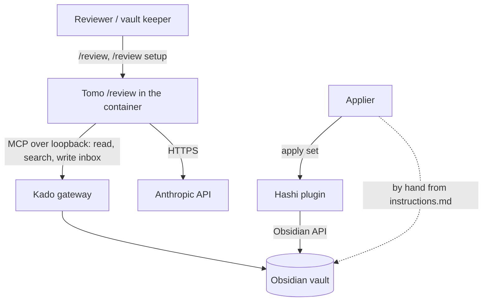
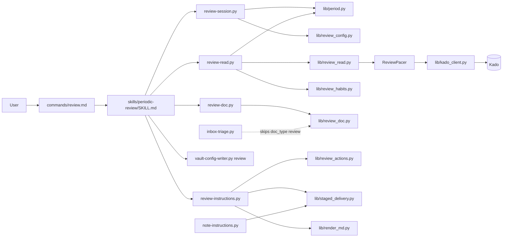
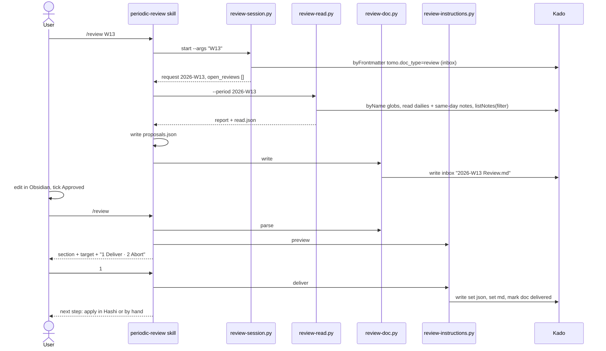
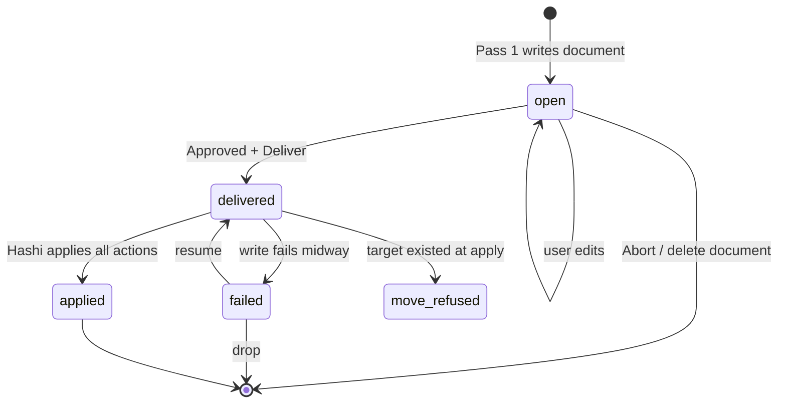

# Solution Design Document

## Validation Checklist

### CRITICAL GATES (Must Pass)

- [x] All required sections are complete
- [x] No [NEEDS CLARIFICATION] markers remain
- [x] Architecture pattern is clearly stated with rationale
- [x] **All architecture decisions confirmed by user**
- [x] Every interface has specification

### QUALITY CHECKS (Should Pass)

- [x] All context sources are listed with relevance ratings
- [x] Project commands are discovered from actual project files
- [x] Constraints → Strategy → Design → Implementation path is logical
- [x] Every component in diagram has directory mapping
- [x] Error handling covers all error types
- [x] Quality requirements are specific and measurable
- [x] Component names consistent across diagrams
- [x] A developer could implement from this design
- [x] Implementation examples use actual schema column names (not pseudocode), verified against migration files — N/A: no database; examples use the real config keys, file paths and Kado tool names
- [x] Complex queries include traced walkthroughs with example data showing how the logic evaluates

---

## Output Schema

### SDD Status Report

| Field | Type | Required | Description |
|-------|------|----------|-------------|
| specId | string | Yes | Spec identifier (NNN-name format) |
| architecture | ArchitectureSummary | Yes | Architecture overview |
| sections | SectionStatus[] | Yes | Status of each SDD section |
| adrs | ADRStatus[] | Yes | Architecture decision statuses |
| validationPassed | number | Yes | Validation items passed |
| validationPending | number | Yes | Validation items pending |
| nextSteps | string[] | Yes | Recommended next actions |

### ArchitectureSummary

| Field | Type | Required | Description |
|-------|------|----------|-------------|
| pattern | string | Yes | Selected architecture pattern |
| keyComponents | string[] | Yes | Main system components |
| externalIntegrations | string[] | No | External services integrated |

### SectionStatus

| Field | Type | Required | Description |
|-------|------|----------|-------------|
| name | string | Yes | Section name |
| status | enum: `COMPLETE`, `NEEDS_DECISION`, `IN_PROGRESS` | Yes | Current state |
| detail | string | No | What decision is needed or what's in progress |

### ADRStatus

| Field | Type | Required | Description |
|-------|------|----------|-------------|
| id | string | Yes | ADR identifier (e.g., ADR-1) |
| name | string | Yes | Decision name |
| status | enum: `CONFIRMED`, `PENDING` | Yes | Confirmation state |

---

## Constraints

- **CON-1 Runtime and language.** Python scripts run in the Tomo container (Python 3.11; the host test run needs ≥ 3.9, `pyproject.toml:13`). Dependencies are stdlib, PyYAML and jsonschema only (`docker/Dockerfile:11-13`); week arithmetic and parsing use the stdlib. Runtime prose in `tomo/dot_claude/` holds imperatives only; every WHY lives in `docs/tomo/<mirrored path>.md` and is written before the runtime text (CLAUDE.md). Every edited managed file bumps its `# version:`.
- **CON-2 Boundaries.** Tomo writes only to the inbox (MVP execution boundary); everything else reaches the vault as an instruction set the user applies in Hashi or by hand. No change to Hashi or Kado. No change to the eval-gated files (`agents/synthesis-conductor.md`, `agents/suggestion-conductor.md`, `skills/suggest-handling/SKILL.md`, `commands/inbox.md`, `dot_claude/settings.json`). The Hashi contract schema `tomo/schemas/hashi-instructions.schema.json` is a mirror and is never edited.
- **CON-3 Data protection.** All vault access goes through Kado and its key (MiYo Constitution L1). Tomo's own logs, stderr and cost records carry metadata only — paths, dates, counts, states (Constitution L2, PRD F7-AC1). Where read content rests on the machine is documented, not cleaned up (PRD F7-AC2, owner decision 2026-11-11).
- **CON-4 Rate limit.** Kado rate-limits per IP, by default 20 requests per 5 s, and that window is shared with the session's own `kado-*` MCP calls (`Kado/src/mcp/server.ts:105-157`, `Kado/docs/api-reference.md:41-84`). A review must pace and retry, never stop at a fixed budget (PRD F3).
- **CON-5 Test vault.** `/Volumes/Moon/Coding/MiYo/temp/Privat-Test/` is read-only for this work; live walks use March 2026; the daily gap after 2026-09-12 stays as it is.

## Implementation Context

### Required Context Sources

#### Documentation Context
```yaml
- doc: docs/XDD/specs/045-weekly-monthly-review/requirements.md
  relevance: CRITICAL
  why: "The approved PRD v1.2 — 8 features, 59 criteria this design must satisfy"

- doc: docs/XDD/specs/044-note-from-template/solution.md
  relevance: CRITICAL
  why: "The precedent: shim + skill + scripts, session start, staged and resumable delivery (ADR-2/3/6/7 of spec 044)"

- doc: docs/tomo/scripts/note-instructions.md
  relevance: HIGH
  why: "WHY of the deliver loop this design generalises (step order, identical-text resume, failed_step before upload)"

- doc: docs/tomo/scripts/inbox-triage.md
  relevance: HIGH
  why: "doc_type routing and the known-bucket rule the review document must fit"

- doc: docs/tomo/scripts/instruction-render.md
  relevance: MEDIUM
  why: "How instructions.md is rendered deterministically; the per-action branches extended here"

- doc: Kado/docs/api-reference.md
  relevance: HIGH
  why: "Rate limiter (:41-84), section reads (:226-247), universal filter (:1066-1092), listNotes fields (:1515-1540)"

- doc: PRIVACY.md
  relevance: HIGH
  why: "Gets the /review paragraph and the new 'Where content rests on your machine' section"

- doc: evals/README.md
  relevance: MEDIUM
  why: "How a plugin eval case is added; /review is not eval-gated, an eval suite is optional"
```

#### Code Context
```yaml
- file: tomo/dot_claude/commands/note.md
  relevance: HIGH
  why: "Shim pattern for commands/review.md"

- file: tomo/dot_claude/skills/note-from-template/SKILL.md
  relevance: HIGH
  why: "Skill-owned flow, plain-text approval form (:15-24), setup match/confirm loop (:62-76)"

- file: tomo/scripts/note-session.py
  relevance: HIGH
  why: "Session start that lists kept/unfinished/stale work before a new request"

- file: tomo/scripts/note-instructions.py
  relevance: CRITICAL
  why: "Deliver loop _deliver_step/_mark_in_flight/_record/_fail/_stable_block (:384-596) extracted into lib/staged_delivery.py"

- file: tomo/scripts/lib/note_meta.py
  relevance: MEDIUM
  why: "Meta dataclass pattern (steps_done, failed_step, frozen); stem regex is /note-specific"

- file: tomo/scripts/lib/kado_client.py
  relevance: CRITICAL
  why: "Retry loop (:721-753), _pace (:676-682), attempt_gate, call/attempt counters (:142-144), _search_all without filter (:638-674), list_notes (:243-273)"

- file: tomo/scripts/lib/link_members.py
  relevance: HIGH
  why: "LinkLookup context manager (:185-257) — the pacer pattern"

- file: tomo/scripts/inbox-triage.py
  relevance: HIGH
  why: "query_frontmatter buckets (:370-395), compute_new_sources (:434-456), _get_doc_type filename fallback (:574-599), pending loop (:939-951)"

- file: tomo/schemas/doc-frontmatter.schema.json
  relevance: HIGH
  why: "doc_type enum (:17) and per-type state branches (:58-101)"

- file: tomo/scripts/lib/tomo_lifecycle.py
  relevance: MEDIUM
  why: "STATE_MACHINE; tests/test_tomo_lifecycle.py:157-161 pins the doc-type set"

- file: tomo/schemas/instructions.schema.json
  relevance: HIGH
  why: "Producer schema — lacks replace_section"

- file: tomo/schemas/hashi-instructions.schema.json
  relevance: HIGH
  why: "Contract: insert_under_marker (:259-287), replace_section (:288-300), move_note (:88-104); read only"

- file: tomo/scripts/lib/render_md.py
  relevance: HIGH
  why: "insert_under_marker branch renders a blockquote (:297-308), no replace_section branch (:370)"

- file: tomo/scripts/lib/wire_snapshot_parity.py
  relevance: MEDIUM
  why: "Lists replace_section as never emitted (:58-62); the exemption goes"

- file: tomo/scripts/vault-config-writer.py
  relevance: HIGH
  why: "Text-preserving writer with subcommands (:9-17, :947-968); templates-include (:888) is the model for the new review subcommand"

- file: tomo/scripts/shared-ctx-builder.py
  relevance: MEDIUM
  why: "build_tracker_fields (:578), build_daily_log (:637), daily path strip (:672-685)"

- file: tests/test_note_privacy.py
  relevance: HIGH
  why: "Marker + USER_TEXT_FIELDS allowlist pattern for test_review_privacy.py"

- file: tests/note_fake_vault.py
  relevance: HIGH
  why: "In-process fake Kado for script tests"

- file: Hashi/src/actions/insertUnderMarker.ts, replaceSection.ts, moveNote.ts
  relevance: HIGH
  why: "Verified apply semantics: placement before/after/inside, section end rule, move refusal on existing target"
```

#### External APIs (if applicable)
```yaml
- service: Kado MCP gateway
  doc: Kado/docs/api-reference.md
  relevance: CRITICAL
  why: "Only vault surface; rate limit with Retry-After ≤ 5 s; empty search can mean denial"

- service: Hashi instruction executor (Obsidian plugin)
  doc: tomo/schemas/hashi-instructions.schema.json (v3 mirror)
  relevance: HIGH
  why: "Applies the review set; lists *_instructions.json in the inbox root and writes per-action applied:true"
```

### Implementation Boundaries

- **Must Preserve:** `/inbox` triage output and routing for every existing doc type; `/note` delivery behaviour and its tests after the deliver loop moves into a lib; the wire schema version; `kado_client` behaviour for existing callers (new counters and the new exception subclass are additive — `KadoRateLimitError` subclasses `KadoError`, so existing `except KadoError` keeps catching it).
- **Can Modify:** `kado_client.py` (counters, `KadoRateLimitError`, `filter` parameter), `inbox-triage.py` (review skip), `doc-frontmatter.schema.json`, `tomo_lifecycle.py`, `instructions.schema.json` (add `replace_section`), `render_md.py` (review-ready branches), `wire_snapshot_parity.py`, `note-instructions.py` (call the extracted lib), `vault-config-writer.py` (new subcommand), `PRIVACY.md`, `tomo/config/vault-example.yaml` (weekly pattern `GGGG-[W]WW`, review section).
- **Must Not Touch:** the five eval-gated files; `hashi-instructions.schema.json`; Hashi and Kado repos; `tomo-privat`; the test vault; `~/.tomo`.

### External Interfaces

#### System Context Diagram



#### Interface Specifications

```yaml
inbound:
  - name: "/review slash command"
    type: Claude Code command in the Tomo container session
    format: "$ARGUMENTS free text: '', 'month', 'setup', 'W13', '2026-W13', 'M03', '2026-03', '@<vault path>'"
    data_flow: "User request → skill"

outbound:
  - name: "Kado MCP"
    type: HTTP JSON-RPC over loopback (kado_client)
    format: kado-read, kado-search, kado-write
    authentication: bearer token from the instance .mcp.json
    data_flow: "Reads dailies, linked notes, weekly notes, templates, target note, instruction JSON; writes inbox files only"
    criticality: HIGH

  - name: "Anthropic API"
    type: HTTPS (Claude Code session)
    data_flow: "Read content of the period goes to the model to write proposals (PRIVACY.md)"
    criticality: HIGH

data:
  - name: "Instance config"
    type: YAML file config/vault-config.yaml
    connection: vault-config-writer.py (write), note_io.load_vault_config (read)
    data_flow: "Periodic note setup and the review section"

  - name: "Working folder"
    type: files under tomo-tmp/review/<stem>/
    data_flow: "read.json (content, Pass 1 only), proposals.json (model output), meta.json (content-free delivery state)"

  - name: "Inbox"
    type: vault folder via Kado
    data_flow: "<name> Review.md, the new periodic note, <stem>_instructions.json, <stem>_instructions.md"
```

### Cross-Component Boundaries (if applicable)

- **API Contracts:** the Hashi instruction schema v3 (unchanged; this design only emits actions it already defines). The `doc-frontmatter` `tomo:` block (one new doc type). Kado tool semantics (unchanged; the `filter` argument already exists server-side).
- **Team Ownership:** Tomo owns everything changed here. Hashi and Kado are consumed as they are; no handoff is needed.
- **Shared Resources:** the Kado rate-limit window (shared with the session's MCP calls and any other Tomo run); the inbox folder (shared with `/inbox` and `/note`).
- **Breaking Change Policy:** no wire change. Adding `replace_section` to the producer schema aligns it with the contract it mirrors; the schema_version stays.

### Project Commands

```bash
# Discovered from pyproject.toml, venv/ and evals/README.md
Install: none for this spec — the repo's ./venv already carries pytest and ruff (no requirements file exists); the container image needs no change
Test:    ./venv/bin/python -m pytest tests/ -q
Test one area: ./venv/bin/python -m pytest tests/test_review_*.py tests/test_period.py -q
Lint:    ./venv/bin/ruff check tomo/scripts scripts tests
Integration (opt-in, Privat-Test): ./venv/bin/python -m pytest -m integration tests/
Eval (paid, owner-run only):       scripts/run-evals.sh --case <review case>
Sync to the test instance (owner instruction only): scripts/update-tomo.sh --instance tomo-instance --yolo
```

## Solution Strategy

- **Architecture Pattern:** the `/note` pattern (spec 044): a command shim, one skill that owns the dialogue, and deterministic scripts that own every state change, every vault read and write and every rendering. The model does exactly one creative step — writing the proposal texts from the read period into a JSON file the scripts validate.
- **Integration Approach:** `/review` is a new command beside `/inbox` and `/note`. It reuses Kado access, the frontmatter block, the instruction-set builder pieces, the readable-instructions renderer and the staged delivery loop (extracted from `note-instructions.py`). `/inbox` learns one thing: skip the `review` doc type. Hashi needs nothing.
- **Justification:** the PRD forbids a black box (every item editable before it lands) and requires the same 2-pass shape as `/inbox` without touching its eval-gated files. The `/note` pattern already passed its live walk and eval with that shape; copying it keeps the risky parts (delivery, resume, privacy) on proven code.
- **Key Decisions:** ADR-1 to ADR-12 below. In short: state lives in the vault, not in `tomo-tmp` (the user edits between passes); the review section is found again by a marker and replaced, never doubled; Kado is paced and retried; weeks follow a rule `(first_day, min_days_in_first_week)` read from the user's notes or asked; Templater templates use a Tomo variant or stay raw with a hint; privacy is documented, not cleaned up.

## Building Block View

### Components



Responsibilities (one owner each):

| Component | Owns |
|---|---|
| `commands/review.md` | Invoking the skill in-session with `$ARGUMENTS` verbatim |
| `skills/periodic-review/SKILL.md` | The dialogue order: start → setup → read → propose → write doc → continue → preview → deliver; plain-text confirmations |
| `lib/period.py` | Week/month arithmetic, the week rule, name-format rendering and parsing, overlapping weeks, argument parsing to a `Period` |
| `lib/review_config.py` | Reading the review setup (config over profile), validating it, the heading-level check of the place |
| `review-session.py` | `start` (parse request, list open reviews), `match` (setup preview against existing notes), `setup-input` (build the writer input from a confirmed proposal) |
| `vault-config-writer.py review` | Writing the confirmed setup into `vault-config.yaml` text-preservingly |
| `lib/review_read.py` + `review-read.py` | Reading the period through Kado under the pacer; splitting dailies into configured sections; same-day link resolution; tasks by ✅ date; weekly-note day blocks; vault growth; per-day report; `read.json` |
| `ReviewPacer` (in `lib/review_read.py`) | Pacing, adaptive slow-down, retry accounting, the not-read list, abort on connection/auth errors |
| `lib/review_habits.py` | Tracker numbers (counts, averages, missing/unreadable days, yesterday shift) |
| `lib/review_doc.py` + `review-doc.py` | Validating `proposals.json`, rendering the review document, parsing the edited document, escaping, start-over replacement, delivered marking |
| `lib/review_actions.py` | Choosing insert vs replace vs new note, building the review section text and the actions, the applied reader |
| `lib/staged_delivery.py` | The ordered, resumable, identical-text-idempotent write of inbox payloads (extracted from `note-instructions.py`) |
| `review-instructions.py` | `preview`, `deliver`, `drop`, `status` subcommands over the above |
| `lib/render_md.py` | Readable `instructions.md`: copy-ready fenced content for `insert_under_marker` and `replace_section`, placement wording |
| `inbox-triage.py` | Treating `review` documents as known and skipping them silently |

### Directory Map

**Component**: runtime (synced into the instance)
```
tomo/
├── dot_claude/
│   ├── commands/
│   │   └── review.md                         # NEW: shim
│   └── skills/
│       └── periodic-review/
│           └── SKILL.md                      # NEW: the /review flow
├── scripts/
│   ├── review-session.py                     # NEW: start / match / setup-input
│   ├── review-read.py                        # NEW: read the period → read.json + report
│   ├── review-doc.py                         # NEW: write / parse / replace / mark-delivered
│   ├── review-instructions.py                # NEW: preview / deliver / drop / status
│   ├── vault-config-writer.py                # MODIFY: + `review` subcommand
│   ├── note-instructions.py                  # MODIFY: use lib/staged_delivery.py
│   ├── inbox-triage.py                       # MODIFY: review doc_type filename rule + silent skip
│   └── lib/
│       ├── period.py                         # NEW
│       ├── review_config.py                  # NEW
│       ├── review_read.py                    # NEW (incl. ReviewPacer)
│       ├── review_habits.py                  # NEW
│       ├── review_doc.py                     # NEW
│       ├── review_actions.py                 # NEW
│       ├── staged_delivery.py                # NEW: extracted deliver loop
│       ├── kado_client.py                    # MODIFY: counters, KadoRateLimitError, filter
│       ├── render_md.py                      # MODIFY: copy-ready insert/replace branches
│       ├── tomo_lifecycle.py                 # MODIFY: + review
│       └── wire_snapshot_parity.py           # MODIFY: drop replace_section exemption
├── schemas/
│   ├── doc-frontmatter.schema.json           # MODIFY: + review doc_type
│   ├── instructions.schema.json              # MODIFY: + replace_section
│   ├── review-proposals.schema.json          # NEW: model output contract
│   └── vault-config-review.schema.json       # NEW: writer input contract
└── config/
    └── vault-example.yaml                    # MODIFY: weekly "GGGG-[W]WW", review section example
```

**Component**: documentation (WHY layer, written before the runtime text)
```
docs/tomo/
├── dot_claude/commands/review.md             # NEW
├── dot_claude/skills/periodic-review.md      # NEW
└── scripts/
    ├── review-session.md, review-read.md, review-doc.md, review-instructions.md   # NEW
    ├── lib/period.md, review_config.md, review_read.md, review_habits.md,
    │   review_doc.md, review_actions.md, staged_delivery.md                        # NEW
    ├── vault-config-writer.md, inbox-triage.md, note-instructions.md,
    │   instruction-render.md, lib/kado_client.md                                   # MODIFY
PRIVACY.md                                    # MODIFY: /review paragraph + where content rests
docs/setup.md                                 # MODIFY: protect the instance like the vault (link to PRIVACY)
tomo/dot_claude/commands/tomo-help.md         # MODIFY: list /review
```

**Component**: tests (host only)
```
tests/
├── test_period.py                            # NEW: arithmetic, rule, formats, arguments
├── test_review_config.py                     # NEW
├── test_review_session.py                    # NEW
├── test_review_read.py                       # NEW (fake vault, pacer, same-day rule, tasks)
├── test_review_habits.py                     # NEW
├── test_review_doc.py                        # NEW (render, parse, escape, edits)
├── test_review_instructions.py               # NEW (insert/replace/new note, resume, applied)
├── test_review_privacy.py                    # NEW (marker allowlist)
├── test_staged_delivery.py                   # NEW (+ existing /note tests stay green)
├── test_vault_config_writer_review.py        # NEW
├── test_inbox_triage_review_skip.py          # NEW
├── test_kado_client_rate_limit.py            # NEW
├── review_fake_vault.py                      # NEW: extends note_fake_vault with listNotes filter, 429 injection
└── test_tomo_lifecycle.py                    # MODIFY: doc-type set
```

### Interface Specifications

#### Interface Documentation References

```yaml
interfaces:
  - name: "Hashi instruction set v3"
    doc: tomo/schemas/hashi-instructions.schema.json
    relevance: CRITICAL
    sections: [insert_under_marker, replace_section, move_note, applied_field]
    why: "The only way the review reaches a periodic note"

  - name: "Tomo document frontmatter"
    doc: tomo/schemas/doc-frontmatter.schema.json
    relevance: HIGH
    sections: [doc_type enum, per-type states]
    why: "The review document's tomo block"

  - name: "Review proposals (model → scripts)"
    doc: tomo/schemas/review-proposals.schema.json (NEW)
    relevance: HIGH
    why: "The one LLM-authored artifact; validated before it reaches the document"

  - name: "Review setup writer input"
    doc: tomo/schemas/vault-config-review.schema.json (NEW)
    relevance: MEDIUM
    why: "Never hand-composed YAML"
```

#### Data Storage Changes

No database. Two persistent shapes change.

```yaml
# config/vault-config.yaml (written by vault-config-writer.py review)
concepts.calendar.granularities.weekly:  {enabled: true, path: "Calendar/302 Weekly/"}     # existing keys, now set
concepts.calendar.granularities.monthly: {enabled: true, path: "Calendar/303 Monthly/"}
concepts.calendar.granularities.daily.path: "Calendar/301 Daily/"   # only when the user confirms the trailing-space fix
naming.calendar_patterns.weekly:  "GGGG-[W]WW"
naming.calendar_patterns.monthly: "YYYY-MM"
templates.mapping.weekly:  "t_week_privat.md"      # as found; may be absent
templates.mapping.monthly: "t_month_privat.md"

review:                                  # NEW top-level section
  language: de                           # review language (default: frontmatter locale of the dailies)
  week:
    first_day: monday                    # monday..sunday
    min_days_in_first_week: 4            # 4 = ISO; 1 = week 1 contains 1 January
  daily:
    sections: ["Habit", "5 Year Journal", "Start of the Day", "ToDos", "Daily Log", "End of the Day"]
    skip_sections: ["On This Day... last year"]   # prefix match on heading text
    task_notes: ["Efforts/500 OnGoing/Next Todos.md"]   # living task notes
  weekly:
    heading: "Tomo Review"
    place: {anchor: "In my own words", placement: before}
    own_sections: ["In my own words", "Reflections"]
    template_variant: null               # e.g. "t_week_privat_tomo.md"
  monthly:
    heading: "Tomo Review"
    place: {anchor: "In my own words", placement: before}
    own_sections: ["In my own words", "Reflections"]
    template_variant: null
```

Tracker fields are not duplicated: F8 reads the existing `trackers.daily_note_trackers` (`today_fields`, `yesterday_fields`, `end_of_day_fields`) and their types; the setup may propose a type change (for example `Sleep` `text` → `duration`) through the existing `vault-config-writer.py trackers` subcommand.

```yaml
# tomo-tmp/review/<stem>/   (<stem> = "<period-name>_review", e.g. "2026-W13_review")
read.json        # content of the period (Pass 1 only; deleted after the document is written or on abort)
proposals.json   # model output (Pass 1 only; deleted with read.json)
meta.json        # content-free: period, kind, doc_path, target, mode, generated, steps_done, failed_step
```

#### Internal API Changes

Script CLIs (all print one JSON object on stdout, exit 0 for usable output; stderr carries a problem class only, never text or titles):

```yaml
review-session.py start --args '<raw $ARGUMENTS>'
  out: {request: {kind: week|month|setup, period?: "2026-W13", year_inferred?: bool, source?: "arg|at|default"},
        open_reviews: [{period, kind, doc_path, state: open|delivered|partly-applied|failed-delivery, stem}],
        setup: {week: present|missing, month: present|missing},
        error?: {kind: invalid-period|unfinished-period|not-periodic-note|unknown-argument, expected, example}}

review-session.py match --kind week|month [--folder P] [--format F] [--first-day D] [--min-days N]
  out: {proposal: {folder, format, first_day, min_days, template, template_kind: plain|templater|missing|unreadable,
                   heading, place, own_sections, daily_sections, language},
        evidence: {matched: [names], unmatched: [names], week_rule: inferred|ambiguous|default, notes_checked: n},
        daily_path_fix?: {configured: "Calendar/301 Daily/ ", found: "Calendar/301 Daily/"}}

review-session.py setup-input --kind week|month --confirmed <json file>  → writes the writer input file, prints its path

vault-config-writer.py review --input <json>   (validated against vault-config-review.schema.json)

review-read.py --period 2026-W13 --kind week [--stem S]
  out: {stem, report: {days: [{date, daily: found|missing|empty|failed, linked: [{path, state}]}],
                       weekly_notes?: [{path, state}], calls, retried, waited_s, not_read: [paths],
                       kado_empty: [sources]},
        read_path: "tomo-tmp/review/<stem>/read.json", nothing_to_review: bool}

review-doc.py write --stem S --proposals tomo-tmp/review/<stem>/proposals.json
  out: {doc_path, target, target_exists, counts: {group: n}, rejected: [{group, index, reason}]}

review-doc.py parse --stem S            (reads the doc through Kado)
  out: {approved: bool, items: {group: [{origin: tomo|user, kept: bool}]}, counts..., warnings: [kind]}

review-doc.py replace --stem S --confirm   (start over; after the skill asked)

review-instructions.py preview --stem S
  out: {mode: insert|replace|new-note, target, place, section_md, escaped_lines: n, templater_hint: bool,
        problems: [place-missing|user-heading-collision|nothing-to-deliver], headings?: [names]}

review-instructions.py deliver --stem S [--place-anchor H]
  out: {status: delivered|resumed|stopped, step, paths: {set_json, set_md, note?}, next: hashi-or-by-hand}

review-instructions.py drop --stem S
review-instructions.py status --stem S   → {state: open|delivered|applied|partly-applied|move-refused}
```

#### Application Data Models

```pseudocode
ENTITY: Period (NEW, lib/period.py)
  FIELDS: kind: week|month, year: int, number: int, start: date, end: date (inclusive), name: str
  BEHAVIORS:
    days() -> list[date]
    weeks_overlapping() -> list[Period]            # month only
    is_finished(today) -> bool                     # end < today
    note_path(folder, fmt, rule) -> list[str]      # flat, then <folder>/<YYYY>/ fallback

ENTITY: WeekRule (NEW)
  FIELDS: first_day: 0..6 (0 = Monday), min_days_in_first_week: 1..7
  BEHAVIORS: week_of(date) -> (week_year, week); week_start(week_year, week) -> date; weeks_in(week_year) -> 52|53
  INVARIANT: ISO == WeekRule(0, 4)

ENTITY: ReviewSetup (NEW, lib/review_config.py) — the `review:` section plus calendar/naming/templates keys
  BEHAVIORS: validate(); place_level(target_headings) -> int; check_format(fmt, rule) -> warnings

ENTITY: ReadResult (NEW) — read.json
  FIELDS: period, days: [{date, sections: {name: text}, fields: {name: raw}, tasks: [{text, done, done_date, source}],
          linked: [{path, kind: planner|journal|other, text}]}],
          weekly: [{path, day_blocks: {date: text}, week_text: {section: text}, links: [target]}],
          growth: {created: [{path, links}], mocs_changed: [path], mocs_linked_by_new: [path]},
          only_in_weekly_links: [target], dailies_not_in_weekly: [target], report: ...

ENTITY: Proposals (NEW) — proposals.json (model output)
  FIELDS: language, groups: {done|open|themes|growth|weekly_only|resurfaced: [{text, sources: [vault path]}]}
  RULE: every item has ≥ 1 source inside the period (daily of a day in the period, or for weekly_only a weekly note
        of an overlapping week); the habits group is never in this file (lib/review_habits.py builds it)

ENTITY: ReviewDoc (NEW) — the inbox document
  FRONTMATTER: tomo: {doc_type: review, state: pending-approval|approved, period, kind, target, target_exists,
                      language, stem, generated}
  BODY: title, info callout (target, place, not-read list), "- [ ] Approved", one H2 per group,
        items "- [x] text (sources)" with 2-space-indented continuation lines

ENTITY: ApprovedReview (NEW) — parse result: ordered groups → kept item texts (Tomo and user items)

ENTITY: ReviewDeliveryMeta (NEW, content-free) — meta.json
  FIELDS: stem, period, kind, doc_path, target, mode, generated, steps_done: [doc-mark|note|set_json|set_md],
          failed_step
```

#### Integration Points

```yaml
- from: periodic-review skill
  to: scripts
    - protocol: Bash invocations, JSON on stdout, files under tomo-tmp/review/<stem>/
    - data_flow: "Requests, reports and previews; the model writes proposals.json only"

- from: review scripts
  to: Kado
    - protocol: kado_client (JSON-RPC over loopback)
    - endpoints: kado-read (note, frontmatter), kado-search (byName glob, listNotes with filter, byFrontmatter), kado-write (inbox only)
    - data_flow: "Period reads; inbox writes; target and instruction JSON reads for mode and applied state"

- from: inbox-triage.py
  to: review documents
    - data_flow: "Filename rule ' Review' inside the pending-approval/approved buckets → doc_type review → skipped before any read"

Hashi:
  - doc: tomo/schemas/hashi-instructions.schema.json
  - integration: "Lists <stem>_instructions.json in the inbox root, validates by schema, applies, writes applied:true per action"
  - critical_data: [target_path, anchor heading text, placement, content, source/destination of move_note]
```

### Implementation Examples

#### Example: the week rule and ISO week 53

**Why this example**: week numbering decides which note a review targets; a wrong rule creates a duplicate weekly note (PRD risk 1).

```python
# lib/period.py — guidance, not the exact implementation
from datetime import date, timedelta

def week_start_of_year(week_year: int, first_day: int, min_days: int) -> date:
    jan1 = date(week_year, 1, 1)
    # first day of the week containing 1 January
    start = jan1 - timedelta(days=(jan1.weekday() - first_day) % 7)
    days_in_year_of_that_week = 7 - (jan1 - start).days
    return start if days_in_year_of_that_week >= min_days else start + timedelta(days=7)

def week_of(d: date, first_day: int, min_days: int) -> tuple[int, int]:
    for wy in (d.year + 1, d.year, d.year - 1):
        s = week_start_of_year(wy, first_day, min_days)
        if d >= s:
            return wy, (d - s).days // 7 + 1
```

Traced walkthrough (verified with the stdlib against `date.isocalendar()` for ISO):

| Input | Rule | Result | Note |
|---|---|---|---|
| 2026-03-26 | ISO (Mon, 4) | 2026-W13, Mon 2026-03-23 .. Sun 03-29 | matches the vault note `2026-W13.md` |
| 2026-12-31 | ISO | 2026-W53 (Dec 28 .. Jan 3) | 2026 has 53 ISO weeks |
| 2027-01-01 | ISO | 2026-W53 | `YYYY-[W]WW` would give "2027-W53" → `check_format` warns on calendar-year + week tokens |
| 2025-12-29 | ISO | 2026-W01 | week spanning two years (F2-AC9) |
| 2025-W53 | ISO | invalid (2025 has 52) | F2-AC7 error, example `2025-W52` |
| 2026-03-01 | (Sun, 1) | 2026-W10 | ISO says W09 → shown as unmatched in the setup preview when it contradicts existing notes |

Name formats are Moment-style and support only the tokens a periodic name needs: `GGGG`/`gggg` (week year), `WW`/`W`/`ww`/`w` (week), `YYYY`, `MM`, `M`, literals in `[...]`. `GGGG/WW` require the ISO rule; `gggg/ww` follow the configured rule; a format mixing `YYYY` with a week token is refused by `check_format` with the year-end example above.

**Week-rule inference (F1-AC3, F1-AC6):** `match` reads the frontmatter of up to 8 recent weekly notes (`journal-start-date`/`journal-end-date` when present, else the dated links of the note's day headings). The first day is the weekday of the start dates; `min_days` is fixed by the first note of a year whose week 1 is known. If all checked notes agree, `week_rule: inferred`; if they disagree or none carry dates, `week_rule: ambiguous` and the skill asks the user in plain words ("Which day does your week start on? Is week 1 the week with 1 January, or the first week with at least four days in the new year?") and maps the answer to `(first_day, min_days)`. The Obsidian plugin configuration is never read for this.

#### Example: same-day reading of one daily

**Why this example**: the owner's dailies link tomorrow's planner and embed last year's log; reading "whatever is linked" would put other days into the week.

```text
ALGORITHM: read_day(date D, daily text T, setup S)
1. Split T into heading sections; keep sections whose heading text is in S.daily.sections; drop sections matching
   S.daily.skip_sections (prefix) — e.g. "On This Day... last year - <weekday>".
2. In kept sections, drop fenced dataview/dataviewjs blocks and inline `= ...` queries (never executed).
3. Collect links and embeds (wiki links, quoth `path:`, dynbedded targets). A target is same-day when its name
   contains D in the daily format (DP-2026-03-26, 5J-2026-03-26); a living task note in S.daily.task_notes is
   always read once for the period, not per day; anything else is ignored.
4. Read each same-day note once (paced). Inside it, drop embeds and sections whose heading names another date or
   year (the 5 Year Journal's "earlier years" subsections).
5. Parse fields `Name:: value` and `**Name**:: value`; yesterday_fields are attributed to D-1.
6. Parse tasks `- [x] … ✅ YYYY-MM-DD`: a task counts as done in the period iff its ✅ date is in the period,
   whichever file holds it; open tasks from task notes are labelled "open today".
```

Trace on 2026-03-26 (structure only): the daily links `DP-2026-03-27` in its `DayPlanner::` field (other day → ignored) and embeds `DP-2026-03-26` via quoth (same day → read); `JahresJournal:: … [[5J-2026-03-26]]` → read, its "earlier years" subsections dropped; `![[2025-03-26#Daily Log]]` sits in the skipped "On This Day" section → not read. `DayEnergy` holding an unrun `<% … %>` on two March days → value unreadable (F8-AC2).

#### Example: the review section and the heading-level rule

**Why this example**: Hashi ends a section at the next heading of the same or higher level; a review heading one level too high swallows the user's own section and a rerun would delete it.

```text
place = before "### In my own words" (level 3)  → review heading level 3, groups level 4

### Tomo Review
%% tomo-review 2026-W13 %%
#### Erledigt
- … ([[2026-03-24]], [[2026-03-26]])
#### Offen
- …
(blank line)
### In my own words          ← untouched; the replace_section of a rerun stops here
```

Rules in `lib/review_actions.py`:
- placement `before`/`after` heading of level n → review heading level n; `inside` → n+1; groups one level deeper; a level above 6 is refused at setup.
- item lines starting with `#`, `- [`, `>`, or a code fence are escaped (`\#`, `- \[`, `\>`, the fence's backticks escaped); the preview reports the count (F5-AC2).
- content ends with one blank line; it is a pure function of the approved document (no clock values), so Hashi's identical-block check makes a resumed insert idempotent.
- rerun: the target is read through Kado; a heading equal to `heading` followed by the marker line of the same period → `replace_section` on that heading; the same heading without the marker → `user-heading-collision`, never replaced.

#### Example: pacer

**Why this example**: the PRD replaces a call budget with pace-and-retry; the policy must be testable without Kado.

```python
class ReviewPacer:                      # lib/review_read.py, modelled on link_members.LinkLookup
    START, MAX = 0.3, 2.0               # seconds between sends; 0.25 s is exactly 20 per 5 s
    def __init__(self, client):
        self.client, self.not_read = client, []
        self._saved = client.min_interval
        client.min_interval = self.START
    def read(self, path, fn):
        before = self.client.retry_count
        try:
            return fn(path)
        except KadoRateLimitError:      # 429/503 outlasted the client's retries (Retry-After honoured)
            self.not_read.append(path); return None
        finally:
            if self.client.retry_count > before:
                self.client.min_interval = min(self.MAX, self.client.min_interval * 2)
    # KadoConnectionError / KadoAuthError propagate → review-read.py stops, writes nothing (F3-AC10)
    def summary(self):
        return {"calls": self.client.call_count, "retried": self.client.retry_count,
                "waited_s": round(self.client.retry_wait_s + self.client.pace_wait_s, 1),
                "not_read": self.not_read}
```

Estimate (inferred from the test vault): a week ≈ 30 calls (≈ 9 s at 0.3 s), a month ≈ 110 calls (≈ 35 s), well inside the 5-minute KPI even with several 5 s `Retry-After` waits.

#### Test Examples as Interface Documentation

```python
def test_week_53_belongs_to_the_old_week_year():
    assert period.parse("2026-W53", today=date(2027, 1, 10)).days()[-1] == date(2027, 1, 3)

def test_a_link_to_tomorrows_planner_is_not_read(review_fake_vault):
    result = read_period(review_fake_vault, Period.week(2026, 13))
    assert "Efforts/300 Planner/DP-2026-03-30.md" not in result.paths_read

def test_rerun_replaces_the_marked_section_only(review_fake_vault):
    actions = build_actions(approved, target_text=WEEKLY_WITH_MARKED_SECTION)
    assert [a["action"] for a in actions] == ["replace_section"]

def test_a_user_heading_named_like_the_review_is_never_replaced():
    assert preview(...)["problems"] == ["user-heading-collision"]
```

## Runtime View

### Primary Flow

#### Primary Flow: finished week to applied review

1. User runs `/review` (or `W13`, `2026-W13`, `@…/2026-W13.md`).
2. `review-session.py start` parses the request and lists open reviews; the skill offers any open review first (F2-AC1).
3. If the period kind is not set up, the setup dialogue runs (F1), saves via `vault-config-writer.py review`, and the request continues.
4. `review-read.py` reads the period under the pacer and prints the per-day report; nothing to review → stop, nothing written.
5. The model reads `read.json` and writes `proposals.json` (one creative step).
6. `review-doc.py write` validates, renders and writes `<name> Review.md` to the inbox; `read.json` and `proposals.json` are deleted.
7. User edits the document in Obsidian, ticks Approved.
8. User runs `/review` again → open review offered → `review-doc.py parse` → `review-instructions.py preview` → the skill prints the section, target and place in plain text and asks `1 Deliver · 2 Abort`.
9. `review-instructions.py deliver` writes (new note,) set JSON, set MD, then marks the document delivered.
10. User applies in Hashi (or by hand); the next `/review` reads `applied` from the set JSON.



### Error Handling

- **Invalid input** (`2026-W54`, `2026-13`, `month 2026-W13`, unknown word, `@` note not periodic): `start` returns `error` with what was expected and one valid example; the skill prints it; nothing written (F2-AC6/7).
- **Unfinished or future period:** `error.kind = unfinished-period` with the last finished period named (F2-AC5).
- **Kado unreachable / auth refused:** `KadoConnectionError`/`KadoAuthError` → the script stops with a problem class on stderr and `status: stopped` on stdout; the skill shows it; nothing written (F3-AC10).
- **Rate limit:** retried inside the client (Retry-After honoured); the pacer slows down; what still fails is listed as not read in the report and at the top of the document (F3-AC11/12/13).
- **Empty results:** a source with `[]` is reported as "Kado returned none" with the hint that the key may not reach the folder (Rule 6, F3-AC9); no daily with content → `nothing_to_review` and no document.
- **Template missing or unreadable:** setup proposes the plain note and says an unreadable template may mean no access (F1-AC7).
- **Not approved:** `parse` → `approved: false` → the skill names the box; nothing delivered (F5-AC1). Everything unticked → `nothing-to-deliver` → offer Abort or start over.
- **Place missing in the target:** `preview` → `place-missing` with the note's headings; the skill asks for one or Abort; `deliver --place-anchor` uses the choice (F5-AC6).
- **Same-named user heading:** `user-heading-collision` → never replaced; ask for another heading or Abort.
- **Delivery fails midway:** `staged_delivery` records `failed_step` before each upload; the next `/review` sees `failed-delivery` and offers resume or drop; identical payloads count as done (F5-AC9).
- **Target created between passes:** at delivery the target is probed; if it now exists, mode switches from new-note to insert (F6-AC4). If it appears after delivery, Hashi refuses the move ("Inconsistent state"); `status` reports `move-refused` on the next `/review`.
- **Second delivery for a period:** `start` lists the delivered-not-applied set; `deliver` refuses a second set for the same stem (F6-AC2).

### Complex Logic (if applicable)

```
ALGORITHM: open-review state (review-session.py start / review-instructions.py status)
INPUT: inbox review documents found by byFrontmatter tomo.doc_type=review, their set JSON, meta.json
1. doc state pending-approval and no set JSON                 → open
2. meta.failed_step set                                        → failed-delivery (resume | drop)
3. set JSON present, every action applied:true                 → applied (not offered; reported once)
4. set JSON present, some applied, move_note not applied while
   target exists and inbox copy remains                        → move-refused
5. set JSON present, not all applied                           → delivered (waits for Hashi)
OUTPUT: list ordered by period; the skill offers 1, 2, 4, 5 before the new request
```

```
ALGORITHM: month reading (F3-AC5/6)
1. weeks = month.weeks_overlapping(rule)               # March 2026, ISO: W09..W14
2. for each week: resolve its note; read it; split day blocks by headings that link a daily (date key);
   drop blocks dated outside the month; keep week-level text tagged with the week and its overlap (days in month)
3. only_in_weekly_links = links in hand-written weekly text − links in any daily of the month
4. dailies_not_in_weekly = links of dailies of the month − links in the weekly notes of their week
5. the model gets both lists as hints; the "weekly_only" and "resurfaced" groups are its proposals over them
6. no weekly notes at all → those groups absent; report says "no weekly notes found"
```

## Deployment View

No change to the deployment. `/review` ships through the existing `install-tomo.sh` / `update-tomo.sh` sync (new files and version bumps), which installs the command, skill, scripts, schemas and libs into the instance. No Docker image change (stdlib only). The setup writes the instance config on first use. Live verification on `tomo-instance` only, after an owner-instructed sync.

## Cross-Cutting Concepts

### Pattern Documentation

```yaml
- pattern: shim command + skill-owned flow + deterministic scripts (spec 044)
  relevance: CRITICAL
  why: "Same 2-pass shape, keeps the model to one creative step"

- pattern: staged resumable delivery with identical-text idempotency (spec 044 ADR-2)
  relevance: CRITICAL
  why: "F5-AC9 resume without duplicates; moved into lib/staged_delivery.py and shared"

- pattern: LinkLookup budget/pace context (spec 042)
  relevance: HIGH
  why: "Template for ReviewPacer"

- pattern: marker + allowlist privacy test (spec 044)
  relevance: HIGH
  why: "F7-AC1"

- pattern: text-preserving vault-config-writer subcommand + JSON schema + skill step
  relevance: HIGH
  why: "Setup without hand-composed YAML"

- pattern: section marker line for Tomo-owned sections (NEW)
  relevance: HIGH
  why: "Recognise and replace the review section on a rerun, never a user heading"
```

### User Interface & UX (if applicable)

**Information Architecture:**
- Entry points: `/review`, `/review month`, `/review setup`, period arguments, `@`-picked notes (the instance's Kado-backed picker `tomo/dot_claude/scripts/file-suggestion.sh` already lists vault notes).
- The review document is the only editing surface; the console shows reports, the preview and two-choice questions.

**Interaction Design:**
- Confirmations are plain text with a numbered choice line and the turn ends there (spec 044 lesson: AskUserQuestion after a bare read is unreliable live and absent in evals).
- Every report names counts and states; empty Kado results are named as such.

```
2026-W13 Review.md (inbox)
┌──────────────────────────────────────────────────────────┐
│ # 2026-W13 Review                                         │
│ > [!info] Ziel: [[2026-W13]] (vorhanden) · vor            │
│ >  "In my own words" · nicht gelesen: DP-2026-03-28       │
│ - [ ] Approved                                            │
│ ## Erledigt                                               │
│ - [x] … ([[2026-03-24]], [[2026-03-26]])                  │
│ ## Offen                                                  │
│ ## Wiederkehrende Themen                                  │
│ ## Vault-Wachstum                                         │
│ ## Gewohnheiten                                           │
│ - [x] Sport: 5 von 7 Tagen (fehlt: 2026-03-28)            │
└──────────────────────────────────────────────────────────┘
```



### System-Wide Patterns

- **Security:** Kado key permissions only; inbox-only writes; no new network surface.
- **Error Handling:** scripts exit 0 with a `status`/`problems` field for usable outcomes; non-zero only for usage errors; stderr = problem class only.
- **Performance:** paced Kado calls (0.3 s start, ≤ 2 s); dailies read as whole notes and split locally (one call per day); growth in two filtered `listNotes` calls; `read.json` holds only configured sections to bound model input.
- **i18n/L10n:** group headings, habit wording and report lines come from a small per-language table (de, en; fallback en); month names never depend on the process locale; the review language is a setup value defaulting to the dailies' `locale`.
- **Logging/Auditing:** the "Review read", "Review document written" and "Review delivered" summaries are JSON on stdout with counts and states only; run cost goes to the existing cost log by hand after live runs.

### Multi-Component Patterns (if applicable)

- **Communication Patterns:** request/response over Kado MCP; Hashi is asynchronous via files in the inbox.
- **Data Consistency:** guarded writes with `expected_modified` for the document's delivered mark; idempotent payloads; Hashi's own refusal on move conflicts.
- **Shared Code:** `lib/staged_delivery.py` shared by `/note` and `/review`; `render_md` shared by all instruction sets.

## Architecture Decisions

- [x] ADR-1 Structure like `/note`: `commands/review.md` shim, `skills/periodic-review/SKILL.md` owns the flow, scripts own state, reads, writes and rendering; the model writes only `proposals.json`.
  - Rationale: proven 2-pass shape (spec 044), testable without an AI (Constitution L1), no eval-gated file.
  - Trade-offs: more scripts than an LLM-driven flow; the skill's prose is not covered by an eval gate.
  - User confirmed: 2026-11-11

- [x] ADR-2 Open state lives in the vault: the inbox review document (`tomo.doc_type: review`) and its instruction set; `tomo-tmp/review/<stem>/` keeps only content-free `meta.json` across sessions.
  - Rationale: the user edits between passes; the document is the source of truth and finds itself by frontmatter even when renamed.
  - Trade-offs: Pass 2 rebuilds its payloads from the document; one byFrontmatter query per `/review` start.
  - User confirmed: 2026-11-11

- [x] ADR-3 Review section: heading at the place's level, marker line `%% tomo-review <period> %%`; first delivery `insert_under_marker` (placement from the setup), a rerun `replace_section`; `replace_section` added to the producer schema and `render_md`; risky line starts escaped.
  - Rationale: Hashi already executes both actions; the marker separates Tomo's section from a same-named user heading; the level rule protects the user's following section.
  - Trade-offs: a rerun overwrites hand edits made inside the landed section (the preview says so); a heading added by hand between delivery and apply can still yield a second section (accepted, low likelihood).
  - User confirmed: 2026-11-11

- [x] ADR-4 Pacing: `kado_client` gains `retry_count`, `retry_wait_s`, `pace_wait_s` and `KadoRateLimitError(KadoError)`; `ReviewPacer` starts at 0.3 s, doubles up to 2 s after retries, records what still failed and continues.
  - Rationale: Kado always sends Retry-After ≤ 5 s; counters belong where the waiting happens, policy belongs to the run.
  - Trade-offs: a slow month on a busy Kado; mitigated by the report and the advice to raise the limit.
  - User confirmed: 2026-11-11

- [x] ADR-5 Setup through a new `vault-config-writer.py review` subcommand with `vault-config-review.schema.json`; previews by `review-session.py match`; nothing saved before confirmation.
  - Rationale: never hand-compose YAML; same confirm loop as `/note`.
  - Trade-offs: one more writer subcommand to maintain.
  - User confirmed: 2026-11-11

- [x] ADR-6 Applied state is read from `applied` in `<stem>_instructions.json` through Kado; a refused move shows as an inbox copy left while the target exists.
  - Rationale: Hashi writes `applied` per action and never sets `tomo.state=applied`.
  - Trade-offs: depends on Hashi keeping that field (it is in the v3 contract).
  - User confirmed: 2026-11-11

- [x] ADR-7 Week rule `(first_day, min_days_in_first_week)`; inferred from existing weekly notes (start/end dates, day headings), asked in plain words when ambiguous, never taken from the Obsidian plugin config; ISO = (Monday, 4).
  - Rationale: covers ISO and locale weeks with one model; the owner's notes carry their own dates.
  - Trade-offs: two setup values instead of one.
  - User confirmed: 2026-11-11 ("wenn wir das nicht erkennen können fragen wir den user")

- [x] ADR-8 Templater templates: use `template_variant` (the `_tomo` convention) when set; otherwise keep the template raw and the readable instructions say to run Templater on the note after the move; no template → plain note (title + review section).
  - Rationale: Tomo does not execute Templater; the owner chose both paths.
  - Trade-offs: without a variant the new note shows Templater code until the user runs it.
  - User confirmed: 2026-11-11 ("1 und 2")

- [x] ADR-9 Privacy: Tomo's own logs, stderr and cost records stay content-free (tested); where read content rests (session transcripts in the container home, `tomo-tmp`, the inbox) is documented in PRIVACY.md with the advice to protect instance and home like the vault; no cleanup promise or script.
  - Rationale: the data is local anyway; a cleanup script would be forgotten or inflexible; Tomo's own records can end up in shared places (the cost log lives in the repo).
  - Trade-offs: transcripts keep journal content until the user removes them.
  - User confirmed: 2026-11-11

- [x] ADR-10 `/inbox` recognises the review document by doc_type `review` with states `pending-approval` → `approved` and the filename suffix ` Review` (inside the Tomo-stamped buckets only) and skips it before any read; no extra Kado query in triage.
  - Rationale: `pending-accept` would fall back to moc-proposal (`inbox-triage.py:950`); a new state would make the document a new item; a filename rule costs nothing and only applies to files Tomo stamped.
  - Trade-offs: a renamed review document produces the existing "unknown doc_type" warning in `/inbox` (harmless; `/review` still finds it by frontmatter).
  - User confirmed: 2026-11-11

- [x] ADR-11 Extract `/note`'s deliver loop (`_deliver_step`, `_mark_in_flight`, `_record`, `_fail`, `_stable_block`) into `lib/staged_delivery.py` and use it from both commands.
  - Rationale: DRY for the hardest-won code path (resume without duplicates); `/note`'s tests guard the move.
  - Trade-offs: touches `note-instructions.py` (not eval-gated) in a spec about `/review`; the refactor is its own commit with `/note`'s suite green before and after.
  - User confirmed: 2026-11-11

- [x] ADR-12 The model's only output is `proposals.json` (schema-validated, every item with a source inside the period); habits, vault growth lists and the link differences are computed by scripts and given to the model as facts.
  - Rationale: deterministic numbers (F8), testable Rule 3, no freehand document assembly.
  - Trade-offs: the proposal schema constrains phrasing to item lists.
  - User confirmed: 2026-11-11

## Quality Requirements

- **Performance:** weekly Pass 1 ≤ $0.50, monthly Pass 1 ≤ $2.00, Pass 2 ≤ $0.20 on the test vault's March 2026; monthly Pass 1 ≤ 5 min wall clock including pacing; a week ≤ 40 Kado calls, a month ≤ 140 without retries.
- **Usability:** every proposal carries a source link; every report names counts, states and missing parts; all confirmations work in plain text.
- **Security:** 0 writes outside the inbox before apply; 0 daily-note text, journal answer, tracker value or proposal text in Tomo's stderr, logs or cost records (privacy test over every script and subcommand).
- **Reliability:** a delivery interrupted at any step resumes without a duplicate payload or section; a rerun never yields two Tomo review sections; a same-named user heading is never replaced.

## Acceptance Criteria

**Setup — PRD F1**
- [ ] WHEN `/review` runs for a period kind without setup, THE SYSTEM SHALL run `match` before any daily read and show the proposal with matched and unmatched note names (F1-AC1).
- [ ] WHEN `/review setup` runs, THE SYSTEM SHALL show the current values and save only a confirmed proposal (F1-AC2).
- [ ] WHEN existing notes are named `2026-W13`-style, THE SYSTEM SHALL propose `GGGG-[W]WW` with the ISO rule (F1-AC3); WHEN none exist, ISO weeks and `YYYY-MM` with "no notes to compare" (F1-AC4).
- [ ] IF the first day is not Monday, THEN THE SYSTEM SHALL recompute the matches under the new rule before confirmation (F1-AC5).
- [ ] IF the template is missing or unreadable, THEN THE SYSTEM SHALL propose the plain note and name possible missing access (F1-AC7).
- [ ] IF the week rule is ambiguous, THEN THE SYSTEM SHALL ask the user in plain words and never read the Obsidian plugin config (F1-AC6).
- [ ] WHEN the user corrects, THE SYSTEM SHALL re-run `match` before asking again; nothing is saved before confirmation (F1-AC8).
- [ ] WHEN confirmed, THE SYSTEM SHALL write only the review keys and a confirmed daily-path fix, then continue the request (F1-AC9); WHEN aborted, nothing is written (F1-AC10).

**Choosing the review — PRD F2**
- [ ] WHEN `/review` starts and an open, failed or delivered-not-applied review exists, THE SYSTEM SHALL list them before the new request (F2-AC1).
- [ ] WHEN no argument is given, THE SYSTEM SHALL choose the last finished week under the rule; `month` the last finished month (F2-AC2).
- [ ] WHEN the argument names a period or an `@` periodic note, THE SYSTEM SHALL review it without a `week`/`month` word (F2-AC3); WHEN the year is missing, THE SYSTEM SHALL take the latest finished one and name the year (F2-AC4).
- [ ] IF an `@` note does not fit either name format, THEN THE SYSTEM SHALL say so with the format and write nothing (F2-AC5).
- [ ] IF the period is unfinished or future, or the argument invalid, THEN THE SYSTEM SHALL explain with one valid example and write nothing (F2-AC6/7).
- [ ] WHILE a kind is not set up, THE SYSTEM SHALL run the setup first (F2-AC8); week 53 and year-spanning weeks follow the rule (F2-AC9).

**Reading — PRD F3**
- [ ] THE SYSTEM SHALL read each daily in the period once, the configured sections, fields, tasks and same-day linked notes; never plugin renderings, other days or other years (F3-AC1/2).
- [ ] THE SYSTEM SHALL count a task as done in the period iff its ✅ date lies in it; open tasks of task notes are "open today" (F3-AC3).
- [ ] WHEN a daily holds only plain text, THE SYSTEM SHALL still read it (F3-AC4).
- [ ] WHEN the kind is month, THE SYSTEM SHALL read the overlapping weekly notes, drop out-of-month day blocks and compute the two link differences (F3-AC5); without weekly notes it SHALL say so (F3-AC6).
- [ ] THE SYSTEM SHALL list notes created in the period, MOCs changed in it and MOCs linked by the new notes, named "vault growth" (F3-AC7).
- [ ] THE SYSTEM SHALL report per day: daily found, content, linked notes missing or unreadable (F3-AC8); IF no daily has content, THEN it SHALL say so with the access hint and write nothing (F3-AC9).
- [ ] IF Kado is unreachable or refuses access, THEN THE SYSTEM SHALL stop, show the error and write nothing (F3-AC10).
- [ ] WHILE Kado rate-limits, THE SYSTEM SHALL pace, retry as long as Kado asks, slow down further, report retries and waiting with the advice to raise Kado's limit, and name only what still failed (F3-AC11/12); THE document SHALL list missing parts at its top (F3-AC13).

**Review document — PRD F4**
- [ ] WHEN the period was read, THE SYSTEM SHALL write `<period-name> Review.md` to the inbox with target, existence, unticked Approved, and nothing else (F4-AC1).
- [ ] THE document SHALL group proposals (done, open, themes, growth, habits; month: weekly-only, resurfaced), each a ticked editable item (F4-AC2), each Tomo item with ≥ 1 source in the period (F4-AC3).
- [ ] WHEN a group is empty, THE document SHALL show one "nothing found" line that never lands (F4-AC4); proposals SHALL be in the setup language (F4-AC5).
- [ ] WHEN `/inbox` runs, THE SYSTEM SHALL skip review documents without classifying or applying them (F4-AC6).
- [ ] THE SYSTEM SHALL never propose text for the configured own sections (F4-AC7).

**Applying — PRD F5**
- [ ] IF Approved is not ticked, THEN THE SYSTEM SHALL name the box and deliver nothing (F5-AC1).
- [ ] WHEN approved, THE SYSTEM SHALL show the section as it will land, target and place, and ask Deliver or Abort (F5-AC2).
- [ ] WHEN the target exists, THE set SHALL insert the section at the place and change nothing else (F5-AC3); WHEN it does not, THE new note SHALL wait in the inbox with a `move_note` (F5-AC4); a Templater template follows ADR-8 (F5-AC5).
- [ ] THE section SHALL contain only kept items; empty groups leave no heading (F5-AC6).
- [ ] IF the place is missing, THEN THE SYSTEM SHALL say so before delivery and offer the note's headings or Abort (F5-AC7).
- [ ] THE set SHALL validate against the Hashi contract and be listed by Hashi like a Pass 2 set (F5-AC8); readable instructions with copy-ready text SHALL sit beside it (F5-AC9).
- [ ] IF delivery fails midway, THEN the next `/review` SHALL offer resume or drop, and resume SHALL not duplicate (F5-AC10).
- [ ] WHEN delivered, THE SYSTEM SHALL name target, place, set and instructions, and mark the document delivered in its first line (F5-AC11).

**One review per period — PRD F6**
- [ ] WHEN the user starts over, THE SYSTEM SHALL name the document to be replaced and ask again (F6-AC1).
- [ ] WHILE a delivered set is not applied, THE SYSTEM SHALL refuse a second set (F6-AC2).
- [ ] WHEN the target holds the marked section, THE SYSTEM SHALL say so and replace it (F6-AC3).
- [ ] IF the target appears between Pass 1 and apply, THEN nothing SHALL be overwritten: insert at delivery, or the refused move reported on the next `/review` (F6-AC4).

**Privacy — PRD F7**
- [ ] THE SYSTEM SHALL keep daily text, journal answers, tracker values and proposal text out of stderr, logs and cost records (F7-AC1).
- [ ] PRIVACY.md SHALL name every place read content rests, that removal is the user's choice, and recommend protecting the instance and home like the vault (F7-AC2).

**Habits — PRD F8**
- [ ] THE habits group SHALL hold one item per configured tracker: day counts for booleans, averages for integer/duration/time, over days with a value (F8-AC1).
- [ ] IF a day has no value or an unreadable one, THEN it SHALL be named, never counted as zero; yesterday fields count for the previous day (F8-AC2).
- [ ] IF no tracker or no value exists, THEN the item or group SHALL be absent (F8-AC3).

## Risks and Technical Debt

### Known Technical Issues

- `kado_client` ignores `RateLimit-Remaining`/`Reset` headers and raises a plain `KadoError` after retries (`kado_client.py:752`); fixed here only as far as `KadoRateLimitError` and counters.
- `render_md` renders `insert_under_marker` content as a blockquote (not copy-ready) and has no `replace_section` branch.
- The owner's monthly template computes week links with `YYYY-[W]ww` (`t_month_privat.md:254-262`) and links W06–W10 for February 2026 instead of W05–W09; `/review` never takes weeks from the monthly note. The template itself is the owner's to fix.
- `vault-example.yaml:109` proposes `YYYY-[W]ww` for weekly names; corrected to `GGGG-[W]WW`.
- The instance's daily path has a trailing space; the setup offers the correction.

### Technical Debt

- The daily-log and trackers wizards write YAML with the Edit tool; not repeated here, not fixed here.
- Nothing in Tomo performed `pending-apply → applied` before; the applied reader added here is review-specific and could later serve `/inbox` and `/note`.

### Implementation Gotchas

- Hashi matches headings case-sensitively, first match wins, and does not mask YAML frontmatter; the review heading must be unique in the target.
- A code fence opened inside an item hides all following headings from Hashi; fences in items are escaped.
- `created` in Kado listings is the file's ctime and can be reset by copying or sync ("created on disk" in the report).
- On case-insensitive macOS, `2026-w13` and `2026-W13` are the same file to the OS but not to Hashi's existence check; names are rendered exactly from the format.
- Weekly notes hold `#### Review Check` under the Sunday heading and next-week planning in `## Organisation`; the day-block split must stop at the next heading of the day-heading's level and skip configured non-period sections.
- `yesterday_fields` describe the previous day; ✅ dates can fall on the next day after midnight.
- The Kado window is shared with the session's own MCP calls; a host-run KPI measurement must pace too.

## Glossary

### Domain Terms

| Term | Definition | Context |
|------|------------|---------|
| Period | A finished week or calendar month | Chosen in F2, read in F3 |
| Periodic note | The user's weekly or monthly note | Target of the review section |
| Review document | The inbox note `<period-name> Review.md` the user edits | Pass 1 output, Pass 2 input |
| Review section | The Tomo-owned section in the periodic note | Marked by `%% tomo-review <period> %%` |
| Own sections | Sections of the periodic note the user writes (e.g. "In my own words") | Never proposed into |
| Living task note | A note of tasks shared by all days (Next Todos) | Done counted by ✅ date |
| Vault growth | Notes created and MOCs changed in the period | Not an edit history |

### Technical Terms

| Term | Definition | Context |
|------|------------|---------|
| Week rule | `(first_day, min_days_in_first_week)`; ISO = (Monday, 4) | lib/period.py |
| Pacer | Per-run call spacing with adaptive slow-down and failure list | ReviewPacer |
| Staged delivery | Ordered inbox writes, resumable, identical text counts as done | lib/staged_delivery.py |
| Stem | `<period-name>_review`, names the working folder and the set files | e.g. `2026-W13_review` |

### API/Interface Terms

| Term | Definition | Context |
|------|------------|---------|
| `insert_under_marker` | Hashi action inserting content at a heading anchor (before/after/inside) | First delivery |
| `replace_section` | Hashi action replacing a heading's body up to the next same-or-higher heading | Rerun |
| `move_note` | Hashi action moving an inbox note to its folder; refuses if the target exists | New periodic note |
| `applied` | Per-action boolean Hashi writes into the set JSON | Applied state |
| Retry-After | Seconds Kado asks a client to wait after 429 (≤ 5 s by default) | kado_client retry |
