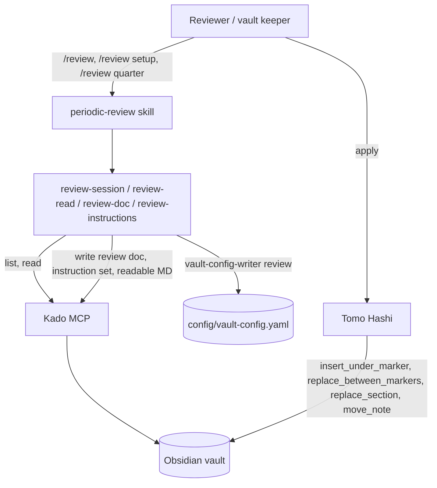
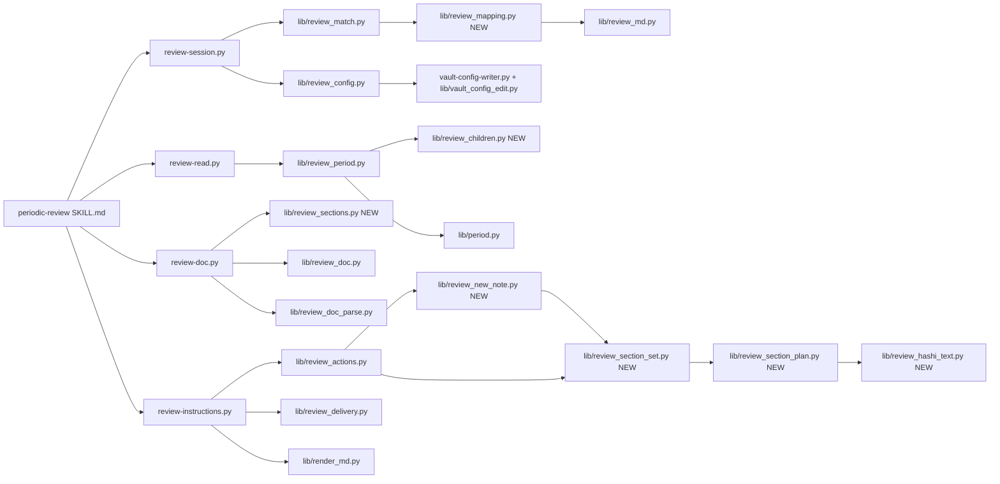
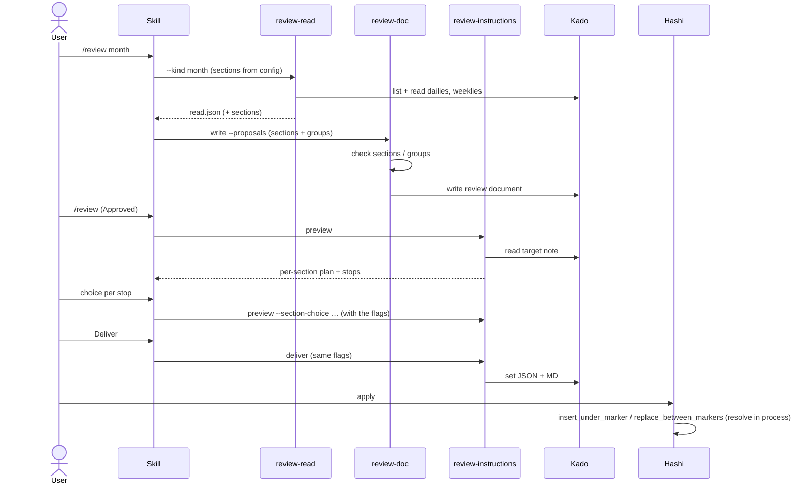

# Solution Design Document

## Validation Checklist

### CRITICAL GATES (Must Pass)

- [x] All required sections are complete
- [x] No [NEEDS CLARIFICATION] markers remain
- [x] Architecture pattern is clearly stated with rationale
- [x] **All architecture decisions confirmed by user**
- [x] Every interface has specification

### QUALITY CHECKS (Should Pass)

- [x] All context sources are listed with relevance ratings
- [x] Project commands are discovered from actual project files
- [x] Constraints → Strategy → Design → Implementation path is logical
- [x] Every component in diagram has directory mapping
- [x] Error handling covers all error types
- [x] Quality requirements are specific and measurable
- [x] Component names consistent across diagrams
- [x] A developer could implement from this design
- [x] Implementation examples use actual schema column names (not pseudocode), verified against migration files
- [x] Complex queries include traced walkthroughs with example data showing how the logic evaluates

Notes on two gates: there are no database migrations; "column names" means the field names of the JSON schemas, the vault-config keys and `read.json` / `meta.json`, checked against `tomo/schemas/*.json` and the code on `main` (2026-11-14). The traced walkthroughs are the section detection under Complex Logic and the template analysis example.

---

## Output Schema

### SDD Status Report

| Field | Type | Required | Description |
|-------|------|----------|-------------|
| specId | string | Yes | Spec identifier (NNN-name format) |
| architecture | ArchitectureSummary | Yes | Architecture overview |
| sections | SectionStatus[] | Yes | Status of each SDD section |
| adrs | ADRStatus[] | Yes | Architecture decision statuses |
| validationPassed | number | Yes | Validation items passed |
| validationPending | number | Yes | Validation items pending |
| nextSteps | string[] | Yes | Recommended next actions |

### ArchitectureSummary

| Field | Type | Required | Description |
|-------|------|----------|-------------|
| pattern | string | Yes | Selected architecture pattern |
| keyComponents | string[] | Yes | Main system components |
| externalIntegrations | string[] | No | External services integrated |

### SectionStatus

| Field | Type | Required | Description |
|-------|------|----------|-------------|
| name | string | Yes | Section name |
| status | enum: `COMPLETE`, `NEEDS_DECISION`, `IN_PROGRESS` | Yes | Current state |
| detail | string | No | What decision is needed or what's in progress |

### ADRStatus

| Field | Type | Required | Description |
|-------|------|----------|-------------|
| id | string | Yes | ADR identifier (e.g., ADR-1) |
| name | string | Yes | Decision name |
| status | enum: `CONFIRMED`, `PENDING` | Yes | Confirmation state |

---

## Constraints

- CON-1 Spec 045's architecture stays (its ADR-1, ADR-2, ADR-12): the `/review` skill owns the flow, scripts own state, reads, writes, checks and rendering, and the model's only output is `proposals.json`. Python 3 stdlib plus the repo's `lib/` only; scripts run in the container and on the host (`./venv/bin/python`). Runtime prose (`tomo/dot_claude/**`) holds imperatives only; every WHY goes to `docs/tomo/<mirrored-path>.md` first. Every edited managed file bumps `# version:`.
- CON-2 Nothing of spec 045 is removed (PRD Constraints): without a mapping every path keeps its behaviour and renders the same review document as on `main`; the month's `read.json` keys and the proposals' `groups` keep their names. Six intended differences reach the unmapped path too, each pinned by a test: `read*.json` is written compact (ADR-7); every instruction set carries `schema_version` "4" (ADR-5); a partly applied set may be overwritten (ADR-12); a mistyped or deleted template is refused at setup and the configured anchor no longer outlives a template change (ADR-13, #267); the "Tomo Review" placement is checked against off-limits rows (an empty list by default, so nothing changes until the user marks one); with a monthly or quarterly name pattern configured, a link to such a note (`[[2026-02]]`, `[[2026-Q1]]`) is navigation, not content, so it leaves a month's marks (`only_in_weekly_links`, `dailies_not_in_weekly`) — a week has no marks (T3.2, owner-logged 2026-11-15). The optional `mark` field is defined only on section items, so the group items' schema stays as it is. Files stay within the L2 size guide (300–500 lines of dense logic): new logic goes into new modules, not into the already large `review-instructions.py` (536, cap 540; a split is planned), `lib/review_actions.py` (413), `lib/period.py` (486), `lib/review_period.py` (421).
- CON-3 Privacy (spec 045 ADR-9, Feature 7): no note text in Tomo's logs, stderr, cost records, `meta.json`, `delivered_plan` or `rows-<kind>.json` (`read*.json` and `proposals.json` hold read content by design and are deleted after the document is written, as in spec 045). Section headings, descriptions and keywords are setup text the user confirmed and may sit in the vault config, `read*.json` and `rows-<kind>.json`; headings and content found in the target note may not enter `meta.json` or `delivered_plan`. Marker ids are opaque and never derived from text.
- CON-4 Tomo writes only to the inbox; the vault changes through the instruction set the user applies in Hashi or by hand. Kado is the only vault access (Constitution L1/L2).
- CON-5 Cross-repo: the new Hashi action and the wire bump go to Hashi through `_outbox/for-hashi/` (owner-orchestrated), with an FYI to Kokoro (Constitution Architecture L2); the PR merges only after Tomo and Hashi work together in the test vault (PRD Constraints).
- CON-6 Eval gate: no gated file is planned to change (`synthesis-conductor.md`, `suggestion-conductor.md`, `suggest-handling/SKILL.md`, `commands/inbox.md`, `settings.json`). If one must change, the full suite runs before merge.

## Implementation Context

**IMPORTANT**: You MUST read and analyze ALL listed context sources to understand constraints, patterns, and existing architecture.

### Required Context Sources

#### Documentation Context
```yaml
- doc: docs/XDD/specs/046-review-template-sections/requirements.md
  relevance: HIGH
  why: "PRD v1.3 — the 49 criteria this design satisfies; the amendments to spec 045"
- doc: docs/XDD/specs/045-weekly-monthly-review/solution.md
  relevance: HIGH
  why: "Base design (v1.25): ADR-1..13, the review section, marker, staged delivery, privacy, pacing"
- doc: docs/XDD/specs/045-weekly-monthly-review/live-walk.md
  relevance: HIGH
  why: "Measured March numbers (165 Kado calls, read.json 274.7 KB over the Read limit, peak 147.5k tokens) and the walk-found Templater/Kado caveats"
- doc: docs/XDD/specs/035-wire-schema-versioning/solution.md
  relevance: HIGH
  why: "Rule 9: a new action kind is consumer-affecting → schema_version bump; the wire gate and manifests"
- doc: docs/tomo/dot_claude/skills/periodic-review.md
  relevance: HIGH
  why: "WHY layer of the /review skill; every new rule lands here before the runtime text"
- doc: evals/README.md
  relevance: MEDIUM
  why: "Which files are gated (none planned here)"
- doc: ~/Kouzou/projects/miyo/miyo-handoff-protocol.md
  relevance: MEDIUM
  why: "Hashi handoff and Kokoro FYI mechanics"
```

#### Code Context
```yaml
- file: tomo/dot_claude/skills/periodic-review/SKILL.md
  relevance: HIGH
  why: "Flow owner (24,278 chars): setup step 2, read step 4, proposals step 5, parse step 6, preview step 7, deliver step 8"
- file: tomo/scripts/review-session.py
  relevance: HIGH
  why: "start / match / setup-input; _INPUT_KEYS :240, writer_input :245, setup_input :263"
- file: tomo/scripts/lib/review_match.py
  relevance: HIGH
  why: "propose :91-198; anchor precedence :142; own_sections pass-through :177"
- file: tomo/scripts/lib/review_templates.py
  relevance: HIGH
  why: "resolve_template :81, template_candidates :56, template_anchor_candidates :129"
- file: tomo/scripts/lib/review_md.py
  relevance: HIGH
  why: "body :47, fence_state :58, headings :69, section_end, QUERY_FENCES/EMBED_FENCES :26 — reused by the template analysis"
- file: tomo/scripts/lib/template_syntax.py
  relevance: MEDIUM
  why: "templater_spans :256 (already public) and _templater_inner_line_indexes :265 (private, takes the text) — the latter made public for the analysis"
- file: tomo/scripts/lib/review_config.py
  relevance: HIGH
  why: "ReviewSetup ~99-122, review_setup 194-266, input_problems 319, writer_edits 335, GRANULARITY :47"
- file: tomo/scripts/lib/vault_config_edit.py
  relevance: HIGH
  why: "render_scalar 109, render_leaf 121, render_tree 127 — cannot render a list of mappings or quote keys today"
- file: tomo/scripts/vault-config-writer.py
  relevance: MEDIUM
  why: "cmd_review 950-1000 with the read-back check"
- file: tomo/scripts/review-read.py
  relevance: HIGH
  why: "_PERIOD_RE :78, period_from :91, run :164-199, json indent=2 :195"
- file: tomo/scripts/lib/review_period.py
  relevance: HIGH
  why: "_PeriodRead: _find_weeklies :214, _weekly_entries :227, _is_periodic :245, _link_differences :259, run :346 (its report block :397-401)"
- file: tomo/scripts/lib/review_doc_read.py
  relevance: MEDIUM
  why: "read_document; consumes pass1_counts :55 — must accept section keys"
- file: tomo/scripts/lib/staged_delivery.py
  relevance: MEDIUM
  why: "deliver_step :124-139; resume needs byte-identical payloads (unchanged)"
- file: tomo/scripts/lib/period.py
  relevance: HIGH
  why: "KINDS :28-31, Period :123-176, _TOKENS :36, format_kind :221, parse_args :384, _parse_period_word :425, _parse_at :473"
- file: tomo/scripts/review-doc.py
  relevance: HIGH
  why: "render_and_write :220-265, _write_meta :193"
- file: tomo/scripts/lib/review_doc.py
  relevance: HIGH
  why: "load_proposals :132, Sources :165, _check_item :209, check_items :236, DocInput :265, item_lines :296, render_document :324, _LABELS :82, group_labels :108"
- file: tomo/scripts/lib/review_doc_parse.py
  relevance: HIGH
  why: "_ITEM :53, _HEADING :54, _APPROVED :55, _parse_body :182, approved_review :124"
- file: tomo/scripts/review-instructions.py
  relevance: HIGH
  why: "load_run :254, preview :294, deliver :342, _overwrite_step :322"
- file: tomo/scripts/lib/review_actions.py
  relevance: HIGH
  why: "marker_line :88, ACTION_ID :60, (`JS_WS`, `fenced_mask`, `hashi_headings`, `bare`, `marker_index` moved to `review_hashi_text`, T5.2) _first/_resolved :264-273, _insertion :295, the rerun branch of build_review_plan, _templated_note :411, _new_note :426-449"
- file: tomo/scripts/lib/review_delivery.py
  relevance: HIGH
  why: "REFUSING/NOTICES :70, second_set :141, plan_record :262, replan_differs :274, resume_refusal :284"
- file: tomo/scripts/lib/review_state.py
  relevance: MEDIUM
  why: "SECTION_ACTIONS :83, all_applied/any_applied :123, _infer_kind :322"
- file: tomo/scripts/lib/render_md.py
  relevance: MEDIUM
  why: "insert_under_marker :312, replace_section :336 — the readable instructions"
- file: tomo/scripts/lib/wire_shape.py
  relevance: MEDIUM
  why: "classify :582 — a new action kind is consumer-affecting"
- file: tomo/schemas/hashi-instructions.schema.json
  relevance: HIGH
  why: "Vendored Hashi schema (byte-identical to Hashi src/schema/instructions.schema.json); schema_version const \"3\" :10"
- file: tomo/schemas/instructions.schema.json
  relevance: HIGH
  why: "Tomo's producer schema; insert_under_marker ~:271, replace_section ~:300"
- file: tomo/schemas/review-proposals.schema.json
  relevance: HIGH
  why: "Closed proposals shape (additionalProperties false)"
- file: tomo/schemas/vault-config-review.schema.json
  relevance: HIGH
  why: "review.<g> config; place :57-71; own_sections :72"
```

#### External APIs (if applicable)
```yaml
- service: MiYo Kado (MCP gateway)
  doc: _inbox/from-kado/ and reference memories (kado-write cheat sheet)
  relevance: HIGH
  why: "All reads (list_dir, read note) and inbox writes; 429 pacing (20 calls / 5 s per IP)"
- service: MiYo Tomo Hashi (instruction-set executor)
  doc: /Volumes/Moon/Coding/MiYo/Hashi/src/{schema,actions,executor} (read-only)
  relevance: HIGH
  why: "insert_under_marker / replace_section semantics, planner KIND_ORDER, validator; the new replace_between_markers action"
```

### Implementation Boundaries

- **Must Preserve**:
  - Spec 045 without a mapping, byte-for-byte: the `groups`, the "Tomo Review" section with its `%% tomo-review <period> %%` marker, `insert_under_marker` / `replace_section`, `%%tN%%` items, the month's `read.json` keys (`only_in_weekly_links`, `dailies_not_in_weekly`, `weekly`), `pass1_counts`.
  - `own_sections` and its two spec 045 roles: the weekly notes' own sections read as sources for a month; the "Tomo Review" section never placed in them.
  - The staged delivery, resume and #258 refusals.
  - The vendored Hashi schema stays byte-identical to Hashi's.
- **Can Modify**: the review scripts and libs named above; `review-proposals.schema.json`, `vault-config-review.schema.json`, both instruction schemas (with the version bump); `vault_config_edit.py` (additive rendering); the `/review` skill and its WHY doc; `commands/review.md` (quarter wording); `tomo/config/vault-example.yaml`.
- **Must Not Touch**: the eval-gated files (CON-6); the Hashi repo (handoff only); Kado; `tomo-privat`; the test vault (read-only; never quote journal text).

### External Interfaces

#### System Context Diagram



#### Interface Specifications

```yaml
# Inbound Interfaces (what calls this system)
inbound:
  - name: "/review command"
    type: Claude Code slash command → skill
    format: "/review [setup | week | month | quarter | 2026-W13 | 2026-03 | 2026-Q1 | Q1 | @note]"
    authentication: none (local container session)
    doc: tomo/dot_claude/commands/review.md
    data_flow: "Period request, setup dialogue answers, Approved review document"

# Outbound Interfaces (what this system calls)
outbound:
  - name: "Kado MCP"
    type: MCP over HTTP (kado_client)
    format: JSON-RPC
    authentication: bearer key (instance)
    doc: reference memories kado-*
    data_flow: "Reads of dailies, weekly/monthly/quarterly notes, templates, target note; writes to the inbox"
    criticality: HIGH
  - name: "Hashi instruction set"
    type: file contract (inbox JSON read by Hashi)
    format: hashi-instructions.schema.json, schema_version "4"
    authentication: none (user applies)
    doc: tomo/schemas/hashi-instructions.schema.json
    data_flow: "insert_under_marker, replace_between_markers (new), replace_section, move_note"
    criticality: HIGH

# Data Interfaces
data:
  - name: "Vault config"
    type: YAML file in the instance
    connection: vault-config-writer.py review (never hand-written)
    doc: tomo/schemas/vault-config-review.schema.json
    data_flow: "review.<g>.sections.<template>, review.<g>.off_limits.<template>, review.quarterly.*"
  - name: "tomo-tmp/review/<stem>/"
    type: files in the instance
    connection: atomic_write_text
    doc: spec 045 SDD (meta.json)
    data_flow: "read.json (or read-index.json + read-<YYYY-MM>.json), proposals.json, meta.json (content-free)"
```

### Cross-Component Boundaries (if applicable)

- **API contracts**: the instruction wire is shared with Hashi. Adding `replace_between_markers` bumps `schema_version` "3" → "4" for every Tomo producer (inbox, `/note`, `/review`); Hashi accepts one `const`, so Tomo and Hashi release together (ADR-5).
- **Team ownership**: Hashi builds the action from the handoff; the owner orchestrates and walks both in the test vault before the Tomo PR merges.
- **Shared resources**: the vault config file (one writer); the inbox folder.
- **Breaking change policy**: the version bump makes a v4 set unappliable by an old Hashi. How the new Hashi treats a waiting v3 set is Hashi's decision, asked in the handoff (owner 2026-11-14); Tomo builds no converter, and the readable instruction document stays the user's fallback. A `/review` resume over an uploaded v3 set rebuilds a v4 payload, which `staged_delivery` reports as `refused` `name-taken` with `exists_path` and `step`; the skill words it per step (the note is not Tomo's; `set_json` / `set_md`: an earlier set waits — apply it in Hashi or delete it, then Resume). The Kokoro FYI names the version change and this policy.

### Project Commands

```bash
# Discovered from pyproject.toml, venv/ and evals/README.md (same as spec 045)
Install: none — the repo's ./venv carries pytest and ruff; the container image needs no change
Test:    ./venv/bin/python -m pytest tests/ -q
Test one area: ./venv/bin/python -m pytest tests/test_review_*.py tests/test_period.py tests/test_vault_config_writer_review.py tests/test_tomo_schema_parity.py tests/test_hashi_instructions_schema.py -q
Lint:    ./venv/bin/ruff check tomo/scripts scripts tests
Wire gate: ./venv/bin/python -m pytest tests/test_035_wire_gate.py tests/test_035_wire_manifests.py -q
Integration (opt-in, Privat-Test): ./venv/bin/python -m pytest -m integration tests/
Quarter read dry run (no model, owner go): python3 tomo/scripts/review-read.py --kind quarter --period 2026-Q1 --stem <stem> --measure
Sync to the test instance (owner instruction only): scripts/update-tomo.sh --instance tomo-instance --yolo
Cost: python3 scripts/tomo-session-stats.py --session <jsonl>
```

## Solution Strategy

- **Architecture pattern**: spec 045's script-owned 2-pass flow, extended along its existing seams. The model still writes one file (`proposals.json`); every rule a script can check is checked by a script; delivery stays an instruction set.
- **Integration approach**: four additions, each in its own module so the large files do not grow:
  1. *Setup*: a deterministic template analysis offers headings; the model only words descriptions and keywords; the confirm table also carries off-limits marks; the writer stores rows per template.
  2. *Pass 1*: the section definitions ride in `read.json`; the single model pass writes `sections` beside `groups`; scripts check caps, double placement, sources and marks, and render one document part per section with a section checkbox.
  3. *Pass 2*: per kept section, Tomo reads the target note, finds the heading and its own block as Hashi will, and emits `insert_under_marker` (first time) or `replace_between_markers` (re-run), with user choices for missing, ambiguous, broken or moved cases.
  4. *Quarter*: the month reader becomes a period reader with a child-review level (month → weekly notes, quarter → monthly notes); a quarter's read is split per month for the model.
- **Justification**: it keeps every spec 045 guarantee testable without an AI (Constitution L1), adds one Hashi action instead of moving logic into Hashi, and costs no extra model pass or setup turn.
- **Key decisions**: ADR-1 … ADR-13 below.

## Building Block View

### Components



| Component | Single responsibility |
|---|---|
| `skills/periodic-review/SKILL.md` | The dialogue: the setup confirm table and its corrections, the model's proposal writing (what each section's description asks for, one place per item, reminders not finished text), the rewrite-once loop, the quarter branch of step 5, wording the stops and asking the per-section choices |
| `review-session.py` | Setup entry points: `match` (writes and reads `rows-<kind>.json`), `setup-input` (refusals: not found, left out, off-limits, not in template, duplicate, bad id) |
| `vault-config-writer.py` | Saving the confirmed setup through `review_config.writer_edits` with the read-back check |
| `review-instructions.py` | Pass 2 entry points: `preview`, `deliver`, `drop`; parses the choice flags; the stops, notices and `nothing-to-deliver` live in `review_delivery` |
| `lib/review_mapping.py` (new) | Template analysis (offered / left-out headings with reasons), heading identity (text, level, parent, occurrence), row ids, off-limits resolution incl. the physical landing check of a placement, dropped headings after a template change |
| `lib/review_config.py` | Reading and validating `review.<g>.*` incl. `sections` and `off_limits`; writer edits |
| `lib/vault_config_edit.py` | YAML rendering: block-style list of mappings, quoted keys, removal on empty |
| `lib/review_match.py` | The setup proposal (adds `sections` and `template_not_found`; anchor precedence by template) |
| `lib/period.py` | Period kinds incl. `quarter`, names, the `Q` token, argument parsing |
| `lib/review_period.py` | Reading a period: dailies, the child-review level, marks parameterised by `CHILD` |
| `lib/review_children.py` (new) | Finding and reading child-review notes (weekly for a month/quarter, monthly for a quarter) and their status report |
| `lib/review_read_parts.py` (new) | The `read*.json` layout: compact encoding, the quarter's split per month, writing the stage files, the loader that joins the parts |
| `review-read.py` | Writes `read.json` (week, month) or `read-index.json` + `read-<YYYY-MM>.json` (quarter), compact, with the section definitions |
| `lib/review_sections.py` (new) | Pass 1 section side: definitions for `read*.json`, every proposal check on items (keys, caps, double placement, sources via `review_doc.Sources`, marks), rendering of a section part and of an analysis sub-part (incl. the mark suffix) |
| `lib/review_doc.py` / `review-doc.py` | Group side as today (per-kind group tables); assembles section parts + "Tomo Review" part; `meta.json` incl. `pass1_sections`; `review-doc.py` reads the new note's template through Kado at Pass 1 to mark routed parts |
| `lib/review_doc_parse.py` | Parses section parts and section checkboxes back and reports a missing expected key; computes per-section counts incl. the user's own items; emits `section-checkbox-missing` as a warning (a `review_actions._gate` refusal, like `approved-missing`) |
| `lib/review_section_plan.py` (new) | `plan_section` only: Pass 2 per kept section on an existing note's text — heading resolution as Hashi does, own-block detection by line range, the off-limits landing check, the mode (insert / replace / skip / review / broken / moved / stops), the section's action, notices (`block-replaced`, `block-moved-confirmed`), the choices a stop offers; `place_off_limits` / `review_off_limits` for the "Tomo Review" place |
| `lib/review_hashi_text.py` (new, T5.2) | The Hashi-parse mirror (`split_lines`, `fenced_mask`, `hashi_headings`, `marker_index`, `JS_WS`) and `item_lines` |
| `lib/review_new_note.py` (new, T5.2) | The new note's text: template choice, splice, stamp |
| `lib/review_section_set.py` (new, T5.4) | The delivery's sections as a set: `plan_existing` / `plan_new_note` (routing), `routed_keys`, `review_parts`, `compose`, `report`, `record`, `lands`; the `section-dropped` and `section-empty` notices come from the parse counts |
| `lib/review_actions.py` | The "Tomo Review" section as today plus its analysis sub-parts; composes the whole plan through `review_section_set` (section actions first, then Tomo Review), numbered `I01…In` — Hashi then runs them by kind (`insert_under_marker`, then `replace_section`, then `replace_between_markers`, `planner.ts:39-56`), which is why a section never lands inside "Tomo Review"; the `review-section-kept` notice |
| `lib/review_delivery.py` | Refusals, `delivered_plan` incl. `sections`, overwrite of a partly applied set |
| `lib/render_md.py` | Readable instructions incl. `replace_between_markers` |

Touched without a new responsibility: `lib/review_templates.py` (quarter kind word), `lib/review_md.py` (`AUTOMATIC_FENCES`, shared regexes), `lib/review_day.py` (imports those regexes), `lib/template_syntax.py` (helper made public), `lib/review_weekly.py` (content split reused for monthly notes), `lib/review_state.py` (`SECTION_ACTIONS`, `_infer_kind`, partly applied state), `lib/review_doc_read.py` (`pass1_counts` with section keys), `lib/staged_delivery.py` (unchanged, named for resume), the schemas and `shapes/instructions.shape.json`, `commands/review.md`, `config/vault-example.yaml`.

**Responsibility matrix (exactly one owner per PRD criterion; collaborators in brackets):**

| Owner | Criteria |
|---|---|
| `skills/periodic-review/SKILL.md` | F1-AC2, F2-AC2, F2-AC6, F6-AC6 (the kind-agnostic flow) |
| `review-read.py` | F1-AC1 |
| `lib/review_sections.py` | F1-AC3 [the "reminder, not finished text" wording is the skill's; verified live], F1-AC4, F1-AC5, F1-AC6 [the semantic part is the skill's prose], F1-AC8, F1-AC9, F3-AC2, F3-AC3 |
| `lib/review_doc.py` | F1-AC7, F1-AC10, F3-AC1 |
| `lib/review_match.py` | F2-AC1, F2-AC9, F6-AC1, F7-AC1, F7-AC2, F7-AC3 |
| `lib/review_mapping.py` | F2-AC3, F2-AC5, F2-AC11 [`landing_off_limits` is called by `setup-input` and `plan_section`] |
| `review-session.py` (`setup-input`) | F2-AC4 |
| `lib/review_config.py` | F2-AC7, F2-AC8 |
| `vault-config-writer.py` | F2-AC10 |
| `lib/review_section_set.py` / `lib/review_new_note.py` (with `lib/review_actions.py`) | F4-AC5, F2-AC12, F4-AC1 |
| `lib/review_doc_parse.py` | F3-AC4 [counts incl. the user's own items; the preview line is worded by `review-instructions.py`], F3-AC5, F3-AC6 |
| `lib/review_section_plan.py` | F4-AC2, F4-AC3, F5-AC1, F5-AC2, F5-AC3, F5-AC5 |
| `review-instructions.py` + `SKILL.md` | F4-AC6, F5-AC4 |
| `lib/review_delivery.py` / `SKILL.md` | F4-AC4 (the choices) |
| `lib/render_md.py` | F4-AC7 |
| `lib/period.py` | F6-AC2, F6-AC3 |
| `lib/review_period.py` | F6-AC4 |
| `lib/review_children.py` | F6-AC5 |

### Directory Map

**Component**: Tomo runtime and scripts
```
tomo/
├── dot_claude/skills/periodic-review/SKILL.md   # MODIFY: setup table, step 5 sections, step 6 warnings, step 7/8 choices, quarter
├── dot_claude/commands/review.md                # MODIFY: quarter in the argument hint
├── config/vault-example.yaml                    # MODIFY: documented sections / off_limits / quarterly example
├── schemas/
│   ├── review-proposals.schema.json             # MODIFY: sections[], item mark, quarter groups
│   ├── vault-config-review.schema.json          # MODIFY: sections, off_limits, quarterly
│   ├── instructions.schema.json                 # MODIFY: replace_between_markers, schema_version "4"
│   ├── hashi-instructions.schema.json           # REPLACE verbatim from Hashi after its release
│   └── shapes/instructions.shape.json           # REGENERATE
└── scripts/
    ├── review-session.py                        # MODIFY: sections/off_limits in _INPUT_KEYS, setup-input refusals, match writes/reads
    │                                            #         + rows-<kind>.json, quarter
    ├── review-read.py                           # MODIFY: quarter period, compact JSON, split per month, --measure
    ├── review-doc.py                            # MODIFY: write and replace call the section checks; pass1_sections; read parts
    ├── review-instructions.py                   # MODIFY: --section-choice / --confirm-moved, partly applied overwrite (thin)
    ├── vault-config-writer.py                   # MODIFY: review subcommand writes rows
    └── lib/
        ├── review_mapping.py                    # NEW
        ├── review_setup_rows.py                 # NEW (spec 046 T2.2): setup-input row refusals, ids, rows-file evidence
        ├── review_sections.py                   # NEW
        ├── review_section_plan.py               # NEW
        ├── review_hashi_text.py                 # NEW (spec 046 T5.2): the Hashi-parse mirror and item lines, split out of review_actions
        ├── review_new_note.py                   # NEW (spec 046 T5.2): new-note text (template choice, splice, stamp), split out of review_actions
        ├── review_section_set.py                # NEW (spec 046 T5.4): the delivery's sections as a set (plan per row, routing, parts, splice) and the I01…In composition
        ├── review_section_report.py             # NEW (spec 046 T6.2): what the delivery reports and records of the section plans, split out of review_section_set
        ├── review_kado_conflict.py              # NEW (spec 046 T6.2): Kado's refused guard read off a KadoError (code, reason), split out of review_delivery
        ├── review_target_read.py                # NEW (spec 046 T6.2): Pass 2's Kado reads of the target note and its template, split out of review-instructions.py
        ├── review_instructions_args.py          # NEW (spec 046 T6.2): the --stem type and the preview/deliver flags (ChoiceFlag), split out of review-instructions.py
        ├── review_children.py                   # NEW
        ├── review_read_parts.py                 # NEW (spec 046 T3.4): read*.json layout, quarter split per month, loader
        ├── period.py                            # MODIFY: QUARTER, Q token, months(), parsing
        ├── review_period.py                     # MODIFY: CHILD table, generic marks, _is_periodic
        ├── review_weekly.py                     # MODIFY: content split reused for monthly notes
        ├── review_config.py                     # MODIFY
        ├── review_match.py                      # MODIFY
        ├── review_templates.py                  # MODIFY: KIND_WORDS quarter
        ├── review_md.py                         # MODIFY: AUTOMATIC_FENCES, shared inline-field/embed regexes
        ├── review_day.py                        # MODIFY: imports the shared regexes from review_md (T1.2)
        ├── template_syntax.py                   # MODIFY: templater span helpers public
        ├── review_doc.py                        # MODIFY: per-kind group tables, assemble parts
        ├── review_doc_parse.py                  # MODIFY: section parts
        ├── review_actions.py                    # MODIFY: action numbering, compose
        ├── review_delivery.py                   # MODIFY
        ├── review_state.py                      # MODIFY: SECTION_ACTIONS, _infer_kind, partly applied
        ├── review_doc_read.py                   # MODIFY: pass1_counts with section keys (:55)
        ├── staged_delivery.py                   # UNCHANGED (resume byte-identity relied on)
        ├── vault_config_edit.py                 # MODIFY
        └── render_md.py                         # MODIFY
tomo-tmp/review/                                 # runtime, instance only
├── <stem>/read.json | read-index.json + read-<YYYY-MM>.json, proposals.json, meta.json
└── rows-<kind>.json                             # written and read by `match` (rows, outline, resolved); read and deleted by `setup-input` on save
                                                 # and by `start`; setup text only
```

**Component**: WHY documents (written before the file they explain; existing ones are listed in spec 045's map and change in place)
```
docs/tomo/
└── scripts/lib/
    ├── review_mapping.md                        # NEW
    ├── review_setup_rows.md                     # NEW (T2.2)
    ├── review_sections.md                       # NEW
    ├── review_section_plan.md                   # NEW
    ├── review_hashi_text.md                     # NEW (T5.2)
    ├── review_new_note.md                       # NEW (T5.2)
    ├── review_section_set.md                    # NEW (T5.4)
    ├── review_section_report.md                 # NEW (T6.2)
    ├── review_kado_conflict.md                  # NEW (T6.2)
    ├── review_target_read.md                    # NEW (T6.2)
    ├── review_instructions_args.md              # NEW (T6.2)
    ├── review_children.md                       # NEW
    └── review_read_parts.md                     # NEW (T3.4)
```

**Component**: Tests (new files; existing review tests are listed in spec 045's map. `test_review_sdd_map.py` reads both maps — T1.2 — and checks only `tests/test_review_*.py`, so the `test_046_*` files below are not map-checked.
The wire bump also moves every instructions-wire hit of `rg -n "schema_version.{0,8}['\"]3['\"]" tests tomo/scripts`, the 038 wire baselines and schema parity — T6.1.)
```
tests/
├── test_review_mapping.py                       # NEW: template analysis, off-limits, landing check
├── test_review_sections.py                      # NEW: proposal section checks and section parts
├── test_review_section_plan.py                  # NEW: plan_section on numbered-line layouts
├── test_review_session_sections.py             # NEW (implemented, spec 046 T2.1): match sections, rows file, template_not_found, quarter
├── test_review_setup_input_rows.py             # NEW (spec 046 T2.2): setup-input refusals, ids, rows file deleted on save
├── test_review_skill_sections.py               # NEW (spec 046 T2.3): skill pins for the setup mapping table and the quarter routing
├── test_review_children.py                      # NEW: child-review notes and their report
├── test_review_period_golden.py                 # NEW: golden month/week read (before the refactor)
├── fixtures/046-t3-1-period-read-golden/        # NEW: month.json, week.json, record.py (recorded from main)
├── review_period_fixtures.py                    # MODIFY: quarter fixtures (disagreeing notes)
├── test_review_read_parts.py                    # NEW (spec 046 T3.4): quarter split, loader, parts <= 256 KB on the scaled fixture
├── review_scaled_quarter.py                     # NEW (T3.4): a 2026-Q1 read scaled to the measured bytes (synthetic)
├── test_046_t4_2_doc_sections.py                # NEW (T4.2): the mapped document
├── test_046_t4_2_unmapped_doc_golden.py         # NEW (T4.2): the unmapped document, byte for byte
├── test_046_t4_3_section_parse.py               # NEW (T4.3): section parts and checkboxes parsed back
├── test_046_t4_3_unmapped_parse_golden.py       # NEW (T4.3): the unmapped parse, unchanged
├── test_046_t4_4_section_stop.py                # NEW (T4.4): the missing-checkbox stop
├── test_046_t4_4_skill_sections.py              # NEW (T4.4): skill pins for proposing by section
├── test_046_t4_5_quarter_read.py                # NEW (T4.5): the quarter read in review-doc
├── test_046_t4_5_skill_quarter.py               # NEW (T4.5): skill pins for the quarter read
├── fixtures/046-t4-2-unmapped-doc-golden/       # NEW (T4.2)
├── fixtures/046-t4-3-unmapped-parse-golden/     # NEW (T4.3)
├── test_046_t6_2_carried_debt.py               # NEW (T6.2): the code debt carried from Phase 5 (section key, read order, blank line)
├── test_046_t6_2_heading_walk.py                # NEW (T6.2): the shared heading walk against its golden
├── fixtures/046-t6-2-heading-walk-golden/       # NEW (T6.2): walk.json, record.py (recorded before the change)
├── test_046_close_out_gaps.py                   # NEW at close-out
└── fixtures/instructions-v4-candidate.schema.json   # NEW until T6.1: test-only schema from the handoff fragment
```

### Interface Specifications

#### Interface Documentation References

```yaml
interfaces:
  - name: "Review proposals"
    doc: tomo/schemas/review-proposals.schema.json
    relevance: HIGH
    sections: [sections, groups, items]
    why: "The model's only output; closed shape"
  - name: "Review vault config"
    doc: tomo/schemas/vault-config-review.schema.json
    relevance: HIGH
    sections: [review.<g>.sections, review.<g>.off_limits, review.quarterly]
    why: "Setup storage"
  - name: "Instruction set"
    doc: tomo/schemas/hashi-instructions.schema.json + Hashi docs/action-reference.md
    relevance: HIGH
    sections: [replace_between_markers, insert_under_marker, schema_version]
    why: "Wire to Hashi"
```

#### Data Storage Changes

No database. Vault config (YAML, through the writer only):

```yaml
review:
  weekly:                      # GRANULARITY: weekly | monthly | quarterly
    sections:
      "t_week_privat.md":      # key = templates.mapping.<g> name (not the _tomo variant), quoted
        - id: s1               # opaque, ^s[0-9]{1,3}$, unique per template, stable (ADR-10)
          heading: "What Went Well This Week?"   # verbatim template text, %% fold %% kept
          level: 4             # 2..6
          parent: "In my own words"              # nearest higher heading, null at top
          occurrence: 1        # 1-based among identical (heading, level, parent)
          description: "What went well: finished tasks, good days, things that worked"
          keywords: [erledigt, geschafft]        # optional, ≤ 12
          groups: [done, themes]                 # optional spec 045 starting points (F2-AC7); never "habits"
          placement: end       # before | under | end | review (analysis row, F2-AC12)
          cap: 8               # 1..30, default 8
        - id: s2               # analysis row: a script-only section, never written; lands in "Tomo Review"
          heading: "Energy and Sleep"
          level: 3
          parent: "Overview"
          occurrence: 1
          description: "What the week's sleep and energy values show"
          placement: review
          cap: 4
    off_limits:
      "t_week_privat.md":
        - {heading: "Reflections", level: 3, parent: "Review of the Week", occurrence: 1, with_subsections: true}
  quarterly:                   # new: folder, format, template mapping, place, language as for monthly (spec 045 Feature 1)
    folder: "Calendar/304 Quarterly"
    format: "YYYY-[Q]Q"
```

A row with `placement: review` is allowed only on a heading left out as `automatic`; every other placement only on an offered heading. `own_sections` is unchanged. `tomo-tmp/review/rows-<kind>.json` holds the last rows `match` showed (setup text only: heading keys, descriptions, keywords, placements, caps), the template's heading outline (keys, lines, ancestors, body kinds, structural reasons) and `resolved` (the template `match` tried last and its kind); `match` writes it and reads it back for `dropped`, `setup-input` checks rows against it and deletes it on save, `start` deletes a stale one. `tomo-tmp/review/<stem>/meta.json` gains `pass1_sections: [{key, count, empty}]` (keys and counts only; only with a mapping; in read.json's section order, which is not the rendered order: analysis parts render after the others; `pass1_counts` stays flat and includes the section keys) and `delivered_plan.sections: [{key, mode, placement, scope_level}]` plus `choices_given: bool` (ids and enums only).

#### Internal API Changes

```yaml
# Script subcommands (CLI JSON contracts)
- review-session.py match --kind <k> [--template T] [--anchor A]
  (writes tomo-tmp/review/rows-<kind>.json with the rows it shows; on a template change it reads the previous file first)
  response adds:
    sections: {template, mappable: bool, candidates: [{heading_key: {heading, level, parent, occurrence},
               state: offered|left-out, reason: templater|link|per-period-parent|off-limits|automatic|null,
               flags: [mixed|container|under-own],
               defaults: {placement, cap} | null, saved: <row or null>}],
               off_limits: [<saved rows>], dropped: [{heading, level, parent}]}
               # mappable: at least one heading offered or left out as automatic; false → candidates [] (F2-AC9)
               # defaults: offered → end/8, automatic → review, any other left-out → null
               # template_candidates / anchor_candidates stay top-level keys as in spec 045
               # dropped: earlier rows the template lacks — after a template change (rows file), and on a
               # same-template run also saved config rows whose heading the template no longer has (owner 2026-11-15)
    template_not_found: {name, source: typed|configured} | absent   # with template: null and candidates listed
- review-session.py setup-input --kind <k> --confirmed <file>
  accepts sections[] and off_limits[] (rows as above); refuses: template-not-found, section-left-out,
  section-not-in-template, section-off-limits, landing-off-limits (a before/end placement whose landing lines
  belong to an off-limits section), analysis-not-automatic, duplicate-section, duplicate-off-limits,
  duplicate-section-id (an id outside ^s[0-9]{1,3}$ is refused by the schema as a `schema` problem at its pointer;
  names as built in T1.3, `review_config.input_problems`)
  pointers: /template (template-not-found), /sections/<i> (row refusals; section-left-out carries `reason`),
  /sections/<i>/placement (landing-off-limits of a row), /place (landing-off-limits of the "Tomo Review" place);
  eligibility evidence is read only from rows-<kind>.json:
  {kind, template, rows: [{heading, level, parent, occurrence, description, keywords, placement, cap}],
   outline: {headings: [...], top: [...]}, resolved: {template, kind}} — no ids, no groups, no note text
- review-read.py --kind week|month|quarter --period <name> --stem <stem> [--measure]
  writes read.json (week, month) or read-index.json + read-<YYYY-MM>.json (quarter); adds `sections` (definitions);
  quarter adds `monthly`, `only_in_monthly_links`, `dailies_not_in_monthly`, report.monthly_status/monthly_notes
  --measure: no file for the model; prints calls, waits, bytes per part
  stdout: read_path (read.json, or read-index.json for a quarter) and, for a quarter, read_parts (the month parts in order);
  --measure prints {status, stem, period, nothing_to_review, measure: {calls, retried, waited_s, not_read (count),
  bytes: {<file>: n}, day_bytes: {<YYYY-MM>: n}}} — counts and bytes only
  quarter files: read-index.json holds every key except days/weekly/monthly, plus `parts`; each read-<YYYY-MM>.json holds
  {month, days, weekly, monthly} (days by date, monthly notes by month, weekly notes by the majority month of their days
  in the quarter); joined back by lib/review_read_parts.load
- review-doc.py write --stem <stem> --proposals <path>
  refusals: proposals-invalid (errors "<pointer>: <error>": unknown-section, duplicate-section, over-cap (<key>),
  double-placement, mark-not-allowed; plus spec 045's), sections-changed (read's section keys differ from the
  configured rows' ids; refused before any Kado call), read-missing / read-invalid (read loaded via
  lib/review_read_parts.load; a missing, broken or duplicated part, or both layouts present, is read-invalid);
  replace --confirm runs the same checks; success and replace --abort delete every read file and proposals.json,
  a refused or failed write keeps them; new per-item reasons for the quarter groups: quarter-only-group,
  no-monthly-notes
  status written: counts per group and per section key
- review-doc.py parse --stem <stem>
  stdout adds section_problems [{key, restore}] and section_counts {key: {ticked, kept, unticked, added, empty}}
  only for a mapped document
- review-instructions.py preview|deliver --stem <stem> [--place-anchor A] [--section-choice <key>=skip|review ...]
                                          [--confirm-moved <key> ...]
  output (preview and deliver, mapped only): sections [{key, mode, placement, notices, scope_level?, stop?, choices?, block_at?, lines (preview only)}],
                dropped [{key, added}], empty [key], choices_invalid? [keys]; a "Tomo Review" place that lands off limits is the problem
                landing-off-limits with `place.anchor`; refusal choice-invalid (a choice no plan took) beside choices-needed
  new stops (owned by review-instructions.py, which reads them from parse and plan; section-checkbox-missing is
             emitted by review_doc_parse as a warning and is a review_actions._gate refusal listed in
             review_delivery.REFUSING, like approved-missing): section-checkbox-missing, section-missing, section-ambiguous, section-broken,
             section-moved, block-in-review-section, landing-off-limits (from review_section_plan), choices-needed
             (from review_delivery); nothing-to-deliver now counts kept sections and the "Tomo Review" part
  new notices: section-dropped (with user item count), section-empty, block-replaced, block-moved-confirmed,
               review-section-kept (an earlier "Tomo Review" section with nothing left for it stays as it is)
```

#### Application Data Models

```pseudocode
ENTITY: SectionRow (vault config)            # see Data Storage Changes
ENTITY: OffLimitsRow (vault config)          # {heading, level, parent, occurrence, with_subsections}
ENTITY: TemplateHeading (review_mapping)
  FIELDS: heading_key{heading, level, parent, occurrence}, line, state, reason, flags
ENTITY: SectionDefinition (read.json "sections")
  FIELDS: key (= row id), heading, level, parent, description, keywords, groups, cap, analysis? (true only on placement-review rows)
ENTITY: Proposals (proposals.json)
  FIELDS: language, sections: [{key, items: [{text, sources, mark?}]}], groups: {...spec 045...}
  mark: weekly_only | not_in_weekly (month) | monthly_only | not_in_monthly (quarter)
ENTITY: SectionPart (DocInput)
  FIELDS: key, heading, placement, landing (heading, level, parent), items, empty,
          routed (lands in "Tomo Review"; set by delivery planning, Phase 5)
  placement and landing come from the configured rows by id, not from read.json
ENTITY: ParsedDoc (review_doc_parse) adds
  FIELDS: sections: Dict[key, bool | None], section_problems: [{key, heading|None, restore}] (public form {key, restore}),
          items carry group = key for section items
  METHODS: lands(item), section_counts() -> {key: {ticked, kept, unticked, added, empty}}
ENTITY: SectionPlan (review_section_plan)
  FIELDS: key, mode: insert|replace|skip|review|broken|moved|missing|ambiguous|in-review|landing-off-limits, start_marker, end_marker, lines,
          escaped_lines, anchor (Hashi text), hashi_placement, placement (the row's before|under|end), scope?, block_at?,
          insert_at, heading_at, notices, offers
  PROPERTY: stop
  METHOD: action(id, target_path)
```

#### Integration Points

```yaml
- from: Tomo (review-instructions.py)
  to: Hashi
  protocol: instruction-set JSON in the inbox, schema_version "4"
  doc: Hashi docs/action-reference.md (after the handoff)
  endpoints_used: [insert_under_marker, replace_between_markers, replace_section, move_note]
  data_flow: "One action per kept section, then the Tomo Review action, ids I01…In"

- from: Tomo
  to: Hashi team (handoff)
  protocol: _outbox/for-hashi/YYYY-MM-DD_tomo-to-hashi_replace-between-markers.md
  data_flow: "Contract below + schema fragment + version bump + file/test list + the open question how Hashi treats a waiting v3 set"
```

**The `replace_between_markers` contract (handoff content):**

```json
"replace_between_markers": {
  "type": "object",
  "required": ["id", "action", "target_path", "start_marker", "end_marker", "content"],
  "additionalProperties": false,
  "description": "Replace only the lines strictly between a start-marker line and its end-marker line in an existing note; the marker lines and every other line stay byte-identical. Modify-only.",
  "properties": {
    "id": {"$ref": "#/$defs/action_id"},
    "action": {"const": "replace_between_markers"},
    "target_path": {"type": "string", "minLength": 1},
    "start_marker": {"type": "string", "minLength": 1, "pattern": "^\\S([^\\n]*\\S)?$"},
    "end_marker":   {"type": "string", "minLength": 1, "pattern": "^\\S([^\\n]*\\S)?$"},
    "scope": {
      "type": "object", "required": ["heading", "level"], "additionalProperties": false,
      "properties": {"heading": {"type": "string", "minLength": 1},
                     "level": {"type": "integer", "minimum": 1, "maximum": 6}}
    },
    "content": {"type": "string", "description": "Lines between the markers joined by \\n, no trailing newline; \"\" = zero lines."},
    "applied": {"$ref": "#/$defs/applied_field"}
  }
}
```

Match rules (Hashi): split on `\n`; mask fenced lines with `fencedLineMask`; a marker line is unfenced, starts at column 0, and `line.trimEnd() === marker`. Start lines are counted over the whole note: 0 → `failed "start marker not found"`, > 1 → `failed "start marker duplicated"`. The end is the first end-marker line after the start: none → `failed "end marker missing"`; an end line before the start or a second end → `failed "end marker duplicated or out of order"`; `start_marker === end_marker` → `failed "markers equal"`. With `scope`, the first heading in `parseHeadings` with `heading === scope.heading && level === scope.level` gives the range from that heading to the next heading of the same or a higher level — a level-aware lookup without a callout fallback, unlike `locateSection(raw, name)`, which matches text only: not found → `failed "scope heading not found"`; a marker outside it → `failed "markers outside scope"`. Missing target → `failed "target note missing"`. Lines between already equal `content` → `skipped-already`; otherwise those lines are replaced → `applied`. **The markers are resolved inside the `vault.process(path, current => …)` callback**; if they no longer resolve there, the result is `failed` and nothing is written. Planner: `KIND_ORDER` directly after `replace_section`; no `depends_on`; `buildSummary` = `${target_path} :: ${start_marker}` (metadata only). Hashi files and tests to change: `src/schema/instructions.schema.json` (`$def`, `oneOf`, `schema_version` "4"), `src/schema/types.ts`, `src/actions/replaceBetweenMarkers.ts` (new), `src/actions/index.ts`, `src/executor/planner.ts`, `src/instruction-fixer/transforms.ts`, `noteSpots.ts`, `src/ui/instruction-fixer/cards/renderActionCard.ts`, `targetFields.ts`, `docs/action-reference.md`, `docs/instruction-fixer.md`, `docs/hooks.md`, `README.md`, `CHANGELOG.md`; tests `test/unit/actions/replaceBetweenMarkers.test.ts` (new: each outcome, fenced, indented, CRLF, scope miss, equal markers, byte-identical body, outside text unchanged, in-`process` re-resolve), `actions/index.test.ts`, `schema/validator.test.ts`, `schema/types.test.ts`, `executor/planner.test.ts`, `instruction-fixer/transforms.test.ts`, `noteSpots.test.ts`, `ui/instruction-fixer/cards/renderActionCard.test.ts`, `targetFields.test.ts`.

### Implementation Examples

#### Example: Template analysis (first matching rule wins)

**Why this example**: the left-out rules decide what the user can map; a wrong "automatic" verdict cannot be undone by the user because F2-AC4 refuses left-out headings.

```python
# lib/review_mapping.py — shape, not final code
REASONS = ("templater", "link", "per-period-parent", "off-limits", "automatic")

def analyse_template(text, off_limits) -> list[TemplateHeading]:
    lines, offset = review_md.body(text), frontmatter_line_count(text)   # a YAML '# x' is no heading
    inner = {i - offset for i in template_syntax.templater_inner_line_indexes(text)}  # inside <%* ... %>: no headings
    heads = [h for h in review_md.headings(lines) if h.line not in inner and h.level >= 2]
    for h in heads:
        h.key = (h.text, h.level, parent_of(h, heads), occurrence_of(h, heads))
        h.state, h.reason = "offered", None
        if "<%" in h.text:                h.left_out("templater")
        elif "[[" in h.text:              h.left_out("link")
        elif per_period(h, heads):        h.left_out("per-period-parent")  # ancestor left out by templater/link;
                                                                            # same (level,text) under ≥ 3 parents;
                                                                            # container of only such headings
        elif covered_by(h, off_limits):   h.left_out("off-limits")         # own row, or ancestor row with_subsections
        else:
            kind = body_kind(h, lines)    # line classes outside fences: automatic | neutral | own-writable
            if kind == "automatic-only":  h.left_out("automatic")
            elif kind == "mixed":         h.flags.add("mixed")
            elif kind == "empty" and has_children(h): h.flags.add("container")
    return heads
```

Line classes: **automatic** = a fence in `AUTOMATIC_FENCES` (dataview, dataviewjs, quoth, dynbedded, tracker, chartsview, calendar-nav, meta-bind-button, toc, tasks), `![[…]]` lines, inline fields `Name:: v`, `` `=…` `` inline queries, `BUTTON[` lines, a Templater line other than `tp.file.cursor`; **neutral** = blank, `<% tp.file.cursor(n) %>`, callout lines, `%%…%%`; **own-writable** = everything else. "automatic-only" needs at least one automatic and no own-writable line; an empty container is left out only when all its descendants are left out as automatic. A heading under an off-limits ancestor without `with_subsections` is offered with flag `under-own`.

Traced on the test vault's `t_week_privat` (structure only): "Overview" and its four children → `automatic` (tracker/dataview fences); the seven day headings → `templater`; their children "My final thoughts for that day" → `per-period-parent`; "Review of the Week" → empty own body, but its sub-headings are not all per-period (it also holds "Learnings of the Week", "Reflections", "In my own words" and "Check My Own Words", all level 3 under it) → **offered** with flag `container` (corrected at T1.2: the first trace read it as a container of per-period headings only); "Learnings of the Week" → `automatic` (dataview + inline field); "What Went Well This Week?" → body `<% tp.file.cursor(1) %>` only → neutral → **offered**. With "In my own words" marked off-limits *heading only*, its four children stay offered (`under-own`); marked *with sub-sections*, they become `off-limits`.

Expected sets on the five test-vault templates, no off-limits rows (structure only; `tests/test_review_mapping.py` pins them; `[c]` = flag `container`, `[m]` = flag `mixed`; a thematic break `---` is own-writable, a line of a `[!type]` callout block neutral):

- `t_week_privat` — offered: Theme of the week, Get Started, Review of the Week [c], Reflections [m], In my own words [c], What Went Well This Week?, What Should I Start Doing?, What Should I Stop Doing?, What Should I Continue Doing?, Check My Own Words, Organisation [c], Planning [m]. Left out: Overview, Habits, Language Learning, Temperature, Energy and Sleep, Notes Created This Week, Learnings of the Week, Last Check → `automatic`; the seven day headings → `templater`; the seven "Notes of the Day %% fold %%", the seven "My final thoughts for that day" and "Review Check" (level 4 under the last day) → `per-period-parent`.
- `t_week_work` — offered: Get Started, My final thoughts for that week [c], Review Check, In my own words [c], What Went Well This Week?, What Should I Start Doing?, What Should I Stop Doing?, What Should I Continue Doing?, Check My Own Words, Organisation [c], Planning, Shut Down. Left out: Overview (own body a `calendar-nav` fence), Reporting, Working Times, Notes Created This Week, Learnings of the Week, Last Check → `automatic`; the five day headings → `templater`.
- `t_month_privat` — offered: Outlook [c], Goals and Wishes [c], Work, Contacts, Health, Spare Time, I look forward to, This will be challenging, ToDos for this month, Goals and Milestones [m], Review of the month [c], In my own words [c], Things I did well this month, Things which were hard this month, Reflections [m], Plan [m]. Left out: Theme of the Month, Overview, Habits %% fold %%, Language Learning %% fold %%, Body Values %% fold %%, Temperature %% fold %%, Energy and Sleep, "Learnings of the Month  %% fold %%" (two spaces, verbatim), Comments from this month, I like about myself, The following is good for me → `automatic`.
- `t_month_work` — offered: Planing, Review [c], In my own words [c], Things I did well this month, Things which were hard this month, Plan [m]. Left out: Overview, Reporting %% fold %%, Learnings of the Month %% fold %%, Working Times, Comments from this month → `automatic`.
- `t_quarter_privat` — offered: Notes Created This Quarter [c], Review Of Weekly Reviews [m], What were the 3 most important lessons I learned, Goals and Projects Review [c], Review Of Milestones [m], Review Of Projects [m], Bucket List [m], Conclusions [c], Start Stop Continue [c], What should I start doing next quarter?, What should I stop doing next quarter?, What should I continue doing next quarter?, Setting New Goals. Left out: Review of Habits, Healthfood, Sport, Bewegungs Break, Entspannung, Alcohol, Junk Food, Body Values, Web of Life, Review of Monthly Reviews, Burnout Reflexion → `automatic`; the three month headings → `templater`.

#### Example: One section part in the review document

```markdown
## What Went Well This Week? %%s1%%
- [x] Abschnitt übernehmen %%s1%%
*Landet: am Ende von „What Went Well This Week?" (Ebene 4, unter „In my own words")*
- [x] Steuererklärung abgeschickt ([[2026-03-24]]) %%t1%%
- [x] Drei Abende ohne Bildschirm ([[2026-03-25]], [[2026-03-27]]) %%t2%%

## Tomo Review %%review%%
*Landet: als Abschnitt „Tomo Review" vor „Organisation"*

## Energy and Sleep %%s2%%
- [x] Abschnitt übernehmen %%s2%%
*Landet: im Abschnitt „Tomo Review" unter „Energy and Sleep"*
- [x] Schlaf unter 6 Stunden an drei Tagen nach spätem Training ([[2026-03-23]], [[2026-03-26]]) %%t3%%

## Offen
- [x] Angebot an den Vermieter noch nicht beantwortet ([[2026-03-27]]) · nur im Wochenrückblick %%t4%%
```

With a mapping, the "Tomo Review" part starts with a divider heading `## Tomo Review %%review%%` and its landing line (the parser treats it as a part boundary that holds no items); analysis rows (F2-AC12) follow as section parts, then the remaining groups as spec 045's `## <label>` parts. Every part stays at `##`, so the parser's grammar is unchanged; without a mapping no divider is rendered and the document is spec 045's. In the delivered note, an analysis row becomes a `<level+1>` sub-heading with its text inside the "Tomo Review" section. A mark (F1-AC9) renders as a suffix from `_LABELS` (`· nur im Wochenrückblick`, `· in keinem Wochenrückblick`, the quarter's monthly equivalents); it is part of the item text, so the user can edit or delete it and it is delivered as written; the parser does not need to read it back. The id on the heading keeps a section recognisable when the user edits the heading text, and keeps a user section named like a group label ("Done") from being read as that group. The checkbox line is matched before `_ITEM`; the italic landing line has no column-0 structure and is ignored by the parser. An empty section shows `- nothing found` (`words['nothing']`) and its checkbox starts `- [ ]`.

Headings, landing lines and the mapped callout's anchor are display-neutralised (review_sections.display_heading: whitespace collapsed, `%%…%%` spans dropped) so no config text forms an id; the unmapped callout keeps its raw anchor (CON-2).

#### Example: The block in the note, first delivery and re-run

```markdown
#### What Went Well This Week?
Mein eigener Text bleibt hier.
%% tomo:s1 2026-W13 %%
- Steuererklärung abgeschickt ([[2026-03-24]])
- Drei Abende ohne Bildschirm ([[2026-03-25]], [[2026-03-27]])
%% /tomo:s1 2026-W13 %%

#### What Should I Start Doing?
```

First delivery: `insert_under_marker {anchor: {type: heading, value: "What Went Well This Week?"}, placement: inside, content: "%% tomo:s1 2026-W13 %%\n- …\n%% /tomo:s1 2026-W13 %%\n"}`. Re-run: `replace_between_markers {start_marker: "%% tomo:s1 2026-W13 %%", end_marker: "%% /tomo:s1 2026-W13 %%", scope: {heading: "What Went Well This Week?", level: 4}, content: "- …"}`. Placement mapping: `before` → Hashi `before`, `under` → Hashi `after`, `end` → Hashi `inside` (after any subsections). Item lines go through `item_lines` / `neutralised`, and a line that contains marker text (`%%`, optional spaces, `tomo:` or `/tomo:`) is escaped.

#### Test Examples as Interface Documentation

```python
def test_end_marker_lost_never_pairs_with_next_block():
    note = "#### A\n%% tomo:s1 2026-W13 %%\n- x\n\n#### B\nuser text\n%% tomo:s2 2026-W13 %%\n- y\n%% /tomo:s2 2026-W13 %%\n"
    plan = plan_section(row("s1", "A"), note, "2026-W13", ITEMS, choice=None, off_limits=[])
    assert plan.mode == "broken"            # unique end markers: s1 has no end; s2's end is not s1's
    assert plan.action("I01", "n.md") is None

def test_quarter_marks_at_monthly_level():
    # fixture: link only in a weekly note, link only in a monthly note, link only in a daily, link to stem 2026-02
    r = read_period(fake_quarter())
    assert r["only_in_monthly_links"] == ["Only-Monthly"]
    assert "Only-Weekly" not in r["only_in_monthly_links"] + flat(r["dailies_not_in_monthly"])
    assert "2026-02" not in flat(r["dailies_not_in_monthly"])
    assert read_period(fake_month_of_same_notes())["only_in_weekly_links"] == ["Only-Weekly"]

def test_month_read_unchanged_by_generalisation():
    assert read_period(FAKE_MARCH) == GOLDEN_MARCH   # captured on main before the refactor
```

## Runtime View

### Primary Flow

#### Primary Flow: a mapped month, first review then re-run

1. `/review month` → skill step 1 → `review-session.py start`: setup present with `sections` for the configured monthly template.
2. Step 4 → `review-read.py --kind month`: reads as spec 045, adds `sections` (definitions) to `read.json`, written compact.
3. Step 5: the model reads `read.json`, writes `proposals.json` with `sections` and `groups` → `review-doc.py write` → `review_sections.check` (keys, caps, double placement, sources, marks) → refusal with `errors` (the model rewrites once) or render → document in the inbox; `meta.json` with `pass1_counts` and `pass1_sections`.
4. The user edits, unticks a section, ticks Approved; `/review` again → step 6 parse: section checkboxes read; a missing expected key stops (`section-checkbox-missing`).
5. Step 7 → `review-instructions.py preview`: target read; per kept section `review_section_plan` resolves heading and block; stops for missing / ambiguous / broken / moved with their choices; preview lists each section's heading, placement, mode and lines, the dropped sections with the user's own item counts, the empty sections, the "Tomo Review" part.
6. The user chooses (Deliver, or a choice per named section) → step 8 `deliver` with the same flags → set `I01…In` + readable MD → staged delivery → document marked.
7. The user applies in Hashi. A later `/review 2026-03` finds `%% tomo:<id> 2026-03 %%` … `%% /tomo:<id> 2026-03 %%` per section → `replace_between_markers`; an unticked section emits nothing and keeps its block.



### Error Handling

| Case | Where | Behaviour |
|---|---|---|
| Typed template not found | `match` | `template_not_found` + candidates; template null; `setup-input` refuses `template-not-found`; nothing saved (F7-AC1) |
| User adds a left-out heading | skill + `setup-input` | refused with the reason (`section-left-out`); a `mixed` heading is never refused (F2-AC4) |
| A row on an off-limits heading | `setup-input` | `section-off-limits` |
| Writer cannot render | `vault-config-writer.py review` | read-back mismatch → exit with pointer; nothing half-written |
| Unknown section key / over cap / double placement / wrong mark | `review-doc.py write` | `proposals-invalid` with `errors` per item; the skill's rewrite-once loop |
| Section checkbox missing | parse | stop `section-checkbox-missing` naming the section and the line to restore; nothing delivered (F3-AC6) |
| Mapped heading missing / ambiguous | plan | stop; choices per stop as under Choices per stop (F4-AC4); a section with an earlier block never gets `review` (Rule 8) |
| Earlier block broken (start without end, duplicates) | plan | stop `section-broken`; choices skip / Abort (F5-AC3); a missing or doubled heading beside such a block offers skip only |
| Block moved out of its section | plan | stop `section-moved` naming where it is; skip, or replace only with `--confirm-moved <key>` (a block in the preamble: skip only) |
| Block inside the "Tomo Review" section | plan | stop `block-in-review-section`; skip / Abort (a `replace_section` of Tomo Review would wipe it) |
| A heading not in the template added in Correct | `setup-input` | `section-not-in-template` |
| A `before`/`end` placement that would land in an off-limits section | `setup-input`, plan | `landing-off-limits` at setup and as the stop at plan (the note may differ from the template); no choice offered, only Abort: the place or the row is changed with `/review setup` |
| An analysis row on a heading that is not script-only | `setup-input` | `analysis-not-automatic` |
| A choice that answers no stop of its section (unknown key, changed note, a choice the stop does not offer) | delivery | refuse `choice-invalid` with `choices_invalid`; the skill reruns preview without the flags |
| Every section unticked and nothing left for "Tomo Review" | `review-instructions.py` | spec 045's `nothing-to-deliver`, now counting kept sections and the part; Abort or start over |
| A re-run leaves nothing for an earlier "Tomo Review" section | `review_actions` | notice `review-section-kept`; the section stays, removal is the user's choice |
| Resume over an uploaded v3 set | `staged_delivery` | `refused` `name-taken` with `exists_path` and `step` (the rebuilt v4 payload differs); the skill words it per step: the note is not Tomo's; for `set_json` / `set_md` an earlier set waits — apply it in Hashi or delete it, then Resume |
| Resume begun with choices, rerun without | delivery | refuse `choices-needed` (like #258 `anchor-needed`) |
| Set partly applied (one section failed at Hashi) | delivery | a new delivery overwrites the set through `_overwrite_step` with the `modified` guard; nothing stuck; `review_state` reads such a set as open (step 6a); `drop` still refuses `already-applied` |
| Hashi `failed` outcomes | Hashi | nothing written for that action; others run; the next run plans from the note as it is |
| Quarter read rate-limited | reader | spec 045 pacing and "not read" report (F6-AC6) |

### Complex Logic (if applicable)

**Section detection per kept section (`review_section_plan.plan_section`)** — the mirror of Hashi's parse:

```
ALGORITHM plan_section(row, note_text, period, items, choice, off_limits, review_at)
INPUT: mapping row (placement before|under|end), target note text (from Kado), period name, the row's kept items,
       the user's choice for this row (skip | review | confirm-moved, or None), the template's off-limits rows,
       review_at (index a new "Tomo Review" will be inserted at; None when unknown or for a new note)
OUTPUT: SectionPlan
1. lines = split on "\n"; fenced = fenced_mask(lines); H = hashi_headings(lines)
2. start = "%% tomo:<id> <period> %%", end = "%% /tomo:<id> <period> %%"
   is_marker(i, m) = not fenced[i] and lines[i].rstrip(JS_WS) == m
3. S = [i | is_marker(i, start)], E = [i | is_marker(i, end)]
   textual(m) = any line whose text contains m, fenced, indented or quoted included
3b. IF textual(start) holds more lines than S or textual(end) more than E: RETURN stop(section-broken) unless choice skip  # a hidden copy
4. mapped = heading in H by (bare text, level, parent, occurrence), or None
   range(h) = h.line .. (next heading in H with level <= h.level) - 1        # subsections included
   TR = range of the "Tomo Review" heading found by the spec 045 marker (review_range), or None;
        review_at is its planned insertion index when it is new
   home(row) = range(mapped) for under|end;
               for before: from the heading above mapped (or line 0) to mapped.line - 1, passing over a whole
               TR that ends directly above mapped
   first_hit(text, level) = the first heading in H with that Hashi text and level      # what Hashi's scope finds
   landing(p) = the heading whose own body receives a line at p (none in the preamble)
5. IF mapped is None: RETURN stop(section-missing) unless choice skip|review   # also on a re-run (renamed heading);
                                                                               # confirm-moved is an extra choice there
   IF count(h in H where h.text == mapped.hashi_text) > 1: RETURN stop(section-ambiguous) unless choice
                                                                               # Rule 9, first delivery and re-run
6. IF S == [] and E == []:                                        # first delivery
     p = insertion point Hashi will use: mapped.line for before, mapped.line + 1 for under,
         range(mapped).end + 1 for end
     IF landing(p) is covered by an off-limits row: RETURN stop(landing-off-limits)
     IF TR is not None and (TR.start < p <= TR.end + 1) or p == review_at:
        RETURN stop(block-in-review-section) unless skip        # Hashi runs every insert before replace_section
     RETURN insert(anchor = mapped.hashi_text, placement = {before: before, under: after, end: inside}[row.placement],
                   content = start + item lines + end)
7. IF len(S) == 1 and len(E) == 1 and E[0] > S[0]:                # re-run
     IF a heading of H lies strictly between S[0] and E[0]: RETURN stop(section-broken)   # straddles a heading
     IF TR is not None and TR.start < S[0] <= TR.end: RETURN stop(block-in-review-section) unless skip
     IF landing(S[0]) is covered by an off-limits row: RETURN stop(landing-off-limits)   # where it actually sits
     IF S[0] lies in home(row) and (row.placement != under or landing(S[0]) == mapped):
        scope = (mapped.hashi_text, mapped.level) for under|end   # first_hit(...) == mapped by step 5
                None for before (the markers are unique in the whole note by steps 3–3b)
        RETURN replace(start, end, scope, item lines)
     near = landing(S[0]); IF near is None: RETURN stop(section-moved, under = preamble) unless skip
     IF first_hit(near.hashi_text, near.level) != near: RETURN stop(section-ambiguous) unless skip
     RETURN stop(section-moved, under = near) unless confirm-moved →
            replace with scope = (near.hashi_text, near.level)    # never without a scope on this path
8. RETURN stop(section-broken) unless choice skip                  # any other count or order
```

**Choices per stop** (`SectionPlan.offers`; a choice answers only the stop that offers it, otherwise the plan stays a stop and `choice-invalid` names the key). Reason: never two Tomo copies of a section for a period (Rule 8), so `review` is offered only where the note holds no earlier marker of the section and period:

| Stop | Offers |
|---|---|
| `section-missing`, no earlier marker of the section and period | skip, review |
| `section-missing`, an intact earlier pair | skip, confirm-moved |
| `section-missing`, beside a broken earlier block (start only, end only, duplicated) | skip |
| `section-ambiguous` (step 5), no earlier marker | skip, review |
| `section-ambiguous` (step 5), any earlier marker | skip |
| `section-ambiguous` (step 7), `section-broken`, `block-in-review-section` | skip |
| `section-moved` | skip, confirm-moved (block in the preamble: skip) |
| `landing-off-limits` | none (Abort; the place or the row is changed with `/review setup`) |

The off-limits landing check is one function, `review_mapping.landing_off_limits(heading, off_limits)`: a heading is covered when a row names it, or when a row with `with_subsections: true` names one of its ancestors; `setup-input` calls it on the template, `plan_section` on the note. The same check runs on spec 045's "Tomo Review" placement (`place.anchor` + `place.placement`) at setup and at plan time, for an existing and a new note, so neither the "Tomo Review" heading nor an analysis sub-heading can land in an off-limits section. On a re-run the existing "Tomo Review" is also checked where it sits (`review_off_limits`: its heading, or the heading whose body holds it) → `landing-off-limits`.

Traced example 1, `end` with subsections (monthly re-run `2026-03`, s4 mapped to "Goals and Wishes" L3 with four L4 children Work, Contacts, Health, Spare Time): H holds "Goals and Wishes" L3 at line 20, the L4 children at 22, 25, 28, 31, and "I look forward to" L3 at 38. range(mapped) = 20..37. The first delivery used Hashi `inside`, so the block sits at 34..36, below "Spare Time". S = [34], E = [36], both in home = 20..37 → `replace_between_markers` with scope `{"Goals and Wishes", 3}`; Hashi's level-aware range is 20..37 as well, so the markers are inside scope. Comparing with "the nearest heading above" would have named "Spare Time" and stopped as moved; the range rule does not. Landing check: the last heading inside the range is "Spare Time"; were "Spare Time" off-limits, the landing check of step 7 stops (and setup already refused `landing-off-limits`).

Traced example 2, `under` (weekly re-run `2026-W13`, s1 → "What Went Well This Week?" L4 at line 10, next L4 at 18): S = [11], E = [14] inside 10..17 → replace with scope `{"What Went Well This Week?", 4}`. If the user had deleted line 14: S = [11], E = [] → step 8 → `section-broken`; no action targets the note's later lines. If line 11 sat inside a ```` ``` ```` fence: S = [] (masked) but the fenced line is a textual copy → step 3b → broken (Hashi would also fail; nothing is lost).

Traced example 3, `before` (s3 → "Planning" L3 at line 50; the previous heading "Check My Own Words" L3 at 44): home = 44..49. A block at 47..49 is replaced without scope. If "Check My Own Words" were off-limits, the landing check of step 6 (first delivery) or 7 (re-run) stops before any write, because a `before` block becomes part of that heading's body.

New note (F4-AC5): the same function runs on the note text `_templated_note` produces. Spec 045's rule applies first — a template that Templater runs on creation is used as its `_tomo` variant or as it is. A mapped heading found exactly once as plain text receives its block spliced in at its placement (with both markers, so the next run finds it); a section whose heading the new note lacks, holds twice, or holds only as Templater code is routed to the "Tomo Review" section, and its landing line in the document says so before delivery. With no template (a plain note) every placed section is routed. The choice `skip` leaves a routed section out; `landing-off-limits` stays a stop. Blocks are spliced together with the "Tomo Review" section, and a block at the same index goes above it (`review_at` None). An empty section writes nothing (no marker pair). Level-1 headings are never rows.

**Quarter marks**: `CHILD = {MONTH: WEEK, QUARTER: MONTH}`. For each day, `Period.containing(child_kind, day)` picks the child note; only read child notes count; `_is_periodic` knows the daily, weekly, monthly and quarterly formats, so a link to `2026-02` is never content. The month writes `only_in_weekly_links` / `dailies_not_in_weekly`; the quarter writes `only_in_monthly_links` / `dailies_not_in_monthly`, and its weekly notes go to `weekly` without marks.

**Double placement**: normalise each item's text (casefold, collapse whitespace, strip the link list) and its source set; two items with the same normalised text, or the same source set and the same normalised first line, anywhere across sections and groups → `double-placement` on the later one. The check runs only where a mapping exists; without one, spec 045's proposals are checked exactly as today (F1-AC10).

## Deployment View

### Single Application Deployment

- **Environment**: the Tomo container (scripts, skill) and the user's Obsidian with Hashi; synced by `update-tomo.sh` (owner instruction).
- **Configuration**: new optional keys `review.<g>.sections`, `review.<g>.off_limits`, `review.quarterly.*`; absent keys mean spec 045 behaviour.
- **Dependencies**: Hashi with `replace_between_markers` and `schema_version` "4".
- **Performance**: Pass 1 cost and time limits of the PRD; quarter read measured first with `--measure`.

### Multi-Component Coordination (if applicable)

- **Deployment order**: (1) the Hashi handoff goes out as soon as this SDD is confirmed; (2) Tomo implements against the contract with a test-only schema built from the handoff fragment; no committed schema changes yet, so the full suite stays GREEN; (3) Hashi releases; (4) the vendored schema is replaced verbatim from Hashi; (5) the owner walks Tomo + Hashi in the test vault (week, month, quarter; first delivery and re-run); (6) the Tomo PR merges; (7) the user re-delivers pending v3 sets.
- **Version dependencies**: Tomo ≥ this release ⇔ Hashi ≥ the release with schema "4".
- **Rollback**: revert both together; v4 sets in the inbox are dropped and re-delivered.
- **Kokoro**: FYI handoff on the wire change (schema "4", the new action, the release lockstep).

## Cross-Cutting Concepts

### Pattern Documentation

```yaml
# Existing patterns used in this feature
- pattern: script-owned 2-pass flow, model writes one schema-validated file (spec 045 ADR-1/ADR-12)
  relevance: CRITICAL
  why: "Every new rule is checkable without an AI"
- pattern: staged delivery with resume and refusals (lib/staged_delivery.py, #258)
  relevance: HIGH
  why: "Multi-action sets must rebuild byte-identically on resume"
- pattern: Hashi-parse mirror (review_hashi_text.hashi_headings, fenced_mask, JS_WS)
  relevance: HIGH
  why: "Tomo's view must equal Hashi's at apply time"
- pattern: setup confirm loop with match → confirm → setup-input → writer (spec 045 ADR-5)
  relevance: HIGH
  why: "Mapping and off-limits ride the same turn"

# New patterns created for this feature
- pattern: opaque per-row block markers with unique end marker
  relevance: HIGH
  why: "Owner text can never be paired into a replace"
- pattern: child-review level table (CHILD)
  relevance: MEDIUM
  why: "One reader for month and quarter"
```

### User Interface & UX (if applicable)

**Information Architecture:** setup confirm table (one row per heading: offered or left-out with reason; offered rows show description, keywords, placement, cap; any row can be marked off-limits, heading only or with sub-sections); the review document (section parts in template order, then "Tomo Review"); the Pass 2 preview (per section: heading, placement, add/replace, lines, notices).

**Design System:** plain Markdown in the console and in the inbox note; German wording for `de` (`Abschnitt übernehmen`, `Landet:`), English otherwise; labels in `_LABELS`.

**Interaction Design:** no extra turn: corrections as plain text in the existing Correct step ("s3 Beschreibung: …", "Reflections tabu mit Unterabschnitten", "entferne s5", "füge ‚Planning' hinzu"); per-section choices asked in the Deliver step before its question (preview is rerun with the flags, then 1 Deliver · 2 Abort).

#### UI Visualization Guide

```
Setup (one turn)
┌ Monthly — t_month_privat.md ───────────────────────────────────────────────────┐
│ #  Heading (level, under)                    Description            Place  Cap │
│ s1 I look forward to (3, Outlook)             Suggestions: …         end    8   │
│ s2 This will be challenging (3, Outlook)      Suggestions: …         end    8   │
│ s3 Things I did well this month (4, In my…)   done, weekly_only      end    8   │
│ s4 Energy and Sleep (3, Overview)             What the values show   review 4   │
│ —  Overview (2): automatic (tracker, dataview) — can get an analysis row       │
│ —  Comments from this month (3): Templater                                     │
│ Off-limits: none                                                               │
│ 1 Confirm · 2 Correct · 0 Cancel                                               │
└────────────────────────────────────────────────────────────────────────────────┘
Review document → per section: heading %%sN%% · checkbox · landing line · items
Preview → per section: heading · placement · add|replace · lines · notices → Deliver | Abort
```

### System-Wide Patterns

- **Security / privacy**: no note text in `meta.json`, `delivered_plan`, stderr, cost records; opaque marker ids; `--measure` prints counts and bytes only (CON-3).
- **Error handling**: stops are named states the skill words; unknown names refuse (spec 045 `classify`).
- **Performance**: compact JSON (`separators=(",", ":")`); quarter split per month; pacing unchanged (ADR-4 of spec 045).
- **Logging/Auditing**: counts only. Tracking events → fields: *Mapping proposed* = `match` output (`sections.candidates` offered / left out per reason); *Mapping saved* = `setup-input` output (rows mapped, corrected / removed / added against `rows-<kind>.json`); *Review read* = `report` incl. `monthly_status` / `monthly_notes`; *Review document written* = `meta.json` `pass1_counts` + `pass1_sections` and the `write` status (items without a source are refused, so 0); *Review delivered* = `meta.json` `delivered_plan.sections` (modes, choices) and the parse counts per section (kept / unticked / deleted Tomo items, user items added, user items dropped with an unticked section); *Run cost* = `tomo-session-stats.py` per pass. The live walk records them in `live-walk.md`.

### Multi-Component Patterns (if applicable)

- **Communication**: file contract (instruction set) only; no runtime call between Tomo and Hashi.
- **Data consistency**: Hashi re-resolves every action inside `vault.process`; Tomo re-plans from the note as it is on every delivery.
- **Shared code**: none (Constitution L1, contracts not shared code); Tomo mirrors Hashi's parse in Python and pins it with fixtures.
- **Service discovery**: none.

## Architecture Decisions

- [x] ADR-1 Gathering: the single existing Pass 1 model pass writes `proposals.json` with `sections: [{key, items}]` beside the unchanged `groups`; the section definitions (key, heading, level, parent, description, keywords, groups, cap) ride in `read.json`, so the model reads one file.
  - Rationale: no extra pass or config read; the model cannot invent or rename a section (keys only); the closed schema stays closed.
  - Trade-offs: the skill grows by about 1,000 characters; the model's single pass carries more instructions. (Measured at T2.3: the setup step alone added about 3,900 characters; accepted by the owner 2026-11-15, the trim belongs to #259.) Phase 4 added about 2,700 bytes more (28,885 → 31,600 bytes, wc -c: proposing by section, the missing-checkbox stop, the quarter read); the trim stays with #259. Phase 5 grew it to 0.2.10, 34,886 bytes (trim #259).
  - User confirmed: 2026-11-14

- [x] ADR-2 Double placement: `review_sections.check` refuses an item proposed in two places (same normalised text, or same sources + first line); the semantic one-finding-one-place stays the model's; caps are refused (`over-cap`), never truncated, and a section key named twice is refused (`duplicate-section`, owner 2026-11-16) so a split entry cannot get round its cap, so the model merges on the rewrite-once loop; a moved month/quarter item keeps its mark in an optional `mark` field checked like its group and rendered as a labelled suffix that travels with the item text.
  - Rationale: only what a script can check is promised (PRD v1.3 F1-AC6); refusing beats silent loss.
  - Trade-offs: a reworded duplicate passes; a refusal costs one rewrite turn.
  - User confirmed: 2026-11-14

- [x] ADR-3 Config: `review.<g>.sections.<template>` (rows with opaque `id`, heading, level, parent, occurrence, description, keywords, groups, placement `before|under|end`, or `review` for an analysis row on a script-only heading (F2-AC12), cap 1..30 default 8; `groups` never holds `habits`) and `review.<g>.off_limits.<template>` (heading key + `with_subsections`); `vault_config_edit` learns block-style lists of mappings, quoted keys and removal on empty; `setup-input` refuses rows on left-out, off-limits or missing headings, placements landing in off-limits text, and duplicate keys.
  - Rationale: per-template keys keep variants apart (F2-AC8) and one template's save from touching another (F2-AC10); `under` avoids reusing spec 045's `inside`, which means "end of section" there.
  - Trade-offs: a writer extension with its own round-trip tests; `setup-input` stays offline, so a forged row's eligibility is checked against the `match` evidence the skill passes, not re-read from Kado.
  - User confirmed: 2026-11-14

- [x] ADR-4 Hashi action `replace_between_markers` as specified under Integration Points, with two safety rules beyond the confirmed shape: (a) unique end markers — start `%% tomo:<id> <period> %%`, end `%% /tomo:<id> <period> %%` — so a lost end marker can never pair with another block; (b) Hashi resolves the markers inside `vault.process`, never splicing indexes from an earlier read.
  - Rationale: a shared end marker or a stale index both delete the user's text; both are cheap to prevent in the contract.
  - Trade-offs: longer marker lines in the note (invisible in reading view); Hashi's existing handlers keep their stale-index pattern (named in the handoff as an observation, not a request).
  - User confirmed: 2026-11-14

- [x] ADR-5 Wire `schema_version` "3" → "4" for all Tomo producers (they read it from the schema through `wire_schema_version`, so `/inbox` and `/note` follow automatically); Tomo and Hashi release in lockstep; how Hashi treats a waiting v3 set is Hashi's decision (handoff); Tomo builds no converter; Kokoro gets an FYI. All instruction-schema changes — the producer schema, `schema_version`, the shape manifest and the vendored copy — land together after Hashi's release (owner 2026-11-14); until then tests of the new action validate against a test-only schema built from the handoff fragment, and the full suite stays GREEN. (Spec 039's v4 moved schema, version and manifest together and let only the vendored copy lag; here nothing moves early.)
  - Rationale: spec 035 Rule 9; Hashi accepts one version; the owner keeps conversion out of Tomo.
  - Trade-offs: inbox and `/note` sets need the new Hashi too; about 14 test files and the 038 wire baselines hard-code `"3"` and move with the bump.
  - User confirmed: 2026-11-14

- [x] ADR-6 Quarter: `lib/period.py` gains `QUARTER`, `Period.quarter`, `months()`, the `Q` token and default format `YYYY-[Q]Q`; `lib/review_period.py` reads by a `CHILD` table (month → weekly notes with marks; quarter → weekly notes as sources + monthly notes with marks); the month's keys stay, the quarter has its own; child-note finding/reading moves to `lib/review_children.py`. A golden test pins the month result before the refactor; a disagreeing-notes fixture pins the quarter's level.
  - Rationale: one reader, the month shape unchanged, the file sizes kept.
  - Trade-offs: a refactor of a tested path; the golden test is the guard.
  - User confirmed: 2026-11-14

- [x] ADR-7 Quarter size: `review-read.py --measure` first (2026-Q1, no model); all `read*.json` compact; a quarter writes `read-index.json` (period, report, sections, part list, and the other keys that carry no month: open tasks, growth, not read, the monthly marks) and one `read-<YYYY-MM>.json` per month that the model reads in turn; `review-doc.py` loads all parts for its checks (T4.5); the model reads the index and then each part in turn, keeping its notes in the conversation; week and month stay one file.
  - Rationale: March's 275 KB was already over the Read limit; a quarter is about 0.8 MB.
  - Trade-offs: the skill gets a quarter branch in step 5; if the measured size stays too large, a quarter-level character budget is the next lever (Technical Debt).
  - User confirmed: 2026-11-14

- [x] ADR-8 Off-limits: marked per template heading in the same confirm table, heading only or with its sub-sections; nothing off-limits by default; off-limits means never written (read as a source stays allowed); `own_sections` keeps its spec 045 roles unchanged.
  - Rationale: owner, 2026-11-14 — "In my own words" as a built-in no-go is too strict; the material is for writing one's own words.
  - Trade-offs: the user must mark protection explicitly; the table grows by one mark per row.
  - User confirmed: 2026-11-14

- [x] ADR-9 Template analysis in `lib/review_mapping.py`, deterministic, first rule wins (templater, link, per-period-parent, off-limits, automatic); conservative `automatic` verdict — only when every body line is automatic and nothing own-writable remains; `tp.file.cursor` placeholders, callouts and comments are neutral; `mixed` headings are offered and never refused; the per-period repeat threshold is 3 parents; headings are kept verbatim (incl. `%% fold %%`). The model only words descriptions, keywords and group hints.
  - Rationale: a wrong left-out cannot be undone by the user (F2-AC4); deterministic rules are testable on the owner's templates.
  - Trade-offs: some automatic-heavy sections are offered with a `mixed` flag; the threshold is a judgement pinned by tests.
  - User confirmed: 2026-11-14

- [x] ADR-10 Marker identity and detection: the row `id` is assigned at save (next free `s<n>` per template), kept when a row is corrected and when a template correction keeps the same (heading, level, parent); per kept section Tomo reads the target and decides insert (no markers), replace (one start, one end after it, both inside the row's home range — the mapped heading's range for `under`/`end`, the gap above it for `before` — with the mapped heading as `scope` for `under`/`end`), or a stop (broken, moved, block inside "Tomo Review", off-limits landing, missing, ambiguous) as in Complex Logic; heading matches count exact Hashi text at any level.
  - Rationale: stable ids keep F5-AC5 (one block per section) across template edits; the strict count matches Rule 9.
  - Trade-offs: a heading that occurs twice in a note always needs a choice, even when the mapped one is first.
  - User confirmed: 2026-11-14

- [x] ADR-11 Review document: a section part is `## <heading> %%sN%%`, the section checkbox `- [x] <label> %%sN%%` (unticked when empty), an italic landing line, then the items with global `%%tN%%` ids; `meta.json` stores the expected keys (`pass1_sections`), and a missing checkbox stops delivery.
  - Rationale: the parser's column-0 grammar would otherwise read a deleted checkbox's items as another heading's (F3-AC6); keys beat label matching (a user section named "Done").
  - Trade-offs: a visible `%%sN%%` in source view; one more meta field.
  - User confirmed: 2026-11-14

- [x] ADR-12 Multi-action sets: ids `I01…In` in a fixed order (sections in mapping order, then "Tomo Review"); Hashi executes by kind regardless (`insert_under_marker` → `replace_section` → `replace_between_markers`, `planner.ts:39-56`), so `plan_section` never plans a section insert inside or at the "Tomo Review" range; user choices are flags on `preview` and `deliver` (`--section-choice <key>=skip|review`, `--confirm-moved <key>`); `delivered_plan.sections` records key, mode, Hashi placement and scope level (enums and integers) only, for sections with lines, plus `choices_given`, and `replan_differs` compares them; `choices-needed` refuses a resume without the original choices; a set with any applied action can be overwritten by a new delivery (`_overwrite_step` with the `modified` guard), so a partly applied set is never stuck.
  - Rationale: byte-identical resume payloads (#258) and no dead end after one failed section.
  - Trade-offs: `second_set` loosens: the old set's waiting actions are replaced by the new plan, which is built from the note as it is now.
  - User confirmed: 2026-11-14

- [x] ADR-13 Template choice (#267, F7): `match` returns `template_not_found` with the candidates and a null template; `setup-input` refuses a confirmed missing template; the configured anchor is used only when the resolved template equals the configured one, and the skill drops `--anchor` when the template changes; `match` itself writes the rows it shows to `tomo-tmp/review/rows-<kind>.json` and, on a template change, reads the previous file to return `dropped`; `setup-input` deletes it on save and `start` deletes a stale one (the model writes no state file, CON-1).
  - Rationale: today a typo is saved and a corrected template keeps the old anchor; prose rules alone did not hold.
  - Trade-offs: one more tomo-tmp file (setup text only, no note text); a carve-out from the skill's "never drop a flag" rule for `--anchor`.
  - User confirmed: 2026-11-14

## Quality Requirements

- **Performance**: weekly Pass 1 ≤ $0.50, monthly Pass 1 ≤ $2.00 and ≤ 7 min, Pass 2 ≤ $0.75 (test vault March 2026); quarterly Pass 1 ≤ $5.00 and ≤ 20 min on 2026-Q1; quarter read ≈ 460 Kado calls ≈ 2.3 min at 0.3 s pacing (measured with `--measure` before the model run); no `read*.json` part above 256 KB; setup adds no question turn.
- **Usability**: one confirm turn for the mapping and off-limits; every stop names the section and its choices in the review language; the preview names each section's heading, placement and mode.
- **Security / privacy**: 0 note-text strings in `meta.json`, `delivered_plan`, stderr and cost records (tested as in spec 045); marker ids match `^s[0-9]{1,3}$`.
- **Reliability**: 0 changed characters of the user's text outside Tomo's markers after an apply (tested in Tomo by plan fixtures and in Hashi by its unit tests); 0 sections with two Tomo blocks per period after a re-run; a lost end marker never yields an action; a partly applied set can always be re-delivered.

## Acceptance Criteria

**Main Flow Criteria: PRD F1 — material per section**
- [ ] F1-AC1 WHERE a mapping exists, THE SYSTEM SHALL read the same notes as without it and add the section definitions to `read.json`.
- [ ] F1-AC2 WHEN the model proposes for a section, THE SYSTEM SHALL accept items for any description, independent of the group set (no group filter on `sections`).
- [ ] F1-AC3 (model part, worded by the skill and checked in the live walk) THE SYSTEM SHALL ask for reminders of what happened or will need to happen, never finished review text; (script part) THE SYSTEM SHALL refuse a section item without a source resolving to a daily (or, for a review-only finding, a weekly/monthly note) of the period.
- [ ] F1-AC4 THE SYSTEM SHALL apply the same source rule to items of forward-looking sections.
- [ ] F1-AC5 IF a section has more items than its cap, THEN THE SYSTEM SHALL refuse the proposals with `over-cap` naming the section.
- [ ] F1-AC6 IF an item is proposed in two places (normalised text, or sources + first line), THEN THE SYSTEM SHALL refuse it with `double-placement`.
- [ ] F1-AC7 WHERE a mapping exists, THE SYSTEM SHALL render the remaining groups as the "Tomo Review" part, omitting empty groups and the part when no group is left (without a mapping, spec 045's `- nothing found` group lines stay).
- [ ] F1-AC8 WHEN a section has no items, THE SYSTEM SHALL render `nothing found` and an unticked section checkbox.
- [ ] F1-AC9 WHERE the kind is month or quarter, THE SYSTEM SHALL accept a `mark` on section items only for that kind's marks, check it as for the group, and render it as a labelled suffix that is delivered with the item text.
- [ ] F1-AC10 WHERE no mapping exists, THE SYSTEM SHALL produce the spec 045 document byte-for-byte (quarter: with its groups).

**Main Flow Criteria: PRD F2 / F7 — setup**
- [ ] F2-AC1 WHEN `match` runs for a kind with a readable template, THE SYSTEM SHALL return `sections.candidates` with key, state, reason, flags and defaults, and save nothing.
- [ ] F2-AC2 THE SYSTEM SHALL accept the confirmed rows from the one confirm turn (corrected, removed, added rows) through `setup-input`.
- [ ] F2-AC3 THE SYSTEM SHALL leave out headings by the five rules and give one reason per left-out heading.
- [ ] F2-AC4 IF the user adds a heading left out for a reason, THEN `setup-input` SHALL refuse it with that reason, and a heading not in the template with `section-not-in-template`; any other heading of the template, `mixed` ones included, is accepted.
- [ ] F2-AC5 THE SYSTEM SHALL key every heading by text, level, parent and occurrence and show level and parent in the table.
- [ ] F2-AC6 THE SYSTEM SHALL offer forward-looking headings like any other eligible heading.
- [ ] F2-AC7 THE SYSTEM SHALL accept `groups` on a row from the kind's model groups (never `habits`) and leave unnamed groups and the habits in "Tomo Review".
- [ ] F2-AC8 THE SYSTEM SHALL store rows under the template's name and apply only the rows of the configured template.
- [ ] F2-AC9 IF no heading is offered or no template exists, THEN THE SYSTEM SHALL return no candidates and save no rows.
- [ ] F2-AC10 WHEN rows are saved, THE SYSTEM SHALL change only `sections.<template>` / `off_limits.<template>` and continue the session.
- [ ] F2-AC11 WHERE a heading is marked off-limits, THE SYSTEM SHALL leave it (with sub-sections: its subtree) out of the candidates, refuse a row on it or a placement landing in it, and stop delivery into it; reading sources is unaffected.
- [ ] F2-AC12 WHERE a row has `placement: review` on a script-only heading, THE SYSTEM SHALL never write into that heading, SHALL render it in the review document with its own section checkbox, and SHALL deliver its items in the "Tomo Review" section under a sub-heading named after it; a row SHALL NOT name `habits`. (The sub-heading repeats a script-only heading's text inside Tomo's own section. No block targets a script-only heading; should a mapped heading share that text, step 5's whole-note count makes it `section-ambiguous`, so Hashi's first-match lookup never lands on the copy blind.)
- [ ] F7-AC1 IF a typed or configured template is not found, THEN THE SYSTEM SHALL return `template_not_found` with the candidates and `setup-input` SHALL refuse it.
- [ ] F7-AC2 WHEN the template changes in the dialogue, THE SYSTEM SHALL propose place and rows from the new template only.
- [ ] F7-AC3 WHEN the template changes and `rows-<kind>.json` holds the earlier rows, THE SYSTEM SHALL return the earlier rows the new template lacks as `dropped`; WHEN the template is unchanged, THE SYSTEM SHALL also return as `dropped` the saved rows whose heading the template no longer has, and `setup-input` SHALL refuse such a row as `section-not-in-template`.

**Main Flow Criteria: PRD F3 — document by section**
- [ ] F3-AC1 THE SYSTEM SHALL render section parts in template order, then "Tomo Review", with spec 045's header parts unchanged.
- [ ] F3-AC2 THE SYSTEM SHALL render one section checkbox per part with the kind's positive label, ticked unless empty.
- [ ] F3-AC3 THE SYSTEM SHALL render a landing line naming the heading and placement.
- [ ] F3-AC4 WHEN a section checkbox is unticked, THE SYSTEM SHALL drop the section and preview one line with the count of the user's own items dropped.
- [ ] F3-AC5 WHEN a ticked section has no ticked items, THE SYSTEM SHALL deliver nothing for it and preview it as empty.
- [ ] F3-AC6 IF an expected section checkbox is missing, THEN THE SYSTEM SHALL stop with `section-checkbox-missing` and deliver nothing.

**Main Flow Criteria: PRD F4 / F5 — delivery and re-run**
- [ ] F4-AC1 WHEN delivering to an existing note, THE SYSTEM SHALL emit one action per kept non-empty section plus the "Tomo Review" action when anything is left.
- [ ] F4-AC2 THE SYSTEM SHALL wrap each block in its start and end markers with no visible heading or prefix.
- [ ] F4-AC3 THE SYSTEM SHALL only insert or replace between markers; no action targets the user's text (no `replace_section` on a mapped section).
- [ ] F4-AC4 IF a mapped heading is missing or ambiguous, THEN THE SYSTEM SHALL stop with skip / review / Abort per section.
- [ ] F4-AC5 WHERE the note is new, THE SYSTEM SHALL apply spec 045's Templater rule (the `_tomo` variant or the template as it is), splice blocks under plain-text headings found exactly once, and route the rest to "Tomo Review", naming them in their landing lines before delivery.
- [ ] F4-AC6 THE SYSTEM SHALL preview per section heading, placement, mode and lines before Deliver or Abort.
- [ ] F4-AC7 THE SYSTEM SHALL render per section the copy-ready block, heading and placement (and for a replace both marker lines) in the readable instructions.
- [ ] F5-AC1 WHEN a kept section holds exactly one earlier block in its section, THE SYSTEM SHALL emit `replace_between_markers`; an unticked section SHALL emit nothing.
- [ ] F5-AC2 WHEN a kept section holds no earlier block, THE SYSTEM SHALL emit `insert_under_marker`.
- [ ] F5-AC3 IF an earlier block is broken, THEN THE SYSTEM SHALL stop with `section-broken` and offer skip / Abort.
- [ ] F5-AC4 WHEN a replace is planned, THE SYSTEM SHALL say in the preview that edits inside the block are replaced and text outside is kept.
- [ ] F5-AC5 THE SYSTEM SHALL never plan an insert for a section whose markers exist anywhere in the note.

**Main Flow Criteria: PRD F6 — quarter**
- [ ] F6-AC1 WHEN no quarterly setup exists, THE SYSTEM SHALL propose folder, format (from existing notes, else `YYYY-[Q]Q`), template, place, language and rows in one confirm turn.
- [ ] F6-AC2 THE SYSTEM SHALL resolve `quarter`, `2026-Q1`, `Q1` (year named) and an @-picked quarterly note; an open review is offered first.
- [ ] F6-AC3 IF the quarter is invalid or unfinished, THEN THE SYSTEM SHALL answer `invalid-period` / `unfinished-period` with an example and write nothing.
- [ ] F6-AC4 THE SYSTEM SHALL read the quarter's dailies, overlapping weekly notes (sources, clipped to the quarter) and monthly notes, and compute `only_in_monthly_links` / `dailies_not_in_monthly`.
- [ ] F6-AC5 THE SYSTEM SHALL report the monthly and weekly notes not found.
- [ ] F6-AC6 THE SYSTEM SHALL run document, Pass 2, re-run, privacy and habits for a quarter as for a month.

**Error Handling Criteria**
- [ ] WHEN a block has moved to another section, THE SYSTEM SHALL stop and replace it there only with `--confirm-moved`, or skip.
- [ ] IF a block sits inside the "Tomo Review" section, THEN THE SYSTEM SHALL offer only skip or Abort (PRD Edge Case, v1.3).
- [ ] IF a `before` or `end` placement would land in an off-limits section, THEN THE SYSTEM SHALL refuse it at setup and stop at plan time (Rule 4).
- [ ] WHEN every section is unticked and nothing is left for "Tomo Review", THE SYSTEM SHALL report `nothing-to-deliver` and offer Abort or start over.
- [ ] WHEN a re-run leaves nothing for an earlier "Tomo Review" section, THE SYSTEM SHALL keep it and say so (`review-section-kept`).
- [ ] IF a resume lacks the original choices, THEN THE SYSTEM SHALL refuse with `choices-needed`.
- [ ] WHEN a set is partly applied, THE SYSTEM SHALL allow a new delivery to overwrite it.

**Edge Case Criteria**
- [ ] WHILE a marker line is fenced or indented, THE SYSTEM SHALL not count it (mirroring Hashi).
- [ ] IF an item line contains marker text (`%%`, optional spaces, `tomo:` or `/tomo:`), THEN THE SYSTEM SHALL escape it.
- [ ] WHILE a week overlaps two quarters, THE SYSTEM SHALL read its weekly note for each, its day blocks clipped to that quarter. Accepted deviation: week-level text not tied to a day (the week's own sections) cannot be clipped and is read for both quarters, tagged with `overlap_days`, as spec 045 does for a month.

## Risks and Technical Debt

### Known Technical Issues

- Hashi's existing `insert_under_marker` and `replace_section` splice indexes from `cachedRead` into the `process` text (`insertUnderMarker.ts:~105`, `replaceSection.ts:~70`); a note changed during apply can misplace an insert. Named to Hashi in the handoff as an observation; the new action is built safe.
- `insert_under_marker` skips only a byte-identical block anywhere in the note; a block added by another set between plan and apply yields a second block (low likelihood; `set-exists` guards the common case).
- The pacer never narrows after a retry (`review_pacer.py:66-67`); one early 429 in a quarter stretches the read to ≈ 13 min.
- Week-level own-section text in the boundary weeks of a quarter cannot be clipped by day (as for a month today).
- Quarter context size: a quarter's Pass 1 holds about 520 KB of month parts (2026-Q1) in one conversation; unmeasured until the quarter live walk (T6.x), which records context use and cost; the quarter character budget is the lever if it does not fit.

### Technical Debt

- `review-instructions.py` (536, cap 540; a split is planned) and `lib/period.py` (486) stay near or over the L2 guide; `review_actions.py` is 413; a split of `period.py` (parsing vs model) is a follow-up.
- `setup-input` stays offline; eligibility of a row is checked against `match` evidence, not re-read.
- `_Note.read` walks the heading tree a second time like `review_mapping._tree`; share it.
- If the measured quarter parts still exceed 256 KB, the next lever is a quarter-level character budget per day (`max_chars_per_day` does not bind today).
- The skill text grows (~1,000 chars for sections, a quarter branch, choice flags; Phase 4 added about 2,700 bytes, 28,885 → 31,600 bytes, wc -c); the trim is #259; Phase 5 took it to SKILL.md 0.2.10, 34,886 bytes. The WHY for every new rule is written to `docs/tomo/` before the runtime text (a gate task per phase).
- The wire bump moves about 14 test files that hard-code `"schema_version": "3"` in schema-validated sets (`test_instruction_render_wire_hygiene`, `test-resolve-section-names`, `test_031_t6_1_end_to_end`, `test_tag_handler_e2e`, `test_037_*`, `test_spec022_schema_additions`, `test-008-phase1`, …), the 038 wire baseline fixtures and `test_tomo_schema_parity`; one task enumerates them with `rg '"schema_version": "3"' tests` (never truncated).

### Implementation Gotchas

- Python `rstrip()` is not JS `trimEnd()` (U+001C–1F, U+0085, U+FEFF); use `review_hashi_text.JS_WS`.
- `%% fold %%` suffixes are part of a heading's text for Hashi; never normalise them away when emitting an anchor.
- `own_sections` compares bare text without level; off-limits rows carry level and parent — do not mix the two.
- `group_labels()` maps label text to groups across languages; a section heading must never pass through it.
- The `pass1_counts` consumer is `lib/review_doc_read.py:55`; it must accept section keys.
- `test_review_sdd_map.py` asserts every `tomo/scripts/lib/review_*.py` is named in spec 045's Directory Map; the four new libs fail it until it is repointed at this spec's map (or reads both).
- Resume byte-identity: the action order and ids must depend only on the plan's sections and the given choices, not on dict order (ids are dense over emitted actions).
- The test vault's quarterly template opens with a Templater block before its frontmatter, so the spec 045 frontmatter question fires; there is no `_tomo` quarter variant.
- Pytest touching review setup must not write the real instances registry (reference memory).

## Glossary

### Domain Terms

| Term | Definition | Context |
|------|------------|---------|
| Mapped section | A heading of the user's periodic template that receives review material | Setup rows, document parts, delivery |
| Off-limits | A heading (optionally with its sub-sections) Tomo never writes into | ADR-8, F2-AC11 |
| Reminder / item | One short line reminding the user of something the period shows, with source links | F1-AC3 |
| Child review | The shorter-period review notes read for a longer period (weekly for a month, monthly for a quarter) | ADR-6 |
| Tomo Review | Spec 045's Tomo-owned section, now for what no mapped section takes | F1-AC7 |

### Technical Terms

| Term | Definition | Context |
|------|------------|---------|
| Block | Tomo's lines in a mapped section between its start and end markers | F4-AC2, ADR-4 |
| Row id | Opaque `s<n>` per template row, used in markers, document ids and meta | ADR-10 |
| Hashi text | A heading's text as Hashi parses it (trimmed, closing hashes kept) | Anchor emission |
| `CHILD` | Table from period kind to its child-review kind | `lib/review_period.py` |
| Partly applied set | An instruction set with some actions applied and some not | ADR-12 |

### API/Interface Terms

| Term | Definition | Context |
|------|------------|---------|
| `replace_between_markers` | New Hashi action replacing only the lines between two marker lines | Integration Points |
| `schema_version` "4" | Instruction wire version after the new action kind | ADR-5 |
| `--section-choice` / `--confirm-moved` | Pass 2 flags carrying the user's per-section choices | ADR-12 |
| `pass1_sections` | `meta.json` list of expected section keys and counts | ADR-11 |
