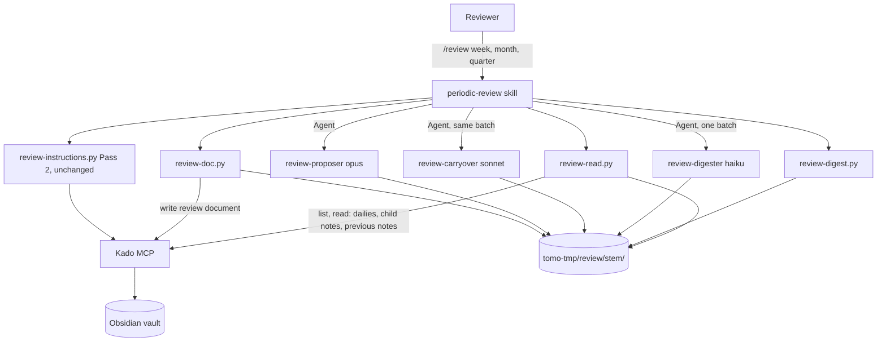
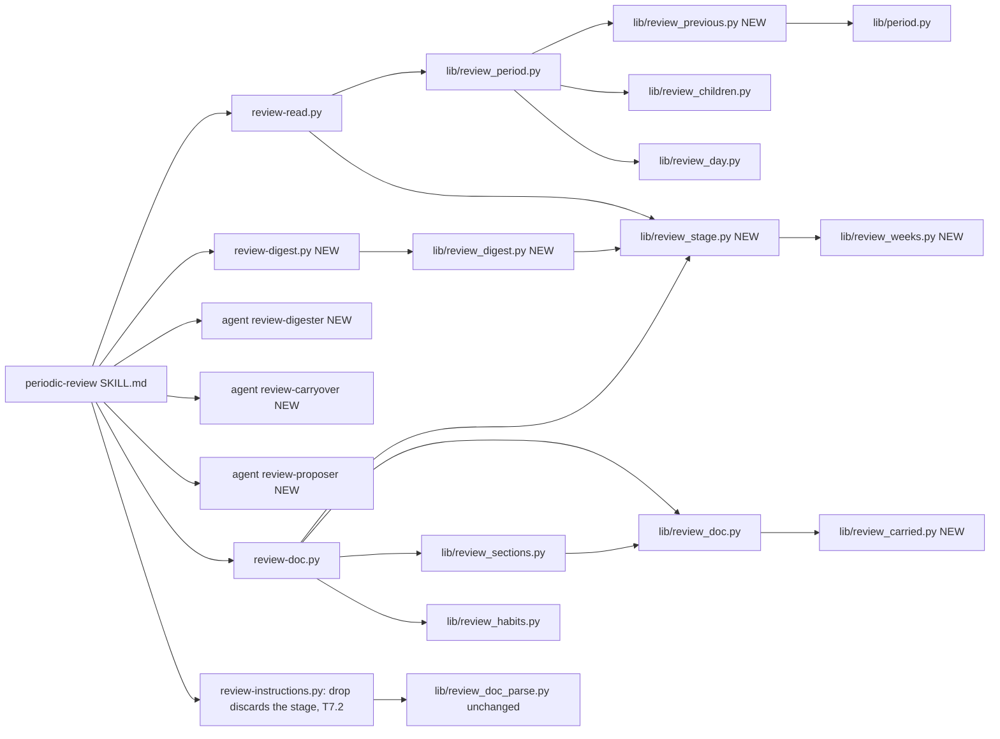
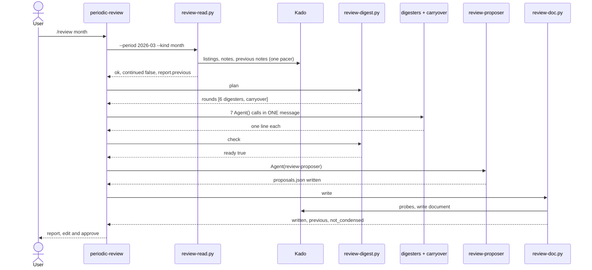
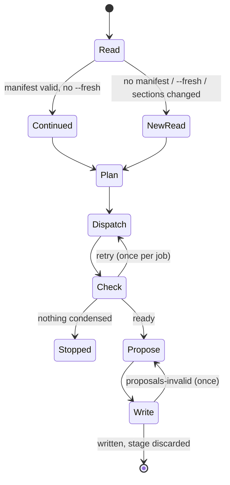

# Solution Design Document

> v1.1 (2026-11-23): owner confirmed ADR-1 … ADR-12; script moves a carried item to its group when its section is full; agent-read stage files line-broken; validation fixes 1–13 worked in.
>
> v1.2 (2026-11-23): owner deviation after the T1.5 measurement (`growth.created` ≈ 157.7 KB indented, 4× the file ceiling): vault growth goes per day to `growth/<date>.json` and per unit to the digesters, the digest gains growth candidates, `context.json` keeps only growth counts and the MOC lists, the read report stays in `manifest.json` and is never proposer input. Amended: ADR-1, ADR-2, ADR-4, ADR-6, ADR-10.
>
> v1.3 (2026-11-23): owner, after the T1.4 smoke: the per-file ceiling drops from 40,960 to 32,768 bytes (ADR-2); a Kado per-path denial is a `FORBIDDEN` tool error (`KadoToolError`), not HTTP 403 — previous notes catch that per call, a `KadoAuthError` still stops the read (ADR-5); the growth-day gotcha is verified against Kado's source. Amended: ADR-2, ADR-5.
>
> v1.4 (2026-11-23): T2.3 review — wording matched to what is built: ADR-2's day re-cut cuts the stored entry's texts (no re-run of `read_day`), a re-cut day is `partly-read` in the manifest's report, a file still over the ceiling is named in `manifest.over_ceiling`; the line gate exempts single-value fields; the manifest shape gains `child_labels` and `over_ceiling`. Amended: ADR-2.
>
> v1.5 (2026-11-23): owner, after the T2.5 measurement (bulk-import day 2026-01-19 = 92,890 B alone over the unit budget; `context.json` 86,345 B in 4 files, mostly per-day `fields`): `UNIT_BUDGET` 81,920 → 131,072 bytes (ADR-2); `context.json` carries `field_aggregates` (per field: days/min/max/mean per period and per unit; days only for a non-numeric field) instead of raw per-day `fields`, which stay in the day files (ADR-1, data model).

> v1.6 (2026-11-23): owner, on the T3.2 finding (the fixture's empty quarterly folder read as `not-read` / `kado-none`): a previous-note folder whose listing Kado answers with nothing is `missing` ("no note found", no error tone); the cause `kado-none` and the line "Kado returned none; the Kado key may not reach the folder" are dropped for previous notes. Why: spec 045 Rule 6 gives the key hint only when Kado answered nothing at all, and the previous notes are read only after the period's dailies were. Accepted trade-off: a key denial that lists as empty also reads "no note found". Amended: ADR-5, ADR-12, Error Handling, data model; PRD F3-AC9.

## Validation Checklist

### CRITICAL GATES (Must Pass)

- [x] All required sections are complete
- [x] No [NEEDS CLARIFICATION] markers remain
- [x] Architecture pattern is clearly stated with rationale
- [x] **All architecture decisions confirmed by user**
- [x] Every interface has specification

### QUALITY CHECKS (Should Pass)

- [x] All context sources are listed with relevance ratings
- [x] Project commands are discovered from actual project files
- [x] Constraints → Strategy → Design → Implementation path is logical
- [x] Every component in diagram has directory mapping
- [x] Error handling covers all error types
- [x] Quality requirements are specific and measurable
- [x] Component names consistent across diagrams
- [x] A developer could implement from this design
- [x] Implementation examples use actual schema column names (not pseudocode), verified against migration files
- [x] Complex queries include traced walkthroughs with example data showing how the logic evaluates

Notes on two gates: there are no database migrations; "column names" means the keys of the JSON files, schemas and vault-config paths, checked against `tomo/schemas/*.json` and the code on branch `feature/270-redesign-the-quarterly-read-chunked-data` at `97b58279` (2026-11-22). The traced walkthroughs are under Complex Logic (a)–(d), plus the previous-period table and the carried-item check trace under Implementation Examples. The owner confirmed ADR-1 … ADR-12 on 2026-11-23.

---

## Output Schema

### SDD Status Report

| Field | Value |
|-------|-------|
| specId | 047-review-chunked-read |
| architecture | see ArchitectureSummary |
| sections | see SectionStatus |
| adrs | ADR-1 … ADR-12, all CONFIRMED (owner, 2026-11-23); ADR-1, 2, 4, 6, 10 amended 2026-11-23 (owner, T1.5 measurement); ADR-2, 5 amended 2026-11-23 (owner, T1.4 smoke) |
| validationPassed | 15 |
| validationPending | 0 |
| nextSteps | `/xdd` plan (Incremental tier expected: baseline e2e first, then read/stage, condense, carry, propose, docs, live walk) |

### ArchitectureSummary

| Field | Value |
|-------|-------|
| pattern | Script-owned staged pipeline (spec 045 ADR-1/ADR-12 extended): one paced read writes a per-day stage; model agents each write one checked file; scripts validate, load and render |
| keyComponents | `review-read.py` + `lib/review_stage.py`, `lib/review_weeks.py`, `lib/review_previous.py`; `review-digest.py` + `lib/review_digest.py`; agents `review-digester` (haiku), `review-carryover` (sonnet), `review-proposer` (opus); `review-doc.py` + `lib/review_doc.py`, `lib/review_sections.py`, `lib/review_carried.py`; `periodic-review` SKILL.md |
| externalIntegrations | Kado MCP (read, inbox write) — unchanged surface; Hashi instruction wire `schema_version` "4" — unchanged |

### SectionStatus

| Name | Status | Detail |
|------|--------|--------|
| Constraints | COMPLETE | |
| Implementation Context | COMPLETE | |
| Solution Strategy | COMPLETE | |
| Building Block View | COMPLETE | Responsibility matrix covers all 56 criteria |
| Runtime View | COMPLETE | Four traced walkthroughs |
| Deployment View | COMPLETE | No deployment change beyond the synced files |
| Cross-Cutting Concepts | COMPLETE | |
| Architecture Decisions | COMPLETE | ADR-1 … ADR-12 confirmed by the owner 2026-11-23 |
| Quality Requirements | COMPLETE | |
| Acceptance Criteria | COMPLETE | |
| Risks and Technical Debt | COMPLETE | |
| Glossary | COMPLETE | |

### ADRStatus

| id | name | status |
|----|------|--------|
| ADR-1 | Stage layout and the loader | CONFIRMED (amended 2026-11-23) |
| ADR-2 | Size limits and what happens when one is exceeded | CONFIRMED (amended 2026-11-23) |
| ADR-3 | The read id, the manifest, and continuing a stored read | CONFIRMED |
| ADR-4 | Digest and carryover contracts, `review-digest.py`, one retry | CONFIRMED (amended 2026-11-23) |
| ADR-5 | Finding and reading the previous notes | CONFIRMED (amended 2026-11-23) |
| ADR-6 | Proposals: the `carried` field, its checks and its labels | CONFIRMED (amended 2026-11-23) |
| ADR-7 | Three review agents, their models and tools | CONFIRMED |
| ADR-8 | Dispatch from the skill: one batch, rounds as fallback, STRICT rules | CONFIRMED |
| ADR-9 | Pass 2 and the wire stay as they are | CONFIRMED |
| ADR-10 | Privacy and deletion of the stage | CONFIRMED (amended 2026-11-23) |
| ADR-11 | Behaviour baseline before the rebuild | CONFIRMED |
| ADR-12 | The document's top lines for previous notes, weeks not condensed and a failed carry | CONFIRMED |

---

## Constraints

- CON-1 Spec 045/046 architecture stays (045 ADR-1, ADR-2, ADR-12; 046 CON-1): the `/review` skill owns the flow, scripts own state, reads, writes, checks and rendering. New in this spec: the model output is no longer one file written in the main session but three kinds of files written by three agents (`digests/<unit>.json`, `carryover.json`, `proposals.json`); each is checked by a script before anything uses it. Python 3 stdlib plus the repo's `lib/`, `jsonschema` and PyYAML as today. Runtime prose (`tomo/dot_claude/**`) holds imperatives only; every WHY goes to `docs/tomo/<mirrored-path>.md` first. Every edited managed file bumps `# version:`.
- CON-2 Platform: a subagent cannot dispatch a subagent; the skill in the main session dispatches every agent (`Agent()` with `subagent_type`, `run_in_background: false`, as `commands/inbox.md:57-69`). One Read call returns at most about 25,000 tokens; the review material is about 1.85 characters per token (research §2); a model context holds about 200,000 tokens. The session model is `sonnet` (`tomo/dot_claude/settings.json:2`); an agent sets its own `model`.
- CON-3 Privacy (spec 045 ADR-9 / F7, PRD F7): no note text in stdout, stderr, cost records, `meta.json`, `manifest.json`, `condensed.json` or `delivered_plan`. Stage files that hold note content (`days/`, `growth/`, `children/`, `previous/`, `context*.json`, `digests/`, `carryover.json`, `proposals.json`) are deleted once the document is written, on a Pass 1 abort, on drop and when a new read replaces them. Kado is the only vault access; only `review-read.py` calls Kado in Pass 1 before the document write, and `review-doc.py write` writes the inbox document.
- CON-4 Nothing of the document or Pass 2 changes for the user (PRD F2): the merged read dict that `review-doc.py` consumes keeps its keys (`period`, `days`, `open_tasks`, `growth` (its `created` list rebuilt by the loader from `growth/`), `not_read`, `report`, `weekly`, `monthly`, `only_in_*_links`, `dailies_not_in_*`, `sections`); the instruction wire stays `schema_version` "4"; no handoff to Hashi or Kado (at most a Kokoro FYI).
- CON-5 File sizes (Constitution L2, 300–500 lines of dense logic): `lib/review_period.py` (433 lines), `lib/review_doc.py` (442), `review-doc.py` (433), `lib/review_config.py` (480) and `lib/period.py` (500) are near the guide. New logic goes into new modules (`review_stage`, `review_weeks`, `review_previous`, `review_digest`, `review_carried`); the existing files get call sites and small extensions only.
- CON-6 Eval gate: no gated file changes (`synthesis-conductor.md`, `suggestion-conductor.md`, `suggest-handling/SKILL.md`, `commands/inbox.md`, `settings.json`). The agents' file writes work under the current `settings.json` (ADR-7), so it is not touched. If one gated file must change, the full suite runs before merge.
- CON-7 Quality before cost (owner, README Decisions Log): the cost and time numbers of the PRD Success Metrics are guidance; the hard conditions are 0 days not read because of size and no sample or search fallback.

## Implementation Context

**IMPORTANT**: You MUST read and analyze ALL listed context sources to understand constraints, patterns, and existing architecture.

### Required Context Sources

#### Documentation Context
```yaml
- doc: docs/XDD/specs/047-review-chunked-read/requirements.md
  relevance: CRITICAL
  why: "PRD v1.1 — the 56 criteria, the amendments to specs 045/046, the Notes for the SDD"
- doc: docs/XDD/specs/047-review-chunked-read/README.md
  relevance: CRITICAL
  why: "Owner decisions: approach A, models, new layout replaces read.json, deletion at write, labels, continue on stored read"
- doc: docs/XDD/specs/047-review-chunked-read/research.md
  relevance: HIGH
  why: "C1–C10, the measured sizes (5.8–5.9 KB per day, 184 KB non-day rest of 2026-Q1), the limits proposed, the consumer list"
- doc: docs/XDD/ideas/2026-11-22-review-chunked-read-and-previous-reviews.md
  relevance: HIGH
  why: "Brainstorm §4 flow and contracts, §5 the open SDD items (limits, read_id, marks)"
- doc: docs/XDD/specs/046-review-template-sections/solution.md
  relevance: HIGH
  why: "ADR-1/2 (sections, marks, double placement), ADR-6/7 (quarter, read parts), CON-2 (group items carry no mark)"
- doc: docs/XDD/specs/045-weekly-monthly-review/solution.md
  relevance: HIGH
  why: "ADR-9 (delete at write), ADR-12 (model writes one file), the pacing and report contract"
- doc: docs/XDD/specs/046-review-template-sections/close-out.md
  relevance: MEDIUM
  why: "The partial quarter reads, the self-started helpers ($2.83), the measured costs used as guidance"
- doc: docs/tomo/dot_claude/skills/periodic-review.md
  relevance: HIGH
  why: "WHY layer of the skill; every new rule is written there before the runtime text"
- doc: evals/README.md
  relevance: MEDIUM
  why: "Gated files (none touched) and how a plugin eval case is added"
- doc: PRIVACY.md (section "Where read content rests", lines 140-168)
  relevance: HIGH
  why: "The sentences test_review_privacy_docs.py pins; extended for the new stage files and the agent models"
```

#### Code Context
```yaml
- file: tomo/scripts/review-read.py
  relevance: CRITICAL
  why: "One KadoClient + one ReviewPacer (174-190), stop rules (231-235), --measure (200-209, 242-244), writes via review_read_parts (241, 247)"
- file: tomo/scripts/lib/review_period.py
  relevance: CRITICAL
  why: "PeriodSources without a quarterly folder (67-87), CHILD (61), the single-pass run with finish() (381-383), result keys (400-427)"
- file: tomo/scripts/lib/review_read_parts.py
  relevance: HIGH
  why: "Replaced: files_of/write/load/stage_files (110-188); its merged-dict contract is what the new loader must return"
- file: tomo/scripts/lib/review_day.py
  relevance: HIGH
  why: "Day entry keys (297-309), the max_chars cap on a section boundary (261-275), _has_content (151)"
- file: tomo/scripts/lib/review_children.py
  relevance: MEDIUM
  why: "find/prefetch/read/status of child notes (58-106); the pattern previous notes follow"
- file: tomo/scripts/review-doc.py
  relevance: CRITICAL
  why: "_load_read (208-215), _drop_stage_content (218-220), render_and_write (270-325), replace --abort (359-361)"
- file: tomo/scripts/lib/review_doc.py
  relevance: CRITICAL
  why: "_LABELS (100-127), Sources.of (203-221), group_reason (242-249), check_item (252-278), MIN_THEME_DAYS (80), _callout (350-361), DocInput (310-327)"
- file: tomo/scripts/lib/review_sections.py
  relevance: HIGH
  why: "check with mark (95-136), _double_placements (167-180), part_items suffix (224-231)"
- file: tomo/scripts/lib/review_doc_parse.py
  relevance: MEDIUM
  why: "_TRAILING_DONE_MARK (74) strips only the trailing ✅ date; edited = link stems (94-100) — the carried suffix is plain text"
- file: tomo/scripts/lib/review_habits.py
  relevance: MEDIUM
  why: "habits(trackers, days, period_days, language) (307-313) — fed by the loader's days"
- file: tomo/scripts/lib/period.py
  relevance: HIGH
  why: "Period.previous (176-177), containing (159), months (179), weeks_overlapping (185-194), note_paths (196-200)"
- file: tomo/scripts/lib/review_config.py
  relevance: HIGH
  why: "GRANULARITY (53), DEFAULT_MAX_CHARS 12000 (59), folder_for (173-186), configured_formats (194-201)"
- file: tomo/scripts/lib/review_reader.py
  relevance: HIGH
  why: "PacedReader: cache, pending, not_read, missing, finish (39-141)"
- file: tomo/scripts/lib/kado_client.py
  relevance: MEDIUM
  why: "KadoAuthError on 401/403 (51-52, 761) = wrong token, stops the whole read; a per-path denial is KadoToolError FORBIDDEN (948-954)"
- file: tomo/schemas/review-proposals.schema.json
  relevance: HIGH
  why: "Closed schema; group items without mark; sectionItem.mark enum"
- file: tomo/dot_claude/skills/periodic-review/SKILL.md
  relevance: CRITICAL
  why: "allowed-tools Read, Write, Bash (5); write rule (11); step 4 (118-127); step 5 (129-165); STRICT (237)"
- file: tomo/dot_claude/agents/inbox-analyst.md
  relevance: MEDIUM
  why: "Frontmatter pattern (1-12): permissionMode acceptEdits, tools, # version header"
- file: tomo/dot_claude/commands/inbox.md
  relevance: MEDIUM
  why: "run_in_background: false and subagent_type STRICT (57-69)"
- file: tomo/dot_claude/skills/suggest-handling/SKILL.md
  relevance: MEDIUM
  why: "STRICT one-message batch and exact prompt structure (86-112)"
- file: tomo/dot_claude/settings.json
  relevance: HIGH
  why: "Edit(tomo-tmp/*) (33) covers Write by agents; NOT changed (eval gate)"
- file: tests/review_e2e_walk.py, tests/review_privacy_fixture.py, tests/test_review_privacy.py
  relevance: HIGH
  why: "In-process walk (WEEK/MONTH only), synthetic vault without quarterly notes, the tmp-leak allowlist (212)"
- file: tests/test_review_sdd_map.py, tests/test_review_why_docs.py
  relevance: MEDIUM
  why: "Glob-driven: every review file must be named in an SDD Directory Map and have a WHY mirror"
- file: scripts/tomo-session-stats.py
  relevance: MEDIUM
  why: "Per-session and per-subagent tokens and peak context (F8-AC1)"
```

#### External APIs (if applicable)
```yaml
- service: Kado MCP (miyo-kado)
  doc: reference memories kado-* ; Kado canonical.ts:685-686, server.ts:105-157 (rate limit 20 req / 5 s per IP)
  relevance: HIGH
  why: "Previous notes add 2-4 calls inside the same pacer; no new tool, no new key scope"
- service: Claude Code Agent tool
  doc: tomo/dot_claude/commands/inbox.md, docs/tomo/dot_claude/agents/*.md
  relevance: HIGH
  why: "Parallel dispatch of 14-16 agents in one message is unproven (research §2); fallback in rounds"
```

### Implementation Boundaries

- **Must Preserve**: the review document's parts, order, checkboxes, ids and marks (046 ADR-11); the Pass 2 grammar, preview, deliver, drop and the instruction wire (v4); the report and stop rules of `review-read.py` (045 F3-AC8..13); `meta.json` content-free and its fields; the `review-doc.py` subcommands and their flags; delete at write (045 ADR-9).
- **Can Modify**: the stage layout under `tomo-tmp/review/<stem>/` (owner: the new layout replaces `read.json`); `review-read.py` output (`read_path`/`read_parts` replaced by `stage`); step 4 and step 5 of SKILL.md; the proposals schema (additive); the callout of the document (additive lines); `review_doc.Sources`, `check_item`, `_LABELS`.
- **Must Not Touch**: `tomo/dot_claude/settings.json` and the other gated files; Hashi and Kado; `review-instructions.py` and the Pass 2 libraries except tests; the vault config schema (no new setup key).

### External Interfaces

#### System Context Diagram



#### Interface Specifications

```yaml
inbound:
  - name: "/review command"
    type: Claude Code slash command → skill
    format: "/review [setup | week | month | quarter | 2026-W13 | 2026-03 | 2026-Q1 | @note]"
    authentication: none (local container session)
    doc: tomo/dot_claude/commands/review.md
    data_flow: "Period request; Pass 1 runs read → condense → propose → write"

outbound:
  - name: "Kado MCP"
    type: MCP over HTTP (lib/kado_client)
    format: JSON-RPC
    authentication: bearer key (instance)
    doc: reference memories kado-*
    data_flow: "review-read.py only (+ the existing review-doc.py probes and the document write); previous notes: 1 folder listing + 1 note per kind"
    criticality: HIGH
  - name: "Agent tool (Claude Code)"
    type: in-session subagent dispatch
    format: "Agent(subagent_type, run_in_background: false, prompt)"
    authentication: none
    doc: tomo/dot_claude/agents/review-*.md (new)
    data_flow: "Prompts carry paths, ids, dates and the review language only — never note text"
    criticality: HIGH
  - name: "Hashi instruction set"
    type: file contract
    format: hashi-instructions.schema.json, schema_version "4" (unchanged)
    authentication: none
    doc: tomo/schemas/hashi-instructions.schema.json
    data_flow: "A carried item reaches it only as item text inside content"
    criticality: HIGH

data:
  - name: "tomo-tmp/review/<stem>/"
    type: files in the instance workspace
    connection: lib/note_io.atomic_write_text (scripts), Write tool (agents, one file each)
    doc: this SDD, Data Storage Changes
    data_flow: "manifest.json, weeks.json, days/, growth/, children/, previous/, context*.json (review-read); digests/, carryover.json, proposals.json (agents); condensed.json (review-digest); meta.json (review-doc, unchanged)"
  - name: "Vault config"
    type: YAML (read only in Pass 1)
    connection: lib/review_config
    doc: tomo/schemas/vault-config-review.schema.json
    data_flow: "concepts.calendar.granularities.<g>.path, naming.calendar_patterns.<g>, review.week.* — no new key"
```

### Cross-Component Boundaries (if applicable)

- **API Contracts**: the instruction wire (Hashi) is untouched: `schema_version` stays "4", no action kind or field is added; a carried mark is part of the item text inside `content` (research §3; 046 SDD :284, :686). `tests/test_035_wire_gate.py` stays green unchanged. The Kado surface is unchanged (same tools, same key).
- **Team Ownership**: Tomo only. A Kokoro FYI names the previous-review follow-up as a review behaviour (optional, PRD Won't Have).
- **Shared Resources**: Kado's rate-limit bucket (shared with the session's MCP calls); the stage folder; the inbox folder.
- **Breaking Change Policy**: a stage written by a pre-047 Tomo (`read.json`, `read-index.json`, `read-*.json`) is never loaded: `review-read.py` deletes it on the next read and `review-doc.py write` refuses `read-missing` without a `manifest.json` (Implementation Gotchas).

### Project Commands

```bash
# Discovered from pyproject.toml, venv/ and evals/README.md (same as specs 045/046)
Install: none — the repo's ./venv carries pytest and ruff; the container image needs no change
Test:    ./venv/bin/python -m pytest tests/ -q
Test one area: ./venv/bin/python -m pytest tests/test_review_*.py tests/test_047_*.py tests/test_period.py -q
Lint:    ./venv/bin/ruff check tomo/scripts scripts tests
Wire gate: ./venv/bin/python -m pytest tests/test_035_wire_gate.py tests/test_035_wire_manifests.py -q
Measure (no model, owner go): python3 tomo/scripts/review-read.py --kind quarter --period 2026-Q1 --stem <stem> --measure
Plugin eval (opt-in, paid, owner go): scripts/run-evals.sh --case <review case>   # not a gate for these files
Sync to the test instance (owner instruction only): scripts/update-tomo.sh --instance tomo-instance --yolo
Cost per step: python3 scripts/tomo-session-stats.py --session <jsonl>
```

## Solution Strategy

- **Architecture Pattern**: a script-owned staged pipeline. One paced read writes a per-day stage; the review's work is split into small model steps that each read only files under the per-call limit and each write one file that a script checks; the proposals are checked and rendered by the existing scripts. It is spec 045's pattern (scripts own every checkable rule, the model writes data files, never the document) with the single model step split into three roles.
- **Integration Approach**:
  1. *Read*: `review-read.py` keeps its one client and one pacer and reads the previous notes in the same pass (before `finish()`); it writes the stage through `lib/review_stage.py` instead of `read*.json`, with a `manifest.json` written last.
  2. *Condense*: `review-digest.py plan` names the units (a week of the period, or part of one when it is over budget) and the carryover job; the skill dispatches all of them in one message; `review-digest.py check` validates each file and drives one retry.
  3. *Propose*: one `review-proposer` agent reads the digests, the carryover, `context.json` and the child notes the kind marks against, and writes `proposals.json` in today's shape plus the `carried` fields.
  4. *Write*: `review-doc.py write` loads the stage through `review_stage.load`, which returns today's merged dict plus `previous`, `carryover` and `condensed`; the existing checks and renderer run on it, extended for carried items and the new top lines.
- **Justification**: the per-call Read limit is gone structurally (every file ≤ 32 KB), no model context holds the whole period (the proposer sees ≤ ~112 KB of digests), and the consumers of the read stay unchanged behind the loader (research C2: one merged dict feeds all of `review-doc.py`). Week, month and quarter run the same flow; only the number of units differs.
- **Key Decisions**: ADR-1 … ADR-12 below.

## Building Block View

### Components



| Component | Single responsibility |
|---|---|
| `skills/periodic-review/SKILL.md` | The flow: step 4 read (continue or new), step 5 plan → one batch dispatch → check → one retry → proposer → write → one rewrite; saying the continued read, the not-condensed weeks, the previous-note lines and the carry failure; the Pass 1 abort |
| `review-read.py` | The read entry point: setup, `--fresh`, continue on a stored read without Kado, one client and pacer, the stop rules, `--measure`, the report incl. `report.previous`, writing the stage |
| `lib/review_period.py` | Reading a period (unchanged rules) + calling `review_previous` inside the pass; `PeriodSources.quarterly_folder`; each created note of `growth.created` keeps its creation `day` (local date of Kado's `created`, the convention of `period_bounds_ms`, review_period.py:139-143) |
| `lib/review_previous.py` (new) | Which previous periods a kind reads; whether a kind is set up; finding and reading each previous note through the `PacedReader`; its state (found, empty, missing, not set up, not read + cause); its text cut by `review_day.cut_at_boundary` (no cutter of its own) |
| `lib/review_stage.py` (new; replaces `lib/review_read_parts.py`) | The stage layout: encoding the agent-read files line-broken (`indent=1`, long texts as arrays of lines) and measuring the 32 KB ceiling on that form; writing `days/`, `growth/` (the created notes per creation day), `children/`, `previous/`, `context*.json` (growth counts and MOC lists only), `weeks.json`, `manifest.json`; asking `review_day` to re-cut an oversized day; the read id; `load` → the merged dict (lines joined back, `growth.created` rebuilt from `growth/`, `report` from `manifest.json`, `condensed.json` read and read-id-checked); `discard`; the continue check |
| `lib/review_weeks.py` (new) | The units of a period: weeks under the configured rule clipped to the period, packed into units under the 128 KB budget (a day weighs its day file plus its growth files); the digest cap per unit |
| `review-digest.py` (new) | Condense entry points: `plan` (what to dispatch, in which rounds, which files the proposer reads), `check` (validate digests and carryover, attempts, retry list, not condensed, nothing condensed) |
| `lib/review_digest.py` (new) | Pure validation of a digest and of the carryover file against the stage (file level: schema, read id, sources, id uniqueness, size); the `condensed.json` state model. `condensed.json` is written only by `review-digest.py` (`plan`, `check`) and read by `review_stage.load` (for `review-doc.py`) and by `review-digest.py` itself |
| agent `review-digester` (new, haiku) | Condense one unit's day files, its growth files (the notes created on its days, with their links) and its weekly note into `digests/<unit>.json`, growth candidates included |
| agent `review-carryover` (new, sonnet) | Take the open items, intentions/goals and themes of the found previous notes into `carryover.json` |
| agent `review-proposer` (new, opus) | Build `proposals.json` over the whole period from digests (growth candidates included), carryover and context (growth counts and MOC lists; never `manifest.json` or its `report`): themes over all days, open judged against later weeks, carried items matched to the days and marked, one place per finding, the "Vault growth" group from the units' growth candidates |
| `review-doc.py` | Write/parse/replace as today; loads via `review_stage.load`; refuses `condense-incomplete` and `read-stale`; passes previous states, not-condensed units and the carry failure to the renderer; discards the stage after the write and on `replace --abort` |
| `lib/review_sources.py` | Sources incl. previous notes; the one source resolver `resolve_sources` (used by `check_item` and `review_carried`); split out of `review_doc.py` in T5.2 (CON-5), re-exported there |
| `lib/review_doc.py` | `check_items` with an explicit carried branch (carried failures go to `errors`, never `rejected`); `_LABELS` incl. carried marks and top-line words; the callout lines |
| `lib/review_carried.py` (new) | Every document-level check of a carried item: previous-note sources ⊆ its ids' sources, day rule per mark, carried + child-mark interplay, group/mark combination, theme never done, every carryover id exactly once; `overflow`: moving a carried item of a full section into the group of its mark before the section checks |
| `lib/review_sections.py` | Section side as today; a section item's `carried` checked through `review_carried.check(..., in_section=True)`, failures as `errors`; `over-cap` counts only after `review_carried.overflow` ran; the suffix renders the carried mark before the child mark |
| `lib/review_habits.py` | Unchanged: habits over every read day of the loader's `days` |
| `lib/review_doc_parse.py` | Unchanged code; a regression test pins that a carried suffix is item text, never an edit or a done mark |
| `schemas/review-digest.schema.json`, `review-carryover.schema.json` (new), `review-proposals.schema.json` | The agents' file contracts |
| `scripts/tomo-session-stats.py` (MODIFY 0.2.1, T7.3 deviation, owner told) | Per-step cost, wall time and peak context of a live run, counts only: per-model pricing from `tomo-token-usage.py`'s `PRICE` (imported; an unknown model falls back to the default rate and is marked) and a per-step block (main session + each subagent by `agentType`); F8-AC1 needed per-step figures and 0.1.1 had one flat Sonnet rate and aggregate subagent totals. Peak = input + cache_read (spec 046 peaks also counted cache_write) |
| Unchanged, named for the boundary: `lib/review_mapping.py`, `lib/review_section_plan.py`, `review-session.py` | Off-limits resolution (F4-AC5); Pass 2 block replacement (F5-AC6); `start` and the open-review listing — no code change |
| Reused without change: `lib/run_id.py`, `lib/review_md.py`, `lib/review_reader.py` | The read id; the markdown helpers behind the cutter; the `PacedReader` the previous notes go through |

Touched without a new responsibility: `lib/review_day.py` (`has_content` made public; the existing cap loop of review_day.py:261-275 becomes the public `cut_at_boundary(units, max_chars)`, which `read_day` keeps using and `review_stage` (oversized day) and `review_previous` (previous note at a heading boundary) call — one cutter), `lib/review_children.py` (unchanged code; its entries go to `children/`), `tests/review_privacy_fixture.py` (quarter variant, previous notes), `tests/review_e2e_walk.py` (quarter, the condense stage), `config/vault-example.yaml` (comment: previous notes use the existing folders and formats).

**Responsibility matrix (exactly one owner per PRD criterion; collaborators in brackets):**

| Owner | Criteria |
|---|---|
| `lib/review_weeks.py` | F1-AC1 [`review-digest.py check` proves each unit's digest names all its days; `review-digester` reads all of them] |
| `lib/review_stage.py` | F1-AC2 [day files are built by the same `read_day` for every kind; clipping by `review_weeks`], F6-AC5, F7-AC1 |
| agent `review-proposer` | F1-AC3 [two-day rule re-checked over all days by `review_doc.check_item`], F1-AC4, F1-AC5 [`double-placement` by `review_sections`], F4-AC2, F4-AC3 [`carried-theme-done` by `review_carried`], F4-AC4 [group/mark rule by `review_carried`], F4-AC8, F4-AC11 |
| `lib/review_period.py` | F1-AC6, F2-AC3 (link differences over the whole period) |
| `lib/review_day.py` | F1-AC7 [`review_stage` calls its `cut_at_boundary` for the 32 KB re-cut] |
| `lib/review_doc.py` | F2-AC1 [proven by the baseline e2e, ADR-11], F3-AC6 [run report: SKILL.md], F3-AC11, F5-AC1 |
| `review-instructions.py` | F2-AC2 (unchanged; proven by the e2e on the new flow) |
| `lib/review_habits.py` | F2-AC4 |
| `review-read.py` | F2-AC5, F2-AC6, F6-AC4 [`review-digest.py plan` dispatches only what is not passed] |
| `lib/review_previous.py` | F3-AC1, F3-AC2, F3-AC3, F3-AC4, F3-AC5, F3-AC7, F3-AC8, F3-AC9, F3-AC10, F4-AC9, F6-AC7 |
| agent `review-carryover` | F4-AC1 |
| `lib/review_mapping.py` (spec 046, unchanged) | F4-AC5 (an off-limits heading is never a mapped section; `review_previous` reads off-limits text as a source) |
| `lib/review_carried.py` | F4-AC6, F4-AC7, F4-AC10 (`overflow`), F5-AC3 |
| `lib/review_sections.py` | F5-AC2 |
| `lib/review_doc_parse.py` | F5-AC4, F5-AC5 |
| `lib/review_section_plan.py` (spec 046, unchanged) | F5-AC6 [regression test `tests/test_047_baseline_e2e.py::test_rereview_replaces_block_with_carried_items`] |
| `review-digest.py` | F6-AC1 [rendered by `review_doc`], F6-AC2 [rendered by `review_doc`], F6-AC8 [stop worded by SKILL.md] |
| `skills/periodic-review/SKILL.md` | F6-AC3, F6-AC6 [`review_stage.discard` via `replace --abort`] |
| `PRIVACY.md` | F7-AC2, F7-AC3 [`docs/setup.md` names the models too] |
| `tests/test_review_privacy.py` (the leak guard over every review script) | F7-AC4 |
| the three agents' frontmatter `tools: Read, Write` | F7-AC5 |
| `scripts/tomo-session-stats.py` | F8-AC1 |
| spec close-out (`close-out.md`) | F8-AC2 |

MECE check: 56 criteria (F1 7, F2 6, F3 11, F4 11, F5 6, F6 8, F7 5, F8 2), each in exactly one row; no criterion unowned. Overlaps are collaborations in brackets, never a second owner.

### Directory Map

**Component**: Tomo runtime and scripts
```
tomo/
├── dot_claude/
│   ├── skills/periodic-review/SKILL.md       # MODIFY 0.2.13 → 0.3.0: allowed-tools + Agent; write rule; step 4 continue/--fresh; step 5 condense/propose; STRICT dispatch, no fallback; Pass 1 abort
│   ├── agents/review-digester.md             # NEW 0.1.0: haiku, tools Read, Write
│   ├── agents/review-carryover.md            # NEW 0.1.0: sonnet, tools Read, Write
│   └── agents/review-proposer.md             # NEW 0.1.0: opus, tools Read, Write; the proposal rules moved out of SKILL.md step 5
├── schemas/
│   ├── review-proposals.schema.json          # MODIFY: optional carried + carried_ids on group and section items
│   ├── review-digest.schema.json             # NEW
│   └── review-carryover.schema.json          # NEW
├── config/vault-example.yaml                 # MODIFY (comment only): previous notes use the existing folders/formats
└── scripts/
    ├── review-read.py                        # MODIFY 0.3.2 → 0.4.0
    ├── review-digest.py                      # NEW 0.1.0
    ├── review-doc.py                         # MODIFY 0.7.2 → 0.8.0
    └── lib/
        ├── review_stage.py                   # NEW 0.1.0
        ├── review_stage_codec.py             # NEW 0.1.0 (T2.3 deviation: encoding, cut and packing helpers split out so review_stage.py stays ≤ 300 lines)
        ├── review_weeks.py                   # NEW 0.1.0
        ├── review_previous.py                # NEW 0.1.0
        ├── review_digest.py                  # NEW 0.1.0
        ├── review_carried.py                 # NEW 0.1.0
        ├── review_sources.py                 # NEW 0.1.0 (T5.2 deviation, owner: Sources and resolve_sources split out of review_doc.py, CON-5)
        ├── review_read_parts.py              # DELETE (replaced by review_stage.py)
        ├── review_period.py                  # MODIFY 0.5.1 → 0.6.0
        ├── review_doc.py                     # MODIFY 0.5.3 → 0.6.0
        ├── review_sections.py                # MODIFY 0.2.2 → 0.3.0
        └── review_day.py                     # MODIFY 0.3.2 → 0.3.3 (has_content public)
```

**Component**: Documentation
```
docs/
├── tomo/dot_claude/skills/periodic-review.md   # MODIFY: step 4/5 WHY, dispatch, STRICTs, abort, continue
├── tomo/dot_claude/agents/review-digester.md   # NEW: WHY (haiku, one unit, no judgement, the cap)
├── tomo/dot_claude/agents/review-carryover.md  # NEW: WHY (sonnet, no setup marker, text as it stands now)
├── tomo/dot_claude/agents/review-proposer.md   # NEW: WHY (opus rationale, whole-period rules, carried rules)
├── tomo/scripts/review-read.md                 # MODIFY: stage layout, continue, previous notes, measure
├── tomo/scripts/review-digest.md               # NEW
├── tomo/scripts/review-doc.md                  # MODIFY: loader, new refusals, top lines
├── tomo/scripts/lib/review_stage.md            # NEW
├── tomo/scripts/lib/review_stage_codec.md      # NEW (T2.3 deviation: the split; the encoding WHY stays in review_stage.md)
├── tomo/scripts/lib/review_weeks.md            # NEW
├── tomo/scripts/lib/review_previous.md         # NEW
├── tomo/scripts/lib/review_digest.md           # NEW
├── tomo/scripts/lib/review_carried.md          # NEW
├── tomo/scripts/lib/review_sources.md          # NEW (T5.2 deviation: the split; why one resolver)
├── tomo/scripts/lib/review_read_parts.md       # DELETE (history moves to review_stage.md)
├── tomo/scripts/lib/review_period.md, review_doc.md, review_sections.md, review_day.md, review_children.md, review_doc_parse.md  # MODIFY
├── setup.md                                     # MODIFY (~:293): the three models see note content; previous notes are read
├── usage.md                                     # MODIFY (Could Have): what the carried marks mean
└── XDD/backlog.md                               # MODIFY: parked items (month stage, setup marker, age counter)
PRIVACY.md                                       # MODIFY: Where read content rests (new files, models, transcripts, interrupted runs)
README.md                                        # MODIFY (:25, :174, agents table :164): every day read, previous reviews followed up
```

**Component**: Tests
```
tests/
├── review_doc_fingerprint.py                 # NEW: structural fingerprint of a review document (ADR-11)
├── test_review_doc_fingerprint.py            # NEW (implemented, spec 047 T1.1): equal without wording, unequal per structural field, no item text
├── test_047_baseline_e2e.py                  # NEW, FIRST: week/month/quarter fingerprints green on the old flow, then on the new
├── test_047_e2e_failures.py                  # NEW (spec 047 T8.2): failure, resume, re-review and vault growth end to end on the new flow
├── review_privacy_fixture.py                 # MODIFY: QUARTERLY folder + quarter config, previous notes (W12, 2026-02), digests/carryover fixtures
├── review_e2e_walk.py                        # MODIFY: quarter, the condense stage (fixture agents), --fresh
├── test_review_stage.py                      # NEW (replaces test_review_read_parts.py)
├── test_review_weeks.py                      # NEW
├── test_review_previous.py                   # NEW
├── test_review_period_previous.py            # NEW (spec 047 T3.2): previous notes inside the period read, one pacer
├── test_review_read_previous.py              # NEW (spec 047 T3.2): month/quarter walkthroughs, report.previous, previous/ files
├── test_review_digest.py                     # NEW
├── test_review_digest_schemas.py             # NEW (spec 047 T4.1): W14 digest/carryover validate; caps, patterns, enums refused
├── test_review_carried.py                    # NEW
├── test_review_proposals_carried_schema.py   # NEW (spec 047 T5.1): carried + carried_ids validate on group and section items; the pair, enum, id pattern refused; 045/046 fixtures still valid
├── test_047_t5_4_carried_write.py            # NEW (spec 047 T5.4): carried items through review-doc.py write: labels, top-line counts, coverage, carry_failed, overflow before over-cap, the new written keys
├── test_047_skill_contract.py                # NEW: pinned step 4/5 prose, allowed-tools, STRICTs, agent prompts
├── test_047_agents.py                        # NEW: frontmatter (model, tools Read/Write, no mcp), version header
├── test_eval_review_no_stage_read.py         # NEW (implemented, spec 047 T6.4): plugin eval case review-no-stage-read offline: stage and stub contract, graders on synthetic traces, the two mutations
├── test_review_read_parts.py                 # DELETE
└── changed by design: test_review_read.py, test_046_t4_5_quarter_read.py, test_046_t4_5_skill_quarter.py,
    test_046_t4_4_skill_sections.py, test_review_skill*.py, test_review_doc.py, test_review_doc_parse.py (new case),
    test_review_privacy.py (allowlist), test_review_privacy_docs.py, test_review_e2e*.py, test_review_period_golden.py
    (result gains `previous`), test_review_sdd_map.py (accepts spec 047's map), test_review_why_docs.py,
    test_046_close_out_gaps.py:41, test_045_close_out_gaps.py, test_review_integration.py
```

### Interface Specifications

#### Interface Documentation References

```yaml
interfaces:
  - name: "review-read.py CLI"
    doc: tomo/scripts/review-read.py docstring (rewritten) + docs/tomo/scripts/review-read.md
    relevance: CRITICAL
    sections: [output, stage layout, rules]
    why: "The skill branches on its status, continued, report.previous"
  - name: "review-digest.py CLI (NEW)"
    doc: tomo/scripts/review-digest.py docstring + docs/tomo/scripts/review-digest.md
    relevance: CRITICAL
    sections: [plan, check]
    why: "Drives dispatch, retry and the not-condensed outcome"
  - name: "Agent file contracts (NEW)"
    doc: tomo/schemas/review-digest.schema.json, review-carryover.schema.json, review-proposals.schema.json
    relevance: CRITICAL
    sections: [all]
    why: "Every agent output is schema-checked before use"
  - name: "Hashi instruction wire"
    doc: tomo/schemas/hashi-instructions.schema.json
    relevance: LOW
    sections: []
    why: "Unchanged; named so a reviewer sees it was checked"
```

#### Data Storage Changes

No database. The stage folder `tomo-tmp/review/<stem>/` replaces `read.json` / `read-index.json` / `read-<YYYY-MM>.json`:

```yaml
manifest.json:            # review-read.py; written LAST (the commit marker of a complete read); metadata only
  layout: 1
  read_id: string         # lib/run_id.generate(), e.g. "2026-11-22T10-04-12Z-3f9a1c"
  read_at: string         # UTC ISO, e.g. "2026-11-22T10:04:12Z"
  stem: string
  period: {kind, name, start, end}
  sections_digest: string # "sha256:<hex>" of the canonical JSON of the section definitions, or "none"
  files: {days: [names], growth: [names], children: [names], previous: [names], context: [names], weeks: "weeks.json"}
  report: object          # the stdout report of the read (paths, states, counts; no text); lives ONLY here — never
                          # copied to an agent-read file, never in proposer.inputs; scripts render the not-read and top lines from it
  not_read: [paths]
  child_labels: [weekly | monthly]  # the child levels the read carried, so load gives back an empty list for a level read but empty
  over_ceiling: [names]   # stage-relative files still over 32,768 B after every cut (non-text content); [] normally

days/<YYYY-MM-DD>.json:   # one per day of the period (empty days too: habits, report)
  read_id, date, dailies, sections, fields, previous_day_fields, partly_read, has_content, links, problems, tasks, linked
  # = review_day.read_day entry (review_day.py:297-309) + read_id; nothing trimmed but what the 32 KB re-cut cuts
  # on disk: every section text and linked text is an array of lines ("sections": {"Journal": ["line 1", "line 2"]}); load joins them with "\n"

children/<label>-<name>[-<n>].json:   # one per child-note entry (label weekly|monthly; -<n> for a duplicate path)
  read_id + the review_children.read entry (path, week|month, overlap_days, duplicate, <kind>_text, ...)
  clipped: bool           # true when cut at a heading boundary to stay under the ceiling

previous/<kind>-<name>.json:          # one per previous period of the kind (ADR-5)
  read_id, kind week|month|quarter, name, role previous-week|previous-month|previous-quarter,
  path: string|null, state found|empty|missing|not-set-up|not-read, cause?: refused|failed,
  partly_read: bool, sections: {heading: [lines]}   # only for found; joined by load

growth/<YYYY-MM-DD>.json (+ growth/<YYYY-MM-DD>-<n>.json parts):   # one per day of the period on which notes were created
  read_id, date, created: [{path, links: [targets]}]   # the review_period._growth entries of that day, sorted by path
  part?: n                # only on an overflow part; each file ≤ 32,768 B indented (entries never split)
  # day = local date of Kado's `created` ms (period_bounds_ms convention); an entry without a usable `created` goes to the
  # period's first day (the created query already bounds it to the period)

context.json (+ context-<n>.json overflow parts named in `parts`):
  read_id, period, sections?, open_tasks, growth {created_count: int, mocs_changed: [paths], mocs_linked_by_new: [paths]},
  only_in_weekly_links?, dailies_not_in_weekly?, only_in_monthly_links?, dailies_not_in_monthly?,
  field_aggregates: {name: {period: agg, units: {<unit>: agg}}}   # v1.5; units = those of weeks.json, a unit
  # without a value left out; agg = {days, min, max, mean} when every value of the field reads as a number
  # (review_habits.parse_value "integer"), else {days}; raw per-day values stay in days/<date>.json
  parts?: [names]
  # no per-note growth list here (owner 2026-11-23, T1.5: 746 created notes ≈ 157.7 KB indented); the notes and their
  # links rest in growth/ and reach the proposer only through the digests' growth candidates

weeks.json:               # lib/review_weeks.py
  read_id, rule {first_day, min_days_in_first_week}, budget_bytes 131072, digest_cap_bytes,
  units: [{unit, week, days [dates], day_files [names], growth_files [names], bytes, weekly_note: name|null, takes_part: bool}]
  # bytes = day files + growth files of the unit (indented); a day with created notes takes part

condensed.json:           # written ONLY by review-digest.py (plan, check); read by review_stage.load and review-digest.py; metadata only
  read_id, units {<unit>: {state pending|retry|passed|failed, attempts}},
  carryover {state none|pending|retry|passed|failed, attempts, notes {<path>: passed|failed}}

digests/<unit>.json       # agent review-digester — schema review-digest.schema.json
carryover.json            # agent review-carryover — schema review-carryover.schema.json
proposals.json            # agent review-proposer — schema review-proposals.schema.json (extended)
meta.json, payloads.json  # unchanged (review-doc.py, review-instructions.py)
```

Encoding (ADR-2): every file an agent reads (`days/`, `growth/`, `children/`, `previous/`, `context*.json`, `weeks.json`) is written line-broken — `json.dumps(..., indent=1, ensure_ascii=False)` with every long text (section, linked-note, child-note, previous-note text) stored as an array of its lines — so no line approaches the Read tool's line limit. Sizes are counted in UTF-8 bytes of exactly that indented form; the indentation and the per-line quotes cost about 15 % more bytes than compact JSON, which the 32,768-byte ceiling absorbs (the largest measured day is 8,303 B indented; a 7-day test-vault week ≈ 41 KB compact ≈ 47 KB indented, under the 128 KB unit budget). `manifest.json` and `condensed.json` (script-only) stay compact. stdout stays ASCII-escaped. The agents' own files (`digests/`, `carryover.json`, `proposals.json`) are whatever valid JSON the agent writes; their caps count their bytes as written.

#### Internal API Changes

```yaml
review-read.py --period P --kind K [--stem S] [--fresh] [--measure] [--tmp] [--config] [--profiles-dir]
  ok (new read):      {status ok, stem, period, continued: false, read_id, read_at, stage: "tomo-tmp/review/<stem>",
                       units: n, report {…as today…, previous: [{kind, name, role, path, state, cause?, partly_read}]},
                       nothing_to_review, discarded?: sections-changed|stage-invalid|fresh}
  ok (continued):     {status ok, stem, period, continued: true, read_id, read_at, stage, units, report (stored), nothing_to_review: false}
                      # no Kado call; only when manifest.layout, period, kind and sections_digest equal the current ones and no --fresh
  stopped:            unchanged (error kado-unreachable|kado-auth, problems setup-missing|setup-invalid|daily-not-configured|dailies-not-read)
  --measure:          {status, stem, period, nothing_to_review, measure {calls, retried, waited_s, not_read (count),
                       bytes {<stage file>: n}, units [{unit, bytes}], over_ceiling [names], over_budget [weeks]}}
  removed keys:       read_path, read_parts

review-digest.py plan --stem S [--tmp]
  ok:      {status ok, stem, read_id, read_at, ready: bool,
            rounds: [[{agent: review-digester, unit, days, day_files, growth_files, weekly_note, sections: bool, section_files: [context file(s) holding sections; [] when sections is false], out: "digests/<unit>.json", cap_bytes},
                      {agent: review-carryover, previous_files, out: "carryover.json", cap_bytes: 12288}]],
            done: [units], not_condensed: [{unit, days}], carryover_state,
            proposer: {inputs: [paths, in read order], out: "proposals.json", carried: bool}}
  # proposer.inputs = context*.json, digests/, carryover.json (when passed), the child notes the kind marks against;
  # never manifest.json (the report), never days/ or growth/
  # the proposer is ALWAYS dispatched once the condense jobs are ready, also on a continued read that holds a
  # proposals.json: plan deletes such a file (it may be from before an interruption or a refused rewrite) and lists
  # no proposals_present state — one proposer run costs less than reasoning about a stale proposal
  refused: {status refused, problems [stage-missing | stage-invalid | read-stale]}
  # rounds: at most MAX_PARALLEL (16) jobs per round; one round unless units + carryover > 16 (ADR-8)

review-digest.py check --stem S [--tmp]
  ok:      {status ok, stem, units {<unit>: {state, errors?: ["<pointer>: <error>"]}},
            carryover {state, notes [{path, state, items}], errors?},
            retry: [{agent, unit?, errors}], not_condensed: [{unit, days}], carry_failed: bool, ready: bool}
  stopped: {status stopped, problems [nothing-condensed], not_condensed: [every unit]}
  refused: {status refused, problems [stage-missing | stage-invalid | read-stale]}
  # each call counts one attempt for every job not passed; a job failing its 2nd attempt is failed (final for this run)
  # errors: digest-missing, not-json, schema (<pointer>), read-id-mismatch, unit-mismatch, days-mismatch,
  #         source-outside-unit, theme-day-outside-unit, unknown-section, growth-note-outside-unit,
  #         growth-source-not-created-day, digest-too-large,
  #         carryover-notes-mismatch, carry-source-unknown, carry-id-duplicate, carryover-too-large

review-doc.py write | replace --confirm   (flags unchanged)
  new refusals:  condense-incomplete (condensed.json missing, or a unit pending/retry), read-stale (a stage file's read_id
                 differs from manifest.json), read-missing (no manifest.json; also a pre-047 stage)
  new proposals-invalid errors (review_carried; ALWAYS in errors, never in rejected): carried-without-carryover,
                 carried-unknown (<id>), carried-missing (<id>), carried-twice (<id>), carried-needs-previous-note,
                 carried-source-not-its-note (<id>), carried-needs-day, carried-gone-has-day, carried-mark-conflict,
                 carried-not-allowed (<group>), carried-theme-done (<id>)
  new notice in written: carried-moved [{key, to: done|open|themes, count}] — carried items the script moved out of a
                 full section into the group of their mark (F4-AC10); counts only
  written: unchanged keys + previous [{kind, name, state, carried: n}], not_condensed [{unit, days}], carry_failed
  replace --abort: now discards the whole stage content (review_stage.discard), keeps meta.json and payloads.json
```

#### Application Data Models

```pseudocode
ENTITY: Digest (NEW, review-digest.schema.json, additionalProperties false)
  read_id: string, unit: string, days: [date]                 # days == the unit's taking-part days
  done: [Entry] ≤ 25, open: [Entry] ≤ 25, notable: [Entry] ≤ 15
  themes: [{text, days: [date] ≥ 1, sources}] ≤ 15             # a single day is allowed here
  sections: [{key ^s[0-9]{1,3}$, items: [Entry] ≤ 30}]         # keys of context.sections only
  child_notes: [Entry] ≤ 15                                    # what the unit's weekly note says; source = its stem
  growth: [{text, sources: [day stem] ≥ 1, notes: [created-note path] 1..10}] ≤ 15   # NEW v1.2: candidates for "Vault growth"
  #   notes ⊆ the unit's created notes (growth/ files of its days); every source a day of the unit on which ≥ 1 of its notes
  #   was created — the same day-source rule today's growth group meets in review_doc.check_item (review_doc.py:274-275)
  Entry: {text (minLength 1), sources: [string] ≥ 1}           # day stems/paths of the unit, or the weekly note stem

ENTITY: Carryover (NEW, review-carryover.schema.json, additionalProperties false)
  read_id: string
  notes: [{path, kind week|month|quarter, name, items: int}]   # exactly the found previous notes
  items: [{id ^c[0-9]{1,3}$, type open|intention|theme, text, sources: [previous-note stem] ≥ 1}] ≤ 30

ENTITY: Proposals (MODIFIED, review-proposals.schema.json)
  groups.<group>[]: {text, sources, + carried?: done|still_open|not_mentioned, + carried_ids?: [^c[0-9]{1,3}$] ≥ 1}
  sections[].items[]: {text, sources, mark?, + carried?, + carried_ids?}
  # carried and carried_ids come together (dependentRequired both ways)
  # carried_ids is the identity (what is carried, coverage); the previous-note entries of sources are the links.
  # Both stay, tied by a subset rule: the item's previous-note sources must be ⊆ the union of the sources of its
  # carried_ids, and ≥ 1 (carried-source-not-its-note / carried-needs-previous-note). Why both: sources is the one
  # field every renderer and check already resolves to links, and ids alone cannot say which of two notes the user
  # should see linked; ids alone would need a second link path. The subset rule stops a link to an unrelated note.

Carryover ids — one home per level: lib/review_digest.py checks the FILE (ids unique, pattern, every source a found
previous note, notes == found notes); lib/review_carried.py checks the DOCUMENT (every id used exactly once, no
unknown id, theme ids never done, sources ⊆ the ids' sources). Neither repeats the other's checks.

ENTITY: Sources (MODIFIED, lib/review_doc.py)
  dailies, weeklies, monthlies (unchanged) + previous: {path or stem → stem}   # found previous notes only
  + previous_of(source) -> Optional[str]
  # dailies of a unit in condensed `failed` are left out: a not-condensed day cannot be a source

ENTITY: DocInput (MODIFIED)
  + previous: [{kind, name, state, cause?, partly_read, carried: int}]
  + not_condensed: [{unit, days}]
  + carry_failed: bool
```

#### Integration Points

```yaml
- from: periodic-review SKILL.md
  to: review-digester / review-carryover / review-proposer
    - protocol: Agent tool, foreground (run_in_background: false), subagent_type
    - data_flow: "Prompt: stem, unit, read_id, file list, out path, cap, review language. Reply: one line '<out> written' or '<out> not written: <reason word>'"
- from: agents
  to: tomo-tmp/review/<stem>/
    - protocol: Read (≤ 32 KB files), Write (one file each)
    - data_flow: "Read stage files only; never Kado, never the vault"
Kado:
  - integration: "Unchanged tools; previous notes add one depth-2 folder listing per previous kind (shared with the child level where it is the same folder) and one read_note per found note"
  - critical_data: [paths, note text into the stage only]
```

### Implementation Examples

#### Example: The loader returns today's merged dict

**Why this example**: the riskiest fact of the research (C2) is that one dict feeds all of `review-doc.py`; this shows the consumers do not change.

```python
# lib/review_stage.py — shape, not final code
def load(stage: Path) -> dict:
    manifest = _object(stage / MANIFEST)                       # StageMissing when absent (also a pre-047 stage)
    read_id = manifest["read_id"]
    days = [_stamped(stage / DAYS / n, read_id) for n in manifest["files"]["days"]]
    created = sorted((c for n in manifest["files"]["growth"] for c in _stamped(stage / GROWTH / n, read_id)["created"]),
                     key=lambda c: c["path"])                     # today's growth.created, rebuilt
    context = _joined_context(stage, manifest["files"]["context"], read_id)   # context.json + parts
    children = [_stamped(stage / CHILDREN / n, read_id) for n in manifest["files"]["children"]]
    result = {k: v for k, v in context.items() if k not in ("read_id", "parts", "field_aggregates")}
    result["growth"] = {"created": created, "mocs_changed": context["growth"]["mocs_changed"],
                        "mocs_linked_by_new": context["growth"]["mocs_linked_by_new"]}
    result.update(period=manifest["period"], days=days, report=manifest["report"], not_read=manifest["not_read"])
    # report: scripts only (not-read and top lines), as today; no agent reads manifest.json
    for label in ("weekly", "monthly"):
        entries = [c for c in children if c["_label"] == label]
        if entries:
            result[label] = entries                                # the CHILD keys exactly as review_period wrote them
    result["previous"] = [_stamped(stage / PREVIOUS / n, read_id) for n in manifest["files"]["previous"]]
    result["condensed"] = _stamped_or_none(stage / CONDENSED, read_id)
    result["carryover"] = (_stamped(stage / CARRYOVER, read_id)
                           if (result["condensed"] or {}).get("carryover", {}).get("state") == "passed" else None)
    return result                                              # StageStale on any read_id mismatch
```

#### Example: Packing a period into units

```python
# lib/review_weeks.py — shape, not final code
FILE_CEILING, UNIT_BUDGET, DIGEST_TOTAL, DIGEST_MAX = 32_768, 131_072, 114_688, 8_192

def units(period: Period, rule: WeekRule, day_bytes: Dict[date, int], takes_part: Set[date]) -> List[dict]:
    # day_bytes: UTF-8 bytes of each day file plus its growth files, in their written, indented (line-broken) form
    weeks = [period] if period.kind == WEEK else period.weeks_overlapping(rule)
    out = []
    for week in weeks:
        days = [d for d in week.days() if period.start <= d <= period.end]    # F1-AC2 clipping
        groups, current, size = [], [], 0
        for d in days:                                                          # greedy, date order, no day dropped
            if current and size + day_bytes[d] > UNIT_BUDGET:
                groups.append(current); current, size = [], 0
            current.append(d); size += day_bytes[d]
        groups.append(current)
        for i, group in enumerate(groups):
            name = week.name if len(groups) == 1 else f"{week.name}{'abcdefg'[i]}"
            out.append({"unit": name, "week": week.name, "days": [d.isoformat() for d in group],
                        "bytes": sum(day_bytes[d] for d in group),
                        "takes_part": any(d in takes_part for d in group)})
    return out

def digest_cap(n_units: int) -> int:
    return min(DIGEST_MAX, DIGEST_TOTAL // max(1, n_units))       # 14 units → 8192, 16 → 7168
```

`takes_part(day)` = `has_content` or non-empty `tasks` or non-empty `linked` or ≥ 1 created note in `growth/`. A unit with no taking-part day gets no digester and is not "not condensed" (it has nothing to condense). A single day heavier than `UNIT_BUDGET` forms a unit alone (never dropped, never split below a day) and is listed in `--measure`'s `over_budget`; its digester reads every one of its files, each ≤ 32,768 B.

#### Example: Previous periods per kind (traced)

```python
# lib/review_previous.py — shape, not final code
def previous_periods(period: Period, rule: WeekRule) -> List[Tuple[str, Period]]:
    if period.kind == WEEK:
        return [("previous-week", period.previous(rule)),
                ("previous-month", Period.containing(MONTH, period.start).previous())]
    if period.kind == MONTH:
        return [("previous-month", period.previous()),
                ("previous-quarter", Period.containing(QUARTER, period.start).previous())]
    return [("previous-quarter", period.previous())]
```

| Review | `period.start` | previous same kind | second previous | PRD |
|---|---|---|---|---|
| week 2026-W14 (ISO) | Mon 2026-03-30 | week containing 2026-03-29 = 2026-W13 | month containing 2026-03-30 = 2026-03 → previous 2026-02 | F3-AC1 |
| week 2026-W01 (ISO) | Mon 2025-12-29 | week containing 2025-12-28 = 2025-W52 | month 2025-12 → previous 2025-11 | F3-AC1 |
| week 2026-W01 (rule Sunday, 1 day) | Sun 2025-12-28 | week containing 2025-12-27 under that rule | month 2025-12 → 2025-11 | edge case "a week rule other than ISO" |
| month 2026-03 | 2026-03-01 | 2026-02 | quarter 2026-Q1 → previous 2025-Q4 | F3-AC2 |
| month 2026-01 | 2026-01-01 | 2025-12 | 2026-Q1 → 2025-Q4 | F3-AC2 |
| quarter 2026-Q1 | 2026-01-01 | 2025-Q4 | — | F3-AC3 |

Set-up check per previous kind: `folder_for(config, profile, GRANULARITY[kind])` (config over profile) and `configured_formats(config)[kind]` both present; otherwise `not-set-up`, no question (F3-AC8). Path candidates: `prev.note_paths(folder, fmt)` (flat, then year subfolder; week year for weeks), matched against the folder listing as `review_children.find` does (F3-AC4).

#### Example: A carried item checked (traced)

```python
# lib/review_doc.py — the ONE source resolver (shape, not final code); check_item's loop becomes a call to it
def resolve_sources(item: dict, sources: Sources, child_group: str = "") -> Resolved:
    """Days, child-note hits, previous-note hits and the links in source order; every check reads this."""
    out = Resolved()
    for source in (str(s) for s in item.get("sources") or []):
        daily, prev = sources.daily_of(source), sources.previous_of(source)
        child = sources.child_of(child_group, source) if child_group in _ONLY_IN_CHILD and daily is None else None
        if daily is not None:
            out.days.add(daily[0]); link = daily[1]
        elif child is not None:
            out.children += 1; link = child
        elif prev is not None:
            out.previous.append(prev); link = prev
        else:
            continue
        if link not in out.links:
            out.links.append(link)
    return out

# lib/review_doc.check_items / lib/review_sections.check — the explicit carried branch at the CALL SITE
#     if item.get("carried"):
#         error, links = review_carried.check(group_or_mark, item, sources, carryover, in_section=<caller>)
#         if error: errors.append(f"{pointer}: {error}")      # proposals-invalid — NEVER rejected
#     else:
#         reason, links = check_item(group_or_mark, item, sources)   # 045/046 behaviour unchanged

# lib/review_carried.py — shape, not final code
ALLOWED = {"done": {"done"}, "open": {"still_open", "not_mentioned"}, "themes": {"still_open", "not_mentioned"}}
CHILD_MARK_OK = {"not_in_weekly", "not_in_monthly"}          # the only child marks a carried item may carry

def check(group: str, item: dict, sources: Sources, carryover: Optional[dict], *, in_section: bool,
          mark: Optional[str] = None) -> Tuple[Optional[str], List[str]]:
    carried = item["carried"]
    if carryover is None:
        return "carried-without-carryover", []
    if not in_section and carried not in ALLOWED.get(group, set()):
        return f"carried-not-allowed ({group})", []
    if mark is not None and (mark not in CHILD_MARK_OK or carried == "not_mentioned"):
        return "carried-mark-conflict", []
    got = resolve_sources(item, sources)
    if not got.previous:
        return "carried-needs-previous-note", got.links
    allowed_notes = {s for cid in item["carried_ids"] for s in carryover_sources(carryover, cid)}
    if not set(got.previous) <= allowed_notes:
        return f"carried-source-not-its-note ({item['carried_ids'][0]})", got.links
    if carried == "not_mentioned" and got.days:
        return "carried-gone-has-day", got.links
    if carried != "not_mentioned" and not got.days:
        return "carried-needs-day", got.links
    return None, got.links                                 # the two-day theme rule does not apply to a carried item

def overflow(proposals: dict, defs: Dict[str, dict], carryover: dict) -> Tuple[dict, List[dict]]:
    """F4-AC10, run BEFORE the section checks: while a section holds more items than its cap and one of them is
    carried, move the LAST carried item (document order) into the group of its mark — done → done; still_open /
    not_mentioned → themes when every id is a `theme` item, else open; a child mark is dropped with the move (groups
    take none). Non-carried items are never moved (046 over-cap refusal unchanged). Returns the new proposals and
    the carried-moved notice rows [{key, to, count}]. Deterministic: no rewrite, never a document refused for it."""

def coverage(proposals: dict, carryover: Optional[dict]) -> List[str]:
    """Every carryover id exactly once over groups and sections; no unknown id; a theme id never carried done."""
```

Trace on the W14 data of walkthrough (b) (`Sources.previous` = {2026-W13, 2026-02}; dailies 2026-03-30, 2026-03-31; carryover c1 sources {2026-W13, 2026-02}, c2 {2026-W13}):

| Item | place | carried / mark | sources | evaluation | result |
|---|---|---|---|---|---|
| "Started running again: 5 km run" ids [c1] | group done | done / — | 2026-W13, 2026-02, 2026-03-31 | done ∈ ALLOWED[done]; previous {W13, 02} ⊆ c1's; days {03-31} | accepted; links [2026-W13, 2026-02, 2026-03-31] |
| "Call Jana about the trip" ids [c2] | group open | not_mentioned / — | 2026-W13 | previous {W13} ⊆ c2's; days ∅ | accepted; links [2026-W13] |
| same, sources + 2026-03-30 | group open | not_mentioned / — | 2026-W13, 2026-03-30 | days {03-30} | error `carried-gone-has-day` |
| same, sources 2026-02 | group open | not_mentioned / — | 2026-02 | {02} ⊄ c2's {W13} | error `carried-source-not-its-note (c2)` |
| "Started running again" ids [c1] | group themes | done / — | … | done ∉ ALLOWED[themes] | error `carried-not-allowed (themes)` |
| month review: "Less screen time" ids [c4] | section s3 | still_open / not_in_weekly | 2026-02, 2026-03-12 | mark ∈ CHILD_MARK_OK; day {03-12}; 03-12's week has a weekly note without it (046 rule) | accepted |
| same with mark weekly_only | section s3 | still_open / weekly_only | 2026-02, 2026-W11 | `*_only` = no day holds it, but still_open needs a day | error `carried-mark-conflict` |
| same, not_mentioned + not_in_weekly | section s3 | not_mentioned / not_in_weekly | 2026-02 | not_in_* needs a daily source, not_mentioned forbids one | error `carried-mark-conflict` |
| s1 cap 2 holds [a, c1-item, b] | section s1 | — | — | overflow: 3 > 2, last carried = c1-item (done) | moved to group done; notice carried-moved [{s1, done, 1}]; no refusal |
| s1 cap 2 holds [a, b, x] (none carried) | section s1 | — | — | overflow moves nothing | error `over-cap (s1)` as in spec 046 |
| c2 left out | — | — | — | coverage: c2 0 times | error `carried-missing (c2)` |
| c1 in done and in a section | — | — | — | coverage: c1 2 times | error `carried-twice (c1)` |

Every carried failure is an `errors` entry → `proposals-invalid` (never a `rejected` row, so never a silent drop); the skill re-dispatches the proposer once with the errors verbatim. A full section is not a failure for a carried item: `overflow` moves it before the checks (F4-AC10).

#### Example: The rendered line

```
- [x] Started running again: 5 km run ([[2026-W13]], [[2026-02]], [[2026-03-31]]) · done (previous review) %%t1%%
- [x] Weniger Bildschirm am Abend ([[2026-02]], [[2026-03-12]]) · noch offen (letzter Rückblick) · in keinem Wochenrückblick %%t7%%
```

`part_items` builds the suffix as `" · " + words["carried_" + carried]` then `" · " + words["mark_" + mark]` (F5-AC2). `review_doc_parse` reads the whole text between `- [x] ` and the id as the item text; `_TRAILING_DONE_MARK` (review_doc_parse.py:74) matches only a trailing ` ✅ YYYY-MM-DD`, so the mark is never a done tick, and `edited` compares link stems only, so the mark is never an edit (F5-AC4).

#### Test Examples as Interface Documentation

```python
def test_digest_naming_a_day_outside_its_unit_is_retried_then_failed(stage_w13):
    write_digest(stage_w13, "2026-W13", sources=["2026-03-30"])          # W14's day
    first = run("review-digest", ["check", "--stem", STEM])
    assert first["units"]["2026-W13"]["state"] == "retry"
    assert "source-outside-unit" in first["units"]["2026-W13"]["errors"][0]
    second = run("review-digest", ["check", "--stem", STEM])             # no new digest written
    assert second["units"]["2026-W13"]["state"] == "failed"
    assert second["not_condensed"] == [{"unit": "2026-W13", "days": [f"2026-03-{d}" for d in range(23, 30)]}]

def test_continued_read_makes_no_kado_call(stage_month, fake_kado):
    out = run("review-read", ["--period", "2026-03", "--kind", "month", "--stem", STEM])
    assert out["continued"] is True and out["read_at"] == stage_month.read_at
    assert fake_kado.calls == 0

def test_rereview_replaces_block_with_carried_items(walk):          # F5-AC6, in tests/test_047_baseline_e2e.py
    walk.pass1("2026-03", carried=True); walk.approve(); walk.deliver(); walk.hashi_apply()
    walk.start_over("2026-03"); walk.approve(); walk.deliver(); walk.hashi_apply()
    note = walk.note("2026-03")
    assert note.count("%% tomo:") == note.count("%% /tomo:") == walk.section_count   # one block per section
    assert "(previous review)" in note and len(walk.instruction_sets("2026-03")) == 1
```

## Runtime View

### Primary Flow

#### Primary Flow: `/review month` for 2026-03

1. The skill runs `review-session.py start` (unchanged), then step 4: `review-read.py --period 2026-03 --kind month --stem 2026-03_review`.
2. `review-read.py` finds no `manifest.json` → new read: discard the stage content, read dailies, the day after, linked notes, task notes, the weekly notes (marked level), growth, and the previous notes 2026-02 and 2025-Q4 — all before `finish()` — then the end pass; write `days/` (31), `children/weekly-*` (W09…W14 as found), `previous/month-2026-02.json`, `previous/quarter-2025-Q4.json`, `context.json`, `weeks.json` (6 units), `manifest.json` last. Print the report incl. `report.previous`.
3. Step 5: `review-digest.py plan` → one round: 6 digesters + 1 carryover (2026-02 found).
4. The skill sends the 7 `Agent()` calls in one message (foreground). Each writes its one file and replies one line.
5. `review-digest.py check` → all passed (or `retry` entries → one re-dispatch in one message → check again).
6. The skill dispatches `review-proposer` with `proposer.inputs`; it writes `proposals.json`.
7. `review-doc.py write` → loads the stage, checks groups, sections and carried items, renders the document with the top lines, writes it to the inbox, writes `meta.json`, discards the stage content.
8. The skill reports as today plus the previous-note lines; Pass 2 runs unchanged.



### Error Handling

| Error | Where detected | Behaviour |
|---|---|---|
| Kado unreachable / key refused during the period read | `review-read.py` | `stopped` as today; nothing written; with `--fresh` the stored read was discarded first, so nothing is left to continue (F6-AC4) |
| Daily folder listing not read | `review-read.py` | `stopped dailies-not-read` as today |
| No day with content | `review-read.py` | `nothing_to_review` as today; nothing written |
| A previous note refused (a `FORBIDDEN` tool error on its read) or failed after the end pass; its folder listing answered with nothing | `lib/review_previous.py` | state `not-read`, cause `refused` / `failed`; an empty listing (or "Path not found") is `missing`, no key hint (v1.6, owner); the review continues (F3-AC9). The `KadoToolError` with `FORBIDDEN` is caught per previous-note call; a `KadoAuthError` (wrong token, 401/403) is not caught and stops the read as today |
| A day file whose indented form is over 32,768 B | `lib/review_stage.py` → `lib/review_day.cut_at_boundary` | the day's units re-cut by the one cutter of `review_day` with `max_chars` scaled by ceiling/size (≤ 3 tries, then a hard cut of the first section), `partly_read` true, named partly read in the report and the callout (F1-AC7); still over after every cut (non-text content) → listed in `manifest.over_ceiling` |
| A week's day files plus growth files over 128 KB | `lib/review_weeks.py` | split into units `<week>a`, `<week>b`… in date order (a day weighs its day file + its growth files); never a day dropped; a single day over the budget is a unit alone, named in `over_budget` |
| A day's created notes over 32,768 B indented | `lib/review_stage.py` | `growth/<date>.json` split into parts `growth/<date>-<n>.json` at entry boundaries, each ≤ 32,768 B; no entry cut or dropped; `--measure` lists them in `over_ceiling` |
| A child note, previous note or context whose indented form is over 32,768 B | `lib/review_stage.py` (child, context), `lib/review_previous.py` (previous) — both via `review_day.cut_at_boundary` | child and previous text cut at a heading boundary (`clipped` / `partly_read` true, named in the report; a previous note's line says "read in part"); context lists moved to `context-<n>.json` parts named in `context.json.parts`, each part again ≤ 32,768 B indented; `--measure` lists every file that needed it in `over_ceiling` |
| A section at its cap with carried items in it | `lib/review_carried.overflow` (in `review-doc.py write`) | the last carried items move to the group of their mark until the section fits; `carried-moved` notice; no rewrite, no refusal (F4-AC10). Non-carried items over the cap keep 046's `over-cap` refusal |
| Digest missing, invalid, stale, outside its unit, over its cap | `review-digest.py check` | first time `retry` with errors → one re-dispatch; second time `failed` → `not_condensed` (F6-AC1) |
| Every taking-part unit failed | `review-digest.py check` | `stopped nothing-condensed` with every unit; no document; the stage stays (F6-AC8, F7-AC2) |
| Carryover missing / not JSON / schema / stale | `review-digest.py check` | `retry` then `failed` → `carry_failed` true; the proposer is told `carried: false`; the top line says so (F6-AC2) |
| Carryover items of one note invalid (unknown source, duplicate id) | `review-digest.py check` | that note `failed` after the retry, its items removed from `carryover.json` by the script; the other note's items carried; the top line names the failed note (F6-AC2) |
| Proposals invalid (schema, sections, carried) | `review-doc.py write` | `proposals-invalid` with `errors` → the skill re-dispatches the proposer once with the errors verbatim; a second `proposals-invalid` → shown, no document (F6-AC3). Every carried failure is an `errors` entry, never a `rejected` row |
| `condensed.json` missing or a unit still pending | `review-doc.py write` | `condense-incomplete`; the skill reruns step 5 from `plan` once |
| A stage file from another read | `review-doc.py`, `review-digest.py` | `read-stale`; the skill runs step 4 with `--fresh`, once |
| Section mapping changed since the read | `review-read.py` (continue check), `review-doc.py` (`sections-changed`, as today) | new read, `discarded: sections-changed` (F6-AC5) |
| Session ends mid-condense | — | stage stays; the next `/review` of the period continues (F6-AC4) |
| User aborts at a Pass 1 question after the read | SKILL.md | `review-doc.py replace --stem <stem> --abort` only; stage content deleted; nothing continues (F6-AC6) |
| An agent self-starts helpers or the skill reads day files | SKILL.md STRICT | forbidden (ADR-8); a plugin eval pins it |
| Parallel dispatch throttled (an `Agent()` call errors or returns without a file) | `review-digest.py check` | counted as a failed attempt → retry in the next message; if the live walk shows throttling at 16, `MAX_PARALLEL` drops to 8 (two rounds) |

### Complex Logic (if applicable)

#### (a) A quarter end to end — 2026-Q1, ISO weeks, test vault

```
INPUT: /review 2026-Q1; dailies 2026-01-01 … 2026-03-31; weekly notes to 2026-W13; monthly notes to 2026-02;
       quarterly folder "Calendar/304 Quarterly/" (miyo profile), format YYYY-[Q]Q; no 2025-Q4 note
1. review-read (new read): CHILD[quarter] = month → levels weekly (sources) + monthly (marked).
   Kado: ≈ 460 calls as in spec 046 + 1 listing of Calendar/304 Quarterly/ (depth 2) → no 2025-Q4.md, no 2025/2025-Q4.md
   (an empty folder lists as nothing: missing as well, v1.6)
   previous/quarter-2025-Q4.json = {state: missing, path: null}
2. Stage: days/ 90 files, average ≈ 5.8 KB compact (Jan 179,969 B / 31) ≈ 6.7 KB indented; none over 32,768 B (measured max 8,303 B).
   Measured T1.5 (indent=1): days mean 6,008 B, max 8,303 B; ISO-week day sums mean 38,621 B, max 46,747 B.
   growth: 746 created notes ≈ 157.7 KB indented over the quarter → growth/<date>.json per creation day (mean
   ≈ 1.75 KB per day, ≈ 11 KB per week; per-week maxima measured in T2.5).
   weeks (indented bytes, day files + growth): W01 clipped to 01-01…01-04 (4 days); W02…W13 7 days ≈ 50 KB mean
   (46.7 KB day maximum + growth); W14 clipped to 03-30, 03-31. All ≤ 128 KB expected → 14 units; a week pushed over
   by its growth splits by the same rule.
   digest_cap = min(8192, 114688 // 14 = 8192) = 8192.
   children: weekly-2026-W01 … W13 (13), monthly-2026-01, monthly-2026-02. Monthly March absent.
   context.json: growth counts (created_count 746) and MOC lists, open tasks, only_in_monthly_links,
   dailies_not_in_monthly (1.9 KB), field aggregates (v1.5; per-day fields were 86 KB in T2.5), sections (3.4 KB); the 30.4 KB compact / 39.5 KB indented read
   report stays in manifest.json. Expected well under 32 KB, no parts (was: growth.created ≈ 157.7 KB, 4× the ceiling).
3. plan: carryover_state none (no found note) → one round of 14 digesters (≤ 16). Each digester of Wnn gets its
   day files, its growth files + children/weekly-Wnn.json (W14: none); its digest carries the unit's growth candidates.
4. check: 14 passed → ready. proposer.inputs = context.json (+parts), digests W01…W14 (14 × ≤ 8 KB),
   children/monthly-2026-01.json, -02.json; carried: false.
5. proposer: themes counted over all 90 days; an open item of W03 done in W09 → done (F1-AC4); monthly_only /
   not_in_monthly from the link lists and month_text; "Vault growth" from the 14 digests' growth candidates and the
   context counts/MOC lists, each item's sources the candidates' creation days; no carried items.
6. write: 0 not condensed, 0 not read for size; top: "Previous review · quarter 2025-Q4: no note found for 2025-Q4".
OUTPUT: one document like spec 046's quarter document, built on all 90 days.
```

#### (b) A week crossing a month edge — 2026-W14 with previous week and previous month

```
INPUT: /review 2026-W14 (Mon 2026-03-30 … Sun 2026-04-05); dailies only 03-30, 03-31 (the test-vault gap after);
       weekly note 2026-W13 found; monthly note 2026-02 found.
1. previous_periods: ("previous-week", 2026-W13), ("previous-month", month containing 03-30 = 2026-03 → 2026-02).
   Not April's previous month (2026-03): the month the week STARTS in decides (F3-AC1, Rule 3).
   Kado: +1 listing of Calendar/302 Weekly/, +1 read of 2026-W13.md, +1 listing of Calendar/303 Monthly/,
   +1 read of 2026-02.md = 4 calls.
   previous/week-2026-W13.json  {state found, sections {"What should I start doing?": ["- start running again", "- call Jana about the trip"]}}
   previous/month-2026-02.json  {state found, sections {"Goals": ["- start running again"]}}
2. weeks: one unit 2026-W14, days 03-30 … 04-05 (a week review is not clipped; 04-01 … 04-05 empty), takes_part.
3. plan: one round = [digester 2026-W14, carryover]. One message, two Agent() calls.
   digests/2026-W14.json: {"read_id":"R","unit":"2026-W14","days":["2026-03-30","2026-03-31"],
     "done":[{"text":"5 km run","sources":["2026-03-31"]}], "open":[], "themes":[], "sections":[], "child_notes":[], "notable":[],
     "growth":[]}
   carryover.json: {"read_id":"R","notes":[{"path":"Calendar/302 Weekly/2026-W13.md","kind":"week","name":"2026-W13","items":2},
       {"path":"Calendar/303 Monthly/2026-02.md","kind":"month","name":"2026-02","items":1}],
     "items":[{"id":"c1","type":"intention","text":"Start running again","sources":["2026-W13","2026-02"]},
              {"id":"c2","type":"open","text":"Call Jana about the trip","sources":["2026-W13"]}]}
   check: digest days ⊆ unit days ✓, sources ⊆ {2026-03-30, 2026-03-31} ✓, 0.4 KB ≤ 8192 ✓;
          carryover notes == found notes ✓, c1/c2 sources ⊆ {2026-W13, 2026-02} ✓, ids unique ✓.
4. proposer: c1 matches the 03-31 run → groups.done carried done, carried_ids [c1] (one item, both notes: F4-AC7);
   c2 no day → groups.open carried not_mentioned, carried_ids [c2]. (Trace table under Implementation Examples.)
5. write: top lines "Previous review · week 2026-W13: found, 2 carried" and "Previous review · month 2026-02: found, 1 carried".
```

#### (c) Resume after an interrupted digest stage — 2026-03

```
INPUT: run 1 at 2026-11-22T10:04:12Z read 2026-03 (units W09 [03-01], W10, W11, W12, W13, W14 [03-30, 03-31]);
       the batch of 6 digesters + carryover was sent; the session ended after W09…W12 and the carryover wrote their files;
       no check ran. condensed.json absent.
1. /review 2026-03 → step 3 → step 4 without --fresh. review-read: manifest layout 1, period 2026-03, kind month,
   sections_digest equal → continued true, no Kado call, read_at 2026-11-22T10:04:12Z, stored report printed.
   Skill: "Continuing the read made at 2026-11-22 10:04 (UTC)." (F6-AC4)
2. plan: condensed.json absent → every job pending; files present for W09…W12 + carryover are validated first
   (plan runs check's validation on existing files without counting an attempt for a present valid file):
   passed W09…W12, carryover; pending W13, W14 → one round [digester W13, digester W14]. A proposals.json left from
   run 1 would be deleted by plan: the proposer is always dispatched again.
3. Dispatch 2, check → passed → proposer → write as in an uninterrupted run.
Variant: the section mapping was edited in between → sections_digest differs → new read (discarded: sections-changed),
   all stage content discarded first, all 6 units dispatched again (F6-AC5).
Variant: the user chose Start over from an open review → step 4 with --fresh → new read.
```

#### (d) A carryover failure — 2026-03, previous month found, previous quarter missing

```
1. previous: month-2026-02 found; quarter-2025-Q4 missing. plan: [6 digesters, carryover(previous_files=[month-2026-02])].
2. carryover.json names source "2025-Q4" for c3 → check: carryover state retry, errors ["/items/2/sources/0: carry-source-unknown"].
   retry list [{agent: review-carryover, errors}] → one Agent() call with the errors verbatim.
3. Second attempt writes text that is not JSON → check: carryover failed (attempt 2), carry_failed true.
   (If only c3's note were wrong and the file otherwise valid: the note 2026-02 would be "failed" only when its own items
   were invalid; items of a valid note stay.)
4. plan/check proposer.carried false → the proposer prompt says no carryover: no item carries `carried`;
   review-doc write refuses carried-without-carryover if one does.
5. Document top: "Previous review · month 2026-02: found", "Previous review · quarter 2025-Q4: no note found for 2025-Q4",
   "The previous reviews could not be taken into account." No carried mark anywhere (F6-AC2).
```

## Deployment View

### Single Application Deployment
- **Environment**: the Tomo Docker container (instance workspace); scripts also run on the host under `./venv` for tests.
- **Configuration**: none new. `MAX_PARALLEL` (16) and the size constants are code constants in `review-digest.py` / `lib/review_weeks.py`, set from the live walk. `settings.json` unchanged.
- **Dependencies**: Kado (unchanged), Claude Code Agent tool with the `haiku`, `sonnet`, `opus` model aliases available to the instance's account.
- **Performance**: guidance (PRD): week Pass 1 ≤ $0.80, month ≤ $2.00 / 7 min, quarter ≤ $5.00 / 20 min, Pass 2 ≤ $0.85. Cost estimate at the rates `scripts/tomo-token-usage.py` uses (opus $15/$75, sonnet $3/$15, haiku $0.80/$4 per M): the proposer costs about 3× research §2's $5/$25 figure — week ≈ $1.05, quarter ≈ $2.40–3.00 — so week Pass 1 ≈ $1.50–1.80, month ≈ $2.60–3.20, quarter ≈ $4.10–5.50 (research §2 at $5/$25: $0.90–1.10 / $1.60–2.00 / $2.50–3.50). All above the week and month guidance, the quarter near its $5.00; guidance only (CON-7, F8-AC2). Kado: previous notes add ≤ 4 calls.

### Multi-Component Coordination (if applicable)
- **Deployment Order**: Tomo only; `update-tomo.sh` syncs new agents (`agents/*.md` glob, update-tomo.sh:374-377) and schemas (`schemas/*.json`, :535-538) automatically.
- **Version Dependencies**: none on Hashi or Kado.
- **Feature Flags**: none (owner: the new layout replaces the old for every kind).
- **Rollback Strategy**: revert the PR; a stage written by the new flow is never loaded by the old one (`read-missing`), and the old flow re-reads.
- **Data Migration Sequencing**: none; a pre-047 stage is discarded on the next read.

## Cross-Cutting Concepts

### Pattern Documentation

```yaml
# Existing patterns used in this feature
- pattern: spec 045 ADR-1/ADR-12 — skill owns the flow, scripts own state, model writes data files
  relevance: CRITICAL
  why: "Every agent file is schema- and rule-checked by a script before use"
- pattern: suggest-handling/SKILL.md:86-112 — STRICT one-message batch dispatch with exact prompt structure
  relevance: HIGH
  why: "The digester/carryover batch"
- pattern: commands/inbox.md:57-69 — run_in_background false, subagent_type STRICT
  relevance: HIGH
  why: "claude 2.1.316 backgrounded a conductor unasked (spec 043)"
- pattern: review_children find/prefetch/read before finish() (review_period.py:369-383)
  relevance: HIGH
  why: "Previous notes join the single pass"
- pattern: spec 046 ADR-6 golden test before a refactor
  relevance: HIGH
  why: "ADR-11 baseline e2e before the rebuild"

# New patterns created for this feature
- pattern: manifest-last stage commit (lib/review_stage.py)
  relevance: HIGH
  why: "A stage is complete only when manifest.json exists; continue and load both key on it"
- pattern: agent output contract = one file + one reply line, checked by a script, one retry
  relevance: HIGH
  why: "Shared by the three review agents; documented in docs/tomo/dot_claude/agents/review-*.md"
```

### User Interface & UX (if applicable)

**Information Architecture:** unchanged document parts; new lines only in the info callout at the top; carried items inside the existing sections and groups with a ` · ` suffix.

**Design System:** the document's existing grammar (046 ADR-11); labels from `_LABELS` EN/DE, English for any other language.

**Interaction Design:** no new question. New one-line statements: the continued read with its time (step 4); the previous-note lines (step 4 report and step 5 written report); the not-condensed weeks; the failed carry; the stop when nothing could be condensed.

#### UI Visualization Guide

```
---
tomo: …
---
# 2026-03 Review
> [!info] Target: [[2026-03]] (exists) · inside "Notes" · not read: 2026-03-14
> Previous review · month 2026-02: found, 3 carried
> Previous review · quarter 2025-Q4: no note found for 2025-Q4
> Not condensed: 2026-W11 (2026-03-09 – 2026-03-15)
- [ ] Approved

## Things I did well this month %%s1%%
- [x] Use this section %%s1%%
*Lands: right under "Things I did well this month" (level 2)*
- [x] Started running again ([[2026-02]], [[2026-03-04]], [[2026-03-18]]) · done (previous review) %%t1%%
…
## Tomo Review %%review%%
## Open
- [x] Book the dentist ([[2026-02]]) · not mentioned again (previous review) %%t9%%
```



### System-Wide Patterns
- **Security**: agents get `tools: Read, Write` only — no Bash, no MCP (F7-AC5); prompts carry paths and ids only; Kado access stays in `review-read.py` and `review-doc.py`.
- **Error Handling**: every script prints one JSON object, exit 0 for usable output (045 contract); agent failures surface only through `check`.
- **Performance**: ≤ 32 KB per file so every Read is one call; one batch for all condense jobs; the proposer reads ≤ ~112 KB of digests.
- **i18n/L10n**: carried marks and top-line words EN/DE in `_LABELS`, English fallback (F5-AC1); item text in the review language (F4-AC11).
- **Logging/Auditing**: stdout carries paths, dates, counts, states and error codes only; `manifest.json` and `condensed.json` are metadata only; F8 cost per step from the transcripts via `scripts/tomo-session-stats.py`.

### Multi-Component Patterns (if applicable)
- **Communication Patterns**: synchronous foreground Agent calls in one message; files as the only data channel.
- **Data Consistency**: `read_id` on every stage file; the manifest written last; `condensed.json` as the job state.
- **Shared Code**: none across repos.
- **Service Discovery / Circuit Breakers / Tracing**: not applicable; `read_id` is the correlation id of one read.

## Architecture Decisions

- [x] ADR-1 Stage layout and the loader: `review-read.py` writes `days/<date>.json`, `growth/<date>.json`, `children/`, `previous/`, `context.json` (+ overflow parts), `weeks.json` and `manifest.json` through a new `lib/review_stage.py`; `review_stage.load` rebuilds the merged dict `review-doc.py` consumes today, plus `previous`, `carryover`, `condensed`. `lib/review_read_parts.py` is deleted.
  - Status: Accepted
  - Options: (A) new files + a loader returning today's dict (research C2); (B) rewrite `review_doc`, `review_sections`, `review_habits` to read the files directly; (C) keep `read.json` for scripts beside the new files for agents.
  - Choice: A. Rationale: the consumers (`check_items`, `rs.check`, `rs.definitions`, `rh.habits`, `period_of`, the callout) stay untouched, so the baseline e2e compares like with like; B rewrites tested code for no user gain; C keeps the 717 KB file the owner wants gone and doubles what rests on disk.
  - Additions: `context.json` gains `field_aggregates` (per field: days, min, max, mean over the period and per unit; days only for a non-numeric field) so the proposer can word analysis rows over the whole period without day files. Amended 2026-11-23 (owner, T2.5 measurement): was raw per-day `fields`, 86,345 B in 4 context files on 2026-Q1; the raw values stay in the day files for the digesters and the habits script, `load` gives them back from there.
  - Amended 2026-11-23 (owner, T1.5 measurement): vault growth is staged per creation day in `growth/<YYYY-MM-DD>.json` (the created notes with their links; `review_period._growth` keeps each entry's `day`), next to `days/` so a unit's growth follows its days with no second packing; `context.json` keeps only `growth.created_count`, `mocs_changed` and `mocs_linked_by_new`; `load` rebuilds today's `growth.created` from `growth/`. The read `report` lives only in `manifest.json`: scripts render the not-read and top lines from it as before, no agent reads it. Why: T1.5 measured `growth.created` (746 notes) at ≈ 157.7 KB indented, 4× the file ceiling, and `report` at 39.5 KB; per-day files beside the units were simpler than a per-unit file that would be rewritten whenever a week splits.
  - Trade-offs: a second representation of the read on disk (files) and in memory (dict) — the loader is the single translation; ~30 test files move with the layout (by design).
  - User confirmed: owner, 2026-11-23

- [x] ADR-2 Size limits: per-file ceiling 32,768 bytes (≈ 17.7k tokens at 1.85 chars/token; ≈ 20k even at the ≈ 1.64 bytes/token of the poorly tokenizing T1.4 file — under the 25k Read limit) for every file an agent reads; per-unit budget 131,072 bytes of day files and growth files (v1.5; was 81,920), a week over it is split into `<week>a`, `<week>b`… in date order; digest cap `min(8,192, 114,688 // units)` bytes (14 units 8 KB, 16 units 7 KB), so the proposer's digests stay ≤ 112 KB; carryover cap 12,288 bytes; previous notes and days keep the per-day reading limit `max_chars_per_day` (default 12,000 chars), cut at a section/heading boundary. A day file over the ceiling (possible when the user raised `max_chars_per_day`) is re-cut from the stored entry: its sections and linked texts are cut with shrinking limits (1.0, 0.8, 0.6 of the room left after the non-text part, each ≥ 1), then the first section alone is hard-cut (shrunk until it fits or the limit is 1); the day is `partly_read` and `partly-read` in the manifest's report; non-text content (tasks, links, fields) is never cut, so a file still over the ceiling after every cut is listed in `manifest.over_ceiling`, never silently over; a child note over it is cut at a heading boundary (`clipped`); context lists overflow into parts — every cut goes through the one cutter `review_day.cut_at_boundary` (review_day.py:261-275 made public). Owner 2026-11-23: every file an agent reads is written line-broken — `indent=1`, UTF-8 (`ensure_ascii=False`), every long text an array of its lines — and the 32,768-byte ceiling and the unit budget (131,072 bytes since v1.5) are measured on that indented form (about 15 % more bytes than compact; a 7-day test-vault week ≈ 47 KB indented); `manifest.json` and `condensed.json` stay compact; stdout stays ASCII. A test writes a stage from the scaled 2026-Q1 fixture and asserts every agent-read file's indented bytes ≤ 32,768 and no text line over 2,000 characters; single-value fields (link targets, task texts) are exempt. `--measure` reports every stage file's bytes, the unit bytes and what is over a limit, with no file written.
  - Status: Accepted
  - Options for the week budget: drop days (rejected: hard condition), one digester per day (90 agents for a quarter), split by budget (chosen). For the encoding: ASCII-escaped as spec 046 ADR-7 (an umlaut costs 6 bytes and more tokens) or UTF-8 (chosen); compact one-line JSON (risks the Read tool cutting long lines) or line-broken with text as line arrays (chosen by the owner).
  - Rationale: research §2 numbers; a 7-day week of the test vault is ≈ 41 KB, so splits are rare and only on heavy weeks; the digest cap keeps the opus input bounded for 16 units.
  - Amended 2026-11-23 (owner, T1.4 smoke): `FILE_CEILING` 40,960 → 32,768 bytes. The Read tool returned word-like `indent=1` files of 24,108 / 32,627 / 40,573 bytes whole in one call, but cut a 40,965-byte file of poorly tokenizing text (long character runs) at line 294 of 477, at its 25,000-token cap; 32 KB leaves margin for link- or hash-heavy text, and real files are far below it (days ≤ 8.3 KB, digests ≤ 8 KB). The other limits stay: the 81,920-byte unit budget spans several files (each ≤ the ceiling); the digest cap (≤ 8,192) and the carryover cap (12,288) are single files under the ceiling; the 114,688-byte digest total spans up to 16 files the proposer reads one by one.
  - Amended 2026-11-23 (owner, T1.5 measurement): T1.5 measured days max 8,303 B and ISO-week sums max 46,747 B (indent=1) — the day, week and digest limits hold unchanged. The 81,920-byte unit budget now counts a unit's day files plus its `growth/` files; a week pushed over it by growth splits by the same greedy date-order rule (a day weighs its day file + its growth files; a single day over the budget is a unit alone, named in `over_budget`, never dropped). A day's growth file over the ceiling splits into parts at entry boundaries. With growth and the report out of it, `context.json` meets the ceiling easily (sections 3.4 KB, `dailies_not_in_monthly` 1.9 KB, counts and MOC lists).
  - Amended 2026-11-23 (owner, T2.5 measurement): `UNIT_BUDGET` 81,920 → 131,072 bytes. On the new stage, the bulk-import day 2026-01-19 (85,912 B growth + 6,978 B day file = 92,890 B) was a unit alone over the old budget (`over_budget: ["2026-W04a"]`); normal weeks measured 16–58 KB. A haiku digester reading ~5 files of a 128 KB unit is ≈ 70k tokens; every file still meets the 32,768-byte ceiling, the digest limits are unchanged.
  - Trade-offs: the numbers are set before the live measurement — the first plan task runs `--measure` on 2026-Q1 (owner go) and may lower them; UTF-8 makes byte counts of German text smaller than the old ASCII numbers in the spec 046 measurement; the line-broken form costs about 15 % of the byte budget.
  - User confirmed: owner, 2026-11-23

- [x] ADR-3 Read id, manifest and continuing a stored read: `review-read.py` stamps a fresh `read_id` (`lib/run_id.generate`) into every stage file it writes and writes `manifest.json` last (layout, read_id, read_at, period, `sections_digest` = sha256 of the canonical section definitions, file lists, the report, `not_read`). Without `--fresh`, when the manifest's layout, period, kind and `sections_digest` equal the current ones, it continues: `continued: true`, no Kado call, the stored report. Otherwise (no manifest, `--fresh`, sections changed, unreadable manifest) it discards the stage content first and reads anew. The skill passes `--fresh` on every Start-over route and on `read-stale`. Checks: `review-digest.py` checks `read_id` on digests and carryover; `review_stage.load` (used by `review-doc.py` and `review-digest.py`) checks it on every stage file and `condensed.json` (`read-stale`). `proposals.json` carries no `read_id`: a new read deletes it, and the proposer runs only after a check of the current read.
  - Status: Accepted
  - Options: check in `review-digest.py` only; in `review-doc.py write` only; both (chosen); stamp `proposals.json` too (rejected: a schema change every test fixture would follow, guarding a case the discard already prevents).
  - Rationale: owner decision (continue on the stored read, F6-AC4/5, Rule 9); the manifest-last write makes a crashed read look like no read.
  - Trade-offs: a continued read does not see vault edits since `read_at` (named in the line; start over reads anew); other setup changes than the mapping (daily sections, `max_chars_per_day`) do not invalidate a stored read — PRD names the mapping only.
  - User confirmed: owner, 2026-11-23

- [x] ADR-4 Digest and carryover contracts and `review-digest.py`: the shapes of Application Data Models under `tomo/schemas/review-digest.schema.json` and `review-carryover.schema.json`. `plan` lists the jobs not passed (validating files already present without counting an attempt), in rounds of ≤ `MAX_PARALLEL`, and the proposer's inputs. `check` validates: schema; `read_id`; `unit` = file name; `days` = the unit's taking-part days (every read day covered); every source inside the unit (days, or the unit's weekly-note stem for `child_notes`); theme days inside the unit; section keys known; size ≤ cap; carryover `notes` = the found previous notes, sources among them, ids unique, size ≤ 12 KB. Each `check` call is one attempt per job not passed: 1st failure `retry` (the skill re-dispatches once with the errors verbatim), 2nd `failed`. A failed unit is "not condensed": its days are named at the top and in the report and cannot be sources (`Sources` leaves them out). All taking-part units failed → `stopped nothing-condensed`. Carryover: a whole-file failure → `carry_failed`; one note's invalid items after the retry → the script removes that note's items from `carryover.json` and marks the note failed. A unit failed in an earlier session is offered again on a continued read (one attempt + one retry). The proposer is always dispatched once the jobs are ready; `plan` deletes a `proposals.json` left from an earlier attempt (no `proposals_present` state). Ownership: `condensed.json` is written only by `review-digest.py`; `review_stage.load` reads it (read-id-checked) for `review-doc.py`; file-level carryover checks are `review_digest`'s, document-level coverage is `review_carried`'s.
  - Status: Accepted
  - Amended 2026-11-23 (owner, T1.5 measurement): the digest gains `growth` — ≤ 15 candidates `{text, sources: [day stem] ≥ 1, notes: [created-note path] 1..10}` for the "Vault growth" group. `check` adds `growth-note-outside-unit` (a `notes` path not among the created notes of the unit's `growth/` files) and `growth-source-not-created-day` (a source that is not a unit day on which one of its `notes` was created). Source rule: a growth candidate's source is the day the note was created, because today's growth group is checked like every non-child group — `check_item` requires ≥ 1 daily of the period (`review_doc.py:274-275`, `NO_SOURCE`), and `Sources` resolves only dailies, weeklies and monthlies (`review_doc.py:195-221`), so a created-note path in `sources` is skipped (`review_doc.py:270-271`) and never linked; the created notes travel in `notes` instead. The digest cap stays `min(8,192, 114,688 // units)`: the candidates replace the ≈ 157.7 KB raw list the proposer would have read, the cap keeps the opus input bounded, and a digest over it is retried as today. The digester's plan job names its `growth_files`; `proposer.inputs` never names `manifest.json`, `days/` or `growth/`.
  - Rationale: everything a script can check about an agent's file is checked before the opus step; "not condensed" is never a partial read of the unit (Rule 7).
  - Trade-offs: the check cannot prove a digest is faithful to its days, only that it is well-formed and stays inside them; fidelity rests on the digester prompt and the owner's quality comparison (KPI).
  - User confirmed: owner, 2026-11-23

- [x] ADR-5 Previous notes: new `lib/review_previous.py`, called by `review_period._PeriodRead.run` before `reader.finish()` and resolved after it, through the same `PacedReader`. Periods per kind by `Period.previous` / `Period.containing` (table above). Set up = folder (`folder_for`, config over profile) and format (`configured_formats`); `PeriodSources` gains `quarterly_folder`. Found by the folder listing (depth 2) and `note_paths` (flat, year subfolder) only — no search (F3-AC4). States: `found` (any text beyond the template skeleton by `review_day.has_content`, Tomo blocks included), `empty`, `missing` (listing answered without a candidate, or answered with nothing: v1.6, owner — spec 045 Rule 6 gives the key hint only when Kado answered nothing at all, and the dailies were read; a key denial that lists as empty also reads missing, accepted), `not-set-up` (no question, F3-AC8), `not-read` with cause `refused` (a `KadoToolError` whose text names `FORBIDDEN` on that call, caught per call; a `KadoAuthError` still stops the read), `failed` (still pending after the end pass). Text: the whole body cleaned by `review_md` (queries, embeds, navigation dropped), off-limits headings included as source text (F4-AC5), cut at a heading boundary at `max_chars_per_day` (`partly_read`, F3-AC10). The target note of the period is never a previous note (different period by construction, Rule 6, F6-AC7); previous notes are read as they are now (F4-AC9).
  - Status: Accepted
  - Rationale: the same discovery the child notes use (one listing, no search), inside the single-pass rule (review_period.py:23-30), 2–4 extra calls.
  - Amended 2026-11-23 (owner, T1.4 smoke): a per-path denial (path ACL or tag rules) is an MCP tool error `FORBIDDEN`, raised by the client as `KadoToolError` (kado_client.py:948-954; `_inbox/from-kado/2026-11-11_kado-to-tomo_tag-access-rules.md`), never retried; HTTP 401/403 → `KadoAuthError` (kado_client.py:51-52, 761) means a wrong token. So `review_previous` catches `KadoToolError` with `FORBIDDEN` in its text per previous-note call → `not-read`, cause `refused`; any other `KadoToolError` is not swallowed; a `KadoAuthError` stops the whole read as today (`stopped kado-auth`). `KadoToolError` carries only the message text, so the match is on that text. Kado answers the same `FORBIDDEN` text for a missing, untagged or denied note, so `refused` never claims which.
  - Trade-offs: a note under another name is `missing` (accepted in the PRD).
  - User confirmed: owner, 2026-11-23

- [x] ADR-6 Proposals and carried marks: the proposer writes `proposals.json` in today's shape; group and section items gain optional `carried` (`done` | `still_open` | `not_mentioned`) with required `carried_ids` (carryover ids). A separate field, not new values in the `mark` enum, because a section item may carry both a child mark and a carried mark (F5-AC2) and group items have no `mark` (046 CON-2). Checks in new `lib/review_carried.py`, called by an explicit carried branch at the call sites (`review_doc.check_items` for groups with `in_section=False`, `review_sections.check` for sections with `in_section=True` and the item's `mark`), both resolving sources through the one `review_doc.resolve_sources`: a previous-note source (`Sources.previous`), and the item's previous-note sources ⊆ the sources of its `carried_ids` (both representations kept: ids are identity and coverage, sources are the links); `done`/`still_open` need ≥ 1 day of the period, `not_mentioned` none (PRD amendment Rule 4); the two-day theme rule does not apply; with a child mark only `not_in_weekly` / `not_in_monthly` and only with `done` / `still_open` (`*_only` means no day holds it, `not_mentioned` forbids the day `not_in_*` needs: `carried-mark-conflict`); groups: `done` only `done`, `open` and `themes` only `still_open`/`not_mentioned`, other groups none; any value in a section. `coverage`: every carryover id exactly once over the document (F4-AC1, F4-AC6, F4-AC7: one item may list several ids), a `theme` id never `done` (F4-AC3), no `carried` without a passed carryover. Every carried failure is an `errors` entry (`proposals-invalid`), never a `rejected` row, so a carried item is never dropped. Owner 2026-11-23: a full section is resolved by the script, not by a rewrite — `review_carried.overflow` runs before the section checks and moves the last carried items of an over-cap section into the group of their mark (done → done; still_open / not_mentioned → open, or themes when the ids are theme items; a child mark is dropped with the move), reported as the `carried-moved` notice (F4-AC10); non-carried items keep spec 046's `over-cap` refusal. Labels in `_LABELS` (owner wording): EN `carried_done` "done (previous review)", `carried_still_open` "still open (previous review)", `carried_not_mentioned` "not mentioned again (previous review)"; DE "erledigt (letzter Rückblick)", "noch offen (letzter Rückblick)", "nicht mehr erwähnt (letzter Rückblick)". Suffix order: carried, then child mark.
  - Status: Accepted
  - Options for who writes proposals: the skill in the main session (sonnet, would have to read every digest itself) or the opus agent (chosen, owner model decision); for the mark: extend the `mark` enum (brainstorm §4.2; cannot express two marks on one item, cannot reach group items without making groups take child marks) or a separate field (chosen).
  - Amended 2026-11-23 (owner, T1.5 measurement): the proposer builds the "Vault growth" group from the digests' growth candidates and `context.json`'s growth counts and MOC lists (no per-note list); a growth item's sources are its candidates' creation days, so `check_item` (`review_doc.py:252-278`) checks it unchanged. A carried item is never in `growth` (unchanged: "other groups none").
  - Rationale: Rule 5 (exactly one carried mark, once) becomes script-checkable through ids.
  - Trade-offs: a schema change on group items that spec 046 deliberately avoided (additive and optional, so every existing fixture stays valid); the proposer must copy ids correctly — a slip costs one rewrite; `overflow` moves items the proposer placed, so the document can differ from `proposals.json` in where a carried item stands (named in the notice).
  - User confirmed: owner, 2026-11-23

- [x] ADR-7 Three agents: `review-digester` (model `haiku`), `review-carryover` (`sonnet`), `review-proposer` (`opus`), each `permissionMode: acceptEdits`, `tools: Read, Write`, `# version: 0.1.0`, no skills, no Bash, no MCP. Each reads only stage files and writes exactly its output path, then replies one line. Writes under `tomo-tmp/` work with the current `settings.json`: its `Edit(tomo-tmp/*)` allow rule (settings.json:33) covers every file-editing tool including Write, and `acceptEdits` auto-accepts edits in the working directory — the same setup under which `inbox-analyst` (Read, Bash, Write, acceptEdits) writes `tomo-tmp/items/` today. `settings.json` is not changed. Opus rationale (for the authoring rule): the proposer is the one judgement-heavy step — merging findings across up to 16 condensed weeks, counting themes over the whole period, judging open against later weeks, matching carried items to days and placing each finding once by section descriptions; the owner chose quality before cost, and it runs once per review on ≤ ~150 KB of input. The digester is haiku because it records what the days say without judgement on ≤ 120 KB; carryover is sonnet because telling open items and intentions from prose without a setup marker is a reading judgement on small input.
  - Status: Accepted
  - Trade-offs: three new runtime files to keep in sync with the schemas; three more models see note content and write their own transcripts (PRIVACY, F7-AC3); opus raises the week cost above the $0.80 guidance (accepted).
  - User confirmed: owner, 2026-11-23

- [x] ADR-8 Dispatch from the skill: `allowed-tools: Read, Write, Bash, Agent`. Step 5 runs `review-digest.py plan`, then sends every job of a round as `Agent()` calls in ONE message, each with `subagent_type` and `run_in_background: false` and the exact prompt template the skill names; then `check`; the `retry` jobs in one message; `check` again; then the proposer. Fallback: `plan` splits into rounds of ≤ `MAX_PARALLEL` jobs (default 16, covering a quarter's 14–16 units plus carryover in one or two rounds); if the live walk shows throttling at 16, the constant drops to 8 — the skill text does not change. New STRICT blocks (each for an observed deviation): one-message batch (suggest-handling pattern); `subagent_type` (observed general-purpose fallback); `run_in_background: false` (spec 043); never read a stage file or search day files with grep/Bash in the main session, never start an agent `plan` did not list, a unit without a passed digest is named as not condensed (spec 046 walk: grep fallback, four self-started helpers for $2.83). The write rule (SKILL.md:11) and the STRICT at :237 name the agents' files as the only exceptions; the skill writes only `confirmed-<kind>.json`. The proposal rules of step 5 move into `review-proposer.md`.
  - Status: Accepted
  - Options: one batch only (unproven at 16), always two rounds (slower for every quarter), plan-driven rounds (chosen).
  - Trade-offs: the skill's pinned step-5 prose and its tests move to the agent file (tests break by design); adding `Agent` to the skill makes self-dispatch possible, so the STRICT and a plugin eval case guard it.
  - User confirmed: owner, 2026-11-23

- [x] ADR-9 Pass 2 and the wire unchanged: a carried mark is text of the item line; `review_doc_parse` needs no change (the done-mark regex is anchored to a trailing ✅ date, `edited` compares link stems); `review-instructions.py` and the delivery libraries are untouched, except the one ADR-10 line below (owner 2026-11-24, T7.2: `drop` of a started delivery calls `review_stage.discard`); `schema_version` stays "4"; no Hashi or Kado handoff. A regression test parses a ticked, an edited and an unticked carried item and asserts kept/edited/absent as for any item, and the e2e delivers one carried item through `deliver`.
  - Status: Accepted
  - Trade-offs: the user can edit the mark away (intended, F5-AC4); no machine-readable trace of carried items survives delivery (counts for the "Review delivered" event come from `parse`'s link stems and the stored Pass 1 counts in `meta.json`).
  - User confirmed: owner, 2026-11-23

- [x] ADR-10 Privacy and deletion: `review_stage.discard(stage)` deletes every stage file that may hold note content (`days/`, `growth/`, `children/`, `previous/`, `digests/`, `context*.json`, `weeks.json`, `carryover.json`, `proposals.json`, `condensed.json`, `manifest.json`, and any legacy `read*.json`) and keeps `meta.json` and `payloads.json`. Called by `review-doc.py write` after the document is written (as `_drop_stage_content` today), by `review-doc.py replace --abort`, by `review-read.py` before a new read; `review-instructions.py drop` keeps removing the whole stage when the delivery has not started, and on a started delivery now calls `review_stage.discard` too (owner 2026-11-24, T7.2: a later read's content stayed on drop). Pass 1 abort: an Abort answered after step 4 wrote a stage and before step 5 wrote the document runs `review-doc.py replace --stem <stem> --abort` and nothing else (exception to the skill's "on Abort run no further script"). A `write` refused with `review-exists` keeps the stage for `replace --confirm` (unchanged). `PRIVACY.md` names the new places, that an interrupted run's material rests until the document is written, a drop, a start over or that period's next new read, the previous notes as a read source, the three models and their own transcripts; `docs/setup.md` names the models; `test_review_privacy.py`'s allowlist lists the content files; `manifest.json` and `condensed.json` stay under the leak guard.
  - Status: Accepted
  - Amended 2026-11-23 (owner, T1.5 measurement): `growth/` (created-note paths and their links) joins the discarded content files and the privacy allowlist.
  - Trade-offs: an interrupted quarter leaves ≈ 0.7 MB of note content on disk until the next run of that period (accepted by the owner, F7-AC2); deletion at deliver stays out of scope (045 ADR-9, owner 2026-11-22).
  - User confirmed: owner, 2026-11-23

- [x] ADR-11 Behaviour baseline first: before any production change, `tests/test_047_baseline_e2e.py` runs week 2026-W13, month 2026-03 and quarter 2026-Q1 on the fake vault through `review_e2e_walk` (Pass 1 and Pass 2), with the privacy fixture extended by a quarterly folder, a quarter setup and quarterly fixture proposals, and records a structural fingerprint per document (`tests/review_doc_fingerprint.py`: part order, section keys and checkbox states, group headings, item counts per part, mark suffix keys, habit items, callout fields, link kinds per item — daily / weekly / monthly / previous — never wording). Green on the old flow; after the rebuild the same test runs the new flow with fixture agents (digests and carryover derived from the same fixture data) and asserts the fingerprint equal except the named differences: previous-note lines, not-condensed lines, carried items and their marks (F2-AC1). The instruction set of each kind is compared byte for byte except ids and timestamps (F2-AC2).
  - Status: Accepted
  - Trade-offs: the fingerprint proves structure, not quality; wording and usefulness stay the owner's live comparison (KPI).
  - User confirmed: owner, 2026-11-23

- [x] ADR-12 Top lines of the document: the info callout keeps its first line and gains continuation lines (`> …`): one per previous note — `Previous review · <kind word> <name>: <state>` (EN) / `Letzter Rückblick · <Art> <name>: <state>` (DE) with states "found, n carried" / "found, nothing carried" (F3-AC11) / "read in part" appended when partly read / "empty" / "no note found for <name>" (F3-AC6, no error tone) / "<kind> notes are not set up" / "not read: Kado refused it | Kado did not return it" (F3-AC9; an empty folder listing is "no note found", v1.6); one `Not condensed: <unit> (<first day> – <last day>)` line per failed unit (F6-AC1); one line "The previous reviews could not be taken into account." when `carry_failed` (F6-AC2). The parser ignores lines above the first `## ` that are not column-0 checkbox lines, so Pass 2 is unaffected.
  - Status: Accepted
  - Trade-offs: the state wording is Tomo's proposal (the PRD fixes only the mark labels); the owner may reword before T-impl.
  - User confirmed: owner, 2026-11-23

## Quality Requirements

- **Performance (hard)**: 0 days named not read because of size on 2026-W13, 2026-03, 2026-Q1 (check: `review-read.py --measure` `over_budget` empty + live-walk report, recorded in the close-out); 0 Read calls in the main session on stage files (check: plugin eval case `review-no-stage-read` + transcript count by `scripts/tomo-session-stats.py`); every agent-read stage file ≤ 32,768 bytes indented and no text line over 2,000 characters; single-value fields (link targets, task texts) are exempt (test: `tests/test_review_stage.py::test_indented_files_stay_under_the_ceiling` on the scaled 2026-Q1 fixture); proposer digests ≤ 114,688 bytes total (test: `tests/test_review_weeks.py::test_digest_cap_bounds_the_total`).
- **Performance (guidance, F8)**: week Pass 1 ≤ $0.80, month ≤ $2.00 and 7 min, quarter ≤ $5.00 and 20 min, Pass 2 ≤ $0.85 (check: `scripts/tomo-session-stats.py --session` per step in the live walk; the close-out reports cost at `tomo-token-usage.py`'s rates — opus $15/$75 — and, in a separate column, at current list prices if they differ). Cost estimate at the rates `scripts/tomo-token-usage.py` uses (opus $15/$75, sonnet $3/$15, haiku $0.80/$4 per M): the proposer costs about 3× research §2's $5/$25 figure — week ≈ $1.05, quarter ≈ $2.40–3.00 — so week Pass 1 ≈ $1.50–1.80, month ≈ $2.60–3.20, quarter ≈ $4.10–5.50 (research §2 at $5/$25: $0.90–1.10 / $1.60–2.00 / $2.50–3.50). All above the week and month guidance, the quarter near its $5.00; guidance only (CON-7, F8-AC2). Kado calls +≤ 4 per read (test: `tests/test_review_previous.py::test_previous_notes_add_at_most_four_calls`); one dispatch round for ≤ 15 units (test: `tests/test_review_digest.py::test_plan_rounds`). Overruns block nothing.
- **Usability**: no new question (test: `tests/test_047_skill_contract.py::test_step4_5_ask_no_new_question`); one line for a continued read with its time (same file, `test_continued_read_line`); one line per previous note (test: `tests/test_review_doc.py::test_one_top_line_per_previous_note`).
- **Security / privacy**: 0 note-text strings in stdout, stderr, `manifest.json`, `condensed.json`, `meta.json`, cost records (test: `tests/test_review_privacy.py` leak guard over every review script incl. `review-digest.py`); 0 content files left after write, Pass 1 abort or drop (test: `tests/test_review_stage.py::test_discard_leaves_only_meta_and_payloads` + `tests/test_review_e2e_cleanup.py`); agents have no Bash and no MCP tool (test: `tests/test_047_agents.py::test_tools_are_read_and_write_only`).
- **Reliability**: 0 carried items placed twice and 0 without a previous-note link (test: `tests/test_review_carried.py` coverage and source cases); 0 carried items dropped at a full section (test: `tests/test_review_carried.py::test_overflow_moves_to_group_of_mark`); every created note in exactly one `growth/` file of its creation day and that day's unit, none in `context.json` (test: `tests/test_review_stage.py::test_growth_goes_to_the_day_it_was_created`); every PRD criterion traced to a test or a recorded live run (check: the close-out trace in ONE pytest invocation); the baseline fingerprint equal for week, month and quarter except the named differences (test: `tests/test_047_baseline_e2e.py`); a re-review replaces Tomo's earlier block incl. carried items (test: `tests/test_047_baseline_e2e.py::test_rereview_replaces_block_with_carried_items`, F5-AC6).

## Acceptance Criteria

**Main Flow Criteria: PRD F1 — every day reaches the proposals**
- [ ] WHEN a period is read, THE SYSTEM SHALL write one day file per day of the period and assign every taking-part day to exactly one unit whose day files and growth files total ≤ 131,072 bytes (F1-AC1, F1-AC2)
- [ ] WHEN a digest is checked, THE SYSTEM SHALL refuse it unless its `days` equal its unit's taking-part days and every source lies in the unit (F1-AC1)
- [ ] THE SYSTEM SHALL build a day file of a quarter with the same `read_day` entry as the same day of a weekly review (F1-AC2)
- [ ] WHEN a week crosses the period's edge, THE SYSTEM SHALL clip its unit to the days inside the period under the configured week rule (F1-AC2)
- [ ] THE SYSTEM SHALL check a theme's two days, the open/done judgement input and the one-place rule over the whole period's sources, never per unit (F1-AC3, F1-AC4, F1-AC5)
- [ ] THE SYSTEM SHALL take from the day after the period only its yesterday fields, and dispatch digesters only over the period's days (F1-AC6)
- [ ] IF a day exceeds the per-day limit or the file ceiling, THEN THE SYSTEM SHALL cut it at a section boundary and name it partly read (F1-AC7)

**Main Flow Criteria: PRD F2 — the review stays the same**
- [ ] WHEN the baseline e2e runs week, month and quarter on the new flow, THE SYSTEM SHALL produce the old fingerprint except the named differences (F2-AC1) and the same instruction set (F2-AC2)
- [ ] THE SYSTEM SHALL compute child-mark link differences and habits over every day of the period (F2-AC3, F2-AC4)
- [ ] THE SYSTEM SHALL keep the per-day report, the empty-period stop, the Kado stop and the missing weekly/monthly reporting of specs 045/046 (F2-AC5)
- [ ] THE SYSTEM SHALL read the period's notes and the previous notes under one pacer in one pass with one retry/wait report (F2-AC6)

**Main Flow Criteria: PRD F3 — previous reviews**
- [ ] WHEN a week, month or quarter is read, THE SYSTEM SHALL read the previous notes of the table (F3-AC1, F3-AC2, F3-AC3), found only through the setup folder and format, flat or in the year subfolder (F3-AC4)
- [ ] THE SYSTEM SHALL give each previous note exactly one state of found, empty, missing, not set up, not read and continue in every state (F3-AC5, F3-AC7, F3-AC8, F3-AC9)
- [ ] WHEN the document is written, THE SYSTEM SHALL name each previous note in one top line with its state, incl. "nothing carried" and "read in part" (F3-AC6, F3-AC10, F3-AC11)

**Main Flow Criteria: PRD F4/F5 — carried items and marks**
- [ ] WHEN a found previous note holds open items, intentions and themes, THE SYSTEM SHALL carry each as an item with `carried` and its carryover id exactly once (F4-AC1, F4-AC6, F4-AC7)
- [ ] IF a carried item is `done` or `still_open`, THEN THE SYSTEM SHALL require a previous-note source and a day of the period; IF `not_mentioned`, THEN a previous-note source and no day (F4-AC2, F4-AC3, F5-AC3)
- [ ] IF a carried item sits in a group, THEN THE SYSTEM SHALL allow `done` only in "done" and `still_open`/`not_mentioned` only in "open" and "themes", and never a theme marked done (F4-AC3, F4-AC4)
- [ ] IF a section is over its cap and holds carried items, THEN THE SYSTEM SHALL move the last carried items into the group of their mark until it fits, report the move, and never drop or refuse for it; non-carried items over the cap keep the 046 refusal (F4-AC10)
- [ ] WHEN a carried item is rendered, THE SYSTEM SHALL append " · " + its carried label in EN or DE (English otherwise), before any child mark (F5-AC1, F5-AC2)
- [ ] WHEN Pass 2 parses a carried item, THE SYSTEM SHALL treat the mark as item text: never an edit, never a done tick; an unticked or deleted carried item is absent (F5-AC4, F5-AC5, F5-AC6)

**Error Handling Criteria: PRD F6**
- [ ] WHEN a unit's digest fails its second attempt, THE SYSTEM SHALL name the unit and its days as not condensed and build from the rest (F6-AC1); WHEN every unit fails, stop and write no document (F6-AC8)
- [ ] WHEN the carryover fails, THE SYSTEM SHALL write no carried mark and one top line, keeping the previous-note lines; WHEN one note's items fail, carry the other's (F6-AC2)
- [ ] WHEN the proposals fail twice, THE SYSTEM SHALL show the errors and write no document (F6-AC3)
- [ ] WHEN a Pass 1 for the same period is rerun without start over and with an unchanged mapping, THE SYSTEM SHALL continue on the stored read without a Kado call, say when it was made and dispatch only jobs not passed (F6-AC4)
- [ ] WHEN it is a first run, a start over or the mapping changed, THE SYSTEM SHALL discard the stage and read anew (F6-AC5, F6-AC7)
- [ ] WHEN the user aborts in Pass 1, THE SYSTEM SHALL delete the stage content and run nothing else (F6-AC6)

**Edge Case Criteria: PRD F7/F8**
- [ ] WHEN the document is written, Pass 1 aborted or the review dropped, THE SYSTEM SHALL leave no content file in the stage (F7-AC1); an interrupted run's files rest only until then, a start over or the next new read, as PRIVACY.md says (F7-AC2, F7-AC3)
- [ ] THE SYSTEM SHALL keep note text out of stdout, stderr, manifest, condensed and cost records (F7-AC4), and give the agents no Kado or vault tool (F7-AC5)
- [ ] WHEN a live run is measured, THE SYSTEM SHALL report cost, time and peak size per step, blocking nothing (F8-AC1, F8-AC2)

## Risks and Technical Debt

### Known Technical Issues

- The spec 046 quarter runs read in part (046 close-out); the baseline cannot reproduce a full-quarter document from the old flow on the live vault — the baseline is on the fake vault only.
- `scripts/tomo-token-usage.py` prices opus at $15/$75 per M (its PRICE table) while research §2 assumed $5/$25. The close-out reports every cost at `tomo-token-usage.py`'s rates and, in a separate column, at current list prices if they differ. Cost estimate at the rates `scripts/tomo-token-usage.py` uses (opus $15/$75, sonnet $3/$15, haiku $0.80/$4 per M): the proposer costs about 3× research §2's $5/$25 figure — week ≈ $1.05, quarter ≈ $2.40–3.00 — so week Pass 1 ≈ $1.50–1.80, month ≈ $2.60–3.20, quarter ≈ $4.10–5.50 (research §2 at $5/$25: $0.90–1.10 / $1.60–2.00 / $2.50–3.50). All above the week and month guidance, the quarter near its $5.00; guidance only (CON-7, F8-AC2).
- 14–16 parallel foreground agents in one message is unproven (precedent: batches of 5 in `/inbox`).

### Technical Debt

- `lib/review_doc.py` grows to ≈ 470 lines (labels, Sources.previous, the delegation); the carried rules live in `review_carried.py` to stay within the guide.
- SKILL.md shrinks in step 5 (the proposal rules move to `review-proposer.md`) but gains the dispatch; the overall trim stays #259.
- The non-note-embed exclusion from `dailies_not_in_*` stays parked (PRD Won't Have).
- A further condensing level (weeks → months) stays parked; if the quarter's digests are measured over the cap with detail loss, it is the next lever.

### Implementation Gotchas

- `tests/test_review_sdd_map.py` accepts a review file only when spec 045's or 046's Directory Map names it; extend it to spec 047's map, or every new file fails it.
- `tests/test_review_why_docs.py` reads every review script's argparse (`review_cli_contract.py`); `review-digest.py` and its subcommands must be named in `docs/tomo/dot_claude/skills/periodic-review.md`, and every new lib needs its `docs/tomo/scripts/lib/*.md` mirror.
- Agent writes into nested folders (early smoke task, Phase 1 of the plan, owner go): in the test instance, dispatch a throwaway agent with the review agents' frontmatter (`tools: Read, Write`, `permissionMode: acceptEdits`) and have it write `tomo-tmp/review/smoke/digests/x.json`; assert the file exists without a permission prompt. Do not rely on `Edit(tomo-tmp/*)` matching nested paths (a single `*` may not cross `/`); if the smoke fails, the fallback is that `review-digest.py plan` pre-creates `digests/` and the agents rely on `acceptEdits` for the working directory — never a `settings.json` change without the full eval suite (CON-6).
- `PacedReader.folder` caches per folder: a week review's previous-week listing of the weekly folder is the same key as the target probe's folder only by accident; previous notes must go through the reader before `finish()` so a 429 on them is retried in the end pass.
- `replace --confirm` renders from the kept stage; it must load through `review_stage.load` and keep `condensed.json` and `carryover.json`.
- A pre-047 stage (`read.json`) left by an older session: `review-read.py` deletes it on the next read; `review-doc.py write` refuses `read-missing` until then.
- The agents' reply must be one line; a digester that echoes the day text into its reply inflates the main context — the agent file says the reply format, and the plugin eval checks it.
- `update-tomo.sh` does not delete files removed from the source: the instance keeps an orphan `scripts/lib/review_read_parts.py` (harmless, nothing imports it).
- `review_period.read_period`'s result gains `previous`, and each `growth.created` entry gains `day`; `test_review_period_golden.py` changes by those keys only.
- Growth day (v1.2): the created query asks `fields: ["links"]` (review_period.py:302-303); verified: `created` is a base field of every search item, not gated by `fields` (Kado `src/types/canonical.ts:440-444` `CoreSearchItem {created; modified}`, set in `src/obsidian/search-adapter.ts:40, 250, 352`), and the time filter uses it (`search-adapter.ts:630-631`); the fake vault matches (tests/review_fake_vault.py:229). The day is the local date of `created`, the same local-day convention as `period_bounds_ms` (review_period.py:139-143); an entry without a usable `created` goes to the period's first day.

## Glossary

### Domain Terms

| Term | Definition | Context |
|------|------------|---------|
| Previous note | The periodic note of the period before (previous week, month or quarter per the PRD table) | `lib/review_previous.py`, `previous/` |
| Carried item | An item taken from a previous note and followed up in this review | `carryover.json` items, proposals `carried` |
| Carried mark | "done / still open / not mentioned again (previous review)" after the item text | `_LABELS` `carried_*` |
| Child marks | The month/quarter marks of specs 045/046 (only in / not in the weekly or monthly review) | `mark` field |
| Not condensed | A unit whose digest failed twice; its days are named and do not reach the proposals | `condensed.json`, top line |

### Technical Terms

| Term | Definition | Context |
|------|------------|---------|
| Stage | `tomo-tmp/review/<stem>/`, the files of one Pass 1 | `lib/review_stage.py` |
| Unit | A week of the period clipped to it, or part of one when over the budget; one digester each | `weeks.json` |
| Taking-part day | A day with content, tasks or linked notes | `lib/review_weeks.py` |
| Read id | Id of one read stamped on every stage file | `manifest.json` |
| Manifest | The stage's commit marker, written last; metadata only | `manifest.json` |
| Round | The jobs dispatched in one message (≤ `MAX_PARALLEL`) | `review-digest.py plan` |

### API/Interface Terms

| Term | Definition | Context |
|------|------------|---------|
| `plan` / `check` | `review-digest.py` subcommands: what to dispatch; validate and advance attempts | Step 5 |
| `--fresh` | `review-read.py` flag: discard the stored read and read anew | Start over, `read-stale` |
| `condense-incomplete` / `read-stale` | New `review-doc.py write` refusals | Error Handling |
| `carried` / `carried_ids` | New optional proposal item fields | `review-proposals.schema.json` |
